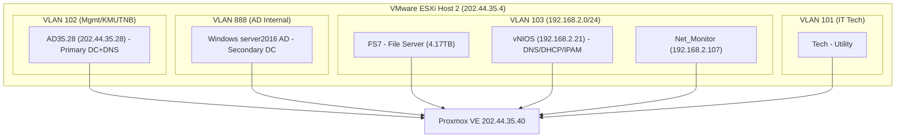

---
tags:
  - esxi
  - audit
  - host2
  - ad-dc
  - infoblox
  - fileserver
  - migration
  - proxmox
created: 2026-10-15
source: C:\Users\Newsk\Desktop\proxmox-mrigate\ESXI_HOST2_SYSTEMS_SPEC_AND_STACK.md
status: analysis
---

# ESXi Host 2 — 6 ระบบหลัก: สเปก / Software Stack / แนวทางย้าย

> [!info] ภาพรวม
> วิเคราะห์เชิงลึกระบบที่เปิดใช้งานบน **VMware ESXi Host 2 (`202.44.35.4`)** จำนวน **6 VM**: 2x Active Directory DC, File Server (FS7 4.17TB), vNIOS (Infoblox DNS/DHCP/IPAM), Net_Monitor (Ubuntu), Tech (Ubuntu). เตรียมแผนย้ายขึ้น Proxmox VE `202.44.35.40`.

> [!warning] ข้อมูลอ้างอิงจากเอกสารต้นฉบับ
> หลายส่วนอ้างถึงเวอร์ชัน/รายละเอียดจาก `ESXI_HOST2_SYSTEMS_SPEC_AND_STACK.md` — ห้ามคัดลอก credential/rule เฉพาะภายในที่อาจซ้ำซ้อน. ข้อมูลรหัสผ่านดูเฉพาะไฟล์ต้นฉบับ.

## 1. สรุป 6 เครื่อง (Executive Summary)

| ลำดับ | VM Name | OS | vCPU/RAM | Provisioned | Used | VLAN/IP | บทบาท |
| :-: | :--- | :--- | :--- | :--- | :--- | :--- | :--- |
| 1 | `windows server 2019 AD35.28` | Windows Server 2016/2019 | 4vCPU/6GB | 250GB | 53.1GB | VLAN102 `202.44.35.28` | **Primary AD DC + DNS** |
| 2 | `Windows server2016 AD` | Windows Server 2016 | 2vCPU/6GB | 80GB | 86.2GB | VLAN888 (ภายใน) | **Secondary AD DC** |
| 3 | `Windown2008 R2_FS7` | Windows Server 2008 R2 | 4vCPU/12GB | 7.2TB | **4.17TB** ⚠️ | VLAN103 | **Central File Server (FS7)** — ขนาดใหญ่สุด |
| 4 | `vNIOS` | Infoblox NIOS (Linux) | 4vCPU/32GB | 244GB | 107.0GB | VLAN103 `192.168.2.21` (4 vNIC) | **Infoblox DNS/DHCP/IPAM** |
| 5 | `Net_Monitor` | Ubuntu 20.04 LTS | 4vCPU/8GB | 128GB | 66.1GB | VLAN103 `192.168.2.107` | **Network Monitoring** |
| 6 | `Tech` | Ubuntu (x64) | 1vCPU/4GB | 200GB | 31.9GB | VLAN101 | **IT Support/Utility** |

## 2. แผนผังเครือข่าย (High Level)

## 3. รายละเอียดแต่ละระบบ

### 3.1 `windows server 2019 AD35.28` (Primary DC)

- **Domain:** `ad.kmutnb.ac.th`, Kerberos `FTE.AD.KMUTNB.AC.TH`, DN `DC=ad,DC=kmutnb,DC=ac,DC=th`
- **Hostname (ชี้ให้เห็น):** `fte-authen.ad.kmutnb.ac.th`
- **Roles/Services:** AD DS, DNS (53), Kerberos (88), LDAP/LDAPS (389/636), Global Catalog (3268), SMB/GPO/SYSVOL/NETLOGON (445), RDP (3389)
- **Storage:** 250GB (used 53.1GB) — space เยอะ
- **Migration:** พิจารณา **เพิ่ม DC ใหม่** บน Proxmox แล้วโอน FSMO (ปลอดภัยกว่า cold-import ทุกครั้ง) — หรือ cold-import หากต้องคงฮาร์ดแวร์แมพครบ

### 3.2 `Windows server2016 AD` (Secondary DC)

- **VLAN 888** (แยก segment), MAC `00:0c:29:63:2c:8d`
- **Role:** AD Replication + DNS backup สำหรับโดเมนเดิม
- **Storage:** 80GB (used 86.2GB) — **provisioned ต่ำกว่าที่ใช้จริงเล็กน้อย**
- **Migration:** Sync-join/promote DC ใหม่ หรือ import VM แล้วตรวจ replication

### 3.3 `Windown2008 R2_FS7` — Central File Server (4.17TB)

> [!danger] Blocker ด้านพื้นที่
> ข้อมูลจริง **~4.17 TB** แต่ storage ว่างบน Proxmox ปัจจุบัน **~3.45 TB** — ไม่พอ import เต็มรูปแบบโดยไม่ขยาย

- **VLAN 103**, MAC `00:0c:29:57:ac:1a`
- **OS:** Windows Server 2008 R2 (64-bit) — legacy; ควรวางแผนรันบน VM (หรือสร้าง File Server ใหม่) ด้วยความระมัดระวัง
- **Disks:** C:40GB + D:4TB + E:3TB (รวม 7.2TB provisioned)
- **Services:** SMB/CIFS (445/139), NTFS ACL, FSRM (quota), VSS (Previous Versions)
- **แนวทางย้าย:**
  - **A)** ขยาย `storage-raid`/เพิ่ม LVM/ZFS ก่อน import (หรือย้าย disk ไปที่มีพื้นที่พอ)
  - **B)** **Robocopy** แบบ incremental (with ACLs/attributes) จาก FS7 เดิม → Windows/File Server VM ใหม่บน Proxmox (แนะนำถ้าต้องการลด downtime/risks)
  - ต้องตรวจสอบ **ACLs + share definitions + DFS?** (ถ้ามี)

### 3.4 `vNIOS` — Infoblox DNS/DHCP/IPAM

> [!important] ต้องคง MAC/License
> 4 vNICs (Mgmt/LAN1/LAN2/HA) — MAC หลายตัว. การเปลี่ยน MAC อาจกระทบ **license/HA/Grid**; ควร **คง MAC เดิม** ให้ครบทุก interface ที่ใช้งานจริง

- **IP:** `192.168.2.21` (VLAN103), hostname `dns.fte.kmutnb.ac.th`
- **vNIC MACs:** `00:0c:29:c7:77:62`, `00:0c:29:c7:77:6c` (LAN1), `00:0c:29:c7:77:76`, `00:0c:29:c7:77:80` (HA)
- **RAM:** 32GB — ค่อนข้างสูง; อาจประเมินลดเหลือ **16–24GB** หากโหลดไม่หนัก (ต้องตรวจจากระบบจริงก่อน)
- **Services:** Grid Manager (80/443), BIND DNS (53), ISC DHCP (67/68), IPAM, SSH (22)
- **Migration:** **สำรอง config/Grid backup** จาก Infoblox GUI ก่อน import → import VM (keep MACs) → ตรวจ Grid connectivity/IPAM/DHCP leases

### 3.5 `Net_Monitor` — Ubuntu 20.04 LTS

- **IP:** `192.168.2.107` VLAN103, MAC `00:0c:29:94:2e:a5`
- **Specs:** 4vCPU/8GB/128GB (used 66GB) — ปกติ
- **Stack:** SSH 8.2p1, SNMP polling, latency/bandwidth, switch/router monitoring
- **Migration:** import ได้ง่ายด้วย ESXi Import Tool (qemu-img/virtio) — ตรวจ network/VLAN103 mapping + SNMP community/targets

### 3.6 `Tech` — Ubuntu IT Utility

- **VLAN101**, MAC `00:0c:29:13:e4:07`
- **Specs:** 1vCPU/4GB/200GB (used 32GB) — เล็กมาก
- **Role:** IT support scripts/tools
- **Migration:** ง่ายสุด — import → mount disk OK

## 4. ความต้องการทรัพยากรสู่ Proxmox

| Resource | รวม 6 VM | ว่างบน Proxmox (`storage-raid`) / Host | สถานะ |
| :--- | :--- | :--- | :--- |
| vCPU | **19 cores** | >=32 cores | ✅ เพียงพอ |
| RAM | **68 GB** | 64 GB | ⚠️ **พอดี** — แนะนำลด vNIOS จาก 32GB → 16–24GB (ประเมินจากการใช้งานจริง) |
| Disk (used) | **~4.51 TB** | **~3.45 TB** | ❌ **ขาด ~1.06 TB** (จาก FS7 4.17TB) |

> [!tip] ถ้า**ไม่รวม FS7** → ใช้พื้นที่จริงเพียง **~344 GB** รวม 5 ตัวแรก — ย้ายเฟส 1–2,5,6 ได้ทันที

## 5. แผนย้ายแบบลำดับ (Recommended)

| เฟส | เครื่อง | วิธี | หมายเหตุ |
| :-: | :--- | :--- | :--- |
| **1** | `Net_Monitor` (66GB), `Tech` (32GB) | **ESXi Import Tool** (`pve-esxi-import-tools`) | ต่ำความเสี่ยงสุด — เสร็จไว |
| **2** | `vNIOS` (107GB) | Import + **คง MAC ทุก vNIC** + สำรอง Grid config | สำคัญสูง (DNS/DHCP) — ทดสอบบน staging ถ้าเป็นไปได้ |
| **3** | AD1, AD2 | **เพิ่ม DC ใหม่บน Proxmox** → Promote → Transfer FSMO → Decommission เดิม | แนะนำตาม best practice Microsoft มากกว่ารวม disk แบบ raw |
| **4** | `FS7` (4.17TB) | **Robocopy** (ACLs preserved) ไป File Server VM ใหม่ **หรือ** ขยาย storage ก่อน cold-import | **Blocker พื้นที่** — ต้องตัดสินก่อนเฟสนี้ |

## 6. เช็คลิสต์ก่อนเริ่มย้าย

- [ ] สำรอง Infoblox Grid/Config (`vNIOS`) + License info
- [ ] สำรอง AD System State (หรือเตรียม DC ใหม่)
- [ ] สำรวจ FS7 shares/permissions + free space เป้าหมาย
- [ ] วางแผน VLAN mapping บน Proxmox bridge/vmbr + VLAN tags ให้ตรง (102/103/888/101)
- [ ] รัน `pve-esxi-import-tools` เช็ค connectivity ไป `202.44.35.4`
- [ ] ตัดสินเรื่อง **RAM vNIOS** (ลดก่อนหรือหลัง import) และ **storage FS7**
- [ ] เตรียม snapshot-freeze window สำหรับ vNIOS/AD เฉพาะจังหวะที่เหมาะสม

## 7. อ้างอิง

- ต้นฉบับ: `C:\Users\Newsk\Desktop\proxmox-mrigate\ESXI_HOST2_SYSTEMS_SPEC_AND_STACK.md`
- Audit ทั้งคลัสเตอร์: [[ESXi Cluster Audit - 3 Hosts 46 VMs]]
- โครงสร้างรวม: [[Proxmox VE Migration FTE]]
- แนวทางย้ายทั่วไป: [[VM Migration Playbook]]

---
*เขียนจากการอ่านเอกสารวิเคราะห์สเปก + Stack รายละเอียดของ 6 VM บน ESXi Host 2*
