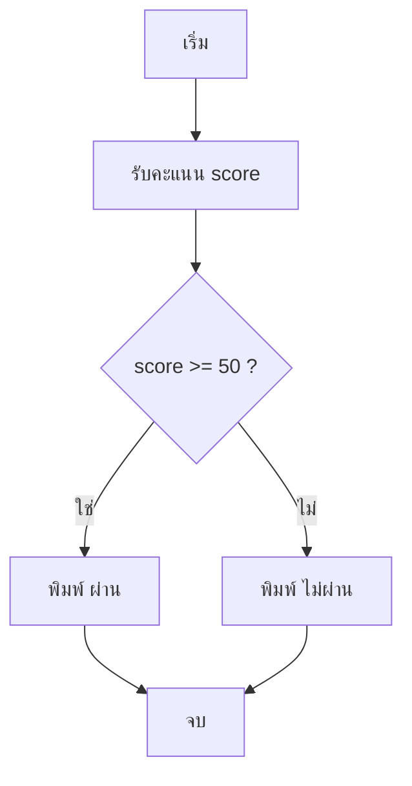
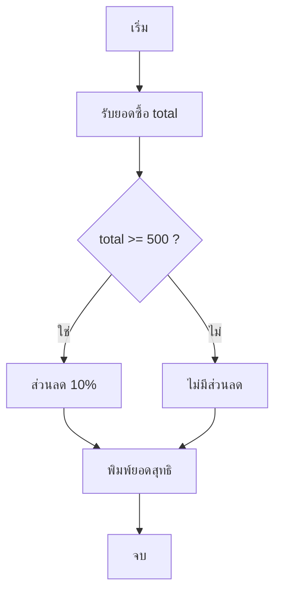

# สัปดาห์ที่ 4 — ตัวดำเนินการและเงื่อนไขใน Lua

*(Lua Week 2 of 4 — Operators, Comparison, Logic, if / elseif / else)*

> [!info] ข้อมูลคาบเรียน
> | รายการ | รายละเอียด |
> | :--- | :--- |
> | รายวิชา | `21901-2009` การสร้างเกมคอมพิวเตอร์ |
> | หน่วยการเรียนรู้ | หน่วยที่ 3 — ตรรกะผังงานและพื้นฐานภาษาลูอา |
> | สัปดาห์ / เวลา | สัปดาห์ที่ 4 · 4 ชั่วโมง (13.00–17.00 น.) |
> | ห้องเรียน | TC203 |
> | เครื่องมือ | Roblox Studio + แท็บ **Output** + ใบงานผังงาน |
> | ชุดการสอน | Lua ชุดที่ **2 จาก 4** (สัปดาห์ 3–6) |
> | ผลงานที่ต้องได้ | สคริปต์ `CalculatorScript` และ `GradeScript` ที่ตัดสินใจถูกต้อง |

> [!abstract] เป้าหมายของสัปดาห์นี้
> 1. ใช้ตัวดำเนินการคำนวณ `+ - * / % ^` ได้
> 2. ใช้ตัวดำเนินการเปรียบเทียบ `== ~= > < >= <=` ได้
> 3. รวมเงื่อนไขด้วย `and` / `or` / `not` ได้
> 4. เขียน `if` และ `if / else` ได้
> 5. เขียน `if / elseif / else` หลายเงื่อนไขได้
> 6. **แปลงผังงาน Flowchart เป็นโค้ด** ได้

> [!note] ต่อจากสัปดาห์ที่ 3
> สัปดาห์นี้เราจะเอา "ตัวแปร" ที่เรียนมา มาทำให้โปรแกรม **ตัดสินใจเอง** ได้
> ยังไม่มีการสั่งงาน Part — จะเริ่มสัปดาห์ที่ 5

---

## 1. แผนเวลา 4 ชั่วโมง

| ช่วง | เวลา | กิจกรรม | ผลที่ต้องเห็น |
| :--- | :--: | :--- | :--- |
| 13.00–13.15 | 15 น. | ทบทวนสัปดาห์ที่ 3 + ควิซสั้น | ตอบได้ครบ 5 ข้อ |
| 13.15–13.45 | 30 น. | ตัวดำเนินการคำนวณ | `CalculatorScript` รันได้ |
| 13.45–14.15 | 30 น. | เปรียบเทียบ + ตรรกศาสตร์ | บอกผลลัพธ์ true/false ได้ |
| 14.15–15.00 | 45 น. | `if / else / elseif` | `GradeScript` ทำงานถูก |
| 15.00–15.15 | 15 น. | พัก | — |
| 15.15–15.50 | 35 น. | เงื่อนไขซ้อน + แปลงผังงาน | เขียนโค้ดจาก Flowchart ได้ |
| 15.50–16.40 | 50 น. | ใบงาน Lua B | ส่ง 3 สคริปต์ |
| 16.40–17.00 | 20 น. | ตรวจงาน + สรุป | ตอบคำถามท้ายคาบได้ |

---

## 2. ทบทวนสัปดาห์ที่ 3 (15 นาที)

| ข้อ | คำถาม | คำตอบ |
| :--: | :--- | :--- |
| 1 | สคริปต์รันตอนไหน | ตอนกด Play (F5) |
| 2 | `local` ใช้ทำอะไร | ประกาศตัวแปรในบล็อก |
| 3 | ชนิดข้อมูล 5 ชนิด | number, string, boolean, nil, table |
| 4 | `..` คืออะไร | ต่อข้อความ |
| 5 | boolean ต่อข้อความต้องทำอย่างไร | ใช้ `tostring()` |

> [!tip] ถ้าตอบไม่ได้
> เปิด [[สัปดาห์ที่ 3 - เริ่มเขียนภาษา Lua (พื้นฐาน)]] หัวข้อ 5–6 ทบทวนก่อน 5 นาที

---

## 3. ขั้นที่ 1 — ตัวดำเนินการคำนวณ

### 3.1 ตารางตัวดำเนินการ

| เครื่องหมาย | ความหมาย              | ตัวอย่าง |  ผล   |
| :---------: | :-------------------- | :------- | :---: |
|     `+`     | บวก                   | `10 + 5` | `15`  |
|     `-`     | ลบ                    | `10 - 5` |  `5`  |
|     `*`     | คูณ                   | `10 * 5` | `50`  |
|     `/`     | หาร                   | `10 / 4` | `2.5` |
|     `%`     | เศษจากการหาร (modulo) | `10 % 3` |  `1`  |
|     `^`     | ยกกำลัง               | `2 ^ 3`  |  `8`  |

### 3.2 ลำดับการคำนวณ

Lua คิดเหมือนคณิตศาสตร์: `*` `/` `%` ก่อน `+` `-`

```lua
print(2 + 3 * 4)      -- 14  (คูณก่อน)
print((2 + 3) * 4)    -- 20  (วงเล็บก่อน)
```

> [!tip] จำง่าย ๆ
> ถ้าไม่แน่ใจลำดับ ให้ **ใส่วงเล็บ** — อ่านง่ายกว่าและไม่ผิด

### 3.3 ตัวอย่าง: คิดราคาสินค้า

```lua
local price = 120
local quantity = 3
local total = price * quantity

print("ราคาชิ้นละ " .. price .. " บาท")
print("จำนวน " .. quantity .. " ชิ้น")
print("รวม " .. total .. " บาท")
```

**ผลลัพธ์**

```text
ราคาชิ้นละ 120 บาท
จำนวน 3 ชิ้น
รวม 360 บาท
```

### 3.4 ตัวอย่าง: หารเอาเศษ (`%`)

```lua
local number = 7
print(number % 2)   -- 1  (เลขคี่)
```

> [!note] `%` ใช้บ่อยในเกม
> ใช้ตรวจเลขคี่–คู่ ใช้ทำรอบ (`i % 2 == 0`) และใช้แบ่งของเป็นชุด

> [!note] อธิบายโค้ดคำนวณ
> | บรรทัด | ทำอะไร | ถ้าผิด |
> | :--- | :--- | :--- |
> | `local price = 120` | เก็บราคาต่อชิ้น | ใส่ `"120"` → คูณไม่ได้ |
> | `local total = price * quantity` | คูณแล้วเก็บผล | ใช้ `+` → ได้ 123 (ผิดความหมาย) |
> | `print(... .. total)` | เอาผลที่คำนวณไว้มาแสดง | ใช้ `price * quantity` ซ้ำก็ได้ผลเท่ากัน |
>
> `*` คือเครื่องหมายคูณ — ถ้าเขียน `120 x 3` จะ error ทันที

---

## 4. ขั้นที่ 2 — ตัวดำเนินการเปรียบเทียบ

### 4.1 ตารางเปรียบเทียบ

| เครื่องหมาย | ความหมาย            | ตัวอย่าง |   ผล    |
| :---------: | :------------------ | :------- | :-----: |
|    `==`     | เท่ากันหรือไม่      | `5 == 5` | `true`  |
|    `~=`     | ไม่เท่ากัน          | `5 ~= 3` | `true`  |
|     `>`     | มากกว่า             | `7 > 3`  | `true`  |
|     `<`     | น้อยกว่า            | `7 < 3`  | `false` |
|    `>=`     | มากกว่าหรือเท่ากับ  | `5 >= 5` | `true`  |
|    `<=`     | น้อยกว่าหรือเท่ากับ | `4 <= 5` | `true`  |

### 4.2 `=` กับ `==` ต่างกัน

| เครื่องหมาย | ใช้ทำอะไร | ตัวอย่าง |
| :--: | :--- | :--- |
| `=` | **กำหนดค่า** | `local score = 50` |
| `==` | **เปรียบเทียบ** | `if score == 50 then` |

> [!warning] จุดพลาดอันดับ 1 ของมือใหม่
> เขียน `if score = 50 then` → error ทันที
> เพราะ `if` ต้องการเงื่อนไข (true/false) ไม่ใช่การสั่งค่า

### 4.3 ลองพิมพ์ผลลัพธ์

```lua
print(10 > 5)        -- true
print(10 < 5)        -- false
print(10 == 10)      -- true
print(10 ~= 10)      -- false
print("a" == "a")    -- true
print("a" == "A")    -- false (ตัวพิมพ์มีผล)
```

> [!tip] string เทียบกันได้
> แต่ต้องสะกดตรงกันเป๊ะ รวมถึงช่องว่างและตัวพิมพ์เล็ก–ใหญ่

---

## 5. ขั้นที่ 3 — ตรรกศาสตร์ `and` / `or` / `not`

### 5.1 ความหมาย

| ตัวเชื่อม | อ่านว่า | เป็นจริงเมื่อ |
| :--- | :--- | :--- |
| `and` | และ | **ทั้งสอง** เงื่อนไขจริง |
| `or` | หรือ | จริง **อย่างน้อยหนึ่ง** เงื่อนไข |
| `not` | ไม่ | ตรงข้ามกับเงื่อนไข |

### 5.2 ตารางความจริง

| A | B | `A and B` | `A or B` | `not A` |
| :--: | :--: | :--: | :--: | :--: |
| true | true | true | true | false |
| true | false | false | true | false |
| false | true | false | true | true |
| false | false | false | false | true |

### 5.3 ตัวอย่างในเกม

```lua
local age = 15
local hasTicket = true

print(age >= 13 and hasTicket)   -- true  (อายุถึงและมีตั๋ว)
print(age >= 18 or hasTicket)    -- true  (มีตั๋วก็พอ)
print(not hasTicket)             -- false (ไม่มีตั๋วหรือเปล่า → ไม่จริง)
```

> [!note] อ่านเป็นภาษาคนก่อนเขียน
> "เข้าได้ถ้า **อายุถึง 13 และ มีตั๋ว**" → `age >= 13 and hasTicket`
> เขียนประโยคไทยให้ได้ก่อน แล้วค่อยแปลงเป็นโค้ด

---

## 6. ขั้นที่ 4 — `if` พื้นฐาน

### 6.1 รูปแบบ

```lua
if เงื่อนไข then
    -- ทำเมื่อเงื่อนไขเป็นจริง
end
```

### 6.2 ตัวอย่าง

```lua
local score = 75

if score >= 50 then
    print("ผ่าน")
end
```

**ผลลัพธ์:** `ผ่าน`

> [!danger] ลืม `end` = โค้ดพังทันที
> ทุก `if` ต้องมี `end` ปิด 1 ตัว
> Error ที่เห็น: `Expected 'end' (to close 'if' at line X)`

> [!note] โครงสร้าง `if` มี 3 ส่วน
> | ส่วน | หน้าที่ | ถ้าลืม |
> | :--- | :--- | :--- |
> | `if เงื่อนไข` | ตรวจว่าใช่หรือไม่ | — |
> | `then` | จุดเริ่มคำสั่งที่จะทำ | `Expected 'then'` |
> | `end` | จุดจบบล็อก | `Expected 'end'` |
>
> การย่อหน้าไม่มีผลต่อการทำงาน แต่ช่วยให้เห็นว่าอะไรอยู่ในบล็อกไหน

---

## 7. ขั้นที่ 5 — `if / else`

### 7.1 รูปแบบ

```lua
if เงื่อนไข then
    -- จริง
else
    -- เท็จ
end
```

### 7.2 ตัวอย่างผ่าน / ไม่ผ่าน

```lua
local score = 45

if score >= 50 then
    print("ผ่าน")
else
    print("ไม่ผ่าน")
end
```

**ผลลัพธ์:** `ไม่ผ่าน`

> [!tip] ทดสอบให้ครบ 3 ค่า
> ลอง `45` (ไม่ผ่าน) · `50` (ผ่าน เพราะ `>=`) · `75` (ผ่าน)
> ถ้าเปลี่ยน `>=` เป็น `>` ค่า `50` จะกลายเป็นไม่ผ่าน — สังเกตความต่าง

> [!note] `if / else` เลือกทำเพียงทางเดียว
> ถ้าเงื่อนไขจริง → ทำใต้ `then` แล้ว **ข้าม** `else`
> ถ้าเงื่อนไขเท็จ → ข้าม `then` ไปทำใต้ `else`
> ไม่มีทางทำทั้งสองบล็อก — ถ้าต้องการทำสองอย่างพร้อมกัน ต้องเขียนเป็น `if` แยกกัน 2 อัน

---

## 8. ขั้นที่ 6 — `if / elseif / else`

### 8.1 รูปแบบ

```lua
if เงื่อนไข 1 then
    -- เงื่อนไข 1 จริง
elseif เงื่อนไข 2 then
    -- เงื่อนไข 2 จริง
else
    -- ไม่จริงสักข้อ
end
```

### 8.2 ตัวอย่าง: ตัดเกรด

```lua
local score = 85

if score >= 80 then
    print("เกรด A")
elseif score >= 70 then
    print("เกรด B")
elseif score >= 60 then
    print("เกรด C")
else
    print("ต้องปรับปรุง")
end
```

**ผลลัพธ์:** `เกรด A`

> [!warning] ลำดับสำคัญมาก
> Lua ตรวจจากบนลงล่าง เจอข้อแรกที่เป็นจริงแล้ว **หยุดทันที**
> ถ้าเอา `score >= 60` ขึ้นบนสุด ทุกคนจะได้ C — ระวังตอนเขียน

### 8.3 ตรวจสอบด้วยตาราง

| score | เงื่อนไขแรก `>= 80`        | ผล           |
| :---: | :------------------------- | :----------- |
|  85   | จริง                       | เกรด A       |
|  75   | เท็จ → ตรวจ `>= 70` จริง   | เกรด B       |
|  65   | เท็จ → เท็จ → `>= 60` จริง | เกรด C       |
|  40   | เท็จทั้งสาม                | ต้องปรับปรุง |

> [!note] ทำไมต้องเรียงเงื่อนไขจากมากไปน้อย
> Lua หยุดที่เงื่อนไขแรกที่เป็นจริง
> ถ้าสลับ `>= 60` ขึ้นก่อน `>= 80` — คนที่ได้ 95 จะถูกตัดสินเป็น C ทันที
> กฎง่าย ๆ: **ตัวเลขมากสุดอยู่บนสุด** แล้วไล่ลงมา

---

## 9. ขั้นที่ 7 — เงื่อนไขซ้อน (nested if)

### 9.1 รูปแบบ

```lua
if เงื่อนไขนอก then
    if เงื่อนไขใน then
        -- จริงทั้งคู่
    else
        -- นอกจริง ในเท็จ
    end
else
    -- นอกเท็จ
end
```

### 9.2 ตัวอย่าง: ตรวจสิทธิ์เข้าเกม

```lua
local age = 15
local hasTicket = true

if hasTicket then
    if age >= 13 then
        print("เข้าเล่นได้")
    else
        print("อายุไม่ถึง 13 ปี")
    end
else
    print("ยังไม่มีตั๋ว")
end
```

**ผลลัพธ์:** `เข้าเล่นได้`

> [!note] เขียนแบบสั้นกว่าก็ได้
> เงื่อนไขเดียวกันเขียนด้วย `and` ได้:
> `if hasTicket and age >= 13 then print("เข้าเล่นได้") else print("เข้าไม่ได้") end`
> แต่แบบซ้อนจะบอกเหตุผลให้ผู้เล่นได้ละเอียดกว่า

---

## 10. ขั้นที่ 8 — แปลงผังงานเป็นโค้ด

### 10.1 ตัวอย่างที่ 1: ผังงานตรวจคะแนน



```lua
local score = 72

if score >= 50 then
    print("ผ่าน")
else
    print("ไม่ผ่าน")
end
```

### 10.2 ตัวอย่างที่ 2: ผังงานร้านค้า



```lua
local total = 620

if total >= 500 then
    local discount = total * 0.10
    local net = total - discount
    print("ได้ส่วนลด " .. discount .. " บาท")
    print("จ่ายจริง " .. net .. " บาท")
else
    print("ไม่ถึง 500 บาท ไม่มีส่วนลด")
    print("จ่ายจริง " .. total .. " บาท")
end
```

**ผลลัพธ์**

```text
ได้ส่วนลด 62 บาท
จ่ายจริง 558 บาท
```

> [!tip] ขั้นตอนการแปลงผังงาน
> 1. อ่านกล่องสี่เหลี่ยม → เขียนเป็นคำสั่ง
> 2. อ่านกล่องข้าวหลามตัด (เงื่อนไข) → เขียนเป็น `if`
> 3. แตกแขนง "ใช่" → ใต้ `then` · "ไม่" → ใต้ `else`
> 4. ปิดท้ายด้วย `end` ทุกบล็อก

> [!note] ตัวแปรในตัวอย่างร้านค้า
> | ตัวแปร | มาจากไหน | ใช้ทำอะไร |
> | :--- | :--- | :--- |
> | `total` | ค่าที่รับเข้ามา (620) | ยอดก่อนลด |
> | `discount` | `total * 0.10` | เงินส่วนลด |
> | `net` | `total - discount` | ยอดที่ต้องจ่ายจริง |
>
> `0.10` คือ 10% (10 ÷ 100) — ถ้าเขียน `10` จะกลายเป็นลด 10 เท่า
> และตัวแปรที่ประกาศในบล็อก `if` จะใช้ได้เฉพาะในบล็อกนั้น

---

## 11. Error ที่พบบ่อยในสัปดาห์นี้

| ข้อความใน Output | สาเหตุ | วิธีแก้ |
| :--- | :--- | :--- |
| `Expected 'end' (to close 'if' at line X)` | ลืม `end` | เติม `end` ให้ครบทุก `if` |
| `'=' expected near 'then'` | ใช้ `=` แทน `==` | `if score == 50 then` |
| `attempt to compare number with string` | เทียบเลขกับข้อความ | ตรวจชนิดข้อมูลให้ตรง |
| `Unknown global 'then'` | พิมพ์ `then` ผิดตำแหน่ง | `if ... then` ต้องอยู่บรรทัดเดียวกัน |
| `elseif` ทำงานไม่ตรงที่คิด | ลำดับเงื่อนไขผิด | เรียงจากมากไปน้อย |
| ไม่พิมพ์อะไรเลย | เงื่อนไขเป็นเท็จทั้งหมด และไม่มี `else` | เพิ่ม `else` เพื่อดูผล |

---

## 12. แบบฝึกในคาบ

| ข้อ | โจทย์ | เวลา |
| :--: | :--- | :--: |
| 1 | พิมพ์ `10 % 3` และ `2 ^ 4` แล้วอธิบายผล | 5 น. |
| 2 | เขียน `if` ตรวจว่า `score >= 50` หรือไม่ | 5 น. |
| 3 | เพิ่ม `else` ให้พิมพ์ "ไม่ผ่าน" | 5 น. |
| 4 | เขียน `elseif` ตัดเกรด 4 ระดับ | 8 น. |
| 5 | แปลงผังงานร้านค้าในหัวข้อ 10.2 เป็นโค้ดเอง | 10 น. |

---

## 13. ใบงาน Lua B — ส่งท้ายสัปดาห์

> [!todo] สิ่งที่ต้องส่ง
> 1. สคริปต์ 3 ไฟล์: `CompareScript`, `GradeScript`, `DiscountScript`
> 2. ภาพหน้าจอ Output ของแต่ละไฟล์
> 3. ผังงาน (วาดมือหรือ Flowchart) ของข้อ 3 จำนวน 1 แผน

### 13.1 โจทย์

**ข้อ 1 (5 คะแนน) — CompareScript**
พิมพ์ผลเปรียบเทียบ 6 บรรทัด (ใช้ `== ~= > < >= <=` อย่างละ 1) พร้อมคอมเมนต์ว่าแต่ละบรรทัดหมายถึงอะไร

**ข้อ 2 (7 คะแนน) — GradeScript**
รับคะแนนจากตัวแปร `score` แล้วตัดเกรด A/B/C/D/F (5 ระดับ) ด้วย `if / elseif / else`
ทดสอบ 3 ค่า แล้วแนบภาพผลลัพธ์ทั้ง 3 ครั้ง

**ข้อ 3 (8 คะแนน) — DiscountScript**
ร้านค้าลดราคาตามยอดซื้อ

| ยอดซื้อ | ส่วนลด |
| :--- | :--: |
| ตั้งแต่ 1,000 บาท | 15% |
| 500–999 บาท | 10% |
| 200–499 บาท | 5% |
| ต่ำกว่า 200 บาท | ไม่มีส่วนลด |

ให้พิมพ์ยอดก่อนลด ส่วนลด และยอดสุทธิ พร้อมวาดผังงานประกอบ 1 แผน

### 13.2 เกณฑ์การให้คะแนน (20 คะแนน)

| รายการ | คะแนน | เกณฑ์เต็ม |
| :--- | :--: | :--- |
| ข้อ 1 เปรียบเทียบครบ 6 แบบ | 5 | ผลลัพธ์ถูกทุกบรรทัด |
| ข้อ 2 ตัดเกรด 5 ระดับ | 7 | เงื่อนไขถูก ลำดับไม่สลับ |
| ข้อ 3 ส่วนลด 4 ช่วง | 8 | คำนวณถูก ทดสอบครบ 4 ยอด |
| รวม | **20** | |
| ผังงานประกอบข้อ 3 | — | ถ้าไม่มี หัก 2 คะแนน |

> [!note] เกณฑ์ผ่าน
> **12 คะแนนขึ้นไป** ถือว่าผ่าน · ตรวจคำตอบด้วยเครื่องคิดเลขก่อนส่ง

---

## 14. คำถามทบทวนท้ายคาบ

1. `=` กับ `==` ต่างกันอย่างไร
2. `%` ใช้ทำอะไร ยกตัวอย่างจากเกม
3. `and` ต่างจาก `or` อย่างไร
4. เขียนเงื่อนไข "อายุ 13 ขึ้นไป และมีตั๋ว" เป็นโค้ด
5. ทำไมลำดับของ `elseif` จึงสำคัญ
6. เงื่อนไขซ้อนกับ `and` ให้ผลเหมือนกันไหม ต่างกันตรงไหน

> [!success]- เฉลย (คลิกเพื่อเปิด)
> 1. `=` กำหนดค่า · `==` เปรียบเทียบ
> 2. หาเศษจากการหาร เช่น ตรวจเลขคี่–คู่ หรือทำรอบ `i % 2 == 0`
> 3. `and` ต้องจริงทั้งคู่ · `or` จริงอย่างน้อยหนึ่ง
> 4. `if age >= 13 and hasTicket then`
> 5. Lua หยุดที่เงื่อนไขแรกที่เป็นจริง ถ้าเงื่อนไขกว้างอยู่บน จะกินทุกกรณี
> 6. ผลเหมือนกัน แต่แบบซ้อนบอกเหตุผลแยกกรณีได้ละเอียดกว่า

---

## 15. ก้าวต่อไป: สัปดาห์ที่ 5

> [!tip] สัปดาห์หน้าเรียนอะไร
> * สั่งงาน **Part** ด้วยโค้ด (สี ขนาด วัสดุ ความโปร่งใส)
> * เข้าถึง Part ด้วย `workspace.ชื่อPart`
> * สร้าง Part ใหม่ด้วย `Instance.new`
> * วนซ้ำด้วย `for` สร้างบันได
>
> อ่านล่วงหน้าได้ที่ [[สัปดาห์ที่ 5 - สั่งงาน Part ด้วย Lua]]

---

## 16. เอกสารอ้างอิง

1. Roblox Corporation. *Lua Learning — Operators and Conditionals*.
2. Roblox Corporation. *Luau — If Statements*.
3. Roblox Corporation. *Programming in Luau — Control Flow*.

---

## 17. โน้ตที่เกี่ยวข้อง

* [[สัปดาห์ที่ 3 - เริ่มเขียนภาษา Lua (พื้นฐาน)]] — สัปดาห์ก่อน
* [[สัปดาห์ที่ 5 - สั่งงาน Part ด้วย Lua]] — สัปดาห์ถัดไป
* [[แบบฝึกหัดที่ 1 - ตรรกะผังงานและลานจุดเกิดใน Roblox Studio]] — แบบฝึกผังงาน
* [[21901-2009 การสร้างเกมคอมพิวเตอร์]] — ข้อมูลรายวิชา
* [[แผนหน่วยการเรียน 21901-2009 การสร้างเกมคอมพิวเตอร์]] — แผน 18 สัปดาห์
