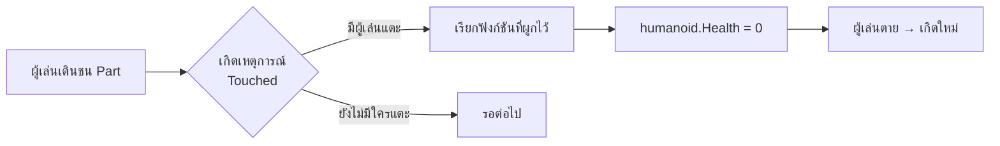
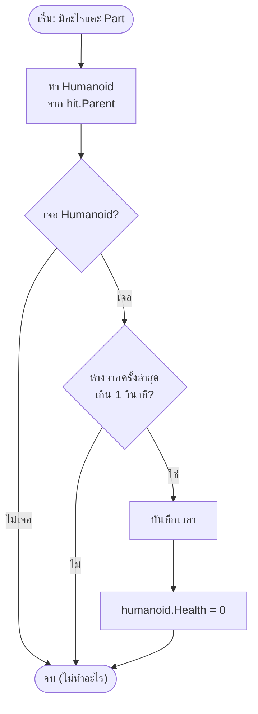
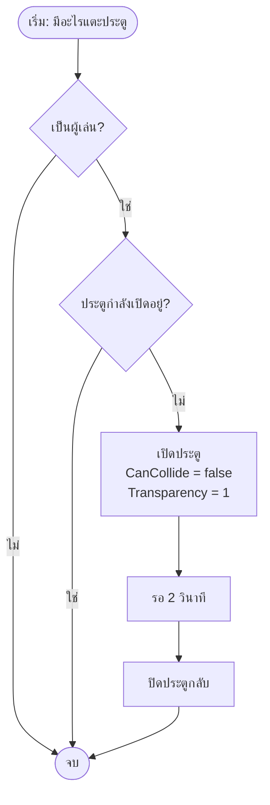

# สัปดาห์ที่ 7 — เหตุการณ์ Touched และ Kill Part

*(Events Week 1 of 2 — Touched, hit, Humanoid, Debounce, Trap Mechanics)*

> [!info] ข้อมูลคาบเรียน
> | รายการ | รายละเอียด |
> | :--- | :--- |
> | รายวิชา | `21901-2009` การสร้างเกมคอมพิวเตอร์ |
> | หน่วยการเรียนรู้ | หน่วยที่ 4 — เหตุการณ์และการตอบสนองในเกม |
> | สัปดาห์ / เวลา | สัปดาห์ที่ 7 · 4 ชั่วโมง (13.00–17.00 น.) |
> | ห้องเรียน | TC203 |
> | เครื่องมือ | Roblox Studio (แท็บ **Output** + **Play**) |
> | ต่อจาก | [[สัปดาห์ที่ 6 - ฟังก์ชัน ลูป และตารางใน Lua]] |
> | ผลงานที่ต้องได้ | ด่าน Obby ที่มี **Kill Part** และ **ประตูอัตโนมัติ** ทำงานได้จริง |

> [!abstract] เป้าหมายของสัปดาห์นี้
> 1. อธิบายได้ว่า **Event-Driven Programming** ต่างจากโค้ดที่รันตามลำดับอย่างไร
> 2. เขียน `Touched:Connect(function(hit) ... end)` ได้ถูกต้อง
> 3. บอกได้ว่า `hit` คืออะไร และตรวจได้ว่าเป็นผู้เล่นจริง
> 4. ใช้ `FindFirstChildOfClass("Humanoid")` และเช็ก `nil` ก่อนใช้งานได้
> 5. ทำ **Kill Part** ที่ฆ่าผู้เล่นเมื่อแตะได้
> 6. อธิบายและเขียน **Debounce** เพื่อกันการทำงานซ้ำได้
> 7. ทำประตูเปิด-ปิดอัตโนมัติและพื้นที่ทำดาเมจได้

> [!note] จุดเปลี่ยนของวิชา
> ตั้งแต่สัปดาห์ที่ 3–6 เราเขียนโค้ดที่ **รันเองตามลำดับ** (บนลงล่าง)
> ตั้งแต่สัปดาห์นี้ โค้ดจะ **รอ** ให้ผู้เล่นทำอะไรบางอย่างก่อนแล้วจึงทำงาน — นี่คือหัวใจของเกมจริงทุกเกม

---

## 1. แผนเวลา 4 ชั่วโมง

| ช่วง | เวลา | กิจกรรม | ผลที่ต้องเห็น |
| :--- | :--: | :--- | :--- |
| 13.00–13.15 | 15 น. | ทบทวนสัปดาห์ที่ 6 | ตอบคำถาม 5 ข้อได้ |
| 13.15–13.45 | 30 น. | แนวคิด Event + Touched ครั้งแรก | `print` ขึ้นเมื่อแตะ Part |
| 13.45–14.20 | 35 น. | `hit` + ตรวจ Humanoid | ตรวจได้ว่าใครแตะ |
| 14.20–14.35 | 15 น. | พัก | — |
| 14.35–15.15 | 40 น. | Kill Part + Debounce | แตะแล้วตาย 1 ครั้ง ไม่รัว |
| 15.15–15.50 | 35 น. | ประตูอัตโนมัติ + พื้นที่ทำดาเมจ | ทำงานได้ทั้งคู่ |
| 15.50–16.40 | 50 น. | แล็บ A–D | ส่งงานครบ |
| 16.40–17.00 | 20 น. | ตรวจงาน + สรุป + ปูทางสัปดาห์ 8 | ตอบคำถามได้ |

---

## 2. ทบทวนสัปดาห์ที่ 6 (15 นาที)

| ข้อ | คำถาม | คำตอบ |
| :--: | :--- | :--- |
| 1 | ฟังก์ชันประกาศอย่างไร | `local function ชื่อ() ... end` |
| 2 | `while true do ... end` อันตรายอย่างไร | วนไม่หยุด ต้องมี `task.wait()` หรือ `break` |
| 3 | `task.wait(2)` หมายถึงอะไร | หยุดรอ 2 วินาทีแล้วไปต่อ |
| 4 | table แบบ array เขียนอย่างไร | `local list = {"a", "b", "c"}` |
| 5 | วนอ่าน table ใช้คำสั่งอะไร | `for i, v in ipairs(list) do ... end` |

> [!tip] ถ้าตอบไม่ได้
> ทบทวน [[สัปดาห์ที่ 6 - ฟังก์ชัน ลูป และตารางใน Lua]] หัวข้อ 3 (ฟังก์ชัน) และ 8 (table)

---

## 3. Event-Driven Programming คืออะไร

### 3.1 โค้ด 2 แบบที่ต่างกัน

| แบบ | ทำงานเมื่อไร | ตัวอย่างในวิชานี้ |
| :--- | :--- | :--- |
| **Sequential** (ตามลำดับ) | รันทันทีที่โหลดสคริปต์ | `print`, `Instance.new`, `for` |
| **Event-Driven** (ตามเหตุการณ์) | รอแล้วค่อยทำงานเมื่อเกิดเหตุการณ์ | `Touched`, `Clicked`, `Activated` |



> [!important] ประโยคเดียวที่ต้องจำ
> **"เราไม่ได้สั่งให้เกมเช็กตลอดเวลา — เราบอกเกมว่า 'ถ้ามีคนแตะ ให้ทำสิ่งนี้'"**
> โค้ดแบบ event ไม่ได้ทำงานตลอด แต่ **ถูกเรียกเมื่อเกิดเหตุการณ์**

### 3.2 เหตุการณ์ที่ใช้บ่อยใน Roblox

| Event | เกิดเมื่อ | ใช้ทำอะไร |
| :--- | :--- | :--- |
| `Touched` | Part ชน/แตะ Part อื่น | Kill Part, ประตู, พื้นที่เก็บไอเทม |
| `TouchEnded` | เลิกแตะ | ปิดเอฟเฟกต์ชั่วคราว |
| `Clicked` | ผู้เล่นคลิก Part (ต้องมี ClickDetector) | ปุ่มกด, เปิดกลไก |
| `Activated` | ผู้เล่นกด Tool | ใช้ไอเทม, ยิง |
| `PlayerAdded` | ผู้เล่นเข้าห้อง | ต้อนรับ, สร้าง leaderstats |
| `Changed` | ค่าของ Property เปลี่ยน | อัปเดต UI ตามค่า |

> [!note] สัปดาห์นี้ใช้แค่ Touched
> ที่เหลือจะค่อย ๆ ใช้ในสัปดาห์ 8–16 (Humanoid, UI, Tool, DataStore)

---

## 4. Touched ครั้งแรก: ให้ Part พูดได้

### 4.1 เตรียมฉาก

1. เปิด Roblox Studio → ฐานเปล่า (Baseplate)
2. สร้าง Part 1 อัน → ตั้งชื่อ **`KillPart`** (ช่อง Name ใน Properties)
3. ตรวจ Properties 3 ตัว

| Property | ตั้งเป็น | เพราะ |
| :--- | :--- | :--- |
| `Anchored` | ✅ เปิด | ไม่ให้ Part หล่นหรือกระเด็น |
| `CanCollide` | ✅ เปิด | ให้ผู้เล่นชนได้จริง |
| `Size` | เช่น 10 × 1 × 10 | เป็นพื้นให้เดินผ่าน |

4. คลิกขวาที่ `KillPart` → **Insert Object** → **Script**
5. ลบโค้ดเดิมใน Script ออกให้หมด

### 4.2 โค้ดแจ้งเตือนเมื่อมีคนแตะ

```lua
-- Script อยู่ใต้ KillPart
local part = script.Parent

part.Touched:Connect(function(hit)
    print("มีอะไรบางอย่างแตะ Part!")
    print("ผู้ที่แตะชื่อ: " .. hit.Name)
end)
```

**ทดลอง:** กด **Play** → เดินไปชน Part → ดูแท็บ **Output**

```text
มีอะไรบางอย่างแตะ Part!
ผู้ที่แตะชื่อ: RightFoot
```

> [!note] ทำไมขึ้นว่า RightFoot
> เพราะเท้าขวาของตัวละครเป็นชิ้นส่วนแรกที่สัมผัสพื้น — `hit` คือ **ชิ้นส่วนที่แตะ** ไม่ใช่ "ตัวผู้เล่น"

### 4.3 อธิบายทีละบรรทัด

| โค้ด | ความหมาย |
| :--- | :--- |
| `local part = script.Parent` | เก็บ Part ที่สคริปต์สังกัดอยู่ไว้ในตัวแปร (สคริปต์อยู่ใต้ Part นั้น) |
| `part.Touched` | "เหตุการณ์ที่ Part นี้ถูกแตะ" |
| `:Connect(...)` | สมัครรับเหตุการณ์ แล้วบอกว่าจะให้ทำอะไร |
| `function(hit)` | ฟังก์ชันที่จะถูกเรียก **ทุกครั้ง** ที่เกิดเหตุการณ์ — `hit` คือสิ่งที่มาแตะ |
| `print(...)` | ทำงานเมื่อถูกเรียก (ไม่ใช่ตอนโหลด) |
| `..` | ต่อข้อความ (string concatenation) |
| `end)` | ปิดฟังก์ชัน + ปิดการเชื่อมเหตุการณ์ |

> [!warning] `Connect` ไม่ได้เรียกฟังก์ชันทันที
> `:Connect(fn)` แปลว่า "จำ fn ไว้ แล้วเรียกเมื่อเกิดเหตุการณ์"
> ถ้าเขียน `:Connect(fn())` (มีวงเล็บเรียก) จะกลายเป็น **เรียกเลย** และมักได้ error

### 4.4 จับคู่เครื่องหมายให้ถูก

```lua
part.Touched:Connect(function(hit)
    -- ทำงาน
end)
```

| เปิด | ปิด | นับได้ |
| :--- | :--- | :--: |
| `Connect(` | `)` ท้ายสุด | 1 คู่ |
| `function(hit)` | `end` | 1 คู่ |

> [!danger] Error ที่พบบ่อยที่สุดของสัปดาห์นี้
> `Expected ')' (to close '(' at line ...)` → **ลืม `)` ปิดท้าย** หลัง `end`
> ท่องว่า: **end แล้วต้องมี )** เพราะ `end` ปิดฟังก์ชัน แต่ `)` ปิด `Connect(`

---

## 5. `hit` คืออะไร และจะรู้ได้อย่างไรว่าเป็นผู้เล่น

### 5.1 โครงสร้างของ `hit`

| ค่า | คืออะไร | ตัวอย่าง |
| :--- | :--- | :--- |
| `hit` | ชิ้นส่วน (BasePart) ที่แตะ | `RightFoot`, `Torso` |
| `hit.Name` | ชื่อชิ้นส่วน | `"RightFoot"` |
| `hit.Parent` | โมเดลที่ชิ้นส่วนนี้อยู่ | Character ของผู้เล่น |
| `hit.Parent.Name` | ชื่อโมเดล (มักเป็นชื่อผู้เล่น) | `"Nat"` |

### 5.2 ปัญหาของ `hit.Name`

ถ้าเราเขียนแบบนี้

```lua
if hit.Name == "Nat" then   -- ❌ ผิด
```

จะใช้ไม่ได้ เพราะ `hit.Name` คือ **ชื่อชิ้นส่วน** (`RightFoot`) ไม่ใช่ชื่อผู้เล่น

### 5.3 วิธีที่ถูก: หา Humanoid

ตัวละครผู้เล่นทุกตัวมี **Humanoid** อยู่ข้างใน (เป็นตัวจัดการเลือด ความเร็ว การตาย)

```lua
local character = hit.Parent
local humanoid = character:FindFirstChildOfClass("Humanoid")

if humanoid then
    print("นี่คือผู้เล่น: " .. character.Name)
end
```

| ฟังก์ชัน | ค้นหาอะไร | ใช้เมื่อ |
| :--- | :--- | :--- |
| `FindFirstChild("Humanoid")` | ลูกที่ชื่อ `"Humanoid"` | รู้ชื่อแน่นอน |
| `FindFirstChildOfClass("Humanoid")` | ลูกที่เป็นคลาส `Humanoid` | **แนะนำ** (ทนการเปลี่ยนชื่อ) |
| `FindFirstChildWhichIsA("Humanoid")` | เหมือนข้างบน (ยืดหยุ่นกว่า) | ใช้ได้เช่นกัน |

> [!important] `nil` คืออะไร
> ถ้าหาไม่เจอ ฟังก์ชันจะคืนค่า `nil` (ไม่มีค่า)
> ถ้าเอา `nil` ไปใช้ต่อ เช่น `humanoid.Health = 0` → **error ทันที**
> จึงต้องเขียน `if humanoid then ... end` ครอบเสมอ

---

## 6. Kill Part เวอร์ชัน 1 (พื้นฐาน)

```lua
-- Script อยู่ใต้ KillPart
local part = script.Parent

part.Touched:Connect(function(hit)
    local humanoid = hit.Parent:FindFirstChildOfClass("Humanoid")

    if humanoid then
        humanoid.Health = 0
        print(hit.Parent.Name .. " ถูกกำจัด!")
    end
end)
```

**ทดลอง:** Play → เดินชน → ตัวละครตายและเกิดใหม่ที่ Spawn

### 6.1 อธิบายทีละบรรทัด

| โค้ด | ความหมาย |
| :--- | :--- |
| `local part = script.Parent` | อ้างถึง Part เจ้าของสคริปต์ |
| `part.Touched:Connect(function(hit)` | ผูกเหตุการณ์แตะกับฟังก์ชัน |
| `hit.Parent` | โมเดลของสิ่งที่แตะ (ตัวละคร) |
| `:FindFirstChildOfClass("Humanoid")` | หา Humanoid ในตัวละคร |
| `if humanoid then` | ถ้าเจอ (ไม่ใช่ `nil`) จึงทำต่อ |
| `humanoid.Health = 0` | ตั้งเลือดเป็น 0 → ตัวละครตาย |
| `print(hit.Parent.Name .. " ถูกกำจัด!")` | แจ้งใน Output ว่าใครตาย |

> [!note] ทำไมไม่ใช้ `humanoid.Health = humanoid.Health - 1000`
> ก็ได้ผลเหมือนกัน แต่ `= 0` อ่านง่ายกว่าและตรงความหมาย "ตายทันที"
> ถ้าอยากทำดาเมจทีละน้อย ให้ลบทีละ 25 (ดูหัวข้อ 9)

### 6.2 ทำไมต้องเช็ก Humanoid

| สิ่งที่มาแตะ | `hit.Parent` | มี Humanoid? | ถ้าไม่เช็ก |
| :--- | :--- | :--: | :--- |
| ผู้เล่น | Character | ✅ | ทำงานถูก |
| กล่องที่กลิ้งมาชน | Model/Part | ❌ | **error: attempt to index nil** |
| Part ที่หล่นใส่ | Part | ❌ | **error** |
| อะไหล่จากด่านอื่น | Model | ❌ | **error** |

> [!tip] กฎที่ใช้ได้ตลอดวิชานี้
> **"หาอะไรได้ก่อน แล้วค่อยใช้ — ถ้าหาไม่ได้ให้หยุด"**
> เขียนเป็น `if ... then return end` หรือ `if ... then ... end`

---

## 7. ปัญหา: Touched ยิงหลายครั้งเกินไป (Debounce)

### 7.1 อาการที่เจอ

ลองใส่ `print("โดนแตะ")` แล้วเดินผ่าน Part 1 ครั้ง — Output จะขึ้น **หลายสิบครั้ง**
เพราะ `Touched` ทำงานทุกครั้งที่ชิ้นส่วนสัมผัสกัน และตัวละครมีหลายชิ้นส่วน (เท้า 2 ข้าง ขา 2 ข้าง)

| ไม่มี Debounce | มี Debounce |
| :--- | :--- |
| ฟังก์ชันทำงาน 20–40 ครั้งต่อการเดินผ่าน 1 ครั้ง | ทำงาน 1 ครั้งต่อช่วงเวลา |
| เสียงซ้ำซ้อน เอฟเฟกต์กระพริบ | เอฟเฟกต์เล่นครั้งเดียว |
| เปลืองการประมวลผล | เบา |

### 7.2 Debounce คืออะไร

**Debounce** = การกันไม่ให้ฟังก์ชันทำงานซ้ำ **ภายในเวลาที่กำหนด**

```text
แตะครั้งที่ 1 → ทำงาน → บันทึกเวลา
แตะครั้งที่ 2 (ห่าง 0.02 วิ) → ยังไม่ครบ cooldown → ข้าม
แตะครั้งที่ 3 (ห่าง 1.2 วิ) → ครบแล้ว → ทำงานอีกครั้ง
```

### 7.3 Kill Part เวอร์ชัน 2 (มี Debounce)

```lua
-- Script อยู่ใต้ KillPart
local part = script.Parent
local cooldown = 1          -- วินาที
local lastTime = 0          -- เวลาที่ทำงานครั้งล่าสุด

part.Touched:Connect(function(hit)
    local humanoid = hit.Parent:FindFirstChildOfClass("Humanoid")
    if not humanoid then
        return
    end

    local now = os.clock()
    if now - lastTime < cooldown then
        return
    end
    lastTime = now

    humanoid.Health = 0
end)
```

### 7.4 อธิบายทีละบรรทัด

| โค้ด | ความหมาย |
| :--- | :--- |
| `local cooldown = 1` | กำหนดช่วงกันซ้ำ 1 วินาที |
| `local lastTime = 0` | ยังไม่เคยทำงาน (เวลา 0) |
| `if not humanoid then return end` | ถ้าไม่ใช่ผู้เล่น → ออกทันที |
| `os.clock()` | เวลาปัจจุบันของเกม (วินาที เป็นทศนิยม) |
| `now - lastTime < cooldown` | ห่างจากครั้งล่าสุดน้อยกว่า 1 วิ หรือไม่ |
| `return` | ออกจากฟังก์ชันทันที (ไม่ทำบรรทัดที่เหลือ) |
| `lastTime = now` | บันทึกว่า "ทำงานตอนนี้แล้ว" |

> [!important] `return` ในฟังก์ชัน event
> `return` ไม่ได้หยุดเกม แต่ **หยุดฟังก์ชันนี้รอบนั้น**
> ใช้เป็น "ประตูกัน" (guard) ก่อนทำงานหนัก — อ่านง่ายกว่าการซ้อน `if` หลายชั้น

### 7.5 แบบฝึกหัดเร็ว: ปรับ cooldown

| ต้องการ | ตั้ง `cooldown` |
| :--- | :--: |
| ฆ่าได้ทันทีทุกครั้งที่แตะ | 0.2 |
| กันรัวแบบพอดี | 1 |
| ให้ผู้เล่นมีเวลาเกิดใหม่ | 3 |

---

## 8. ตัวอย่างที่ 2 — ประตูเปิดอัตโนมัติเมื่อแตะ

### 8.1 เป้าหมาย

ผู้เล่นเดินชนประตู → ประตูจางหายและเปิดให้ผ่าน → 2 วินาที → ปิดกลับ

### 8.2 เตรียมฉาก

1. สร้าง Part ตั้งชื่อ **`Door`**
2. ตั้ง `Anchored` = ✅, `CanCollide` = ✅
3. ใส่ Script ใต้ `Door`

### 8.3 โค้ด

```lua
-- Script อยู่ใต้ Door
local door = script.Parent
local isOpen = false

door.Touched:Connect(function(hit)
    local humanoid = hit.Parent:FindFirstChildOfClass("Humanoid")
    if not humanoid then
        return
    end

    if isOpen then
        return
    end

    isOpen = true
    door.CanCollide = false
    door.Transparency = 1

    task.wait(2)

    door.CanCollide = true
    door.Transparency = 0
    isOpen = false
end)
```

| โค้ด | ความหมาย |
| :--- | :--- |
| `local isOpen = false` | สถานะประตู: ปิดอยู่ |
| `if isOpen then return end` | ถ้าเปิดอยู่แล้ว ไม่ต้องเปิดซ้ำ |
| `door.CanCollide = false` | ให้เดินทะลุได้ |
| `door.Transparency = 1` | โปร่งใส 100% (มองไม่เห็น) |
| `task.wait(2)` | รอ 2 วินาที **โดยไม่ค้างทั้งเกม** |
| `isOpen = false` | ตั้งกลับเป็นปิด |

> [!warning] `task.wait()` ในฟังก์ชัน event
> ระหว่างรอ 2 วินาที เหตุการณ์อื่นยังทำงานได้ปกติ
> แต่ถ้ามีคนแตะซ้ำ ฟังก์ชันจะถูกเรียกรอบใหม่ — `isOpen` จึงต้องเช็กก่อน

---

## 9. ตัวอย่างที่ 3 — พื้นที่ทำดาเมจ (Damage Zone)

### 9.1 เป้าหมาย

เดินผ่านพื้นที่ร้อน → เสียเลือด 25 ต่อวินาที (ไม่ตายทันที)

```lua
-- Script อยู่ใต้ LavaPart
local part = script.Parent
local damage = 25
local cooldown = 1
local lastHit = {}

part.Touched:Connect(function(hit)
    local humanoid = hit.Parent:FindFirstChildOfClass("Humanoid")
    if not humanoid then
        return
    end

    local player = game.Players:GetPlayerFromCharacter(hit.Parent)
    local key = hit.Parent.Name

    if player then
        key = player.Name
    end

    local now = os.clock()
    if lastHit[key] and now - lastHit[key] < cooldown then
        return
    end
    lastHit[key] = now

    humanoid.Health = humanoid.Health - damage
    print(key .. " เหลือเลือด " .. humanoid.Health)
end)
```

| โค้ด | ความหมาย |
| :--- | :--- |
| `local lastHit = {}` | table เก็บเวลาล่าสุด **แยกตามผู้เล่น** |
| `GetPlayerFromCharacter(hit.Parent)` | แปลงตัวละครเป็นผู้เล่น (ได้ `nil` ถ้าไม่ใช่) |
| `lastHit[key]` | เวลาล่าสุดของคนนี้ (ถ้ายังไม่เคย = `nil`) |
| `if lastHit[key] and ...` | ถ้าเคยแตะ และยังไม่ครบ cooldown → ข้าม |
| `humanoid.Health - 25` | ลดเลือดลง 25 |

> [!note] ทำไมต้องแยก cooldown ตามคน
> ถ้าใช้ `lastTime` ตัวเดียว ผู้เล่น A แตะแล้ว ผู้เล่น B จะโดนบล็อกไปด้วย
> การใช้ table แบบ `lastHit[ชื่อผู้เล่น]` ทำให้แต่ละคนมีเวลาของตัวเอง

---

## 10. เขียน Flowchart ก่อนเขียนโค้ด (ตามกฎรายวิชา)

> [!important] Two-Phase Workflow
> ก่อนพิมพ์โค้ดทุกครั้ง ให้วาดผังงานลงใบงานก่อน 1 แผ่น
> ผังงานที่ถูก = โค้ดที่ถูกครึ่งหนึ่งแล้ว

### 10.1 ผังงาน Kill Part



### 10.2 ผังงานประตู



---

## 11. Error ที่พบบ่อย

| # | Error / อาการ | สาเหตุ | วิธีแก้ |
| :--: | :--- | :--- | :--- |
| 1 | `attempt to index nil with 'Health'` | ไม่ได้เช็ก `humanoid` ก่อน | ใส่ `if humanoid then` |
| 2 | `Expected ')' to close '('` | ลืม `)` หลัง `end` | เติม `)` ท้าย `Connect(...)` |
| 3 | `Expected 'end'` | ลืม `end` ปิดฟังก์ชัน | นับ `function` กับ `end` ให้เท่ากัน |
| 4 | แตะแล้วไม่มีอะไรเกิดขึ้น | ลืม `:Connect` หรือ Part ไม่มี `CanCollide` | ตรวจ 2 จุดนี้ |
| 5 | Part หล่นหายจากฉาก | ไม่ได้เปิด `Anchored` | เปิด Anchored |
| 6 | ฟังก์ชันทำงานรัว ๆ | ไม่มี Debounce | ใช้ `os.clock()` + `cooldown` |
| 7 | `print` ขึ้นแต่ไม่มีอะไรตาย | เช็ก Humanoid ผิดที่ (เช่น `hit:FindFirstChild`) | ต้องเป็น `hit.Parent:FindFirstChild` |
| 8 | Script ไม่ทำงานเลย | Script ไปอยู่ผิดที่ (ไม่ได้อยู่ใต้ Part) | ลาก Script เข้าไปใต้ Part หรือแก้ `script.Parent` |
| 9 | ฆ่าตัวเองตอนทดสอบ | Part วางทับ Spawn | ย้าย Spawn หรือย้าย Part |
| 10 | ทำงานเฉพาะครั้งแรกครั้งเดียว | `isOpen` ไม่ถูกตั้งกลับเป็น `false` | ตั้งกลับหลังจบงาน |

> [!tip] ลำดับแก้บั๊ก 3 ขั้น
> 1. **อ่าน error ใน Output** — ชื่อบรรทัดอยู่ขวาสุด
> 2. **ใส่ `print`** ตรงจุดที่สงสัย ว่าค่าคืออะไร
> 3. **Stop → แก้ → Play ใหม่** (อย่าแก้ขณะรัน)

---

## 12. แล็บในคาบ (50 นาที)

### แล็บ 7A — Kill Part พื้นฐาน (10 นาที)

> [!question] โจทย์
> สร้าง Part ชื่อ `KillPart` ให้ผู้เล่นตายเมื่อแตะ
> และพิมพ์ชื่อผู้เล่นที่ตายออก Output

**เกณฑ์ผ่าน:** เดินชนแล้วตัวละครตาย 1 ครั้ง และ Output ขึ้น `ชื่อ ถูกกำจัด!`

### แล็บ 7B — Kill Part + Debounce (12 นาที)

> [!question] โจทย์
> เพิ่ม cooldown 1 วินาที และให้ Part เปลี่ยนสีเป็นสีแดงเมื่อมีคนตาย แล้วกลับเป็นสีเดิมใน 0.3 วินาที

**เกณฑ์ผ่าน:** เดินผ่าน 1 ครั้ง ได้ผลลัพธ์ 1 ครั้ง (ไม่รัว) และเห็นเอฟเฟกต์สี

### แล็บ 7C — ประตูอัตโนมัติ (13 นาที)

> [!question] โจทย์
> สร้างประตูที่เปิด 2 วินาทีแล้วปิดเอง แต่ถ้ามีคนยืนขวางอยู่ให้เปิดค้างไว้ (ใบ้: ใช้ `Touched` + `TouchEnded` นับจำนวนคนที่อยู่ในพื้นที่)

**เกณฑ์ผ่าน:** เดินผ่านได้ ไม่ติดค้างในประตู

### แล็บ 7D (โบนัส) — พื้นที่ทำดาเมจ (15 นาที)

> [!question] โจทย์
> พื้นที่ที่ลดเลือด 25 ต่อวินาที และเปลี่ยนสีตามจำนวนคนที่อยู่ในพื้นที่ (0 คน = เทา, 1 คน = ส้ม, 2 คนขึ้นไป = แดง)

**เกณฑ์ผ่าน:** เลือดลดถูกต้องและสีเปลี่ยนตามจำนวน

---

## 13. Checklist ก่อนส่งงาน

- [ ] Part ทุกตัวที่ใช้เป็นพื้น/กำแพง เปิด `Anchored`
- [ ] Script อยู่ใต้ Part ที่ต้องการ และใช้ `script.Parent` ถูก
- [ ] ทุกฟังก์ชัน event มี `if humanoid then` หรือ `if not humanoid then return end`
- [ ] มี Debounce ทุกจุดที่ทำให้เกิดผลถาวร (ตาย, เก็บไอเทม, เปิดประตู)
- [ ] กด Stop ก่อนแก้โค้ดทุกครั้ง แล้ว Play ใหม่
- [ ] ทดสอบด้วยผู้เล่น 2 คน (Play → Test → Clients and Servers = 2)
- [ ] ไม่มี error ค้างใน Output

---

## 14. คำถามท้ายคาบ + เฉลย

1. Event-Driven Programming ต่างจากโค้ดตามลำดับอย่างไร
2. `hit` คืออะไร และทำไม `hit.Name` จึงไม่ใช่ชื่อผู้เล่น
3. ทำไมต้องเช็ก `if humanoid then`
4. Debounce แก้ปัญหาอะไร
5. `os.clock()` ใช้ทำอะไร
6. `return` ในฟังก์ชัน event ทำอะไร
7. ทำไมต้องเปิด `Anchored` ที่ Part
8. ถ้าต้องการให้ประตูปิดเองหลัง 3 วินาที ต้องแก้อะไร

> [!success]- เฉลย
> 1. โค้ดตามลำดับรันทันทีทั้งหมด ส่วน event รอให้เกิดเหตุการณ์ก่อนแล้วจึงเรียกฟังก์ชัน
> 2. `hit` คือชิ้นส่วนที่แตะ (เช่น `RightFoot`) ชื่อผู้เล่นอยู่ที่ `hit.Parent.Name`
> 3. เพราะ Part อื่นก็แตะได้ และ `nil` ไม่มี Property `Health` → จะ error
> 4. Touched ยิงหลายครั้งต่อการแตะ 1 ครั้ง เพราะตัวละครมีหลายชิ้นส่วน
> 5. อ่านเวลาปัจจุบันของเกม ใช้คำนวณ cooldown
> 6. ออกจากฟังก์ชันรอบนั้นทันที ใช้เป็น guard ก่อนทำงานหนัก
> 7. กันไม่ให้ Part หล่น/กระเด็นจากแรงชน
> 8. เปลี่ยน `task.wait(2)` เป็น `task.wait(3)`

---

## 15. สรุป

| หัวข้อ | จำสั้น ๆ |
| :--- | :--- |
| Event-Driven | โค้ดรอเหตุการณ์ ไม่ได้รันตลอด |
| `Touched` | เกิดเมื่อ Part ชน Part |
| `:Connect(fn)` | ผูกฟังก์ชันกับเหตุการณ์ (ไม่เรียกทันที) |
| `hit` | ชิ้นส่วนที่แตะ |
| Humanoid | ตัวจัดการเลือด/ความเร็ว อยู่ใน Character |
| `FindFirstChildOfClass` | หา Humanoid ได้ปลอดภัยกว่าใช้ชื่อ |
| nil | ไม่มีค่า → ต้องเช็กก่อนใช้เสมอ |
| Debounce | กันทำงานซ้ำด้วย `os.clock()` + `cooldown` |
| `return` | ออกจากฟังก์ชันรอบนั้น |
| `task.wait()` | รอโดยไม่ค้างเกม |

---

## 16. ก้าวต่อไป (สัปดาห์ที่ 8)

> [!tip] Humanoid & Obby Mechanics
> * อ่าน/เขียน `Humanoid.Health`, `MaxHealth`, `WalkSpeed`, `JumpPower`
> * **Speed Booster** — พื้นที่ที่ทำให้วิ่งเร็วชั่วคราว
> * **Jump Pad** — พื้นที่ที่ดันผู้เล่นขึ้น
> * เริ่มประกอบ **ด่าน Obby** จริง 5 ด่าน
> * ใบงาน: ผังงาน + ด่านที่เล่นได้จริง

---

## 17. เอกสารอ้างอิง

- Roblox Creator Documentation. *Touched*.
- Roblox Creator Documentation. *Humanoid*.
- Roblox Creator Documentation. *Debounce pattern*.
- Roblox Creator Hub. *Create Your First Experience*.

---

## โน้ตที่เกี่ยวข้อง

- [[สัปดาห์ที่ 6 - ฟังก์ชัน ลูป และตารางใน Lua]] — บทก่อน
- [[สัปดาห์ที่ 5 - สั่งงาน Part ด้วย Lua]] — พื้นฐาน Instance/Property
- [[สัปดาห์ที่ 4 - ตัวดำเนินการและเงื่อนไขใน Lua]] — `if` ที่ใช้ในบทนี้
- [[21901-2009 การสร้างเกมคอมพิวเตอร์]] — Week Log และแผนรายวิชา
- [[แผนหน่วยการเรียน 21901-2009 การสร้างเกมคอมพิวเตอร์]] — แผน 18 สัปดาห์
