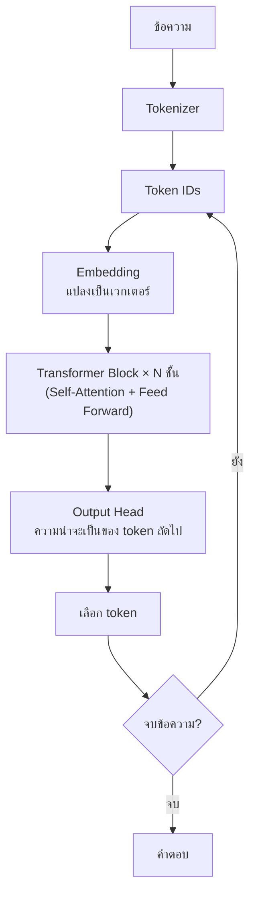
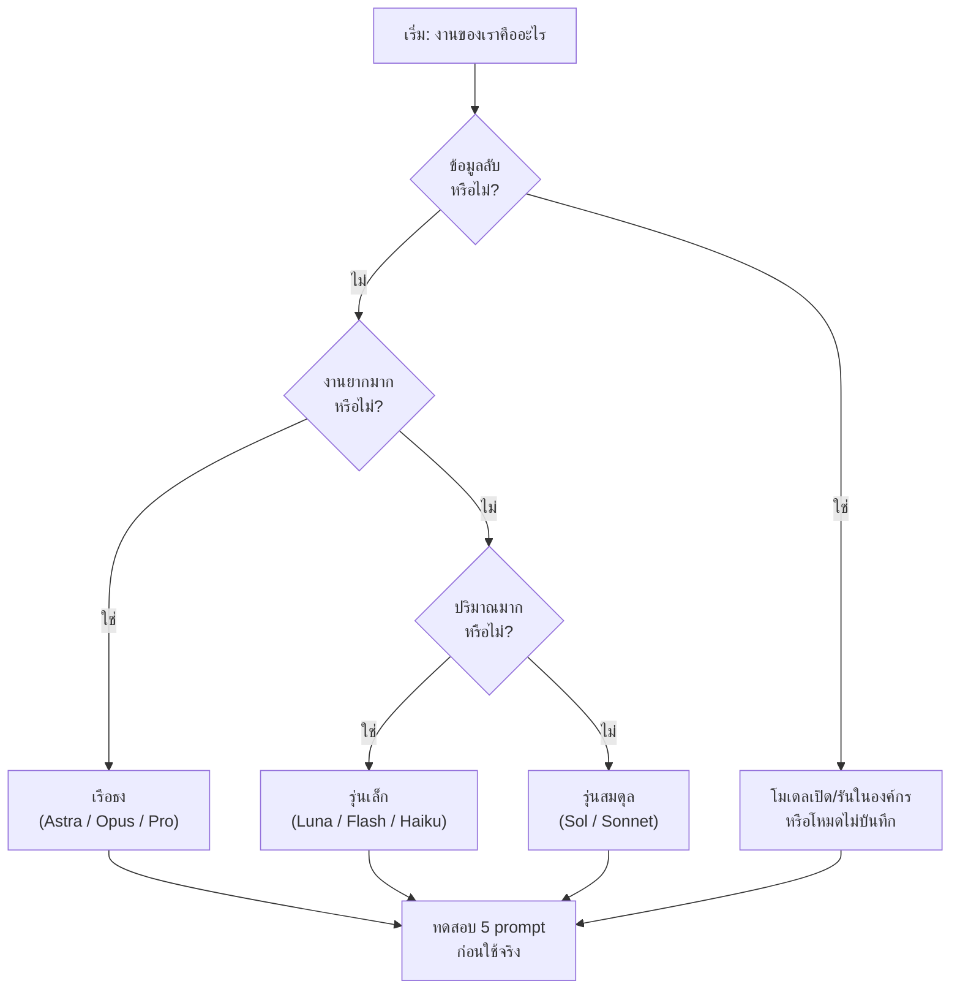

# บทที่ 3: การเปรียบเทียบโมเดล AI และสถาปัตยกรรมของโมเดลภาษา

*(Choosing the Right Model: The 2026 LLM Landscape & Architecture)*

> [!info] ข้อมูลบทเรียน
> | รายการ | รายละเอียด |
> | :--- | :--- |
> | รายวิชา | `21909-2009` การใช้งานแอปพลิเคชันปัญญาประดิษฐ์ |
> | หน่วยการเรียนรู้ | หน่วยที่ 1–2 (ความรู้พื้นฐาน AI/LLM และ Context) |
> | สัปดาห์ | **สัปดาห์ที่ 2** (4 ชั่วโมง) |
> | หัวข้อตามโครงการสอน | เปรียบเทียบโมเดล AI แต่ละค่าย · แนะนำสถาปัตยกรรมโมเดลภาษา |
> | ใบงาน | **ใบงานที่ 1** เปรียบเทียบผลลัพธ์ของโมเดลต่าง ๆ ในโจทย์เดียวกัน |
> | เครื่องมือ | ChatGPT, Google Gemini, Claude, Google AI Studio (ฟรี) |

> [!abstract] สาระสำคัญของบท (Key Takeaways)
> 1. **ไม่มีโมเดลที่ดีที่สุด** — มีแต่โมเดลที่ **เหมาะกับงานและงบประมาณ** ของเรา
> 2. **โมเดลยุคนี้แบ่งเป็น 3 ชั้น** — เรือธง (ฉลาดสุด/แพงสุด), สมดุล, และรุ่นเล็ก (เร็ว/ถูก)
> 3. **สถาปัตยกรรมหลักคือ Decoder-only Transformer** — ต่างกันที่ขนาด ข้อมูลที่ฝึก และเทคนิคเสริม เช่น MoE และ Reasoning
> 4. **ราคาคิดตาม token** — งานเดียวกันใช้โมเดลต่างกัน อาจต่างกันถึง 50–150 เท่า
> 5. **Benchmark ไม่ใช่คำตอบสุดท้าย** — ต้องทดสอบกับงานจริงของตัวเองเสมอ

---

## 1. ทบทวนสัปดาห์ที่ 1 สู่คำถามของสัปดาห์นี้

สัปดาห์ก่อนเรารู้ว่า LLM ทำนาย token ถัดไป และมีข้อจำกัดเรื่อง context, hallucination, memory

สัปดาห์นี้จะตอบคำถามที่ practitioner ทุกคนต้องเจอ:

> [!question] คำถามหลักของบท
> **"ในเมื่อมีโมเดลให้เลือกเป็นร้อย ๆ ตัว เราจะเลือกตัวไหนให้งานของเรา — และเพราะอะไร?"**

ลองดูสถานการณ์จริง:

| งาน                      | ถ้าเลือกผิด                 | ถ้าเลือกถูก                           |
| :----------------------- | :-------------------------- | :------------------------------------ |
| สรุปอีเมล 2,000 ฉบับ     | จ่ายแพงเกินจำเป็น 20 เท่า   | ใช้โมเดลเล็กราคาถูก ทำงานเสร็จเท่ากัน |
| วิเคราะห์โค้ด 500 บรรทัด | โมเดลเล็กทำพลาดจนต้องแก้เอง | โมเดลเรือธงจบในครั้งเดียว             |
| ตอบแชทลูกค้าภาษาไทย      | โมเดลต่างชาติแปลไทยแข็ง     | โมเดลที่เก่งไทยตอบเป็นธรรมชาติ        |
| ข้อมูลลูกค้าลับ          | ส่งข้อมูลออกนอกองค์กร       | ใช้โมเดลที่รันในเครื่อง/องกรณ์        |
|                          |                             |                                       |

---

## 2. แผนที่ตลาดโมเดล AI ปี 2569

### 2.1 ค่ายหลักที่ต้องรู้จัก

| ค่าย                          | โมเดลเด่น                              | จุดแข็งที่คนพูดถึง                                      |
| :---------------------------- | :------------------------------------- | :------------------------------------------------------ |
| **OpenAI**                    | ตระกูล GPT                             | ใช้งานกว้าง รองรับเครื่องมือครบ นิเวศน์แอปใหญ่          |
| **Google DeepMind**           | ตระกูล Gemini                          | Multimodal แข็ง, context ใหญ่, ผูกกับ Workspace/Android |
| **Anthropic**                 | ตระกูล Claude                          | งานเขียนละเอียด โค้ดยาว ๆ และงานที่ต้องใช้เหตุผลซับซ้อน |
| **Meta**                      | ตระกูล Llama                           | **โมเดลเปิด (Open Weights)** นำไปรันเองได้              |
| **DeepSeek / Qwen / Mistral** | โมเดลเปิดขนาดใหญ่                      | ราคาถูก รันเองได้ เหมาะกับงานที่มีข้อจำกัดด้านข้อมูล    |
| **xAI**                       | ตระกูล Grok                            | เชื่อมกับข้อมูลเรียลไทม์                                |
| **ค่ายไทย**                   | Typhoon, OpenThaiGPT, Pathumma, THaLLE | เก่งภาษาไทยและบริบทท้องถิ่น                             |

> [!note] "โมเดลเปิด" ต่างจาก "โมเดลปิด" อย่างไร
> * **โมเดลปิด (Closed)** — ใช้ผ่านเว็บ/API ของเจ้าของเท่านั้น เช่น ChatGPT, Gemini, Claude
> * **โมเดลเปิด (Open Weights)** — ดาวน์โหลดน้ำหนักโมเดลไปรันบนเครื่องหรือเซิร์ฟเวอร์ตัวเองได้ เช่น Llama, Qwen, DeepSeek
> * ข้อดีของโมเดลเปิด: ข้อมูลไม่ออกนอกองค์กร, ปรับแต่งได้, ไม่มีค่าใช้จ่ายต่อ token
> * ข้อเสีย: ต้องมี GPU, ดูแลเอง, และมักเก่งน้อยกว่าเรือธงรุ่นปิด

### 2.2 โมเดลแบ่งเป็น 3 ชั้น (Tier)

ทุกค่ายใหญ่ใช้โครงสร้างเดียวกัน คือ **เรือธง → สมดุล → รุ่นเล็ก**

| ชั้น | เป้าหมาย | แลกกับอะไร | ใช้เมื่อไหร่ |
| :--- | :--- | :--- | :--- |
| **เรือธง (Flagship)** | ฉลาดที่สุด | แพง + ช้า | งานยาก งานเดียวจบ งานที่พลาดไม่ได้ |
| **สมดุล (Balanced)** | ฉลาดพอ + ราคาคุ้ม | กลาง ๆ ทุกด้าน | งานประจำวันขององค์กร |
| **รุ่นเล็ก (Fast / Nano)** | เร็วและถูก | ความสามารถจำกัด | งานปริมาณมาก งานง่าย งานที่ต้องการทันที |

> [!tip] กฎง่าย ๆ ที่ใช้ได้จริง
> **"งานง่ายใช้รุ่นเล็ก งานยากใช้รุ่นใหญ่ และทดสอบก่อนเปลี่ยน"**
> หลายองค์กรประหยัดได้ 60–80% โดยเปลี่ยนงานง่ายไปใช้รุ่นเล็กลง โดยคุณภาพลดลงเพียงเล็กน้อย

### 2.3 ตัวอย่างโมเดล ณ เดือนตุลาคม 2569

> [!warning] ตารางนี้เป็น "ภาพถ่าย" ของตลาด ไม่ใช่ค่าถาวร
> ชื่อโมเดล เวอร์ชัน ราคา และ context เปลี่ยนทุกไม่กี่เดือน
> **สิ่งที่ต้องจำคือ "วิธีอ่านตาราง" ไม่ใช่ "ตัวเลขในตาราง"** — ก่อนใช้จริงให้ตรวจหน้าข้อมูลของผู้ให้บริการอีกครั้ง

| ค่าย          | เรือธง               | สมดุล             | เร็ว/ถูก              |
| :------------ | :------------------- | :---------------- | :-------------------- |
| **OpenAI**    | GPT-6 Astra          | GPT-6.1 Sol       | GPT-6 Luna            |
| **Google**    | Gemini 3.1 Pro       | Gemini 2.5 Pro    | Gemini 3.1 Flash      |
| **Anthropic** | Claude Opus 5.5      | Claude Sonnet 5.5 | Claude Haiku 5.5      |
| **Meta**      | Llama (open weights) | Llama รุ่นกลาง    | Llama รุ่นเล็ก        |
| **DeepSeek**  | DeepSeek R-series    | DeepSeek V-series | รุ่น distill ขนาดเล็ก |

**ราคาตัวอย่าง (USD ต่อ 1 ล้าน token)**

| โมเดล             | Input  | Output | หมายเหตุ         |
| :---------------- | :----: | :----: | :--------------- |
| GPT-6 Astra       |  $10   |  $50   | เรือธง งานยากมาก |
| GPT-6.1 Sol       |   $2   |  $10   | สมดุล ยอดนิยม    |
| GPT-6 Luna        | $0.20  | $1.20  | ปริมาณมาก        |
| Gemini 3.1 Pro    |   $7   |  $21   | Multimodal แข็ง  |
| Gemini 3.1 Flash  | $0.15  | $0.60  | เร็วและถูกมาก    |
| Claude Opus 5.5   |   $4   |  $20   | งานเขียน/โค้ดยาว |
| Claude Sonnet 5.5 |   $2   |  $10   | สมดุล            |
| Claude Haiku 5.5  | ~$0.10 | ~$0.50 | งานเบา           |

> [!danger] อย่าจำตัวเลข ให้จำ "ช่วงราคา"
> เรือธง ≈ $4–15 input · รุ่นกลาง ≈ $1–3 · รุ่นเล็ก ≈ $0.1–0.5
> ความต่างระหว่างรุ่นเล็กกับเรือธงอาจถึง **50–100 เท่า** — นี่คือเหตุผลที่การเลือกโมเดลมีผลต่อต้นทุนมหาศาล

### 2.4 โมเดลไทยที่ควรรู้จัก

| โมเดล           | ผู้พัฒนา | จุดเด่น                                     |
| :-------------- | :------- | :------------------------------------------ |
| **Typhoon**     | SCB 10X  | โมเดลไทยขนาดกลาง เก่งไทย ใช้งานผ่าน API ได้ |
| **OpenThaiGPT** | AIEAT    | เน้นภาษาไทยและบริบทท้องถิ่น                 |
| **Pathumma**    | NECTEC   | โมเดลเปิดสำหรับงานวิจัยและงานไทย            |
| **THaLLE**      | KBTG     | เน้นงานการเงินและภาษาไทย                    |

> [!note] ใช้โมเดลไทยเมื่อไหร่
> * งานที่ต้องเข้าใจภาษาไทยเชิงลึก (สำนวน คำราชาศัพท์ เอกสารราชการ)
> * งานที่ต้องการให้ข้อมูลอยู่ในประเทศ
> * งานที่งบประมาณจำกัดและไม่ต้องใช้เหตุผลซับซ้อนระดับเรือธง
> แต่ถ้าเป็นงานยากมาก ๆ เรือธงต่างชาติมักยังนำอยู่ — **ควรทดสอบเทียบกันจริง**

---

## 3. เบื้องหลังสถาปัตยกรรม: โมเดลภาษาสร้างขึ้นอย่างไร

### 3.1 โครงสร้างหลัก: Decoder-only Transformer

โมเดลยุคนี้เกือบทั้งหมดใช้สถาปัตยกรรมเดียวกัน คือ **Transformer แบบ Decoder-only** (ตัวทำนายคำถัดไป)



**องค์ประกอบสำคัญ**

| องค์ประกอบ         | หน้าที่                    | ผลต่อการใช้งาน                         |
| :----------------- | :------------------------- | :------------------------------------- |
| **Tokenizer**      | ตัดข้อความเป็น token       | ภาษาไทยกิน token มากกว่าอังกฤษ         |
| **Embedding**      | แปลง token เป็นเวกเตอร์    | คุณภาพการจับความหมาย                   |
| **Self-Attention** | ให้ token มองเห็นกันและกัน | ยิ่ง context ยาว ยิ่งใช้หน่วยความจำมาก |
| **Feed Forward**   | ประมวลผลเชิงลึก            | จำนวนพารามิเตอร์ส่วนใหญ่อยู่ที่นี่     |
| **Output Head**    | แปลงกลับเป็นคำ             | กำหนดความหลากหลายของคำตอบ              |

> [!note] จำนวน "ชั้น" (Layers) กับ "พารามิเตอร์"
> โมเดลใหญ่ = ชั้นมาก + กว้างมาก + พารามิเตอร์มาก (พันล้านถึงล้านล้าน)
> แต่ **พารามิเตอร์มากไม่ได้แปลว่าดีกว่าเสมอ** — ขึ้นกับคุณภาพข้อมูล การฝึก และเทคนิคเสริม

### 3.2 Mixture of Experts (MoE): โมเดลใหญ่ที่ประหยัดแรง

โมเดลรุ่นใหม่หลายตัวใช้ **MoE** คือแบ่งเครือข่ายเป็น "ผู้เชี่ยวชาญ" หลายกลุ่ม แล้วเปิดใช้เฉพาะบางกลุ่มในแต่ละ token

| แบบ       | วิธีทำงาน                     | ข้อดี                        |
| :-------- | :---------------------------- | :--------------------------- |
| **Dense** | ใช้ทุกพารามิเตอร์ทุกครั้ง     | คาดเดาง่าย เสถียร            |
| **MoE**   | ใช้เฉพาะ expert ที่เกี่ยวข้อง | เร็วขึ้นมากเมื่อเทียบขนาดรวม |
|           |                               |                              |

> [!tip] ตัวอย่างการอ่านสเปก
> ถ้าเห็นว่า "โมเดลขนาด 600B แต่เปิดใช้เพียง 60B ต่อ token" แปลว่าเป็น MoE — ความเร็วใกล้รุ่น 60B แต่ความสามารถใกล้รุ่น 600B

### 3.3 Reasoning Models: คิดนานขึ้นเพื่อตอบให้ถูก

โมเดลรุ่นใหม่บางตัวเป็น **โมเดลใช้เหตุผล (Reasoning Model)** — ก่อนตอบจะ "คิด" เป็นขั้นตอนภายใน (chain of thought) ทำให้:

* เก่งคณิตศาสตร์ โค้ด และตรรกะซับซ้อนขึ้น
* ใช้ token มากขึ้น (จึงแพงและช้ากว่า)
* เหมาะกับงานที่ **ความถูกต้องสำคัญกว่าความเร็ว**

> [!warning] ข้อควรรู้
> Reasoning model ไม่ได้ "ฉลาดทุกเรื่อง" — งานเขียนสร้างสรรค์หรือสรุปสั้น ๆ อาจได้ผลไม่ต่างจากรุ่นปกติ แต่จ่ายแพงกว่า

### 3.4 Multimodal: อ่านภาพ ฟังเสียง ดูวิดีโอ

โมเดลยุคนี้ רביםเป็น **multimodal** คือรับได้มากกว่าข้อความ

| ความสามารถ | ตัวอย่างการใช้งาน |
| :--- | :--- |
| **Vision** | อ่านภาพหน้าจอ error, อ่านป้าย, วิเคราะห์รูปถ่ายอุปกรณ์ |
| **Audio** | ถอดเสียงประชุม, สรุปคลิป |
| **Video** | วิเคราะห์เหตุการณ์ในกล้องวงจรปิด |
| **Document** | อ่าน PDF ที่มีตารางและภาพ |

> [!note] ระวังต้นทุน
> ภาพ 1 ภาพอาจถูกแปลงเป็น token หลายพันตัว — ส่งภาพ 20 ภาพอาจกิน context มากกว่าข้อความทั้งหน้า

### 3.5 ขนาดโมเดลกับความสามารถ (Scaling & Distillation)

| แนวคิด | ความหมาย | ผลในทางปฏิบัติ |
| :--- | :--- | :--- |
| **Scaling Law** | เพิ่มข้อมูล + พารามิเตอร์ + คำนวณ → ดีขึ้น | เป็นเหตุผลที่โมเดลใหญ่ขึ้นเรื่อย ๆ |
| **Distillation** | ให้โมเดลใหญ่ "สอน" โมเดลเล็ก | ได้โมเดลเล็กราคาถูกที่เก่งใกล้รุ่นใหญ่ |
| **Quantization** | ลดความละเอียดของน้ำหนักโมเดล | รันบนเครื่องทั่วไปได้ แต่คุณภาพลดลงเล็กน้อย |
| **Fine-tuning** | ฝึกเพิ่มด้วยข้อมูลเฉพาะทาง | เก่งงานเฉพาะ แต่ต้องมีข้อมูลและงบ |

---

## 4. เกณฑ์เปรียบเทียบโมเดล 8 ด้าน

> [!important] หลักคิด
> เปรียบเทียบโมเดลต้องดู **หลายมิติพร้อมกัน** — โมเดลที่ชนะ benchmark อาจแพ้เรื่องราคา, ภาษาไทย, หรือความเป็นส่วนตัว

### 4.1 ความสามารถ (Capability)

ดูจากงานที่เราจะทำจริง ไม่ใช่คะแนนรวม:

* งานเขียน/สรุป
* โค้ด/ดีบัก
* คณิตศาสตร์/ตรรกะ
* วิเคราะห์ภาพ/เอกสาร
* การใช้เครื่องมือ (tool calling)

### 4.2 ขนาด Context Window

| งาน | Context ที่ต้องการ |
| :--- | :--- |
| แชททั่วไป | 8K–32K |
| สรุปเอกสาร 20 หน้า | 32K–64K |
| วิเคราะห์โค้ดทั้งโปรเจกต์ | 128K–1M |
| วิเคราะห์ log ทั้งวัน | 200K ขึ้นไป |

### 4.3 ราคา (คำนวณจริง ไม่ใช่ดูแค่ตัวเลข)

**สูตรคิดต้นทุน**

```text
ต้นทุน = (input tokens ÷ 1,000,000 × ราคา input)
       + (output tokens ÷ 1,000,000 × ราคา output)
```

**ตัวอย่างจริง:** สรุปเอกสาร 50 หน้า

| รายการ | ค่า |
| :--- | :--- |
| เอกสาร ≈ 30,000 tokens | input |
| คำตอบ ≈ 2,000 tokens | output |
| ใช้ GPT-6.1 Sol ($2 / $10) | 0.06 + 0.02 = **$0.08** |
| ใช้ GPT-6 Astra ($10 / $50) | 0.30 + 0.10 = **$0.40** |
| ใช้ Gemini 3.1 Flash ($0.15 / $0.60) | 0.0045 + 0.0012 = **$0.006** |

> [!tip] บทเรียนจากตัวเลขนี้
> งานเดียวกันต่างกันถึง **~66 เท่า** ระหว่าง Astra กับ Flash
> ถ้าทำวันละ 100 เอกสาร ความต่างจะอยู่ที่ประมาณ $40 ต่อวัน — หรือเกือบ 40,000 บาทต่อเดือน

### 4.4 ความเร็ว (Latency & Throughput)

| ตัวชี้วัด | ความหมาย | สำคัญเมื่อ |
| :--- | :--- | :--- |
| **Time to First Token (TTFT)** | เวลาก่อนได้คำแรก | แชทที่ต้องรู้สึกตอบสนองทันที |
| **Tokens per second** | ความเร็วในการสร้างคำ | งานยาวที่ต้องรอผล |
| **Rate limit** | จำนวนคำขอต่อนาที | ระบบที่มีผู้ใช้หลายคน |

### 4.5 ภาษาไทย

| ประเด็น | สิ่งที่ต้องทดสอบ |
| :--- | :--- |
| ความเข้าใจสำนวน | ลองประโยคที่มีคำไทยเชิงวัฒนธรรม |
| การสะกด | ชื่อเฉพาะไทย วัด ศาลา |
| คำศัพท์เทคนิค | ศัพท์ช่าง/ไอทีที่มีคำไทย |
| ความยาว | ภาษาไทยใช้ token มากกว่าอังกฤษ 2–4 เท่า |

> [!note] ทดสอบภาษาไทยด้วยตัวเอง
> ให้โมเดล 3 ตัวสรุปข่าวไทยเรื่องเดียวกัน แล้วเทียบว่าใคร "อ่านรู้เรื่อง" ที่สุด
> อย่าเชื่อคำโฆษณาว่า "รองรับภาษาไทย" — ต้องลอง

### 4.6 ความเป็นส่วนตัวและนโยบายข้อมูล

| คำถาม | ทำไมสำคัญ |
| :--- | :--- |
| ข้อมูลที่ส่งไปถูกนำไปฝึกต่อหรือไม่ | กระทบความลับองค์กร |
| เก็บข้อมูลนานแค่ไหน | กระทบ PDPA |
| มีโหมดไม่บันทึกหรือไม่ | ใช้กับข้อมูลอ่อนไหว |
| รันในเครื่องได้หรือไม่ | ทางเลือกที่ปลอดภัยที่สุด |

### 4.7 ระบบนิเวศและเครื่องมือ

* รองรับ **function calling** / tool use
* มี SDK และเอกสารภาษาไทย/อังกฤษ
* เชื่อมกับเครื่องมือที่ใช้อยู่ (Google Workspace, Microsoft 365)
* มี API ฟรีสำหรับนักเรียน/นักศึกษา

### 4.8 ขีดจำกัดการใช้งาน (Quota)

| แพลตฟอร์ม | ฟรี | ข้อจำกัด |
| :--- | :--- | :--- |
| ChatGPT | ใช้ได้ | จำกัดจำนวนข้อความ/ช่วงเวลา |
| Gemini | ใช้ได้ | จำกัดรุ่นโมเดลและจำนวน |
| Claude | ใช้ได้ | จำกัดข้อความ |
| Google AI Studio | API ฟรี | มี rate limit |
| OpenRouter / Groq | มีโมเดลฟรี | จำกัดคำขอ |

---

## 5. อ่าน Benchmark อย่างไรไม่ให้โดนหลอก

### 5.1 Benchmark ที่พบบ่อย

| ชื่อ | วัดอะไร |
| :--- | :--- |
| **MMLU / MMLU-Pro** | ความรู้ทั่วไประดับมหาวิทยาลัย |
| **GPQA** | คำถามวิทยาศาสตร์ระดับผู้เชี่ยวชาญ |
| **AIME** | คณิตศาสตร์แข่งขัน |
| **SWE-bench** | แก้ bug ในโปรเจกต์จริง |
| **HumanEval** | เขียนโค้ดตามโจทย์ |
| **MMMU** | งานที่ต้องใช้ทั้งภาพและข้อความ |
| **LMArena (Elo)** | ให้มนุษย์โหวตคำตอบที่ดีกว่า |

### 5.2 กับดักของการอ่านตัวเลข

> [!danger] 5 กับดักที่ต้องระวัง
> 1. **Benchmark Contamination** — โจทย์อาจหลุดเข้าไปในข้อมูลฝึก ทำให้คะแนนสูงเกินจริง
> 2. **Cherry-picking** — ผู้ขายเลือกเฉพาะ benchmark ที่ตัวเองชนะ
> 3. **ตัวเลขต่างกันไม่กี่เปอร์เซ็นต์** — อาจไม่มีความหมายในงานจริง
> 4. **ทดสอบด้วยภาษาอังกฤษ** — คะแนนดีแต่อาจไม่เก่งไทย
> 5. **เปลี่ยนเวอร์ชัน** — ชื่อเดิมแต่โมเดลข้างหลังเปลี่ยน

### 5.3 วิธีทดสอบที่เชื่อถือได้ที่สุด: ทดสอบกับงานของเราเอง

> [!tip] วิธี 5 Prompt Test (ใช้ได้ทุกครั้ง)
> 1. เลือกงานจริง 5 งานที่ทำบ่อย
> 2. เขียน prompt เดียวกันเป๊ะ ๆ
> 3. รันกับ 3 โมเดล
> 4. ให้คะแนน 1–5 ใน 3 ด้าน: ถูกต้อง / ใช้งานได้ทันที / โทนภาษา
> 5. เลือกตัวที่คะแนนรวมดีที่สุด **ภายใต้งบประมาณที่รับได้**

---

## 6. เลือกโมเดลให้ตรงงาน: แผนผังตัดสินใจ



### 6.1 ตารางเลือกแบบเร็ว

| งาน | แนะนำ | เหตุผล |
| :--- | :--- | :--- |
| สรุปอีเมล/เอกสารสั้น | รุ่นเล็ก | งานง่าย ปริมาณมาก |
| เขียนโค้ดทั้งโปรเจกต์ | เรือธงหรือ reasoning | ต้องเข้าใจบริบทใหญ่ |
| วิเคราะห์ภาพหน้าจอ error | Multimodal รุ่นกลาง | ต้องอ่านภาพ + อธิบาย |
| ตอบแชทลูกค้าภาษาไทย | รุ่นกลาง/โมเดลไทย | โทนภาษาและต้นทุน |
| งานวิจัยเชิงลึก | Reasoning model | ต้องคิดหลายขั้น |
| ข้อมูลลูกค้าลับ | โมเดลเปิดในองค์กร | ความเป็นส่วนตัว |

---

## 7. แผนเวลา 4 ชั่วโมง (สัปดาห์ที่ 2)

| ช่วง | นาที | กิจกรรม |
| :--- | :--: | :--- |
| 0–15 | 15 | ทบทวนสัปดาห์ 1 + เช็กลิสต์ความรู้ |
| 15–45 | 30 | บรรยาย: ตลาดโมเดล 3 ชั้น + ราคา |
| 45–75 | 30 | สาธิต: คำนวณต้นทุนจากโจทย์จริง |
| 75–105 | 30 | บรรยาย: สถาปัตยกรรม Transformer / MoE / Reasoning |
| 105–120 | 15 | พัก |
| 120–165 | 45 | ใบงานที่ 1: ทดสอบ 3 โมเดลในโจทย์เดียว |
| 165–195 | 30 | นำเสนอผลเปรียบเทียบหน้าชั้น |
| 195–225 | 30 | อภิปราย: เลือกโมเดลตามสถานการณ์ |
| 225–240 | 15 | สรุป + เชื่อมสู่สัปดาห์ที่ 3 (Token & Context) |

---

## 8. ใบงานที่ 1: เปรียบเทียบโมเดลในโจทย์เดียวกัน

> [!todo] โจทย์
> เลือกโจทย์ 1 ข้อจากรายการ แล้วทดสอบกับ **3 โมเดล** (เช่น ChatGPT, Gemini, Claude)
> ใช้ prompt เดียวกันเป๊ะ ๆ และบันทึกผลลงตาราง

**ตัวเลือกโจทย์**

1. อธิบายวิธีแก้ปัญหา Wi-Fi ในบ้านที่สัญญาณอ่อน ให้เข้าใจง่าย
2. เขียนอีเมลขอเลื่อนกำหนดส่งงานอย่างสุภาพ
3. สรุปข่าวเทคโนโลยี 1 ข่าวให้เหลือ 5 บรรทัด
4. เขียนโค้ด Python นับจำนวนคำในไฟล์ข้อความ
5. แปลงขั้นตอนการประกอบคอม 5 ขั้นเป็นตาราง

**ตารางบันทึกผล**

| หัวข้อ | โมเดล A | โมเดล B | โมเดล C |
| :--- | :--- | :--- | :--- |
| ชื่อโมเดล | | | |
| ตอบตรงคำถาม (1–5) | | | |
| ถูกต้องของข้อมูล (1–5) | | | |
| ภาษาไทยเป็นธรรมชาติ (1–5) | | | |
| ความยาว/ความเร็ว | | | |
| จุดเด่น | | | |
| จุดอ่อน | | | |
| ราคาโดยประมาณ | | | |

> [!note] เกณฑ์การให้คะแนน (20 คะแนน)
> * ครบ 3 โมเดล และใช้ prompt เดียวกัน (5)
> * ตารางครบทุกช่อง (5)
> * วิเคราะห์จุดเด่น/จุดอ่อนได้สมเหตุสมผล (5)
> * สรุปได้ว่า "งานนี้ควรเลือกโมเดลไหน เพราะอะไร" (5)

---

## 9. บทสรุป

* **ตลาดโมเดลแบ่งเป็น 3 ชั้น** — เรือธง สมดุล และรุ่นเล็ก เลือกตามความยากของงานและงบประมาณ
* **สถาปัตยกรรมหลักคือ Decoder-only Transformer** — ต่างกันที่ขนาด ข้อมูล และเทคนิคเสริม (MoE, Reasoning, Multimodal)
* **ราคาต่างกันได้ถึง 50–150 เท่า** — การเลือกโมเดลจึงเป็นการตัดสินใจทางธุรกิจ ไม่ใช่แค่ทางเทคนิค
* **Benchmark เป็นเพียงจุดเริ่มต้น** — คำตอบสุดท้ายมาจากการทดสอบกับงานจริงของเรา
* **โมเดลไทยมีที่ทาง** — โดยเฉพาะงานภาษาไทยและงานที่ต้องเก็บข้อมูลในประเทศ

> [!quote] ข้อคิดปิดบท
> *"คนที่ใช้ AI เก่ง ไม่ใช่คนที่ใช้โมเดลแพงที่สุด แต่คือคนที่รู้ว่าจุดไหนควรจ่ายแพง และจุดไหนไม่จำเป็น"*

---

## 10. คำถามทบทวน

1. เหตุใดจึงกล่าวว่า "ไม่มีโมเดลที่ดีที่สุด" จงอธิบายพร้อมยกตัวอย่าง
2. จงเปรียบเทียบโมเดลแบบ **Dense** และ **MoE** ว่าต่างกันอย่างไร
3. Reasoning Model ต่างจากโมเดลทั่วไปอย่างไร และเหมาะกับงานประเภทใด
4. จงคำนวณต้นทุนการสรุปเอกสาร 40,000 input tokens + 2,000 output tokens ด้วยโมเดลราคา $2/$10
5. เพราะเหตุใด Benchmark จึงอาจทำให้เข้าใจความสามารถของโมเดลผิด
6. ถ้าต้องตอบแชทลูกค้า 5,000 ข้อความต่อวัน นักเรียนจะเลือกโมเดลแบบใด เพราะเหตุใด
7. โมเดลไทยเหมาะกับงานประเภทใดมากที่สุด
8. จงออกแบบวิธีทดสอบโมเดล 3 ตัวสำหรับงานของตัวเองใน 5 ขั้นตอน

---

## 11. เอกสารอ้างอิง

1. Russell, S., & Norvig, P. (2021). *Artificial Intelligence: A Modern Approach* (4th ed.). Pearson.
2. Vaswani, A., et al. (2017). *Attention Is All You Need*. NeurIPS.
3. Kaplan, J., et al. (2020). *Scaling Laws for Neural Language Models*. arXiv:2001.08361.
4. Hoffmann, J., et al. (2022). *Training Compute-Optimal Large Language Models*. arXiv:2203.15556.
5. Wei, J., et al. (2022). *Chain-of-Thought Prompting Elicits Reasoning in Large Language Models*. NeurIPS.
6. เอกสารราคาและสเปกโมเดลจากผู้ให้บริการ (OpenAI, Google, Anthropic) — ตรวจสอบ ณ ตุลาคม 2569
7. SCB 10X. *Typhoon LLM*. https://opentyphoon.ai
8. AIEAT. *OpenThaiGPT*. https://openthaigpt.aieat.or.th

---

## 12. โน้ตที่เกี่ยวข้อง

* [[ความรู้พื้นฐานปัญญาประดิษฐ์]] — บทที่ 1: AI คืออะไร มาจากไหน
* [[การใช้ LLM พื้นฐาน]] — บทที่ 2: Token, Hallucination, Context Window, Memory, System Prompt
* [[บทความ ลำดับขั้นของผู้ใช้ AI]] — 5 ขั้นของผู้ใช้ AI
* [[การบ้าน สัปดาห์ที่ 1 - ภารกิจสร้างผู้ช่วย AI]] — การบ้านทบทวนพื้นฐาน
* [[21909-2009 การใช้งานแอปพลิเคชันปัญญาประดิษฐ์]] — ข้อมูลรายวิชา
* [[แผนหน่วยการเรียน 21909-2009 การใช้งานแอปพลิเคชันปัญญาประดิษฐ์]] — แผนการสอน 18 สัปดาห์
