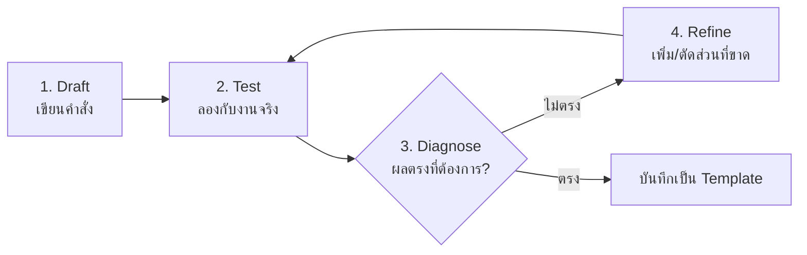

# บทที่ 4 — Prompt Engineering เบื้องต้น

*(สัปดาห์ที่ 3 · หน่วยที่ 3 — Role, Task, Context, Constraint, Format + Zero-shot vs Few-shot)*

> [!info] ข้อมูลบทเรียน
> | รายการ | รายละเอียด |
> | :--- | :--- |
> | รายวิชา | `21909-2009` การใช้งานแอปพลิเคชันปัญญาประดิษฐ์ |
> | กลุ่มเรียน | 3ชทค2 (จันทร์ คาบ 6–9) · 3ชทค1 (พุธ คาบ 1–4) |
> | ห้องเรียน | TC203 |
> | เวลา | 4 ชั่วโมง |
> | ใบงาน | **ใบงานที่ 3** — ออกแบบ Few-shot Prompt แก้โจทย์เทคนิคคอมพิวเตอร์ (20 คะแนน) |
> | ต่อจาก | [[การเปรียบเทียบโมเดล AI]] (บทที่ 3 — เลือกโมเดลได้แล้ว) |

> [!abstract] เป้าหมายของบทนี้
> 1. อธิบายได้ว่าทำไมคำสั่งเดียวกันจึงได้คำตอบต่างกัน
> 2. แยกองค์ประกอบ **5 ส่วน** ของ prompt ที่ดีได้ (Role · Task · Context · Constraint · Format)
> 3. เขียน prompt จากประโยคสั้น ๆ ที่กำกวม ให้เป็นคำสั่งที่ใช้งานได้จริง
> 4. ใช้เทคนิค **Zero-shot / Few-shot** ได้อย่างถูกสถานการณ์
> 5. กำหนดรูปแบบผลลัพธ์ (ตาราง / Bullet / JSON) ได้
> 6. ตรวจงาน AI และ **ปรับ prompt ซ้ำ** จนได้ผลที่ต้องการ

> [!note] ทำไมต้องเรียนบทนี้
> สองสัปดาห์แรกเราตอบคำถามว่า "AI ทำงานอย่างไร" และ "จะเลือกโมเดลตัวไหน"
> สัปดาห์นี้เราจะตอบว่า **"จะสั่งมันอย่างไรให้ได้งานที่เอาไปใช้ได้"**
> เพราะคนที่ใช้ AI เก่งไม่ใช่คนที่พิมพ์เร็ว แต่เป็นคนที่ **สั่งเป็น**

---

## 1. ทำไมคำสั่งเดียวกันได้คำตอบต่างกัน

### 1.1 ตัวอย่างเทียบให้เห็น

| คำสั่ง | ผลลัพธ์ที่ได้ | ปัญหา |
| :--- | :--- | :--- |
| "ช่วยเขียนโปรแกรมด้วย" | ได้โค้ดภาษาอะไรก็ไม่รู้ ทำอะไรก็ไม่รู้ | ไม่บอกงาน ไม่บอกเงื่อนไข |
| "เขียนโปรแกรมคิดเกรดด้วย Python" | ได้โค้ดกลาง ๆ ไม่มีข้อมูลนำเข้า | ไม่บอกว่าคะแนนมาจากไหน |
| "เขียนฟังก์ชัน Python รับคะแนน 0–100 แล้วคืนเกรด A–F ตามเกณฑ์ที่กำหนด พร้อมอธิบายทีละบรรทัด" | ได้โค้ดที่เอาไปใช้ได้ทันที | ครบทุกส่วน |

> [!tip] หลักคิดเดียวที่ต้องจำ
> **AI ไม่รู้สิ่งที่อยู่ในหัวเรา** — มันรู้แค่สิ่งที่เราพิมพ์ลงไป
> ยิ่งระบุชัด ผลลัพธ์ยิ่งใช้ได้จริง

### 1.2 AI เดาให้เราเสมอ

เมื่อข้อมูลไม่ครบ โมเดลจะ **เติมช่องว่างด้วยสิ่งที่น่าจะเป็น** (นี่คือกลไกเดียวกับ Hallucination ที่เรียนในบทที่ 2)

```text
สั่ง: "สรุปเอกสารนี้ให้หน่อย"
AI เดา: สรุปแบบไหน? ยาวเท่าไร? ให้ใครอ่าน? ต้องมีตัวเลขไหม?
```

ผลคือได้สรุปที่อาจ **ยาวเกินไป สั้นเกินไป หรือผิดวัตถุประสงค์** — ไม่ใช่เพราะ AI โง่ แต่เพราะเราไม่ได้บอก

---

## 2. องค์ประกอบ 5 ส่วนของ Prompt ที่ดี

> [!important] สูตร R-T-C-C-F
> **R**ole → **T**ask → **C**ontext → **C**onstraint → **F**ormat
> จำง่าย ๆ ว่า "ใครทำ · ทำอะไร · ด้วยข้อมูลอะไร · ห้ามอะไร · ส่งงานแบบไหน"

| ส่วน               | ตอบคำถามว่า             | ตัวอย่าง                                                       |
| :----------------- | :---------------------- | :------------------------------------------------------------- |
| **R — Role**       | ให้ AI สวมบทบาทอะไร     | "คุณเป็นช่างเทคนิคคอมพิวเตอร์ที่มีประสบการณ์ 10 ปี"            |
| **T — Task**       | ให้ทำงานอะไรชัดเจน      | "วินิจฉัยอาการเสียจากข้อมูลที่ให้"                             |
| **C — Context**    | ข้อมูลพื้นฐานที่ต้องรู้ | "เครื่องลูกค้าเป็น Windows 11, อาการคือเปิดไม่ติดแต่ไฟติด"     |
| **C — Constraint** | ข้อห้าม/ขอบเขต          | "ห้ามแนะนำให้ลง Windows ใหม่เป็นข้อแรก, ตอบไม่เกิน 5 ข้อ"      |
| **F — Format**     | รูปแบบผลลัพธ์           | "ตอบเป็นตาราง 3 คอลัมน์: สาเหตุ / วิธีตรวจ / ค่าใช้จ่ายประมาณ" |

### 2.1 ตัวอย่างเต็ม (ครบ 5 ส่วน)

```text
[Role]
คุณเป็นช่างเทคนิคคอมพิวเตอร์ประจำร้านซ่อม ที่อธิบายให้ลูกค้าที่ไม่มีความรู้เทคนิคเข้าใจได้

[Task]
วินิจฉัยอาการเสียของคอมพิวเตอร์จากข้อมูลที่ให้ และจัดลำดับการตรวจสอบจากถูกที่สุดไปแพงที่สุด

[Context]
- เครื่อง: PC ประกอบเอง อายุ 3 ปี
- OS: Windows 11
- อาการ: เปิดเครื่องแล้วไฟติด พัดลมหมุน แต่จอไม่แสดงภาพ
- เพิ่งย้ายบ้านเมื่อวานนี้

[Constraint]
- ห้ามแนะนำ "ลง Windows ใหม่" จนกว่าจะตรวจฮาร์ดแวร์ครบ
- ห้ามเดารุ่นอุปกรณ์ที่ไม่ได้ระบุ
- ถ้าข้อมูลไม่พอ ให้ถามกลับได้ไม่เกิน 3 คำถาม

[Format]
ตอบเป็นตาราง: | ลำดับ | สาเหตุที่น่าจะเป็น | วิธีตรวจ | ค่าใช้จ่ายโดยประมาณ |
ปิดท้ายด้วย 1 ประโยคสรุปว่าควรเริ่มจากข้อไหน
```

> [!success] สังเกตความต่าง
> prompt เดียวกันนี้ให้ผลที่ **ตรวจสอบได้** — เพราะเราบอกทั้งบทบาท ข้อมูล ข้อห้าม และรูปแบบ

### 2.2 ถ้าไม่มีส่วนไหนจะเป็นอย่างไร

| ขาดส่วน | อาการที่เจอ |
| :--- | :--- |
| ไม่มี Role | ได้คำตอบกว้าง แบบ Wikipedia |
| ไม่มี Task ที่ชัด | AI ถามกลับหรือเดาเป้าหมายผิด |
| ไม่มี Context | ได้คำตอบสำเร็จรูป ใช้กับงานจริงไม่ได้ |
| ไม่มี Constraint | ได้คำแนะนำเกินขอบเขต (เช่น ให้ลง Windows ใหม่ทุกกรณี) |
| ไม่มี Format | ได้ย่อหน้ายาว อ่านยาก ต้องมาเรียบเรียงเอง |

> [!warning] ไม่จำเป็นต้องครบ 5 ส่วนทุกครั้ง
> งานง่าย (เช่น "แปลงประโยคนี้เป็นภาษาอังกฤษ") ใช้แค่ Task + Format พอ
> กฎคือ: **งานยิ่งซับซ้อน ยิ่งต้องระบุมาก**

---

## 3. Zero-shot, One-shot และ Few-shot

### 3.1 ความหมาย

| เทคนิค | ให้ตัวอย่างกี่อัน | เหมาะกับ |
| :--- | :--: | :--- |
| **Zero-shot** | 0 | งานทั่วไปที่ AI เข้าใจอยู่แล้ว |
| **One-shot** | 1 | งานที่ต้องล็อกรูปแบบ |
| **Few-shot** | 2–5 | งานที่ต้องการสไตล์/รูปแบบเฉพาะ งานจัดหมวด |

> [!note] "Shot" คืออะไร
> "Shot" = ตัวอย่างที่เราป้อนให้โมเดลดูเป็นแบบอย่าง (ตัวอย่างนำเข้า → ผลลัพธ์ที่ต้องการ)

### 3.2 Zero-shot — สั่งแล้วทำเลย

```text
จัดหมวดอาการเสียต่อไปนี้ว่าเป็น ปัญหาฮาร์ดแวร์ / ซอฟต์แวร์ / เครือข่าย
อาการ: เปิดเครื่องติดแต่จอไม่ขึ้น
```

**ผลลัพธ์:** `ฮาร์ดแวร์`

ใช้ได้เมื่อรูปแบบง่าย แต่ถ้างานต้องได้ **สไตล์เดียวกันทุกครั้ง** มักไม่นิ่ง

### 3.3 Few-shot — สอนด้วยตัวอย่าง

```text
จัดหมวดอาการเสียเป็น 3 กลุ่ม: ฮาร์ดแวร์ / ซอฟต์แวร์ / เครือข่าย

ตัวอย่างที่ 1
อาการ: เปิดเครื่องติดแต่จอไม่ขึ้น
หมวด: ฮาร์ดแวร์

ตัวอย่างที่ 2
อาการ: เปิดเว็บได้แต่ขึ้นว่า DNS_PROBE_FINISHED
หมวด: เครือข่าย

ตัวอย่างที่ 3
อาการ: ดับเบิลคลิกโปรแกรมแล้วขึ้น error 0xc000007b
หมวด: ซอฟต์แวร์

งาน: อาการ "เสียงออกลำโพงข้างเดียว" อยู่ในหมวดใด
```

**ผลลัพธ์:** `ฮาร์ดแวร์`

> [!tip] ทำไม Few-shot ได้ผล
> โมเดลไม่ได้ "เรียนรู้" จากตัวอย่าง (ไม่มีการเทรนใหม่) — แต่ตัวอย่างช่วยให้มันเห็น **รูปแบบการตอบ** ที่เราต้องการ
> เหมือนสอนน้องใหม่ด้วยการ "ทำให้ดู 3 ครั้ง" แล้วให้ทำเอง

### 3.4 หลักเลือกตัวอย่างสำหรับ Few-shot

| หลัก                | ควรทำ                      | ไม่ควรทำ                                   |
| :------------------ | :------------------------- | :----------------------------------------- |
| ตัวอย่างหลากหลาย    | ครอบคลุมหลายกรณี           | ให้แต่กรณีคล้ายกัน                         |
| ตัวอย่างถูกต้อง     | ตรวจแล้วว่าไม่มีผิด        | ให้ตัวอย่างที่ AI ทำตามผิด                 |
| รูปแบบเหมือนกันเป๊ะ | ใช้โครงเดียวกันทุกตัวอย่าง | ตัวอย่างที่ 1 บรรทัด ตัวอย่างที่ 2 ย่อหน้า |
| ไม่เกิน 5 ตัวอย่าง  | 3 ตัวอย่างกำลังดี          | ใส่ 10 ตัวอย่างจน prompt ยาวเกินจำเป็น     |

> [!warning] Few-shot ไม่ใช่ยาวิเศษ
> ถ้าตัวอย่างขัดกันเอง (เช่น ตัวอย่าง 1 จัด "จอไม่ขึ้น" เป็นฮาร์ดแวร์ ตัวอย่าง 2 จัดเป็นซอฟต์แวร์)
> โมเดลจะสับสนและตอบไม่แน่นอน — **ตัวอย่างต้องสอดคล้องกัน**

---

## 4. กำหนดรูปแบบผลลัพธ์ (Format)

### 4.1 รูปแบบที่ใช้บ่อย

| สั่งว่า | ได้อะไร | เหมาะกับ |
| :--- | :--- | :--- |
| "ตอบเป็นตาราง 4 คอลัมน์" | ตาราง Markdown | เปรียบเทียบ/สรุป |
| "ตอบเป็น Bullet ไม่เกิน 5 ข้อ" | รายการสั้น | สรุปประชุม/ขั้นตอน |
| "ตอบเป็น JSON ตาม schema นี้" | ข้อมูลพร้อมใช้ต่อ | งานที่ต้องเอาไปประมวลผล |
| "ตอบเป็นขั้นตอน 1-2-3" | ลำดับ | วิธีปฏิบัติ |
| "อธิบายให้เด็ก ม.3 เข้าใจ" | ภาษาง่าย | สื่อการสอน |

### 4.2 ตัวอย่างการสั่ง JSON

```text
ตอบเป็น JSON เท่านั้น ห้ามมีข้อความอื่น
{
  "device": "...",
  "symptom": "...",
  "category": "hardware | software | network",
  "confidence": 0.0
}
```

> [!tip] ระบุ "ห้ามมีข้อความอื่น"
> ถ้าไม่ระบุ โมเดลมักใส่คำเกริ่นว่า "นี่คือ JSON ที่คุณต้องการ" ทำให้เอาไปใช้ต่อไม่ได้
> การเขียนโค้ดในสัปดาห์ที่ 8–9 จะใช้ท่านี้บ่อยมาก

---

## 5. เทคนิคเสริมที่ได้ผลจริง

| เทคนิค | วิธีเขียน | ใช้เมื่อ |
| :--- | :--- | :--- |
| **ให้ถามกลับ** | "ถ้าข้อมูลไม่พอ ให้ถามกลับก่อน อย่าเดา" | ข้อมูลจากลูกค้าน้อย |
| **กำหนดกลุ่มผู้อ่าน** | "อธิบายให้ลูกค้าที่ไม่มีความรู้เทคนิคฟัง" | งานบริการ/ขาย |
| **จำกัดความยาว** | "ไม่เกิน 150 คำ" | สรุปรายงาน |
| **ให้ตรวจตัวเอง** | "หลังตอบ ให้ระบุจุดที่คุณไม่มั่นใจ 2 ข้อ" | งานเสี่ยงสูง |
| **ให้ทางเลือก** | "เสนอ 3 ทางเลือก พร้อมข้อดี–ข้อเสีย" | ตัดสินใจ |
| **ป้อนตัวอย่างเชิงลบ** | "ห้ามตอบแบบนี้: 'ควรปรึกษาช่าง'" | กันคำตอบเลื่อนลอย |

> [!danger] กับดัก: สั่งซ้อนกันหลายงานใน prompt เดียว
> "ช่วยสรุปเอกสาร เปรียบเทียบ 3 รุ่น แล้วเขียนอีเมลส่งลูกค้า และทำตารางราคา"
> โมเดลจะทำแต่ละส่วนได้ตื้น ๆ
> **แก้:** แตกเป็น 3 รอบ (สรุป → เปรียบเทียบ → เขียนอีเมล) แล้วป้อนผลรอบก่อนหน้าเข้าไป

---

## 6. วงจรปรับ Prompt 4 รอบ



### 6.1 วิธีวินิจฉัยว่าต้องแก้อะไร

| อาการ | ส่วนที่ต้องเพิ่ม |
| :--- | :--- |
| คำตอบกว้างเกิน | เพิ่ม **Context** และ **Constraint** |
| รูปแบบไม่เหมือนเดิมทุกครั้ง | เพิ่ม **Format** หรือ **Few-shot** |
| ตอบนอกเรื่อง | เพิ่ม **Role** และระบุขอบเขตงาน |
| ยาวเกินไป | ระบุจำนวนคำ/ข้อ |
| ข้อมูลผิด | เพิ่ม "ถ้าไม่แน่ใจให้บอกว่าไม่แน่ใจ" + ตรวจกับแหล่งจริง |

> [!note] กฎ 3 รอบ
> ถ้าปรับ 3 รอบแล้วยังไม่ได้งาน **อย่าฝืน** — ให้เปลี่ยนวิธี: แตกงานเล็กลง หรือเปลี่ยนโมเดล (บทที่ 3)

---

## 7. 10 ข้อผิดพลาดที่พบบ่อย

| # | ผิดพลาด | อาการ | วิธีแก้ |
| :--: | :--- | :--- | :--- |
| 1 | คำสั่งกำกวม | ได้คำตอบไม่ตรง | ระบุ Task ให้เป็นกริยาชัด ๆ |
| 2 | ไม่ให้ข้อมูล | AI เดา | ใส่ Context |
| 3 | สั่งหลายงานพร้อมกัน | ทุกส่วนตื้น | แตกเป็นรอบ |
| 4 | ไม่กำหนดรูปแบบ | ต้องมาเรียบเรียงเอง | ใส่ Format |
| 5 | ใช้คำว่า "ดี ๆ สวย ๆ" | ได้ผลที่วัดไม่ได้ | ระบุเกณฑ์ที่วัดได้ |
| 6 | ตัวอย่างขัดกัน | คำตอบไม่นิ่ง | ตรวจตัวอย่างก่อนป้อน |
| 7 | ไม่บอกกลุ่มผู้อ่าน | ภาษาผิดระดับ | ระบุผู้อ่าน |
| 8 | เชื่อคำตอบทันที | ใช้ข้อมูลผิด | ตรวจกับแหล่งจริงเสมอ |
| 9 | prompt ยาวเกินจำเป็น | โมเดลหลงประเด็น | ตัดส่วนที่ไม่เกี่ยว |
| 10 | ไม่บันทึก prompt ที่ดี | ต้องเริ่มใหม่ทุกครั้ง | เก็บเป็น Template |

---

## 8. Prompt Template ใช้ซ้ำ

### 8.1 โครง Template

```text
[Role] คุณเป็น ...
[Task] จง ...
[Context] ข้อมูล: {{ข้อมูล}}
[Constraint] ห้าม ... / ไม่เกิน ...
[Format] ตอบเป็น ...
```

### 8.2 ตัวอย่าง Template งานช่างเทคนิค

| ชื่อ Template | ตัวแปรที่ต้องเติม | ใช้ทำอะไร |
| :--- | :--- | :--- |
| วินิจฉัยอาการเสีย | `{{อุปกรณ์}}` `{{อาการ}}` `{{ประวัติ}}` | ทำตารางสาเหตุ–วิธีตรวจ |
| เขียนใบเสนอราคา | `{{รายการ}}` `{{ราคา}}` | ออกเอกสารพร้อม VAT |
| อธิบาย error code | `{{รหัส}}` `{{โปรแกรม}}` | แปลเป็นภาษาคน + วิธีแก้ |
| สรุปคู่มือ | `{{เนื้อหา}}` `{{จำนวนข้อ}}` | สรุปเป็นขั้นตอน |
| เขียนอีเมลถึงลูกค้า | `{{ปัญหา}}` `{{แนวทางแก้}}` | ภาษาสุภาพ |

> [!tip] เก็บ Template ไว้ที่ไหน
> ใช้โน้ต Obsidian 1 ไฟล์ต่อ 1 Template แล้วคัดลอกไปวางในแชท
> หรือใส่เป็น **System Prompt** (บทที่ 2) ถ้าใช้ซ้ำทุกวัน

---

## 9. Workshop ในคาบ

แปลง prompt อ่อน → prompt แข็ง (เขียนลงสมุด/ไฟล์ แล้วลองกับ ChatGPT หรือ Gemini)

| # | Prompt อ่อน | ต้องเติมอะไร |
| :--: | :--- | :--- |
| 1 | "ช่วยอธิบายเรื่อง RAM" | Role, ผู้อ่าน, ความยาว, รูปแบบ |
| 2 | "เขียนใบเสนอราคาให้หน่อย" | Context (รายการ/ราคา), รูปแบบตาราง, VAT |
| 3 | "แก้โค้ดนี้ให้ที" | ภาษา, ข้อผิดพลาดที่เจอ, ห้ามเปลี่ยนโครงสร้าง |
| 4 | "สรุปเอกสารนี้" | จำนวนข้อ, ผู้อ่าน, สิ่งที่ต้องมี/ไม่ต้องมี |
| 5 | "ควรซื้ออะไรดี" | งบประมาณ, การใช้งาน, เกณฑ์เปรียบเทียบ |

> [!todo] วิธีทำในคาบ
> 1. เขียน prompt อ่อนตามตาราง
> 2. เติม R-T-C-C-F ให้ครบ
> 3. ลองรันทั้งสองเวอร์ชัน แล้วเทียบผล
> 4. บันทึกว่าการเติมส่วนไหนทำให้ผลต่างชัดที่สุด

---

## 10. ใบงานที่ 3 (20 คะแนน)

> [!todo] สิ่งที่ต้องส่ง
> 1. ไฟล์/เอกสารที่มี **prompt อ่อน 1 อัน** และ **prompt แข็ง 1 อัน** ของโจทย์เดียวกัน
> 2. **ตัวอย่าง Few-shot 3 ตัวอย่าง** ที่เกี่ยวข้องกับโจทย์
> 3. ภาพผลลัพธ์จาก AI ทั้ง 2 เวอร์ชัน (ก่อน–หลัง)
> 4. คำอธิบาย 1 ย่อหน้า: ปรับอะไร และผลต่างอย่างไร

### 10.1 โจทย์

เลือก **1 หัวข้อ** จากงานช่างเทคนิคคอมพิวเตอร์

| ตัวเลือก | ตัวอย่างงาน |
| :--- | :--- |
| A | วินิจฉัยอาการเสียคอมพิวเตอร์จากคำบอกเล่าของลูกค้า |
| B | ออกใบเสนอราคาซ่อม พร้อมแยกค่าอะไหล่–ค่าแรง–VAT |
| C | อธิบาย error code ของโปรแกรมให้ลูกค้าเข้าใจ |
| D | สรุปคู่มือการใช้งานอุปกรณ์ให้เหลือ 7 ขั้นตอน |
| E | เขียนอีเมลแจ้งลูกค้าเรื่องเครื่องซ่อมเสร็จ |

### 10.2 เกณฑ์การให้คะแนน

| รายการ | คะแนน | เกณฑ์เต็ม |
| :--- | :--: | :--- |
| เลือกโจทย์และวิเคราะห์งานชัดเจน | 3 | ระบุผู้ใช้และเป้าหมายได้ |
| prompt แข็งครบ 5 องค์ประกอบ | 5 | R-T-C-C-F ครบและสอดคล้องกัน |
| Few-shot 3 ตัวอย่างมีคุณภาพ | 6 | หลากหลาย รูปแบบเดียวกัน ไม่ขัดกัน |
| เปรียบเทียบก่อน–หลัง + เหตุผล | 4 | อธิบายได้ว่าส่วนไหนทำให้ผลต่าง |
| ความเรียบร้อยและการอ้างอิง | 2 | จัดรูปแบบอ่านง่าย ระบุโมเดล/วันที่ใช้ |
| **รวม** | **20** | |

> [!note] เกณฑ์ผ่าน
> **12 คะแนนขึ้นไป** · ส่งช้า 1 สัปดาห์หัก 2 คะแนน
> คัดลอก prompt ของเพื่อนทั้งดุ้น = 0 ทั้งคู่ (ให้ปรับจาก Template ได้ แต่ต้องอธิบายเหตุผลเอง)

---

## 11. คำถามทบทวน

1. R-T-C-C-F ย่อมาจากอะไร และส่วนไหนสำคัญที่สุด
2. Zero-shot กับ Few-shot ต่างกันอย่างไร ยกตัวอย่างงานที่เหมาะกับแต่ละแบบ
3. ถ้า AI ตอบกว้างเกินไป ควรเพิ่มส่วนใด
4. ทำไมต้องระบุ "ห้ามมีข้อความอื่น" เมื่อสั่งให้ตอบ JSON
5. ทำไมการสั่งหลายงานใน prompt เดียวจึงได้ผลไม่ดี
6. ถ้าปรับ prompt 3 รอบแล้วยังไม่ได้งาน ควรทำอย่างไร

> [!success]- เฉลย (คลิกเพื่อเปิด)
> 1. Role, Task, Context, Constraint, Format — ไม่มีส่วนใดสำคัญที่สุด ขึ้นกับงาน แต่งานซับซ้อนมักต้องการ Context + Constraint
> 2. Zero-shot ไม่ให้ตัวอย่าง (งานทั่วไป) · Few-shot ให้ 2–5 ตัวอย่าง (งานที่ต้องล็อกรูปแบบ/สไตล์)
> 3. Context และ Constraint
> 4. เพราะโมเดลมักใส่คำเกริ่น ทำให้ parse ไม่ได้
> 5. เพราะโมเดลแบ่งกำลังตอบแต่ละส่วนแบบตื้น ควรแตกเป็นรอบ ๆ
> 6. เปลี่ยนวิธี: แตกงานให้เล็กลง เปลี่ยนโมเดล หรือทำเองบางส่วน

---

## 12. ก้าวต่อไป

> [!tip] สัปดาห์ที่ 4
> * **Chain-of-Thought (CoT)** — สั่งให้ AI คิดทีละขั้น
> * **System Instruction** — ตั้งกฎถาวรให้ผู้ช่วย
> * **Multimodal** — วิเคราะห์ภาพ/สกรีนช็อต/โค้ด
> * ใบงานที่ 4: เขียน System Prompt สั่งโมเดลวิเคราะห์ภาพและโค้ด

---

## 13. เอกสารอ้างอิง

1. OpenAI. *Prompt Engineering Guide* — Best practices for GPT models.
2. Google. *Gemini API — Prompt Design Strategies*.
3. Anthropic. *Prompt Engineering Overview*.
4. Wei, J. et al. (2022). *Chain-of-Thought Prompting Elicits Reasoning in Large Language Models*.
5. Brown, T. et al. (2020). *Language Models are Few-Shot Learners* (GPT-3).

---

## 14. โน้ตที่เกี่ยวข้อง

* [[การใช้ LLM พื้นฐาน]] — บทที่ 2: Token, Context Window, System Prompt
* [[การเปรียบเทียบโมเดล AI]] — บทที่ 3: เลือกโมเดลให้ตรงงาน
* [[ความรู้พื้นฐานปัญญาประดิษฐ์]] — บทที่ 1: AI คืออะไร
* [[เตรียมสอน สัปดาห์ที่ 3 - 21909-2009 การใช้งานแอปพลิเคชันปัญญาประดิษฐ์]] — แผนสอน 4 ชั่วโมงของบทนี้
* [[แผนหน่วยการเรียน 21909-2009 การใช้งานแอปพลิเคชันปัญญาประดิษฐ์]] — แผน 18 สัปดาห์
