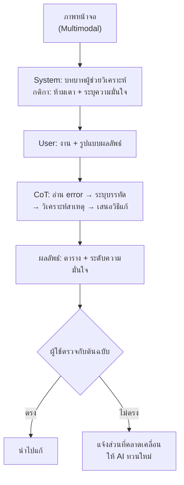

# บทที่ 5 — Chain-of-Thought, System Instruction และ Multimodal

*(Advanced Prompting: ให้โมเดล "คิดก่อนตอบ" · กำหนด "บุคลิกและกติกา" · และ "อ่านภาพ" ได้)*

> [!info] ข้อมูลบทเรียน
> | รายการ | รายละเอียด |
> | :--- | :--- |
> | รายวิชา | `21909-2009` การใช้งานแอปพลิเคชันปัญญาประดิษฐ์ |
> | หน่วยการเรียนรู้ | หน่วยที่ 3 — Prompt Engineering จากพื้นฐานถึงขั้นสูง |
> | สัปดาห์ / เวลา | สัปดาห์ที่ 4 · 4 ชั่วโมง (08.00–12.00 น.) |
> | กลุ่มเรียน / ห้อง | 3ชทค1 / TC203 |
> | ต่อจาก | [[บทที่ 4 - Prompt Engineering เบื้องต้น]] |
> | ผลงานในคาบ | **ใบงานที่ 4** — System Prompt สำหรับวิเคราะห์ภาพและโค้ด |

> [!abstract] เป้าหมายของบทนี้
> 1. อธิบายได้ว่า Chain-of-Thought (CoT) คืออะไร และทำไมจึงทำให้คำตอบแม่นขึ้น
> 2. เขียน zero-shot CoT และ few-shot CoT ได้
> 3. บอกได้ว่าเมื่อไร **ควร** และ **ไม่ควร** ใช้ CoT
> 4. แยกความต่างของ `system` / `user` / `assistant` ได้
> 5. เขียน System Prompt 6 องค์ประกอบได้
> 6. อธิบายได้ว่าโมเดล "เห็นภาพ" ได้อย่างไร และมีข้อจำกัดอะไร
> 7. รวมทั้งสามเทคนิคเป็น workflow เดียวได้

> [!note] ตำแหน่งของบทนี้ในเส้นเรื่องรายวิชา
> บทที่ 4 สอน **"พูดกับ AI อย่างไรให้ได้งาน"** (Role–Task–Context–Constraint–Format)
> บทนี้ต่อยอดเป็น **"ทำให้ AI คิดเป็นขั้นตอน อยู่ในกรอบ และรับข้อมูลได้หลายแบบ"**
> ซึ่งเป็นพื้นฐานของทุกอย่างหลังจากนี้ (Embedding → Agent → Harness)

---

## 1. ภาพรวม: จาก "สั่งงาน" สู่ "ควบคุมพฤติกรรม"

| ระดับ | เราควบคุมอะไร | เครื่องมือ | บท |
| :--: | :--- | :--- | :--: |
| 1 | คำตอบของงานเดียว | Prompt ธรรมดา | 4 |
| 2 | **วิธีคิด** ของโมเดล | Chain-of-Thought | 5 |
| 3 | **บุคลิกและกติกาทั้งบทสนทนา** | System Instruction | 5 |
| 4 | **ชนิดของข้อมูลเข้า** (ภาพ/เสียง/ไฟล์) | Multimodal | 5 |
| 5 | **ความจำและเครื่องมือภายนอก** | Context/RAG/Tools | 6+ |

> [!important] ประโยคเดียวที่ต้องจำ
> **Prompt = "งานที่สั่ง" · System = "สัญญาจ้าง" · CoT = "สั่งให้แสดงวิธีทำ" · Multimodal = "ให้ดูของจริงประกอบ"**

### 1.1 ทบทวน R-T-C-C-F จากบทที่ 4 (3 นาที)

| ตัวอักษร | หมายถึง | ตัวอย่าง |
| :--: | :--- | :--- |
| **R** | Role | "คุณเป็นวิศวกรซอฟต์แวร์อาวุโส" |
| **T** | Task | "ตรวจหา bug ในโค้ดนี้" |
| **C** | Context | "โปรเจกต์ Python 3.12 ใช้ในห้องปฏิบัติการ" |
| **C** | Constraint | "ห้ามเดา ถ้าไม่แน่ใจให้บอกว่าไม่แน่ใจ" |
| **F** | Format | "ตอบเป็นตาราง 3 คอลัมน์" |

---

## 2. Chain-of-Thought (CoT) — สอนให้ AI "คิดก่อนตอบ"

### 2.1 CoT คืออะไร

**Chain-of-Thought (ลูกโซ่ความคิด)** = การสั่งให้โมเดล **แสดงขั้นตอนการคิดทีละขั้น** ก่อนสรุปคำตอบ

```text
แบบปกติ:   โจทย์ → [คิดในหัว] → คำตอบ
แบบ CoT:   โจทย์ → ขั้นที่ 1 → ขั้นที่ 2 → ขั้นที่ 3 → คำตอบ
```

> [!note] ทำไมมันได้ผล
> โมเดลภาษาสร้างข้อความ **ทีละ token** และ token ที่สร้างไปแล้วกลายเป็นบริบทให้ token ถัดไป
> การเขียนขั้นตอนลงไป = **เพิ่ม "พื้นที่คิด" ให้โมเดล** ก่อนถึงบรรทัดสรุป
> งานที่ต้องใช้หลายขั้น (คำนวณ ตรรกะ ไล่โค้ด) จึงพลาดน้อยลงชัดเจน

### 2.2 เปรียบเทียบผลจริง: มี vs ไม่มี CoT

**โจทย์:** "ท่อ A เติมน้ำเต็มถังใน 6 ชั่วโมง ท่อ B ใช้ 4 ชั่วโมง ถ้าเปิดพร้อมกันจะเต็มถังในกี่ชั่วโมง"

| แบบ | คำตอบที่มักได้ | ถูก/ผิด |
| :--- | :--- | :--: |
| ไม่มี CoT | "10 ชั่วโมง" (เอา 6+4) หรือ "5 ชั่วโมง" (เฉลี่ย) | ❌ |
| มี CoT | "1/6 + 1/4 = 5/12 ของถังต่อชั่วโมง → 12/5 = **2.4 ชั่วโมง**" | ✅ |

> [!tip] สังเกตความต่าง
> โมเดลไม่ได้ "เก่งขึ้น" — มันแค่ **ไม่ถูกบังคับให้เดาคำตอบในบรรทัดแรก**
> คนเราก็เหมือนกัน: โจทย์ที่ต้องคิด ถ้าเขียนขั้นตอนก่อนตอบจะพลาดน้อยลง

### 2.3 Zero-shot CoT

เติมประโยคเดียวต่อท้ายโจทย์ ไม่ต้องยกตัวอย่าง

| ประโยค | ใช้เมื่อ |
| :--- | :--- |
| `คิดทีละขั้นตอน` | งานคำนวณทั่วไป |
| `Think step by step` | เหมือนกัน (ได้ผลกับโมเดลอังกฤษดีกว่าเล็กน้อย) |
| `แสดงวิธีคิดก่อนสรุปคำตอบ` | งานที่ต้องการตรวจสอบย้อนหลัง |
| `แยกเป็นข้อ ๆ แล้วค่อยสรุป` | งานวิเคราะห์หลายประเด็น |

```text
[ตัวอย่าง prompt]
ท่อ A เติมน้ำเต็มถังใน 6 ชั่วโมง ท่อ B ใช้ 4 ชั่วโมง
ถ้าเปิดพร้อมกันจะเต็มถังในกี่ชั่วโมง
ให้คิดทีละขั้นตอน แล้วจึงสรุปคำตอบสุดท้าย
```

**ผลลัพธ์ (ย่อ)**

```text
ขั้นที่ 1: ท่อ A เติมได้ 1/6 ของถังต่อชั่วโมง
ขั้นที่ 2: ท่อ B เติมได้ 1/4 ของถังต่อชั่วโมง
ขั้นที่ 3: รวมกัน = 1/6 + 1/4 = 2/12 + 3/12 = 5/12 ของถังต่อชั่วโมง
ขั้นที่ 4: เวลาที่ใช้ = 1 ÷ (5/12) = 12/5 = 2.4 ชั่วโมง
คำตอบสุดท้าย: 2.4 ชั่วโมง (2 ชั่วโมง 24 นาที)
```

### 2.4 Few-shot CoT

ให้ **ตัวอย่าง 1–2 ข้อ** ที่แสดงทั้งโจทย์ วิธีคิด และคำตอบ แล้วให้โมเดลทำข้อใหม่ตามแบบ

```text
ตัวอย่างที่ 1
โจทย์: ซื้อ SSD 2,000 บาท ลด 15% ต้องจ่ายเท่าไร
คิด: 2,000 × 15% = 300 → 2,000 − 300 = 1,700
ตอบ: 1,700 บาท

ตัวอย่างที่ 2
โจทย์: ซื้อ RAM 1,200 บาท ลด 10% ต้องจ่ายเท่าไร
คิด: 1,200 × 10% = 120 → 1,200 − 120 = 1,080
ตอบ: 1,080 บาท

งานจริง
โจทย์: ซื้อการ์ดจอ 9,500 บาท ลด 12% ต้องจ่ายเท่าไร
คิด:
ตอบ:
```

> [!important] ความต่างที่ต้องเข้าใจ
> **Zero-shot CoT** = สั่งให้คิด (บอกวิธีคิด)
> **Few-shot CoT** = **ทำให้ดู** ว่าคิดอย่างไร (ตัวอย่างพร้อม reasoning)
> ถ้างานมีรูปแบบเฉพาะ (เช่น คิดภาษีของร้าน) few-shot CoT ได้ผลกว่ามาก

### 2.5 เมื่อไรควร / ไม่ควรใช้ CoT

| ควรใช้ | ไม่ควรใช้ |
| :--- | :--- |
| โจทย์คำนวณหลายขั้น | ถามข้อเท็จจริงสั้น ๆ ("เมืองหลวงฝรั่งเศส") |
| ไล่ลำดับโค้ดหาบั๊ก | งานเขียนสร้างสรรค์ (กลอน/แคปชัน) |
| ตรรกะเงื่อนไขซับซ้อน | งานแปลสั้น ๆ |
| วิเคราะห์ trade-off หลายทาง | งานที่ต้องการคำตอบเร็วและสั้น |
| วางแผนงานเป็นขั้นตอน | งานที่รูปแบบผลลัพธ์สำคัญกว่าวิธีคิด |

> [!warning] ต้นทุนที่ต้องแลก
> CoT ทำให้ **คำตอบยาวขึ้น = ใช้ token มากขึ้น = ช้าลงและแพงขึ้น**
> ถ้าไม่ได้ต้องการวิธีคิด ให้ขอแค่คำตอบ และสั่งแยกส่วน "วิธีคิด" ไว้ในส่วนที่ซ่อนได้

### 2.6 CoT กับการโกหกอย่างสมเหตุสมผล

งานวิจัยพบว่าโมเดลสามารถ **แต่งเหตุผลที่ฟังดูดี** ให้คำตอบที่ผิดได้ — เรียกว่า unfaithful reasoning

| อาการ | ตัวอย่าง | วิธีป้องกัน |
| :--- | :--- | :--- |
| คำนวณถูกแต่หยิบตัวเลขผิด | ใช้ 15% แทน 12% | ให้ทวนค่าที่ใช้ก่อนคำนวณ |
| ข้ามขั้นแล้วสรุปเลย | ขั้น 1 → ขั้น 3 | สั่ง "ห้ามข้ามขั้น" |
| สรุปขัดกับเหตุผลของตัวเอง | คิดได้ 2.4 แต่ตอบ 3 | สั่ง "ตรวจคำตอบกับขั้นตอนก่อนสรุป" |

> [!tip] เทคนิคเสริม 3 ตัว
> **1. Self-consistency** — ถาม 3 ครั้ง (หรือ 3 แนวทาง) แล้วเลือกคำตอบที่ซ้ำกันมากที่สุด
> **2. Step-back** — ถามหลักการกว้าง ๆ ก่อน ("หลักการคำนวณงานรวมท่อคืออะไร") แล้วค่อยลงโจทย์
> **3. Decomposition** — แตกงานใหญ่เป็นข้อย่อย แล้วทำทีละข้อ

### 2.7 โมเดล "Reasoning" รุ่นใหม่

โมเดลบางรุ่น (เช่นตระกูล reasoning/o-series, Gemini ที่มี thinking mode) **คิดภายในก่อนตอบ** และอาจไม่แสดงขั้นตอนให้เห็น

| แบบ | ลักษณะ | ควรเขียน prompt อย่างไร |
| :--- | :--- | :--- |
| โมเดลทั่วไป | ต้องสั่ง "คิดทีละขั้น" | ใส่ CoT ทุกครั้งที่งานซับซ้อน |
| โมเดล reasoning | คิดเองอยู่แล้ว (อาจซ่อน) | ไม่ต้องสั่งซ้ำ แต่ควรสั่ง **รูปแบบคำตอบ** ให้ชัด |

> [!note] สังเกตง่าย ๆ
> ถ้าโมเดลใช้เวลาคิดนานขึ้นก่อนตอบ และคำตอบมีคุณภาพดีโดยไม่ต้องสั่ง CoT — นั่นคือ reasoning model

---

## 3. System Instruction — "สัญญาจ้าง" ที่มีผลทุกข้อความ

### 3.1 บทบาท 3 ระดับในบทสนทนา

| บทบาท | ใครกำหนด | มีผลแค่ไหน | ใช้ทำอะไร |
| :--- | :--- | :--- | :--- |
| `system` | ผู้พัฒนา/ผู้ตั้งค่า | **มีผลทั้งบทสนทนา** | บุคลิก กติกา ขอบเขต รูปแบบ |
| `user` | ผู้ใช้ | มีผลกับคำถามนั้น | งานที่ต้องการ |
| `assistant` | โมเดล | เป็นบริบทของคำตอบก่อนหน้า | ความต่อเนื่อง |

> [!important] ลำดับความสำคัญ
> โดยทั่วไป **system > user** — ถ้าผู้ใช้สั่งให้ทำสิ่งที่ system ห้ามไว้ โมเดลควรปฏิเสธ
> (ใน API บางค่ายเรียก role นี้ว่า `developer` — ความหมายเดียวกัน)

### 3.2 System Prompt ทำอะไรได้

| ด้าน | ตัวอย่างคำสั่ง |
| :--- | :--- |
| บุคลิก/บทบาท | "คุณคือติวเตอร์สอนเขียนโปรแกรมสำหรับนักศึกษาปวช." |
| เป้าหมาย | "ช่วยให้ผู้เรียนเข้าใจเอง ไม่ใช่ท่องจำ" |
| กลุ่มผู้ฟัง | "ผู้อ่านไม่มีความรู้เรื่องเทคนิค ใช้ภาษาง่าย" |
| กติกา | "ห้ามเดา ถ้าไม่แน่ใจให้บอกว่าไม่แน่ใจ" |
| รูปแบบผลลัพธ์ | "ตอบเป็นตาราง 3 คอลัมน์เสมอ" |
| ภาษา/โทน | "ตอบภาษาไทย ลงท้ายด้วยครับ สั้นกระชับ" |
| การปฏิเสธ | "ถ้าคำถามนอกขอบเขต ให้บอกว่าขอไม่ตอบและเสนอเรื่องที่ทำได้" |

### 3.3 System Prompt ที่ดีมี 6 องค์ประกอบ

```text
1) WHO   — คุณเป็นใคร
2) GOAL  — เป้าหมายสูงสุดคืออะไร
3) AUDIENCE — พูดกับใคร
4) RULES — กติกาที่ห้าม/ต้องทำ
5) FORMAT — รูปแบบผลลัพธ์
6) FALLBACK — ถ้าทำไม่ได้ให้ทำอะไร
```

### 3.4 ตัวอย่างที่ 1: ผู้ช่วยตรวจโค้ด

```text
[System]
WHO: คุณคือ senior software engineer ที่ตรวจโค้ด Python ของนักศึกษา
GOAL: หาข้อผิดพลาดและสอนให้ผู้เรียนแก้เองได้
AUDIENCE: นักศึกษาปวช.3 ที่เพิ่งเรียน Python 4 สัปดาห์
RULES:
- ห้ามแก้โค้ดให้ทั้งไฟล์ ให้ชี้จุดและอธิบายเหตุผล
- ถ้าโค้ดไม่ผิด ให้บอกว่าไม่ผิด อย่าแต่งข้อผิดพลาดขึ้นมา
- ระบุระดับความมั่นใจ (สูง/กลาง/ต่ำ) ทุกข้อ
FORMAT: ตาราง | บรรทัด | ปัญหา | เหตุผล | วิธีแก้ | ความมั่นใจ |
FALLBACK: ถ้าข้อมูลไม่พอ ให้ถามกลับ 1 คำถามก่อนตอบ
```

### 3.5 ตัวอย่างที่ 2: ผู้ช่วยติวเตอร์ (โหมดสอบ)

```text
[System]
คุณคือติวเตอร์ที่ห้ามบอกคำตอบตรง ๆ
ทุกครั้งที่ผู้เรียนถาม ให้:
1) ถามกลับเพื่อตรวจความเข้าใจ 1 ข้อ
2) ให้คำใบ้ 1 ระดับ
3) ให้ผู้เรียนลองตอบเองก่อน
ถ้าผู้เรียนตอบถูก ให้สรุปสั้น ๆ และชม 1 ประโยค
ถ้าตอบผิด 3 ครั้งติด ให้เฉลยพร้อมอธิบายทีละขั้น
```

> [!tip] System Prompt แบบ "โหมด" ใช้ร่วมกับคำสั่งลัด (preset) ของแอปได้
> เช่น สร้าง 3 โหมด: ติวเตอร์ / ผู้ตรวจโค้ด / ผู้สรุปเอกสาร แล้วสลับตามงาน

### 3.6 ทดสอบว่า System Prompt ทำงานจริง

| ทดสอบ | สิ่งที่ควรเกิด |
| :--- | :--- |
| ถามนอกขอบเขต | โมเดลปฏิเสธตาม FALLBACK |
| สั่งให้เปลี่ยนบุคลิก | โมเดลไม่เปลี่ยน (ยึด system) |
| ขอผลลัพธ์ผิดรูปแบบ | โมเดลยังคงรูปแบบเดิม |
| ให้ข้อมูลไม่ครบ | โมเดลถามกลับ ไม่เดา |

> [!warning] ถ้าเทสต์แล้วไม่ผ่าน
> สาเหตุที่พบบ่อย: (1) คำสั่งขัดกันเอง (2) เขียนยาวเกินจนโมเดลหลง (3) สั่งเป็น "ห้าม" อย่างเดียวโดยไม่บอกว่าต้องทำอะไรแทน

### 3.7 ข้อผิดพลาดที่พบบ่อย

| # | ปัญหา | ตัวอย่างที่ผิด | แก้เป็น |
| :--: | :--- | :--- | :--- |
| 1 | คำสั่งขัดกัน | "ตอบสั้นที่สุด" + "อธิบายละเอียดทุกข้อ" | เลือกอย่างเดียว หรือแยกตามสถานการณ์ |
| 2 | ยาวเกินจำเป็น | 20 บรรทัดสำหรับงานง่าย | เก็บเฉพาะกติกาที่จำเป็น |
| 3 | ห้ามอย่างเดียว | "ห้ามเดา" | "ถ้าไม่แน่ใจ ให้บอกว่าไม่แน่ใจและถามข้อมูลเพิ่ม" |
| 4 | ไม่มีรูปแบบผลลัพธ์ | "ตอบให้ดี ๆ" | "ตอบเป็นตาราง 3 คอลัมน์" |
| 5 | ไม่มี FALLBACK | โมเดลแต่งคำตอบเมื่อไม่มีข้อมูล | กำหนดทางออกชัดเจน |
| 6 | เปลี่ยน system กลางทาง | แก้ system ทุกครั้งที่คุย | ตั้งครั้งเดียว ล็อกไว้ |

---

## 4. Multimodal — ให้ AI รับข้อมูลได้มากกว่าข้อความ

### 4.1 Multimodal คืออะไร

**Multimodal** = โมเดลรับข้อมูลได้หลายรูปแบบในคำขอเดียว

| ชนิด | ตัวอย่าง | ใช้ทำงานอะไร |
| :--- | :--- | :--- |
| Text | ข้อความ ไฟล์ `.md` `.csv` | งานทั่วไป |
| Image | ภาพถ่าย ภาพหน้าจอ แผนภาพ | อ่าน error, วิเคราะห์ UI, อ่านกราฟ |
| Audio | เสียงพูด เสียง ambiente | ถอดเสียง, สรุปประชุม |
| Video | คลิป | สรุปเหตุการณ์, หาช่วงสำคัญ |
| Document | PDF, สไลด์ | สรุปเอกสาร, ดึงตาราง |

> [!note] ภาพถูก "อ่าน" อย่างไร
> ภาพถูกแบ่งเป็น **ชิ้นย่อย (patch)** แล้วแปลงเป็นตัวเลขคล้าย token
> โมเดลไม่ได้ "มองเห็น" เหมือนคน แต่จับความสัมพันธ์ของสี รูปทรง และตำแหน่ง
> ภาพละเอียด = ใช้ token มาก = ช้าลงและมีค่าใช้จ่ายสูงขึ้น

### 4.2 งานที่ multimodal ทำได้ดี

| งาน | ตัวอย่างจริง | หมายเหตุ |
| :--- | :--- | :--- |
| อ่านข้อความในภาพ (OCR) | ภาพหน้าจอ error, ป้าย, ใบเสร็จ | ตัวหนังสือชัด = แม่นมาก |
| อ่านกราฟ/ตาราง | กราฟผลการทดลอง, ตารางสเปก | ระบุแกน/คอลัมน์ให้ชัด |
| วิเคราะห์ UI | ภาพ mockup เว็บ/แอป | บอกสิ่งที่อยากให้วิจารณ์ |
| แปลงภาพเป็นโครงสร้าง | ภาพใบงาน → ตาราง Markdown | ขอเป็นตาราง/JSON |
| อ่านแผนภาพ/UML/วงจร | flowchart, ER diagram | ระบุสัญลักษณ์ที่กำกวม |
| ตรวจงานออกแบบ | ภาพโปสเตอร์/สไลด์ | ให้เกณฑ์ก่อนวิจารณ์ |

### 4.3 ข้อจำกัดที่ต้องรู้ (สำคัญมาก)

| ข้อจำกัด | อาการ | วิธีลดความเสี่ยง |
| :--- | :--- | :--- |
| อ่านตัวเลขเล็กผิด | 8 กับ 3, 1 กับ l | ขอให้ทวนตัวเลขทีละตัว |
| นับของไม่แม่น | "มี 12 ชิ้น" ทั้งที่มี 14 | แบ่งภาพเป็นส่วน ๆ แล้วนับทีละส่วน |
| แต่งรายละเอียด | บอกรุ่นอุปกรณ์ที่ไม่มีในภาพ | สั่ง "ระบุเฉพาะสิ่งที่เห็นชัด" |
| ภาพเบลอ/เอียง/มืด | อ่านไม่ครบ แต่ตอบเหมือนครบ | ให้บอกระดับความมั่นใจ |
| ข้อมูลอ่อนไหว | ภาพมีเลขบัตร/ใบหน้าเพื่อน | เบลอ/ครอปก่อนอัปโหลด |
| ข้อความยาวในภาพ | อ่านข้ามบรรทัด | ครอปเป็นส่วน ๆ ทีละโซน |

> [!danger] กฎความปลอดภัย
> อย่าอัปโหลดภาพที่มี **เลขบัตรประชาชน เบอร์โทร ที่อยู่ ใบหน้าเพื่อน** โดยไม่ได้รับอนุญาต
> และอย่าเชื่อตัวเลขที่โมเดลอ่านจากภาพโดยไม่ตรวจกับต้นฉบับ

### 4.4 เทคนิคเขียน prompt กับภาพ

| เทคนิค | ตัวอย่าง |
| :--- | :--- |
| **ระบุตำแหน่ง** | "โลโก้อยู่มุมซ้ายบน" / "ตารางอยู่ครึ่งล่างของภาพ" |
| **บอกสิ่งที่ต้องการ** | "หาสาเหตุของ error ในภาพนี้" ไม่ใช่ "ดูภาพนี้" |
| **ให้บริบท** | "ภาพนี้ถ่ายจากหน้าจอ Windows 11 ขณะรัน Python" |
| **กำหนดรูปแบบ** | "ตอบเป็นตาราง 3 คอลัมน์" หรือ "ตอบเป็น JSON" |
| **ขอความมั่นใจ** | "ทุกข้อให้ระบุ มั่นใจสูง/กลาง/ต่ำ" |
| **ห้ามเดา** | "ถ้าอ่านไม่ชัด ให้บอกว่าอ่านไม่ชัด อย่าเดา" |
| **แบ่งโซน** | "อ่านเฉพาะกรอบแดงทางขวา" |

### 4.5 ตัวอย่าง prompt วิเคราะห์ภาพหน้าจอ error

```text
[แนบภาพหน้าจอ]
คุณเป็นผู้ช่วยวิเคราะห์ข้อผิดพลาดของ Python
ในภาพคือหน้าจอขณะรันโปรแกรมใน VS Code

งานที่ต้องทำ:
1) อ่านข้อความ error ในภาพออกมาให้ครบทุกบรรทัด (ถ้าอ่านไม่ชัดให้บอก)
2) ระบุชนิด error และบรรทัดที่เกิดปัญหา
3) อธิบายสาเหตุที่เป็นไปได้ 2–3 ข้อ เรียงตามความน่าจะเป็น
4) ให้วิธีแก้ทีละขั้น
5) ระบุระดับความมั่นใจของแต่ละข้อ (สูง/กลาง/ต่ำ)

ห้ามเดาข้อความที่มองไม่เห็น ถ้าจำเป็นให้ถามกลับ
```

> [!note] หมายเหตุ
> ตัวอย่างนี้ใช้ได้กับทั้ง ChatGPT, Gemini และ Claude — ต่างกันแค่ปุ่มแนบไฟล์

### 4.6 ภาพแบบไหนให้ผลดีที่สุด

| ปัจจัย | ดี | ไม่ดี |
| :--- | :--- | :--- |
| ความคม | ตัวอักษรอ่านออก | เบลอ/สั่น |
| แสง | สว่างสม่ำเสมอ | ย้อนแสง/มืดครึ่งภาพ |
| การครอป | เน้นส่วนที่ต้องการ | ทั้งจอเล็กจนอ่านไม่ออก |
| ความตรง | ถ่ายตรงฉาก | เอียงมาก |
| ขนาด | ด้านยาว ~1,000 px ขึ้นไป | ต่ำกว่า 500 px |

---

## 5. รวมทั้งสามเทคนิค: workflow เดียว

### 5.1 สถานการณ์จริง

> นักศึกษาถ่ายภาพหน้าจอโปรแกรมที่พัง ส่งในกลุ่มไลน์ แล้วถามว่า "อาจารย์ครับ มัน error อะไร"

### 5.2 workflow 3 ชั้น



### 5.3 System Prompt ฉบับรวม (ใช้ซ้ำได้ทั้งเทอม)

```text
WHO: คุณคือผู้ช่วยวิเคราะห์ปัญหาคอมพิวเตอร์สำหรับนักศึกษาปวช.
GOAL: หาสาเหตุและวิธีแก้ โดยให้ผู้เรียนเข้าใจ ไม่ใช่แค่ copy คำตอบ
RULES:
- วิเคราะห์จากสิ่งที่เห็นในภาพ/โค้ดเท่านั้น ห้ามเดาสิ่งที่ไม่มี
- ทุกข้อสรุปต้องระบุความมั่นใจ (สูง/กลาง/ต่ำ)
- ถ้าข้อมูลไม่พอ ให้ถามกลับ 1 คำถามก่อนตอบ
- อธิบายศัพท์เทคนิคทุกคำที่นักศึกษาอาจไม่รู้
FORMAT:
1) สรุปปัญหา 2 บรรทัด
2) ตาราง: | ลำดับ | สาเหตุที่เป็นไปได้ | หลักฐานจากภาพ | วิธีตรวจสอบ | ความมั่นใจ |
3) ขั้นตอนแก้ทีละข้อ
4) สิ่งที่ควรระวัง
FALLBACK: ถ้าอ่านภาพไม่ชัด ให้บอกว่าส่วนใดไม่ชัด และขอภาพเพิ่ม
```

> [!tip] เก็บ prompt นี้ไว้ใช้ต่อ
> สัปดาห์ที่ 8–9 (OpenCode / Agent) จะนำ system prompt แบบนี้ไปใช้เป็น "บุคลิกของ agent"

---

## 6. ใบงานที่ 4 — System Prompt วิเคราะห์ภาพและโค้ด (20 คะแนน)

> [!question] โจทย์
> ให้นักศึกษาเขียน **System Prompt 1 ชุด** ที่ใช้ได้กับ **2 ภารกิจ** ต่อไปนี้
>
> **ภารกิจ A — วิเคราะห์ภาพ**
> แนบภาพหน้าจอ error หรือภาพแผนภาพ/ตาราง แล้วให้ AI
> 1. อ่านข้อความในภาพทั้งหมด
> 2. ระบุสาเหตุที่เป็นไปได้ 2–3 ข้อ พร้อมหลักฐานจากภาพ
> 3. เสนอวิธีแก้ทีละขั้น
> 4. ระบุระดับความมั่นใจทุกข้อ
>
> **ภารกิจ B — วิเคราะห์โค้ด**
> วางโค้ด Python (10–30 บรรทัด ที่มี bug 1 จุด) แล้วให้ AI
> 1. หาบรรทัดที่ผิด
> 2. อธิบายว่าผิดเพราะอะไร (อ้างอิงหลักภาษา)
> 3. เสนอวิธีแก้ 2 ทางที่ต่างกัน
> 4. ระบุว่าจะทดสอบอย่างไรว่าหายแล้ว
>
> **เงื่อนไขบังคับ**
> - System Prompt ต้องมีครบ 6 องค์ประกอบ (WHO/GOAL/AUDIENCE/RULES/FORMAT/FALLBACK)
> - ต้องสั่งให้ใช้ **CoT** ในภารกิจ B
> - ต้องมีกฎ "ห้ามเดา" และ "ระบุความมั่นใจ"
> - ต้องกำหนดรูปแบบผลลัพธ์เป็นตาราง
> - ส่งผลรันจริง 2 ภาพ (screenshot) แนบกับ prompt

| หัวข้อ | คะแนน | เกณฑ์ |
| :--- | :--: | :--- |
| ครบ 6 องค์ประกอบ | 5 | ครบและสอดคล้องกัน ไม่ขัดแย้ง |
| คุณภาพกฎ (Rules) | 4 | เฉพาะเจาะจง วัดผลได้ ไม่กำกวม |
| รูปแบบผลลัพธ์ | 3 | ตารางชัดเจน ใช้ได้จริงทั้ง 2 ภารกิจ |
| การใช้ CoT | 3 | สั่งให้คิดเป็นขั้นและตรวจคำตอบก่อนสรุป |
| ผลรันจริง | 3 | ภาพหน้าจอครบ 2 ภารกิจ ผลตรงตามรูปแบบ |
| ภาษา/ความเรียบร้อย | 2 | ภาษาไทยถูกต้อง ไม่มีคำสั่งขัดกัน |

> [!todo] กำหนดส่ง
> ส่งในคาบ (ท้ายชั่วโมงที่ 4) — ไฟล์ `.md` หรือ `.txt` + ภาพหน้าจอ 2 ภาพ

---

## 7. ข้อผิดพลาดและความเข้าใจผิดที่พบบ่อย

| # | ความเข้าใจผิด | ที่ถูก |
| :--: | :--- | :--- |
| 1 | "CoT ทำให้โมเดลฉลาดขึ้น" | ทำให้โมเดลมีพื้นที่คิดก่อนตอบ ไม่ได้เพิ่มความรู้ |
| 2 | "ยิ่งสั่งยาวยิ่งดี" | คำสั่งยาวเกินทำให้กติกาขัดกันและหลงประเด็น |
| 3 | "System Prompt เขียนครั้งเดียวใช้ได้ทุกงาน" | ควรแยกชุดตามงาน แต่ล็อกไว้ตลอดบทสนทนา |
| 4 | "AI อ่านภาพได้ทุกอย่าง" | อ่านตัวเลขเล็ก/นับของ/ภาพเบลอ ยังพลาดได้ |
| 5 | "CoT ทำให้คำตอบถูกเสมอ" | CoT ที่ผิดเหตุผลก็ได้คำตอบผิด (แต่ดูน่าเชื่อกว่าเดิม) |
| 6 | "ใส่ reasoning ไว้ในผลลัพธ์ตลอด" | ถ้าไม่ต้องการ ให้ขอแยกส่วน "วิธีคิด" ออกหรือซ่อน |
| 7 | "System Prompt กันการถูกหลอกได้ 100%" | ยังมี prompt injection — ต้องออกแบบ FALLBACK |

---

## 8. แผนการสอน 4 ชั่วโมง

| เวลา | นาที | กิจกรรม | สื่อ/ผลลัพธ์ |
| :--- | :--: | :--- | :--- |
| 08.00–08.10 | 10 | ทบทวน R-T-C-C-F + จุดประสงค์ | คำถามปากเปล่า |
| 08.10–08.40 | 30 | CoT: หลักการ + เปรียบเทียบมี/ไม่มี | ตัวอย่างท่อน้ำ + กระดาน |
| 08.40–09.20 | 40 | ฝึก zero-shot / few-shot CoT | เครื่องคอมพิวเตอร์ |
| 09.20–09.30 | 10 | พัก | — |
| 09.30–10.10 | 40 | System Instruction 6 องค์ประกอบ | สไลด์ + ตัวอย่าง 2 ชุด |
| 10.10–10.40 | 30 | ทดสอบ system prompt (4 test cases) | ผลรันจริง |
| 10.40–11.20 | 40 | Multimodal: วิเคราะห์ภาพ + ข้อจำกัด | ภาพตัวอย่าง 3 ภาพ |
| 11.20–11.50 | 30 | ใบงานที่ 4 | ส่งในคาบ |
| 11.50–12.00 | 10 | สรุป + ปูทางสัปดาห์หน้า (Embedding) | — |

### 8.1 ภาพตัวอย่างที่ควรเตรียมไว้ 3 ภาพ

| ภาพ | ใช้สอนเรื่อง |
| :--- | :--- |
| หน้าจอ Python error (ตัวหนังสือชัด) | OCR + วิเคราะห์สาเหตุ |
| ภาพเบลอ/เอียง/มุมเดียว | ข้อจำกัด + การขอความมั่นใจ |
| ภาพ UI หรือโปสเตอร์ | วิเคราะห์เชิงออกแบบ + ให้เกณฑ์ |

---

## 9. คำถามทบทวน + เฉลย

1. CoT คืออะไร และทำไมจึงช่วยให้คำตอบแม่นขึ้น
2. Zero-shot CoT กับ few-shot CoT ต่างกันอย่างไร
3. งาน 4 ประเภทที่ไม่ควรใช้ CoT
4. `system` / `user` / `assistant` ต่างกันอย่างไร
5. System Prompt ที่ดีมี 6 องค์ประกอบอะไรบ้าง
6. ทำไมต้องมี FALLBACK
7. Multimodal หมายถึงอะไร และภาพถูกประมวลผลอย่างไร (อธิบายสั้น)
8. ข้อจำกัด 3 ข้อของ AI อ่านภาพ และวิธีลดความเสี่ยง
9. ถ้า AI อ่านตัวเลขในภาพผิด ควรทำอย่างไร

> [!success]- เฉลย
> 1. สั่งให้แสดงขั้นตอนคิดก่อนตอบ ทำให้มีบริบทเพิ่มขึ้นก่อนสรุป งานหลายขั้นจึงพลาดน้อยลง
> 2. Zero-shot แค่สั่ง "คิดทีละขั้น" · Few-shot ให้ตัวอย่างที่แสดงวิธีคิดด้วย
> 3. ถามข้อเท็จจริงสั้น ๆ · งานสร้างสรรค์ · แปลสั้น ๆ · งานที่ต้องการแค่ผลลัพธ์เร็ว
> 4. system = กติกาทั้งบทสนทนา · user = คำถาม · assistant = คำตอบก่อนหน้า
> 5. WHO · GOAL · AUDIENCE · RULES · FORMAT · FALLBACK
> 6. เพื่อให้โมเดลมีทางออกที่ถูกต้องเมื่อทำตามคำสั่งหลักไม่ได้ (แทนการเดา)
> 7. รับข้อมูลได้หลายชนิด (ข้อความ/ภาพ/เสียง/วิดีโอ) · ภาพถูกแบ่งเป็น patch แล้วแปลงเป็นตัวเลขคล้าย token
> 8. ตัวเลขเล็กผิด · นับของไม่แม่น · แต่งรายละเอียด → ลดด้วยการขอความมั่นใจ ครอปเป็นโซน และห้ามเดา
> 9. ครอปเฉพาะส่วนตัวเลขแล้วถามซ้ำ / ให้ทวนทีละตัว / ตรวจกับต้นฉบับก่อนใช้ผล

---

## 10. สรุป

| หัวข้อ | จำสั้น ๆ |
| :--- | :--- |
| CoT | ให้คิดเป็นขั้นก่อนสรุป — เพิ่มความแม่นในงานหลายขั้น |
| Zero-shot CoT | "คิดทีละขั้น" |
| Few-shot CoT | ให้ตัวอย่างพร้อมวิธีคิด |
| ต้นทุน CoT | token มากขึ้น ช้าลง |
| unfaithful reasoning | เหตุผลดูดีแต่คำตอบผิด → ต้องตรวจ |
| System | กติกาทั้งบทสนทนา มีผลเหนือ user |
| 6 องค์ประกอบ | WHO · GOAL · AUDIENCE · RULES · FORMAT · FALLBACK |
| Multimodal | รับภาพ/เสียง/วิดีโอ ภาพ→patch→token |
| ข้อจำกัดภาพ | ตัวเลขเล็ก · นับของ · แต่งรายละเอียด |
| หลักความปลอดภัย | ห้ามเดา · ระบุความมั่นใจ · ตรวจกับต้นฉบับ |

---

## 11. ก้าวต่อไป

> [!tip] สัปดาห์ที่ 5 — Embedding และ Semantic Search
> * ข้อความ → เวกเตอร์ (ตัวเลขหลายร้อยมิติ)
> * วัดความคล้ายด้วย cosine similarity
> * ค้นหาด้วย "ความหมาย" ไม่ใช่ "คำตรงตัว"
> * ปูทางไปสู่ RAG (ค้นเอกสารแล้วตอบ)
> * **ใบงานที่ 5**: สร้างระบบค้นหาความคล้ายคลึงของข้อความ

---

## 12. เอกสารอ้างอิง

- Wei, J. et al. (2022). *Chain-of-Thought Prompting Elicits Reasoning in Large Language Models*.
- Kojima, T. et al. (2022). *Large Language Models are Zero-Shot Reasoners*.
- Wang, X. et al. (2022). *Self-Consistency Improves Chain of Thought Reasoning*.
- OpenAI. *Prompt Engineering Guide — Message Roles & Reasoning Models*.
- Google. *Gemini API — Multimodal Prompting*.
- Anthropic. *Claude Prompt Engineering — System Prompts*.

---

## โน้ตที่เกี่ยวข้อง

- [[บทที่ 4 - Prompt Engineering เบื้องต้น]] — บทก่อน (R-T-C-C-F, zero/few-shot)
- [[การเปรียบเทียบโมเดล AI]] — ความต่างของโมเดลแต่ละค่าย
- [[การใช้ LLM พื้นฐาน]] — token และ context window
- [[เตรียมสอน สัปดาห์ที่ 4 - 21909-2009 การใช้งานแอปพลิเคชันปัญญาประดิษฐ์]] — แผนสอนคาบนี้
- [[21909-2009 การใช้งานแอปพลิเคชันปัญญาประดิษฐ์]] — ข้อมูลรายวิชา
