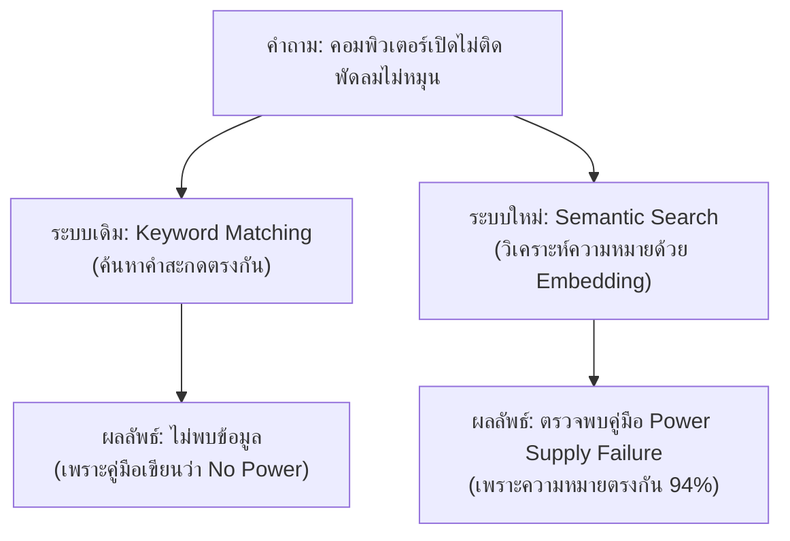
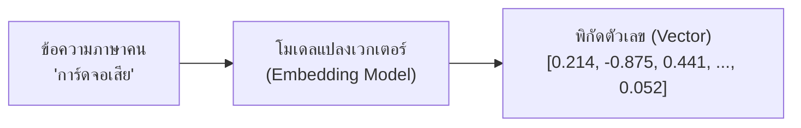
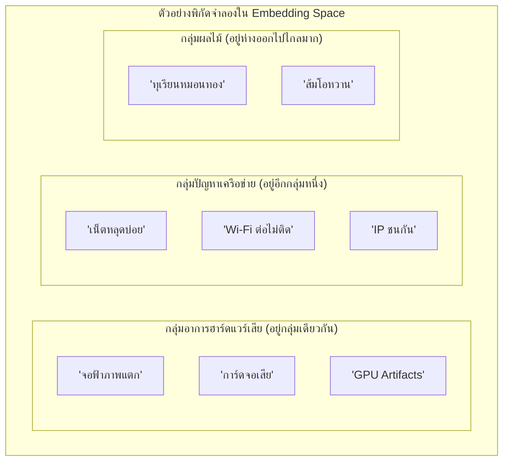
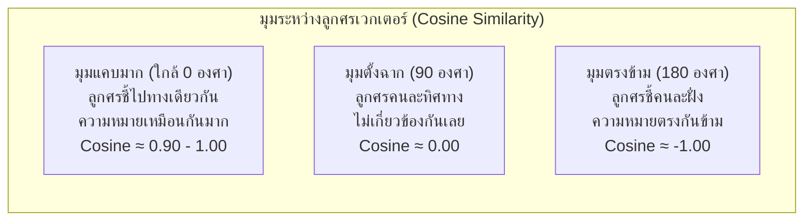
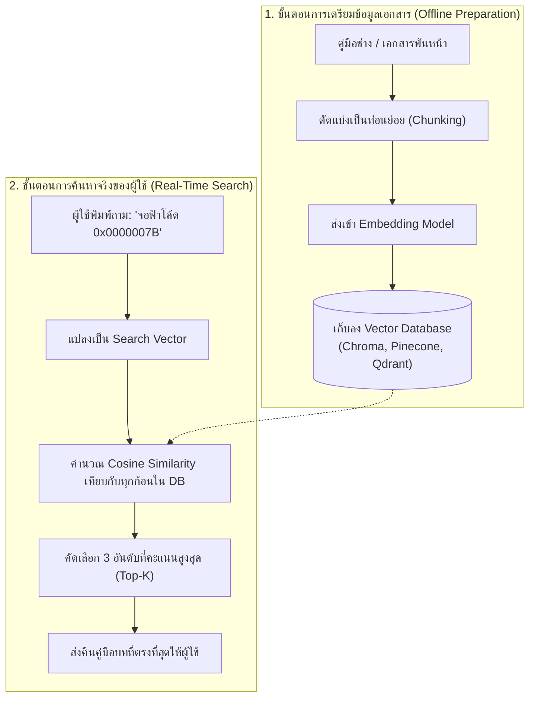

# บทที่ 6 — โมเดลเวกเตอร์และการฝังข้อความ (Embedding Models และ Semantic Search)

*(Vector Representation: เมื่อข้อความกลายเป็นพิกัดทางคณิตศาสตร์ -> การค้นหาด้วยความหมาย -> รากฐานของระบบ RAG)*

> [!NOTE]
> **ข้อมูลบทเรียนประจำสัปดาห์**
>
> | รายการ | รายละเอียด |
> | :--- | :--- |
> | รายวิชา | `21909-2009` การใช้งานแอปพลิเคชันปัญญาประดิษฐ์ |
> | ระดับชั้น | ประกาศนียบัตรวิชาชีพ (ปวช.) ชั้นปีที่ 3 สาขาวิชาช่างเทคนิคคอมพิวเตอร์ |
> | หน่วยการเรียนรู้ | หน่วยที่ 4 — โมเดลเวกเตอร์และการฝังข้อความ (Embedding Models & Semantic Search) |
> | สัปดาห์ / เวลา | สัปดาห์ที่ 6 (ภาคเรียนที่ 2/2569) เวลา 4 ชั่วโมง (08.00–12.00 น.) |
> | กลุ่มเรียน / ห้อง | 3ชทค1 / TC203 |
> | ต่อจาก | [[บทที่ 5 - Chain-of-Thought System Instruction และ Multimodal]] (การคุมพฤติกรรมโมเดล) |
> | ปูทางสู่ | สัปดาห์ที่ 7: ระบบ RAG ค้นหาคู่มือช่างเทคนิค และสัปดาห์ที่ 8: เครื่องมือ OpenCode |
> | ผลงานในคาบ | **ใบงานที่ 5** — ทดลองสร้างระบบค้นหาอาการเสียคอมพิวเตอร์ด้วย Vector Similarity (20 คะแนน) |

> [!IMPORTANT]
> **เป้าหมายการเรียนรู้ประจำบท**
> เมื่อเรียนจบบทนี้แล้ว นักศึกษาสามารถ:
> 1. อธิบายได้ว่าทำไมคอมพิวเตอร์จึงไม่เข้าใจตัวอักษรโดยตรง และทำไมต้องแปลงข้อความเป็นตัวเลข (Vector)
> 2. อธิบายความแตกต่างระหว่างการค้นหาด้วยคำสำคัญ (Keyword Search) กับการค้นหาเชิงความหมาย (Semantic Search) ได้
> 3. อธิบายแนวคิดเรื่อง "พิกัดในอวกาศหลายมิติ" (Embedding Space) และความสัมพันธ์ของคำที่มีความหมายใกล้เคียงกันได้
> 4. เข้าใจหลักการวัดระยะห่างและความคล้ายคลึงด้วย **Cosine Similarity** และสามารถอ่านค่าคะแนน 0.0 ถึง 1.0 ได้อย่างถูกต้อง
> 5. อธิบายสถาปัตยกรรมการทำงานของระบบ Semantic Search ตั้งแต่ข้อความนำเข้าจนถึงการดึงข้อมูลที่ตรงที่สุด
> 6. เข้าใจบทบาทของ Embedding ในฐานะ "สมองส่วนความจำและสืบค้น" ของระบบ **RAG (Retrieval-Augmented Generation)**

---

## 1. ปัญหาของการค้นหาแบบเดิม: ทำไมคอมพิวเตอร์ถึง "ตาบอดต่อความหมาย"?

### 1.1 การค้นหาแบบดั้งเดิม (Keyword Matching / Ctrl+F)

ตั้งแต่ยุคแรกของคอมพิวเตอร์ จนถึงคำสั่ง `Ctrl + F` ในโปรแกรม Word หรือการเขียนคำสั่ง `WHERE title LIKE '%จอฟ้า%'` ในฐานข้อมูล SQL คอมพิวเตอร์ใช้เทคนิคที่เรียกว่า **Lexical Search (การจับคู่ตัวอักษรตรงตัว)**

หลักการคือ: **"ถ้าตัวสะกดตรงกัน แปลว่าเจอ ถ้าตัวสะกดต่างกันแม้แต่ตัวเดียว แปลว่าไม่เจอ"**

ลองดูตัวอย่างที่เกิดขึ้นจริงในงานซ่อมคอมพิวเตอร์:

| สิ่งที่ลูกค้าพิมพ์ค้นหา | สิ่งที่บันทึกอยู่ในคู่มือซ่อม | ผลการค้นหาแบบเดิม (Keyword / Ctrl+F) | ทำไมถึงเป็นแบบนั้น? |
| :--- | :--- | :---: | :--- |
| `คอมเปิดไม่ติด` | `เครื่องบูตไม่ขึ้นเนื่องจากพาวเวอร์ซัพพลายเสีย` | **ไม่พบผลลัพธ์ (0 รายการ)** | ตัวสะกดไม่ตรงกันเลยแม้แต่คำเดียว |
| `จอฟ้า` | `อาการ Blue Screen of Death (BSOD)` | **ไม่พบผลลัพธ์ (0 รายการ)** | ภาษาไทยกับภาษาอังกฤษ สะกดไม่เหมือนกัน |
| `แรมเสีย` | `Memory Module Contact Error` | **ไม่พบผลลัพธ์ (0 รายการ)** | คำศัพท์ช่างต่างจากภาษาทางการ |
| `ไวรัสกินแฟลชไดรฟ์` | `มัลแวร์ซ่อนไฟล์ในอุปกรณ์ USB Storage` | **ไม่พบผลลัพธ์ (0 รายการ)** | ใช้คำคนละระดับภาษา |

> [!WARNING]
> **จุดอ่อนร้ายแรงของการค้นหาแบบจับคู่คำ (Keyword Search):**
> 1. **คำพ้องความหมาย (Synonyms):** คำที่มีความหมายเหมือนกันแต่เขียนคนละแบบ คอมพิวเตอร์มองเป็นคนละเรื่อง เช่น "แล็ปท็อป" กับ "โน้ตบุ๊ก", "จอภาพ" กับ "มอนิเตอร์"
> 2. **คำพ้องรูป (Polysemy):** คำที่เขียนเหมือนกันแต่ความหมายคนละเรื่อง เช่น "หนูแทะสายไฟ" (สัตว์) กับ "เมาส์เสีย" (อุปกรณ์คอมพิวเตอร์) ระบบเดิมแยกไม่ออก
> 3. **การสะกดผิดเล็กน้อย (Typo):** พิมพ์ "วินโดวส์" ตกตัวการันต์ หรือพิมพ์ "Window" ขาดตัว s ระบบก็หาไฟล์ไม่เจอแล้ว

---

### 1.2 การค้นหาเชิงความหมาย (Semantic Search) คืออะไร?

มนุษย์เราเวลาได้ยินคนพูดว่า *"เครื่องเปิดไม่ขึ้น"* กับ *"คอมไฟไม่เข้า"* สมองของเราจะรู้ทันทีว่า **"สองประโยคนี้มีความหมายแทบจะเหมือนกัน"** แม้ตัวสะกดจะไม่มีอะไรเหมือนกันเลยก็ตาม

ความสามารถในการเข้าใจความหมายโดยไม่ยึดติดกับตัวอักษรนี้ เรียกว่า **Semantic Understanding (ความเข้าใจเชิงความหมาย)**

และระบบค้นหาที่สามารถจับคู่ข้อมูลโดยดูจาก **"ความหมายของประโยค"** แทนที่จะดูแค่ตัวสะกด เรียกว่า **Semantic Search (การค้นหาเชิงความหมาย)**



คำถามสำคัญคือ: **คอมพิวเตอร์ทำสิ่งนี้ได้อย่างไร? ทั้งที่ข้างในชิปประมวลผลมีแค่เลข 0 กับ 1?**

คำตอบคือหัวใจของบทเรียนนี้: **Vector Embedding**

---

## 2. Vector Embedding คืออะไร: แปลงข้อความเป็น "พิกัดความหมาย"

### 2.1 หลักการพื้นฐาน: คอมพิวเตอร์ไม่เข้าใจภาษา แต่เข้าใจตัวเลข

คอมพิวเตอร์ไม่รู้ว่าคำว่า "รัก", "คอมพิวเตอร์", "ไฟไหม้", "ซีพียู" แปลว่าอะไร
แต่นักวิทยาศาสตร์ปัญญาประดิษฐ์ค้นพบวิธีอันชาญฉลาด นั่นคือ:

> **"จับข้อความทุกข้อความ แปลงให้กลายเป็น 'ชุดตัวเลขพิกัด (Vector)' แล้วนำไปปักหมุดลงในแผนที่จำลองขนาดมหึมา"**

กระบวนการนำข้อความ (ตัวอักษร) มาผ่านโมเดลปัญญาประดิษฐ์ชนิดพิเศษ แล้วได้ผลลัพธ์ออกมาเป็นชุดตัวเลขพิกัด เรียกว่า **Vector Embedding (การฝังข้อความในรูปเวกเตอร์)**



---

### 2.2 อุปมาเปรียบเทียบในชีวิตจริง: แผนที่ GPS ของความหมาย

ลองนึกถึงระบบนำทาง **GPS บนสมาร์ตโฟน**:
* ถ้าเราบอกว่า พิกัด กทม. คือ ละติจูด 13.75, ลองจิจูด 100.50
* พิกัด เมืองนนทบุรี คือ ละติจูด 13.86, ลองจิจูด 100.51
* พิกัด กรุงลอนดอน คือ ละติจูด 51.50, ลองจิจูด -0.12

เพียงแค่เราเอาตัวเลขพิกัดมาลบกัน คอมพิวเตอร์ก็คำนวณได้ทันทีว่า **กทม. อยู่ใกล้เมืองนนทบุรีมาก และอยู่ห่างจากลอนดอนคนละทวีป** ทั้งที่คอมพิวเตอร์ไม่เคยเดินทางไปประเทศอังกฤษเลย!

**Embedding Model ทำสิ่งเดียวกันเป๊ะกับ "คำศัพท์และประโยค":**
* มันสร้างแผนที่ขึ้นมาแผนที่หนึ่ง เรียกว่า **Embedding Space (อวกาศความหมาย)**
* คำที่มีความหมายใกล้เคียงกัน จะถูกวางไว้ **ใกล้กัน**
* คำที่มีความหมายตรงข้ามกัน หรือไม่เกี่ยวข้องกัน จะถูกวางไว้ **ห่างกันลิบโลก**



---

### 2.3 "มิติ" ของเวกเตอร์คืออะไร? (Dimensions)

ในแผนที่โลก เราใช้ **2 มิติ** (ละติจูด, ลองจิจูด) หรือถ้ามีภูเขาด้วยก็เป็น **3 มิติ** (กว้าง, ยาว, สูง)

แต่ความหมายของภาษาคนซับซ้อนกว่าแผนที่บนผิวโลกมาก เช่น:
* คำนี้เกี่ยวกับคอมพิวเตอร์ไหม? (มิติที่ 1)
* คำนี้เป็นอาการเสียทางฮาร์ดแวร์หรือซอฟต์แวร์? (มิติที่ 2)
* คำนี้เป็นอารมณ์โกรธหรือดีใจ? (มิติที่ 3)
* คำนี้เกี่ยวกับเงินและราคาไหม? (มิติที่ 4)
* คำนี้เป็นคำถามหรือคำตอบ? (มิติที่ 5)

โมเดล Embedding ยุคใหม่จึงไม่ได้ใช้แค่ 2 หรือ 3 มิติ แต่ใช้ถึง **768 มิติ, 1,536 มิติ หรือ 3,072 มิติ!**

> [!NOTE]
> **ขนาดมิติ (Dimensions) ของโมเดลชื่อดังในปัจจุบัน:**
> * `text-embedding-3-small` (OpenAI): **1,536 มิติ** (เป็นอาเรย์ตัวเลขทศนิยม 1,536 ตัวเรียงกัน)
> * `text-embedding-004` (Google Gemini): **768 มิติ**
> * `bge-m3` (Open-Source ยอดนิยมสำหรับภาษาไทย): **1,024 มิติ**

ตัวอย่างหน้าตาจริงของ Vector ที่ได้จากประโยคว่า *"คอมพิวเตอร์เปิดไม่ติด"*:
```text
[ 0.0241, -0.0512, 0.1384, 0.0092, -0.2104, 0.0841, 0.3129, ... รวมทั้งหมด 768 ตัวเลข ]
```
ตัวเลขชุดนี้แหละคือ **"ดีเอ็นเอทางความหมาย"** ของประโยคนั้น!

---

### 2.4 ปรากฏการณ์มหัศจรรย์: การบวกลบคำด้วยคณิตศาสตร์ (Vector Arithmetic)

เมื่อภาษาถูกแปลงเป็นเวกเตอร์ ความสัมพันธ์ของคำจะกลายเป็นสูตรคณิตศาสตร์ที่บวกลบได้จริง!

การทดลองที่โด่งดังที่สุดในประวัติศาสตร์ AI คือ:
$$\vec{V}_{\text{King}} - \vec{V}_{\text{Man}} + \vec{V}_{\text{Woman}} \approx \vec{V}_{\text{Queen}}$$
*(เอาเวกเตอร์คำว่า "พระราชา" ลบคุณลักษณะของ "เพศชาย" ออก แล้วบวกคุณลักษณะของ "เพศหญิง" เข้าไป เวกเตอร์ที่ได้จะไปตกใกล้กับคำว่า "พระราชินี" ทันที!)*

ถ้าเป็นในสายงานช่างเทคนิคคอมพิวเตอร์:
$$\vec{V}_{\text{Windows}} - \vec{V}_{\text{Microsoft}} + \vec{V}_{\text{Apple}} \approx \vec{V}_{\text{macOS}}$$
$$\vec{V}_{\text{Core i7}} - \vec{V}_{\text{Intel}} + \vec{V}_{\text{AMD}} \approx \vec{V}_{\text{Ryzen 7}}$$

นี่คือสิ่งยืนยันว่า **ปัญญาประดิษฐ์ไม่ได้จำแค่ตัวอักษร แต่มันเข้าใจโครงสร้างความสัมพันธ์ของแนวคิดอย่างแท้จริง**

---

## 3. การวัดความใกล้เคียง: Cosine Similarity ทำงานอย่างไร?

เมื่อเรามีเวกเตอร์ของประโยค 2 ประโยค คำถามคือ **"เราจะรู้ได้อย่างไรว่า 2 ประโยคนี้ความหมายใกล้กันแค่ไหน?"**

ในทางเรขาคณิต เวกเตอร์คือ **ลูกศรที่พุ่งออกจากจุดกำเนิด (0, 0)**:



### 3.1 นิยามของ Cosine Similarity

**Cosine Similarity (ความคล้ายคลึงเชิงโคไซน์)** คือการวัด **"มุม"** ระหว่างลูกศรเวกเตอร์ 2 อัน โดยไม่สนใจความยาวของลูกศร:

$$\text{Cosine Similarity} = \cos(\theta) = \frac{\vec{A} \cdot \vec{B}}{\|\vec{A}\| \|\vec{B}\|}$$

> [!TIP]
> **เกณฑ์การอ่านคะแนน Cosine Similarity แบบช่างคอม (จำง่าย ใช้งานได้ทันที):**
> * **0.90 – 1.00:** ความหมายแทบจะเหมือนกันทุกประการ (เช่น *"คอมเปิดไม่ติด"* กับ *"เครื่องเปิดไม่ขึ้น"*)
> * **0.75 – 0.89:** ความหมายไปในทิศทางเดียวกัน เกี่ยวข้องกันอย่างใกล้ชิด (เช่น *"คอมเปิดไม่ติด"* กับ *"พาวเวอร์ซัพพลายพัง"*)
> * **0.50 – 0.74:** มีความเกี่ยวข้องในระดับหมวดหมู่กว้างๆ (เช่น *"คอมเปิดไม่ติด"* กับ *"ติดตั้งโปรแกรม Office"*)
> * **0.00 – 0.49:** ไม่เกี่ยวข้องกันเลยคนละเรื่อง (เช่น *"คอมเปิดไม่ติด"* กับ *"สูตรทำต้มยำกุ้ง"*)

---

### 3.2 ตารางตัวอย่างทดสอบจริง: เปรียบเทียบอาการเสียคอมพิวเตอร์

สมมุติต้นฉบับคือประโยคอ้างอิง: **"เครื่องคอมพิวเตอร์เปิดไม่ติด พัดลมไม่หมุน"**

| ประโยคที่นำมาเทียบ | ผลการวิเคราะห์ของมนุษย์ | คะแนน Cosine Similarity | การตัดสินของ Semantic Search |
| :--- | :--- | :---: | :---: |
| `ไฟไม่เข้าเครื่อง กดปุ่ม Power แล้วนิ่ง` | ความหมายเดียวกันเป๊ะ แค่ใช้คำคนละแบบ | **0.93** | **ตรงกันอย่างยิ่ง (Match สูงสุด)** |
| `พาวเวอร์ซัพพลายเสีย จ่ายไฟไม่ได้` | สาเหตุตรงกัน เกี่ยวข้องกันสูง | **0.84** | **เกี่ยวข้องอย่างมาก** |
| `หน้าจอดำสนิท แต่มีเสียงพัดลมทำงาน` | เป็นอาการเปิดติดแต่ไม่ขึ้นภาพ (ต่างจากเคสแรก) | **0.68** | **เกี่ยวข้องปานกลาง** |
| `ติดตั้ง Windows 11 ผ่านแฟลชไดรฟ์` | เรื่องซอฟต์แวร์ คนละเรื่องกับการเปิดไม่ติด | **0.29** | **ไม่เกี่ยวข้อง** |
| `วันนี้อากาศร้อนมากอยากกินชานมไข่มุก` | คนละเรื่อง 100% | **0.05** | **ตัดทิ้งทันที** |

เห็นได้ชัดว่า **เราสามารถเขียนโค้ดตั้งเงื่อนไข เช่น `if similarity > 0.80:`** เพื่อดึงคู่มือซ่อมที่ตรงประเด็นมาแสดงให้ช่างได้ทันที โดยไม่ต้องกลัวปัญหาเรื่องคำสะกดผิดหรือคำพ้องรูปอีกต่อไป!

---

## 4. สถาปัตยกรรมระบบ Semantic Search (สืบค้นเชิงความหมาย)

เมื่อนำแนวคิด Embedding มาร้อยเรียงเป็นระบบจริง สถาปัตยกรรมจะแบ่งออกเป็น 2 ช่วงเวลาหลัก:



### คำศัพท์เทคนิคที่ช่างคอมต้องรู้ในสถาปัตยกรรมนี้:
1. **Chunking (การตัดแบ่งก้อนข้อมูล):** การนำเอกสารเล่มหนาๆ มาหั่นออกเป็นท่อนย่อยๆ ท่อนละ 200–500 คำ เพื่อให้แต่ละท่อนมีใจความที่กระชับและแปลงเป็นเวกเตอร์ได้แม่นยำ
2. **Vector Database (ฐานข้อมูลเวกเตอร์):** ฐานข้อมูลชนิดพิเศษที่ไม่ได้เก็บข้อมูลเป็นตารางแถวและคอลัมน์เหมือน MySQL แต่เก็บ **พิกัดเวกเตอร์** และมีความสามารถในการคำนวณระยะห่างระหว่างเวกเตอร์นับล้านตัวได้ภายในเสี้ยววินาที เช่น **ChromaDB, Pinecone, Milvus, Qdrant**
3. **Top-K (การดึงผลลัพธ์ K อันดับแรก):** การสั่งให้ดึงข้อมูลที่คะแนน Similarity สูงสุดออกมาจำนวน $K$ รายการ เช่น Top-3 หรือ Top-5

---

## 5. ก้าวต่อไป: จาก Semantic Search สู่ RAG (Retrieval-Augmented Generation)

นักศึกษาหลายคนอาจสงสัยว่า: **"อาจารย์ครับ แล้วเรื่อง Embedding กับ Semantic Search นี้ มันไปเกี่ยวกับ ChatGPT หรือ Gemini ที่เราใช้ทุกวันยังไง?"**

คำตอบคือ: **นี่คือรากฐานของเทคโนโลยีที่มาแรงที่สุดในโลกธุรกิจยุคนี้ เรียกว่า RAG!**

### 5.1 ทำไม LLM ตัวเปล่าๆ ถึงใช้งานจริงในบริษัทไม่ได้?
1. **โมเดลไม่รู้ข้อมูลภายในองค์กร:** Gemini ไม่รู้ว่าเอกสารระเบียบพัสดุของวิทยาลัยเทคนิคลพบุรีเขียนว่าอย่างไร เพราะข้อมูลนี้ไม่ได้อยู่บนอินเทอร์เน็ตสาธารณะ
2. **โมเดลชอบเดา (Hallucination):** ถ้าถามเรื่องที่โมเดลไม่รู้ มันจะแต่งเรื่องขึ้นมาอย่างมั่นใจ
3. **ข้อมูลตกยุค (Outdated):** โมเดลถูกฝึกมาถึงแค่ช่วงเวลาหนึ่ง ไม่รู้ข้อมูลสินค้าที่เพิ่งเปิดตัวเมื่อวาน

### 5.2 RAG คืออะไร?

> **RAG (Retrieval-Augmented Generation)** = **"ระบบค้นเอกสารให้โมเดลอ่าน ก่อนที่มันจะตอบคำถาม"**


เปรียบเทียบให้เห็นภาพชัดเจน:
* **การใช้ LLM แบบเดิม:** เหมือนส่งนักศึกษาเข้าห้องสอบโดย **ห้ามเปิดหนังสือ** ใครจำได้ก็ตอบได้ ใครจำไม่ได้ก็มั่ว
* **การใช้ LLM ร่วมกับ RAG:** เหมือนการสอบแบบ **Open Book (เปิดหนังสือได้)** แต่มีบรรณารักษ์อัจฉริยะ (Embedding) วิ่งไปเปิดหน้าที่ถูกต้องมาวางตรงหน้าให้ทันที นักศึกษามีหน้าที่แค่อ่านแล้วสรุปคำตอบ!

---

## 6. โค้ดตัวอย่าง: สัมผัสการทำงานของ Embedding ในระดับภาษาโปรแกรม

เพื่อให้เห็นภาพว่าโค้ดทำงานอย่างไร ลองดูตัวอย่างการใช้ภาษา Python ร่วมกับไลบรารี Sentence-Transformers อย่างง่าย (ไม่ต้องกังวลเรื่องจำไวยากรณ์ ในคาบเราจะทดลองผ่าน Web UI และเครื่องมือสำเร็จรูป):

```python
# ตัวอย่างจำลองการทำงานของ Vector Embedding และ Cosine Similarity
from sentence_transformers import SentenceTransformer
from sklearn.metrics.pairwise import cosine_similarity

# 1. โหลดโมเดล Embedding ขนาดเล็กที่รองรับภาษาไทย
model = SentenceTransformer('sentence-transformers/paraphrase-multilingual-MiniLM-L12-v2')

# 2. คลังข้อมูลคู่มืออาการเสียของช่างคอมพิวเตอร์
manual_database = [
    "เปลี่ยนพาวเวอร์ซัพพลายใหม่ ตรวจสอบสายไฟ AC 220V และสวิตช์เปิดปิด",
    "ถอดแรมออกมาทำความสะอาดหน้าสัมผัสด้วยยางลบ แล้วเสียบลงสล็อตเดิมให้แน่น",
    "เข้า Safe Mode ถอนการติดตั้งไดรเวอร์การ์ดจอตัวล่าสุดที่มีปัญหา",
    "สแกนไวรัสด้วย Windows Defender และลบไฟล์แปลกปลอมในโฟลเดอร์ Temp"
]

# 3. แปลงคู่มือทั้งหมดให้เป็นพิกัดเวกเตอร์
doc_vectors = model.encode(manual_database)

# 4. คำถามจากลูกค้า
user_query = "คอมสตาร์ทไม่ติด ไฟไม่เข้าเครื่องเลย"
query_vector = model.encode([user_query])

# 5. คำนวณหาความคล้ายคลึงเชิงความหมาย (Cosine Similarity)
scores = cosine_similarity(query_vector, doc_vectors)[0]

# 6. แสดงผลลัพธ์
for i in range(len(manual_database)):
    print(f"คะแนนความตรง: {scores[i]:.2f} | คู่มือ: {manual_database[i]}")
```

ผลลัพธ์ที่โปรแกรมพิมพ์ออกมา:
```text
คะแนนความตรง: 0.88 | คู่มือ: เปลี่ยนพาวเวอร์ซัพพลายใหม่ ตรวจสอบสายไฟ AC 220V และสวิตช์เปิดปิด  <-- ชนะเลิศ!
คะแนนความตรง: 0.35 | คู่มือ: ถอดแรมออกมาทำความสะอาดหน้าสัมผัสด้วยยางลบ แล้วเสียบลงสล็อตเดิมให้แน่น
คะแนนความตรง: 0.22 | คู่มือ: เข้า Safe Mode ถอนการติดตั้งไดรเวอร์การ์ดจอตัวล่าสุดที่มีปัญหา
คะแนนความตรง: 0.15 | คู่มือ: สแกนไวรัสด้วย Windows Defender และลบไฟล์แปลกปลอมในโฟลเดอร์ Temp
```
คอมพิวเตอร์เลือกคู่มือพาวเวอร์ซัพพลายมาให้โดยอัตโนมัติ ทั้งที่ในคำถามของลูกค้า **ไม่มีคำว่า "พาวเวอร์ซัพพลาย" เลยแม้แต่คำเดียว!**

---

## 7. กิจกรรมปฏิบัติการประจำสัปดาห์: ใบงานที่ 5

> [!NOTE]
> **ใบงานที่ 5: ระบบสืบค้นอาการเสียคอมพิวเตอร์ด้วย Semantic Search (20 คะแนน)**
> 
> **ภารกิจของนักศึกษา:**
> 1. ให้นักศึกษาเปิดเครื่องมือทดสอบ **Google AI Studio** หรือเว็บแอปเปรียบเทียบ Embedding
> 2. นำชุดข้อมูลอาการเสียของงานช่างเทคนิคคอมพิวเตอร์จำนวน **10 อาการ** (ที่ครูกำหนดให้ในห้องเรียน) แปลงเป็น Vector Embedding
> 3. ทำการทดสอบ Query ด้วยประโยคคำถามของลูกค้า 3 รูปแบบ:
>    * รูปแบบที่ 1: ภาษาพูดชาวบ้านทั่วไป (เช่น *"คอมร้องตี้ดยาวๆ ไม่หยุด"*)
>    * รูปแบบที่ 2: ภาษาอังกฤษปนไทย (เช่น *"ติดบูตลูป Restart วนไปมา"*)
>    * รูปแบบที่ 3: คำที่มีตัวสะกดผิดเล็กน้อย
> 4. บันทึกค่าคะแนน Cosine Similarity ลงในตารางผลการทดลอง และวิเคราะห์ว่าระบบสามารถจับคู่ไปยังคู่มือซ่อมที่ถูกต้องหรือไม่
> 5. สรุปผลการทดลอง: บอกข้อดีและข้อจำกัดของ Semantic Search เมื่อเทียบกับระบบค้นหาคำสำคัญแบบเดิม

---

## 8. สรุปสาระสำคัญประจำบท (Chapter Summary)

> [!IMPORTANT]
> **สรุปแก่นความรู้ที่ต้องจำขึ้นใจ:**
> 1. **Keyword Search** ตรวจสอบแค่ตัวสะกดภายนอก ทำให้ค้นหาคำพ้องรูป คำพ้องเสียง หรือคำต่างภาษาไม่เจอ
> 2. **Embedding Model** ทำหน้าที่แปลงข้อความตัวอักษรให้กลายเป็นชุดพิกัดตัวเลข (Vector) ในอวกาศหลายมิติ
> 3. ข้อความที่มีความหมายหรือบริบทใกล้เคียงกัน จะถูกวางไว้ **ใกล้กัน** ในพื้นที่ Embedding Space
> 4. เราใช้ **Cosine Similarity** ในการวัดมุมระหว่างลูกศรเวกเตอร์ เพื่อคำนวณคะแนนความคล้ายคลึงระหว่าง 0.0 ถึง 1.0
> 5. **Semantic Search** คือหัวใจหลักของระบบ **RAG** ซึ่งช่วยให้ปัญญาประดิษฐ์สามารถค้นหาคู่มือหรือเอกสารภายในองค์กรที่ถูกต้อง ก่อนนำมาสรุปตอบคำถามได้อย่างแม่นยำ ไร้การมโน (Hallucination)

---

### โน้ตเชื่อมโยงบทเรียนถัดไป
ในสัปดาห์หน้า (สัปดาห์ที่ 7) เราจะนำความรู้เรื่อง Embedding นี้ ไปสร้างระบบ **RAG ขนาดจิ๋วสำหรับค้นหาคู่มือช่างเทคนิคคอมพิวเตอร์** โดยให้ AI ดึงข้อมูลจากไฟล์ PDF คู่มือเมนบอร์ดจริงมาตอบคำถาม!
* โน้ตบทเรียนถัดไป: `[[บทที่ 7 - การสร้างระบบ RAG ค้นหาคู่มือช่างเทคนิคคอมพิวเตอร์]]`
