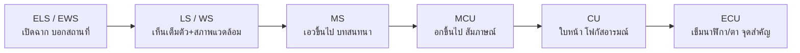
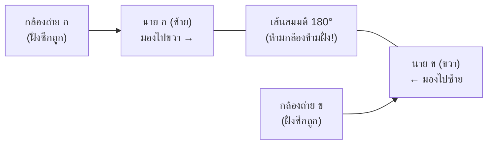

# บทที่ 3: วิดีโอ (Video) และภาษาภาพเบื้องต้น

> [!abstract] ภาพรวมบทเรียน
> ใน [[บทที่ 2 - ภาพนิ่งและการรับแสง]] เราเรียนรู้วิธีควบคุม **"แสงเพียง 1 ภาพ"** (รูรับแสง ชัตเตอร์ ISO) ไปแล้ว
> บทนี้จะพาต่อยอดสู่ **"แสงหลายพันภาพที่เรียงต่อเนื่องกัน"** จนกลายเป็น **วิดีโอ (Video)**
>
> เนื้อหาแบ่งออกเป็น **3 ส่วนหลัก** ที่คนทำงานตัดต่อและถ่ายทำต้องเข้าใจไปพร้อมกัน:
> 1. **มิติของเวลา (Time & Motion):** เฟรมเรต, Slow Motion, ชัตเตอร์แองเกิล, กฎ 180°, ปัญหาไฟกระพริบ 50 Hz และ Rolling Shutter
> 2. **มิติของข้อมูลภาพ (Digital Video Signal):** ความละเอียด, อัตราส่วนภาพ, Bitrate, Codec, Chroma Subsampling และ Scopes
> 3. **ภาษาภาพและเครื่องมือ (Cinematography & Gear):** ขนาดช็อต, มุมกล้อง, กฎการจัดภาพ, การเคลื่อนกล้อง, เครื่องมือเสริม (Tripod, Gimbal, Dolly, Crane, Drone) และกฎความต่อเนื่อง (Continuity)

> [!info] เมื่อเรียนจบบทนี้ นักศึกษาต้องทำได้
> 1. อธิบายหลักการเกิดภาพเคลื่อนไหว และเลือกใช้เฟรมเรตให้เหมาะกับงานและระบบไฟฟ้าในไทยได้
> 2. คำนวณ Shutter Angle และตั้งค่าชัตเตอร์ตามกฎ 180° รวมถึงรู้จังหวะที่ควรปรับเปลี่ยนได้
> 3. แก้ปัญหาไฟกระพริบ (50 Hz Flicker) และอาการภาพบิดเบี้ยว (Rolling Shutter) หน้างานได้
> 4. เลือกความละเอียด อัตราส่วนภาพ Bitrate และ Codec ให้เหมาะกับทั้งการตัดต่อและการเผยแพร่ได้
> 5. อ่านเครื่องมือวัดภาพ (Waveform, RGB Parade, Vectorscope) เพื่อเช็กแสงและสีแทนสายตาได้
> 6. เลือกใช้ขนาดช็อต มุมกล้อง กฎการจัดภาพ และเครื่องมือเสริม (Tripod, Gimbal, Dolly, Crane, Drone) เพื่อเล่าเรื่องและสร้างอารมณ์ได้
> 7. วางตำแหน่งกล้องตามกฎความต่อเนื่อง (180°, 30°, Shot-Reverse Shot) ได้อย่างถูกต้อง

---

## 1. วิดีโอคืออะไร — จากภาพนิ่ง 1 ใบ สู่ภาพเคลื่อนไหว

### 1.1 วิดีโอไม่ใช่ "ภาพที่ขยับได้" แต่คือ "ภาพนิ่งเรียงต่อกันเร็วมาก"

ความเข้าใจผิดแรกของมือใหม่คือคิดว่ากล้องวิดีโอบันทึก "การเคลื่อนไหว" แบบไหลลื่นต่อเนื่องเหมือนน้ำไหล แต่ความจริงทางเทคนิคแล้ว **ไม่มีกล้องตัวไหนในโลกที่บันทึกการเคลื่อนไหวต่อเนื่องได้จริง**

สิ่งที่กล้องวิดีโอทำคือ **กดชัตเตอร์ถ่ายภาพนิ่งรัว ๆ หลายสิบภาพภายใน 1 วินาที** แล้วนำภาพนิ่งเหล่านั้นมาเปิดเรียงต่อกันอย่างรวดเร็ว

> [!tip] นึกภาพ "สมุดพลิกการ์ตูน" (Flipbook)
> เคยเห็นสมุดเล่มเล็ก ๆ ที่วาดรูปคนไว้ตรงมุมกระดาษแต่ละหน้าโดยขยับแขนทีละนิดไหม?
> - ถ้าเปิดดูทีละหน้าช้า ๆ → เราจะเห็นแค่ **ภาพวาดนิ่ง ๆ** ทีละใบ
> - แต่พอเอานิ้วรูดพลิกหน้ากระดาษเร็ว ๆ → สมองจะหลอมภาพนิ่งเหล่านั้นเข้าด้วยกันจนเห็น **คนกำลังวิ่งหรือกระโดด**
>
> **ไฟล์วิดีโอ 1 วินาทีที่ 25 fps ก็คือสมุดพลิกที่มีภาพถ่าย 25 หน้า** ส่วนหนังยาว 2 ชั่วโมง ก็คือการเอาภาพถ่าย **172,800 ภาพ** มาเปิดรูดต่อกันไม่หยุดนั่นเอง

---

### 1.2 ทำไมตาและสมองจึงถูกหลอกให้เห็นเป็นภาพเคลื่อนไหว

การที่เราดูภาพนิ่งต่อกันแล้วไม่เห็นเป็นภาพกะพริบ เกิดจากกลไกทางชีววิทยา 3 อย่างทำงานร่วมกัน:

1. **Persistence of Vision (การติดตา):**
   จอประสาทตาของมนุษย์ไม่ได้ลบภาพทันทีที่ภาพหายไป แต่จะ **"จำภาพค้างไว้" ชั่วครู่ประมาณ 1/15 วินาที** ก่อนที่ภาพจะจางลง ดังนั้นเมื่อภาพที่ 2 โผล่มาทับก่อนภาพที่ 1 จะหายไปจากตา เราจึงไม่เห็นความมืดคั่นกลาง
2. **Phi Phenomenon (ปรากฏการณ์หลอมการเคลื่อนที่):**
   สมองมนุษย์ถูกออกแบบมาให้เชื่อมโยงเหตุการณ์ที่ใกล้เคียงกัน เมื่อเห็นวัตถุอยู่ที่ตำแหน่ง A แล้วเสี้ยววินาทีต่อมาไปโผล่ที่ตำแหน่ง B สมองจะ **เติมช่องว่างตรงกลางให้เองโดยอัตโนมัติ** และตีความว่าวัตถุนั้น "เคลื่อนที่" จาก A ไป B (เหมือนไฟวิ่งป้ายโฆษณาที่จริง ๆ แล้วหลอดไฟไม่ได้วิ่ง แค่ติด-ดับสลับหลอด)
3. **Flicker Fusion Threshold (จุดหลอมรวมการกะพริบ):**
   เมื่อความถี่ในการเปลี่ยนภาพสูงพอ (ประมาณ 24 ภาพต่อวินาทีขึ้นไปในโรงภาพยนตร์ที่มีชัตเตอร์ช่วย) ตาจะเลิกเห็นอาการกระพริบและรับรู้เป็นภาพเดียวที่ลื่นไหล

| ปรากฏการณ์ | เกิดขึ้นที่ไหน | ทำหน้าที่อะไร | ถ้าต่ำกว่าเกณฑ์จะเกิดอะไร |
| :--- | :--- | :--- | :--- |
| Persistence of vision | ดวงตา (จอประสาทตา) | ค้างภาพเดิมไว้ชั่วครู่ (~1/15 วิ) | เห็นช่องว่างสีดำคั่นระหว่างภาพ |
| Phi phenomenon | สมอง (การตีความ) | เชื่อมตำแหน่ง A→B เป็นการเคลื่อนที่ | เห็นภาพวาร์ปหรือกระโดดแทนการเดิน |
| Flicker fusion | ระบบประสาทการมองเห็น | รวมแสงที่เปิด-ปิดเร็วให้ดูนิ่ง | ปวดตา เห็นจอกระพริบตลอดเวลา |

---

### 1.3 การเคลื่อนไหวในวิดีโอเกิดจาก 2 แหล่ง

เวลาเราดูคลิปวิดีโอแล้วเห็นภาพขยับ ต้องแยกให้ออกก่อนว่า **"ใครเป็นคนขยับ"** เพราะวิธีแก้ปัญหาหน้างานต่างกันสิ้นเชิง:

1. **วัตถุเคลื่อนที่ในเฟรม (Subject Motion):** กล้องตั้งนิ่งอยู่บนขาตั้ง แต่นักแสดงเดิน น้ำตกไหล หรือรถวิ่งผ่านหน้าเลนส์
   - *ตัวอย่าง:* ตั้งกล้องนิ่งถ่ายรถแข่งวิ่งผ่านทางโค้ง ถ้ารถวิ่งเร็วมากแล้วตั้งชัตเตอร์ช้า ตัวรถจะเบลอเป็นเส้น แต่พื้นถนนและต้นไม้ข้างหลังยังคมกริบ
2. **กล้องเคลื่อนที่ (Camera Motion):** ตัวแบบอาจนั่งนิ่งอยู่กับที่ แต่คนถือกล้องเดินเข้าหา หรือหมุนกล้อง (Pan) กวาดไปตามห้อง
   - *ตัวอย่าง:* ถ่ายห้องเรียนที่โต๊ะเก้าอี้อยู่นิ่ง ๆ แต่เราเดินถือกล้องเร็วเกินไป ภาพ **ทั้งเฟรม** จะเบลอและสั่นไหว (และอาจเจอภาพเอียงจาก Rolling Shutter ด้วย)

> [!important] จุดที่ต้องเข้าใจ
> ทั้งสองแบบเกิดขึ้นพร้อมกันได้ และ **"ความเร็วชัตเตอร์" คือตัวควบคุมความเบลอของทั้งสองอย่าง**
> ยิ่งเคลื่อนไหวเร็วทั้งคนและกล้อง ยิ่งต้องระวังเรื่องความเบลอ ความสั่น และการเลือกเฟรมเรตให้ทัน

---

### 1.4 รูปแบบการผลิตภาพเคลื่อนไหว: Live Action vs Frame-by-Frame

| รูปแบบ | หลักการทำงาน | ข้อดี / ข้อจำกัด | ตัวอย่างงานจริง |
| :--- | :--- | :--- | :--- |
| **Live Action** (ถ่ายทำจริง) | ใช้กล้องบันทึกเหตุการณ์จริงตรงหน้า รวดเดียวจบตามเวลาจริง | ถ่ายเร็ว สมจริง แต่อยู่ภายใต้ข้อจำกัดของแสงและฟิสิกส์ | หนังคนแสดง, สารคดี, Vlog, ข่าว, โฆษณา |
| **Frame-by-Frame** (สร้างทีละเฟรม) | วาด ปั้น หรือขยับวัตถุทีละน้อย แล้วถ่าย/เรนเดอร์ทีละ 1 ภาพ | ทำสิ่งที่โลกจริงทำไม่ได้ (บิน วาร์ป กลายร่าง) แต่ใช้เวลามาก | การ์ตูนแอนิเมชัน, Stop Motion, โมชันกราฟิก, VFX |

> [!note] เชื่อมกับ [[บทที่ 1 - ความรู้เบื้องต้นเกี่ยวกับสื่อดิจิทัล]]
> งาน Animation และ Motion Graphics จากบทที่ 1 อาศัยหลักการ **Frame-by-Frame** (หรือการคำนวณตำแหน่งระหว่าง Keyframe) ส่วนกล้องถ่ายทำจริงคือ **Live Action** ซึ่งในงานระดับมืออาชีพมักนำทั้งสองอย่างมาซ้อนรวมกัน (เช่น ถ่ายนักแสดงบนฉากเขียวแบบ Live Action แล้วซ้อนมังกร CG แบบ Frame-by-Frame เข้าไป)

---

## 2. เฟรมเรต (Frame Rate): ทำไมต้อง 24 / 25 / 30 / 60 และ Slow Motion

### 2.1 เฟรมเรต (fps) คืออะไร

**Frame Rate** หรือ **fps (Frames Per Second)** คือ **จำนวนภาพนิ่งที่กล้องบันทึก (หรือจอฉาย) ภายในเวลา 1 วินาที**

กลับไปนึกถึงสมุดพลิก:
- ถ้า 1 วินาที มีรูปแค่ **12 หน้า (12 fps)** → ภาพจะดูกระตุกเป็นจังหวะ เหมือนการ์ตูนสมัยเก่า
- ถ้า 1 วินาที มีรูป **24–25 หน้า (24–25 fps)** → การขยับดูต่อเนื่องเป็นธรรมชาติแบบภาพยนตร์
- ถ้า 1 วินาที มีรูป **60 หน้า (60 fps)** → การเคลื่อนไหวจะเนียนกริบ ละเอียดทุกเสี้ยววินาที

> [!note] เฟรมเรต (fps) ไม่ได้ทำให้ภาพ "คมชัดขึ้น"
> นักศึกษามือใหม่มักสับสนว่า "ถ่าย 60 fps ภาพจะชัดกว่า 25 fps" — **ไม่จริง!**
> - **ความคมชัด (Sharpness/Detail)** ขึ้นอยู่กับ Resolution (เช่น 1080p vs 4K), คุณภาพเลนส์ และการโฟกัส
> - **เฟรมเรต (fps)** ควบคุมแค่ **"ความลื่นไหลของการเคลื่อนไหว"** และ **"ความสามารถในการทำภาพช้า (Slow Motion)"** เท่านั้น

---

### 2.2 ทำไมโลกนี้ถึงมีตัวเลขเฟรมเรตหลายค่า (ประวัติศาสตร์ที่ยังส่งผลถึงวันนี้)

ตัวเลขอย่าง 24, 25, 29.97, 30 ไม่ได้ถูกตั้งขึ้นมั่ว ๆ แต่มาจากข้อจำกัดทางเทคโนโลยีและระบบไฟฟ้าในแต่ละภูมิภาค:

1. **24 fps (และ 23.976 fps) — มาตรฐานภาพยนตร์ (Cinema):**
   ในยุคหนังเสียงเริ่มเข้ามาช่วงปลายทศวรรษ 1920 สตูดิโอภาพยนตร์ต้องการมาตรฐานความเร็วฟิล์มที่ **ประหยัดค่าฟิล์มที่สุด แต่เสียงพูดยังชัดและภาพไม่กระตุก** ผลทดสอบพบว่า **24 ภาพ/วินาที** คือจุดที่คุ้มค่าที่สุด หลังจากนั้นเกือบ 100 ปี สมองมนุษย์จึงคุ้นชินว่า *"ภาพที่ดู 24 fps คืออารมณ์แบบหนังโรง"* (Cinematic Look)
2. **25 fps (และ 50 fps) — มาตรฐานระบบ PAL (ไทย, ยุโรป, ออสเตรเลีย):**
   ในยุคโทรทัศน์ขาว-ดำ การฉายภาพบนจอ CRT ต้องอ้างอิงความถี่ของไฟฟ้าในประเทศนั้น ประเทศไทยและยุโรปใช้ไฟฟ้า **50 Hz** (สลับขั้ว 50 รอบต่อวินาที) วิศวกรจึงหารครึ่งได้ **25 fps** เพื่อให้สัญญาณทีวีซิงก์กับไฟบ้านพอดีและไม่เกิดคลื่นกวนหน้าจอ
3. **30 fps (และ 29.97 / 60 fps) — มาตรฐานระบบ NTSC (สหรัฐอเมริกา, ญี่ปุ่น):**
   อเมริกาและญี่ปุ่นใช้ไฟฟ้า **60 Hz** จึงหารครึ่งได้ **30 fps** (ต่อมาเมื่อเปลี่ยนเป็นทีวีสี ต้องชะลอความเร็วลง 0.1% เพื่อไม่ให้คลื่นสีไปกวนคลื่นเสียง จึงกลายเป็น **29.97 fps** และ **23.976 fps** ที่ยังหลงเหลืออยู่ในเมนูกล้องจนถึงทุกวันนี้)

> [!warning] กับดักสำคัญสำหรับคนถ่ายงานในประเทศไทย (ระบบไฟ 50 Hz)
> ประเทศไทยใช้ไฟฟ้า **50 Hz** ดังนั้นหลอดไฟฟลูออเรสเซนต์และหลอด LED ในห้องเรียน/ห้างร้านบ้านเราจะกะพริบจริง ๆ **100 ครั้งต่อวินาที** (ตามตาเปล่ามองไม่เห็น แต่กล้องเห็น!)
> หากเราไปตั้งกล้องมือถือหรือกล้องใหญ่ที่ **30 fps** (มาตรฐานอเมริกา) ถ่ายในห้องเรียนประเทศไทย บ่อยครั้งจะเจอ **แถบดำวิ่งขึ้นลง** หรือ **แสงสว่าง-มืดกระพริบทั้งจอ**
>
> **ทางแก้ที่ปลอดภัยที่สุดในไทย:** ใช้ **25 fps** หรือ **50 fps** สำหรับงานทั่วไปและงานในอาคาร

---

### 2.3 ตารางเลือกเฟรมเรตให้เหมาะกับงาน

| เฟรมเรต | มาตรฐาน | อารมณ์ภาพที่ได้ | งานที่แนะนำในไทย |
| :---: | :--- | :--- | :--- |
| **24 / 23.976** | Cinema | ชวนฝัน นุ่มนวล แบบภาพยนตร์ | หนังสั้น, MV, โฆษณาเน้นอารมณ์ (ระวังไฟกระพริบในอาคาร) |
| **25** | PAL | สมจริง เป็นธรรมชาติ ปลอดภัยกับไฟไทย | รายการทีวี, สัมภาษณ์, ข่าว, งานอีเวนต์ในร่ม, คลิปทั่วไป |
| **29.97 / 30** | NTSC / Web | ลื่นกว่า 25 เล็กน้อย นิยมบนมือถือ | คลิป TikTok/Reels (กลางแจ้ง หรือไฟแบบ Flicker-free) |
| **50** | PAL ×2 | ลื่นมาก คมชัดทุกจังหวะ และยืดช้า 2× ได้ | กีฬา, งานเต้น, งานที่ต้องเผื่อ Slow Motion 2 เท่าในไทย |
| **60** | NTSC ×2 | ลื่นที่สุดในงานทั่วไป | แคสต์เกม, รีวิวซอฟต์แวร์/หน้าจอ, กีฬากลางแจ้ง |
| **120 / 240** | High-Speed | เก็บเสี้ยววินาทีที่ตาเปล่ามองไม่ทัน | Slow Motion เนียน ๆ (น้ำกระเซ็น, ฉากแอ็กชัน) |

> [!important] กฎเหล็กในห้องตัดต่อ: อย่าเอาคลิปคนละ fps มาปนกันโดยไม่วางแผน
> ถ้า Timeline ตั้งไว้ที่ **25 fps** แต่เอาคลิป **30 fps** มาวางโดยไม่แปลง โปรแกรมตัดต่อจะสุ่ม "ลบทิ้ง" 5 เฟรมทุกวินาที ภาพจะเกิดอาการ **กระตุกเป็นจังหวะ (Micro-stutter)** ดูไม่เนียน

---

### 2.4 Slow Motion และ Speed Ramp เกิดขึ้นได้อย่างไร

**Slow Motion** ไม่ใช่เวทมนตร์ของโปรแกรมตัดต่อ แต่คือหลักคณิตศาสตร์ง่าย ๆ: **"ถ่ายมาให้เยอะกว่า แล้วเอามาเปิดช้าลง"**

$$\text{อัตรายืดช้า (Slow Factor)} = \frac{fps_{\text{ที่ถ่ายมา}}}{fps_{\text{ของ Timeline}}}$$

**ตัวอย่างให้เห็นภาพชัดเจน:**
สมมติเราถ่ายหยดน้ำตกกระทบแก้วในเวลาจริง **1 วินาที** ด้วยความเร็ว **100 fps** (แปลว่าได้ภาพนิ่งมาทั้งหมด 100 ใบ)
แล้วเรานำไฟล์นั้นไปวางใน Timeline ที่ตั้งค่าเล่นที่ **25 fps** (แปลว่าใน 1 วินาที จะโชว์ภาพแค่ 25 ใบ):
- 100 ใบ ÷ 25 ใบต่อวินาที = **เล่นได้นานถึง 4 วินาที!**
- คลิปจึงช้าลง **4 เท่า (25% Speed)** โดยที่ทุกเฟรมเป็นภาพจริงล้วน ๆ **ไม่กระตุกเลย**

> [!example] ตารางเปรียบเทียบการคำนวณ Slow Motion จริง
>
> | ถ่ายที่ (fps) | Timeline (fps) | ความเร็วที่ลดได้ (Speed %) | ยืดช้าได้กี่เท่า | ตัวอย่างการใช้งาน |
> | :---: | :---: | :---: | :---: | :--- |
> | **50** | 25 | 50% | **2×** | เดินถ่าย B-roll ให้นิ่งและดูละมุนขึ้น |
> | **60** | 30 | 50% | **2×** | กีฬาทั่วไป, คนกระโดด |
> | **100** | 25 | 25% | **4×** | สาดน้ำ, เส้นผมปลิว, กีฬาความเร็วสูง |
> | **120** | 24 | 20% | **5×** | ละอองน้ำ, จังหวะชกมวย, ดอกไม้ไฟ |

> [!tip] สองสิ่งที่ต้องระวังเมื่อถ่าย Slow Motion
> 1. **ต้องมีแสงให้พอ:** ยิ่ง fps สูง ชัตเตอร์ยิ่งต้องเร็ว (เช่น 120 fps ต้องใช้ชัตเตอร์ 1/240 วินาทีขึ้นไป) แสงจะเข้าเซนเซอร์น้อยลงมาก หากถ่ายในห้องมืด ภาพจะมืดหรือเกิด **Noise เต็มจอ**
> 2. **Speed Ramp (เร่งแล้วเบรกช้า):** คลิป TikTok หรือโฆษณาที่วิ่งมาเร็ว ๆ แล้วจู่ ๆ ช้าลงกลางอากาศ ต้อง **ถ่ายที่ 50/60/120 fps ไว้ตั้งแต่แรก** ถ้าถ่ายมาแค่ 25 fps แล้วมาสั่งช้าในโปรแกรม ภาพจะขาดช่วงเหมือนสไลด์โชว์

---

## 3. Shutter Angle และกฎ 180° — คุมความเบลอให้ดูเป็น "หนัง"

### 3.1 เชื่อมความรู้จากบทที่ 2: ชัตเตอร์ในภาพนิ่ง vs วิดีโอ

ใน [[บทที่ 2 - ภาพนิ่งและการรับแสง]] เราเรียนรู้ว่า **ความเร็วชัตเตอร์ (Shutter Speed)** คือระยะเวลาที่ม่านชัตเตอร์เปิดรับแสงในภาพ 1 ใบ:
- ภาพนิ่ง: อยากหยุดหยดน้ำ → ตั้ง 1/1000 ได้เลย ไม่มีใครว่า
- **แต่วิดีโอต่างออกไป!** ถ้าเราตั้งชัตเตอร์ 1/1000 วินาทีถ่ายคนเดินแล้วเอามาต่อกัน 25 ภาพ ภาพแต่ละใบจะคมกริบไร้เงาเบลอ ผลคือพอเล่นเป็นวิดีโอ **ภาพจะดูแข็ง กระตุก และระคายตา** เหมือนดูภาพจากกล้องวงจรปิดหรือวิดีโอเกมยุคเก่า

ทำไมถึงเป็นแบบนั้น? เพราะ **ดวงตามนุษย์เห็น "ความเบลอจากการเคลื่อนไหว" (Motion Blur) อยู่ตลอดเวลา!** ลองโบกมือเร็ว ๆ หน้าตัวเองดู เราจะเห็นมือเป็นเงาจาง ๆ ต่อเนื่อง ไม่ได้เห็นมือคมชัดแยกเป็นชิ้น ๆ ดังนั้นวิดีโอที่ดูสบายตาและดูเป็น "หนัง" จึงต้องมี Motion Blur ในสัดส่วนที่พอดี

---

### 3.2 Shutter Angle คืออะไร (ทำไมวัดเป็นองศา?)

ในยุคกล้องฟิล์มภาพยนตร์ กล้องไม่ได้ใช้ม่านเปิด-ปิดขึ้นลงแบบกล้องถ่ายรูป แต่ใช้ **แผ่นจานหมุน (Rotary Shutter)** ที่มีช่องแหว่งเป็นรูปพัดหมุนวนอยู่หน้าฟิล์ม:
- 1 รอบการหมุน (360°) = เวลาทั้งหมดของ 1 เฟรม
- **Shutter Angle** คือ **ขนาดมุมของช่องที่เปิดให้แสงผ่านเข้าไปโดนฟิล์มได้**

เช่น ถ้าช่องเปิดกว้างครึ่งวงกลมพอดี (**180°**) แปลว่าฟิล์มจะได้รับแสง **ครึ่งหนึ่งของเวลาทั้งหมดต่อเฟรม** ส่วนอีกครึ่งวงกลมที่ทึบจะเป็นช่วงที่กลไกเลื่อนฟิล์มไปเฟรมถัดไป กล้องถ่ายหนังดิจิทัลระดับโปร (เช่น RED, ARRI, Sony Cinema Line, Blackmagic) และโหมดวิดีโอมืออาชีพจึงยังนิยมใช้หน่วยเป็นองศาเพราะคำนวณง่าย:

$$\text{เวลาเปิดรับแสง (Shutter Speed)} = \frac{\text{Shutter Angle}}{360°} \times \frac{1}{fps}$$

> [!example] ตัวอย่างการคำนวณที่ 25 fps (1 เฟรมใช้เวลา 1/25 วินาที = 40 มิลลิวินาที)
>
> | Shutter Angle | สัดส่วนของเฟรม | คำนวณ Shutter Speed | อารมณ์ภาพที่ได้ |
> | :---: | :--- | :--- | :--- |
> | **360°** | เปิดเต็ม 100% (ไม่มีช่วงปิด) | $1/25$ วิ (40 ms) | เบลอฟุ้งมาก เหมือนภาพฝัน/เมา/ถ่ายแสงน้อยจัด |
> | **180°** | เปิดครึ่งเดียว 50% | **$1/50$ วิ (20 ms)** | **มาตรฐานสากล — Motion Blur เป็นธรรมชาติที่สุด** |
> | **90°** | เปิด 1 ใน 4 (25%) | $1/100$ วิ (10 ms) | เบลอน้อยลง ภาพคมขึ้น กระชับขึ้น |
> | **45°** | เปิด 1 ใน 8 (12.5%) | $1/200$ วิ (5 ms) | คมกริบ เห็นเม็ดดินเม็ดทรายกระเด็น ดุดัน |

---

### 3.3 กฎ 180° (The 180-Degree Shutter Rule)

ถ้ากล้องของคุณไม่มีเมนู Shutter Angle แต่มีแค่ **Shutter Speed** (เช่นกล้อง Mirrorless, DSLR, หรือมือถือโหมด Pro) ให้จำสูตรง่าย ๆ ที่เรียกว่า **กฎ 180°**:

> [!important] สูตรกฎ 180°
> $$\text{Shutter Speed} = \frac{1}{2 \times fps}$$
> **พูดให้จำง่ายที่สุด: "ตั้งเลขตัวส่วนชัตเตอร์เป็น 2 เท่าของเฟรมเรตเสมอ"**
>
> | เฟรมเรตที่ถ่าย | Shutter Speed ตามกฎ 180° | หมายเหตุในการใช้งานจริง |
> | :---: | :---: | :--- |
> | **24 fps** | 1/48 (หรือ **1/50**) | กล้องทั่วไปมักไม่มี 1/48 ให้ใช้ 1/50 แทนได้เลย |
> | **25 fps** | **1/50** | มาตรฐานสำหรับงานวิดีโอในประเทศไทย |
> | **30 fps** | **1/60** | มาตรฐานงานเว็บ/มือถือ |
> | **50 fps** | **1/100** | สำหรับ Slow Motion 2× |
> | **60 fps** | **1/120** (หรือ 1/125) | กล้องทั่วไปอาจมีแค่ 1/125 ใช้แทนกันได้ |
> | **120 fps** | **1/240** (หรือ 1/250) | ใช้สำหรับ Slow Motion 4×–5× |

---

### 3.4 เมื่อไรควร "แหกกฎ 180°" อย่างจงใจ

กฎมีไว้เข้าใจเพื่อควบคุมผลลัพธ์ ไม่ใช่ห้ามเปลี่ยนตลอดชีวิต ผู้กำกับภาพจงใจปรับองศาเพื่อเล่าอารมณ์ได้:

1. **ลดลงเหลือ 45°–90° (ชัตเตอร์เร็วกว่าปกติ) — ฉากต่อสู้ / สงคราม / ความตึงเครียด:**
   *ตัวอย่างจริง:* ภาพยนตร์เรื่อง *Saving Private Ryan* ฉากยกพลขึ้นบก ใช้ Shutter Angle แคบราว 45°–90° ทำให้เม็ดทรายที่ระเบิดและหยดน้ำกระเด็นคมกริบไร้ความเบลอ คนดูจึงรู้สึกตึงเครียด ดิบ และเหมือนอยู่ในเหตุการณ์จริง นอกจากนี้ยังใช้ใน **งาน VFX / Green Screen** ที่ตัวละครขยับเร็ว เพื่อให้คอมพิวเตอร์ตัดขอบ (Keying/Rotoscope) ได้ง่ายโดยไม่ติดขอบเบลอ
2. **เปิดกว้างขึ้นเป็น 270°–360° (ชัตเตอร์ช้าลง) — ฉากฝัน / มึนเมา / เวลายืด:**
   ภาพจะเกิดเงาลากยาว (Ghosting) สร้างความรู้สึกล่องลอย สับสน หรือช่วยเก็บแสงเพิ่มในสถานการณ์ที่มืดจัดและไม่อยากดัน ISO สูงเกินไป

> [!warning] ปัญหาใหญ่เมื่อถ่ายกลางแจ้งด้วยกฎ 180°: แสงจ้าเกิน!
> สมมติถ่ายกลางแดดตอนเที่ยงที่ 25 fps ตั้งชัตเตอร์ **1/50** (ค่อนข้างช้า) ISO ต่ำสุด 100 แล้ว และอยากเปิดรูรับแสงกว้าง **f/1.8** ให้หลังเบลอ — ผลคือ **ภาพขาวโพลนไหม้หมด!** เพราะแสงเข้าเยอะเกิน
>
> **ห้ามแก้โดยการเร่งชัตเตอร์ไป 1/2000** (เพราะ Motion Blur จะหายหมด วิดีโอจะกระตุก!)
> **ทางแก้ของมืออาชีพคือ:** ใส่ **ND Filter (แผ่นกรองแสงสีเทา)** หน้าเลนส์ — เปรียบเหมือน **"ใส่แว่นกันแดดให้กล้อง"** เพื่อลดปริมาณแสงลงโดยที่ยังรักษาชัตเตอร์ 1/50 และหน้าชัดหลังเบลอ f/1.8 ไว้ได้ครบ

---

## 4. ปัญหาหน้างาน: ไฟกระพริบ (50 Hz Flicker) และ Rolling Shutter

สองปัญหานี้เจอแทบทุกกองถ่ายและพบได้บ่อยมากในคลิปนักศึกษา หากเข้าใจฟิสิกส์ของมัน เราจะแก้ได้ภายใน 10 วินาที

### 4.1 ไฟกระพริบ (Flicker) จากระบบไฟฟ้า 50 Hz

**เกิดอะไรขึ้นจริง?**
ไฟฟ้าตามบ้านและอาคารเรียนในประเทศไทยเป็นไฟฟ้ากระแสสลับความถี่ **50 Hz** (ไหลกลับไปกลับมาครบ 1 รอบ 50 ครั้งใน 1 วินาที) นั่นแปลว่าใน 1 รอบ มันมีจังหวะที่กระแสไฟพุ่งขึ้นสูงสุดและตกลงเป็นศูนย์ **2 ครั้ง**

ดังนั้น หลอดไฟฟลูออเรสเซนต์ ป้ายไฟ หรือหลอด LED ทั่วไป ไม่ได้สว่างค้างตลอดเวลา แต่มัน **ติด-ดับ-ติด-ดับ เร็วถึง 100 ครั้งต่อวินาที (ทุก ๆ 10 มิลลิวินาที)** ซึ่งเร็วเกินกว่าตามนุษย์จะสังเกตเห็น

> [!tip] อุปมา "ถ่ายรูปคลื่นทะเล"
> ลองนึกภาพหลอดไฟที่ติด-ดับทุก ๆ 10 มิลลิวินาที เหมือน **คลื่นทะเลที่ซัดเข้ามาทุก 10 วินาที**:
> - ถ้ากล้องถ่ายโดยเปิดรับแสง **10 มิลลิวินาทีพอดี (ชัตเตอร์ 1/100)** หรือ **20 มิลลิวินาที (ชัตเตอร์ 1/50)** → ทุกเฟรมจะได้แสงครบ **1 ลูกคลื่น หรือ 2 ลูกคลื่นเต็ม ๆ เท่ากันหมด** → **ภาพนิ่งสนิท ไม่กระพริบ**
> - แต่ถ้าดันไปตั้งชัตเตอร์ **1/60** (16.7 มิลลิวินาที) หรือ **1/125** (8 มิลลิวินาที) → เฟรมแรกอาจจับได้ช่วงคลื่นสูงสุด (สว่าง) เฟรมถัดมาจับได้ช่วงคลื่นต่ำสุด (มืด) เฟรมถัดไปเหลื่อมไปเรื่อย ๆ → **ผลคือเกิดแถบดำวิ่งไต่ขึ้นลง หรือภาพกะพริบเป็นผีสิงทั้งคลิป!**

| อาการที่เห็นบนจอ | สาเหตุที่แท้จริง | วิธีแก้หน้างานทันที |
| :--- | :--- | :--- |
| แถบสว่าง-มืดวิ่งขึ้นลงในห้องเรียน | ชัตเตอร์ไม่ลงตัวกับคาบไฟ 10 ms (เช่นใช้ 1/60, 1/125, 1/250) | ปรับเป็น **1/50** หรือ **1/100** (และถ่ายที่ **25 หรือ 50 fps**) |
| ภาพสว่าง-มืดสลับจังหวะช้า ๆ | ถ่ายที่ 30 fps ภายใต้ไฟ 50 Hz | เปลี่ยนเฟรมเรตเป็น **25 fps** |
| ถ่ายหน้าจอคอม/ทีวี/ป้าย LED แล้วขึ้นคลื่นลาย | รีเฟรชเรตของจอ (เช่น 60 Hz / PWM dimming) ไม่ตรงกับชัตเตอร์ | ค่อย ๆ หมุนปรับ Shutter Speed ทีละขั้น (หรือเปิดฟังก์ชัน Synchro Scan / Anti-flicker) จนกว่าแถบบนจอจะหาย |
| ไฟ LED ราคาถูกกระพริบแก้ไม่หาย | วงจรหรี่ไฟ (Dimmer) ของหลอด LED ใช้ความถี่แปลก ๆ | หยุดหรี่ไฟ (เปิดสว่าง 100%) หรือเปลี่ยนไปใช้ไฟถ่ายทำแบบ **Flicker-free** |

---

### 4.2 Rolling Shutter — ทำไมเสาไฟถึงเอียง พัดลมถึงเบี้ยว

เซนเซอร์กล้องดิจิทัลเกือบทั้งหมด (ทั้งมือถือ Mirrorless และกล้องวิดีโอทั่วไป) เป็นชนิด **CMOS Sensor** ซึ่งมีวิธีอ่านข้อมูลภาพแบบ **Rolling Shutter**

**Rolling Shutter ทำงานอย่างไร?**
กล้อง **ไม่ได้** บันทึกแสงทุกจุดบนภาพพร้อมกันในเสี้ยววินาทีเดียว แต่มันอ่านข้อมูลทีละแถวเรียงลำดับลงมาจาก **แถวบนสุด → ลงล่างสุด** เหมือนหัวอ่านเครื่องสแกนเอกสาร ซึ่งกระบวนการอ่านตั้งแต่หัวจนถึงหางใช้เวลาประมาณ **1/30 ถึง 1/60 วินาที**

> [!example] อุปมาให้เห็นภาพชัดที่สุด
> สมมติมีคนถือ **กล้องสแกนจากบนลงล่าง** ถ่ายคนที่กำลังวิ่งผ่านหน้าไปทางขวา:
> - วินาทีที่ 0.000: เครื่องสแกนแถวบนสุด → จับภาพ **หัว** ของคนไว้ที่ตำแหน่งซ้าย
> - วินาทีที่ 0.015: กว่าเครื่องสแกนจะเลื่อนลงมาถึงแถวล่างสุด → ตัวคนวิ่งเลยไปข้างหน้าแล้ว → จึงจับภาพ **เท้า** ไว้ที่ตำแหน่งขวา
> - เมื่อเอาภาพมารวมเป็น 1 ใบ → **คนทั้งตัวและเสาข้างหลังจะเอียงเฉียงเหมือนตัวอักษรเอียง!**

**อาการที่พบได้บ่อยจาก Rolling Shutter:**
1. **Skew (ภาพเอียง):** เมื่อแพนกล้องซ้าย-ขวาเร็ว ๆ เสาไฟฟ้า กรอบประตู หรือตึกที่ควรตั้งตรง 90° จะเอียงเฉียงไปตามทิศทางตรงข้ามกับการแพน
2. **Wobble / Jello Effect (ภาพย้วยเหมือนเยลลี่):** เมื่อถือกล้องเดินบนทางขรุขระ หรือกล้องสั่นสะเทือนแรง ๆ เส้นตรงในภาพจะบิดโค้งสั่นพลิ้วเหมือนมองผ่านแผ่นวุ้น
3. **ใบพัดเบี้ยว / แสงแฟลชขาดครึ่ง:** ถ่ายพัดลมหมุนเร็วหรือใบพัดเฮลิคอปเตอร์ จะเห็นใบพัดโค้งงอ หรือถ่ายติดแสงแฟลชกล้องข่าวเพียงครึ่งบนของเฟรมเพราะครึ่งล่างยังอ่านไม่ทัน

**วิธีป้องกันและแก้ไข:**
- **แพนกล้องให้ช้าลง** และนิ่งขึ้น (ไม่เกิน 15°–30°/วินาที)
- ใช้ **ขาตั้งกล้อง** หรือ **Gimbal** เพื่อลดการสั่นสะเทือนความถี่สูง
- เลี่ยงการซูมระยะไกล (Telephoto) ตอนถือมือ เพราะแรงสั่นเพียงนิดเดียวจะขยายผลให้เกิด Jello รุนแรงมาก
- ในระดับอุตสาหกรรมภาพยนตร์ กล้องรุ่นใหญ่บางรุ่นใช้ **Global Shutter** (อ่านทุกพิกเซลพร้อมกัน 100% ในครั้งเดียว) ทำให้ไม่มีอาการภาพเอียงเลยแม้แต่น้อย แต่มีราคาสูงมากและมักมี Dynamic Range หรือการจัดการ Noise สู้ CMOS ปกติไม่ได้

---

## 5. ข้อมูลภาพดิจิทัล: ความละเอียด, อัตราส่วนภาพ, Bitrate และ Codec

เมื่อแสงผ่านเลนส์เข้ามาเป็นภาพเคลื่อนไหวและซิงก์เวลาถูกต้องแล้ว ขั้นตอนต่อไปคือ **กล้องจะแปลงภาพเหล่านั้นเป็น "ไฟล์วิดีโอ" ได้อย่างไร?**

### 5.1 ความละเอียด (Resolution) คืออะไร

ใน [[บทที่ 1 - ความรู้เบื้องต้นเกี่ยวกับสื่อดิจิทัล]] เราเรียนรู้แล้วว่าภาพดิจิทัลสร้างจากจุดสีเล็ก ๆ ที่เรียกว่า **Pixel (พิกเซล)**

**Resolution (ความละเอียด)** คือ **จำนวนพิกเซลทั้งหมดใน 1 เฟรม** (แนวนอน × แนวตั้ง)

> [!tip] อุปมา "ภาพโมเสกจากแผ่นกระเบื้อง"
> ลองนึกภาพการปูกระเบื้องรูปหน้าคนบนกำแพงขนาดเท่าเดิม:
> - **720p** เหมือนใช้กระเบื้องแผ่นใหญ่ (1280 × 720 ชิ้น) — ดูห่าง ๆ พอรู้เรื่อง แต่เข้าไปใกล้จะเห็นรอยหยัก
> - **1080p (Full HD)** เหมือนใช้กระเบื้องขนาดกลาง (1920 × 1080 ≈ 2 ล้านชิ้น) — เนียนพอสำหรับจอทีวีและยูทูบทั่วไป
> - **4K UHD** เหมือนใช้กระเบื้องชิ้นเล็กจิ๋ว (3840 × 2160 ≈ 8.3 ล้านชิ้น) — **ละเอียดกว่า Full HD ถึง 4 เท่า!**

| ชื่อเรียก | ขนาดพิกเซล (กว้าง × สูง) | จำนวนพิกเซลรวม | งานที่เหมาะสม |
| :--- | :---: | :---: | :--- |
| **720p (HD)** | 1280 × 720 | ~0.9 ล้าน | งานเว็บเบา ๆ, สตรีมมิงเน็ตช้า |
| **1080p (Full HD)** | 1920 × 1080 | ~2.1 ล้าน | **มาตรฐานงานทั่วไป, ทีวี, YouTube, งานส่งครู** |
| **1440p (2K / QHD)** | 2560 × 1440 | ~3.7 ล้าน | แคสต์เกม, คอนเทนต์คอมพิวเตอร์ |
| **4K UHD** | 3840 × 2160 | ~8.3 ล้าน | งานคุณภาพสูง, ถ่ายเผื่อครอป, โฆษณา |
| **DCI 4K** | 4096 × 2160 | ~8.8 ล้าน | มาตรฐานโรงภาพยนตร์ |
| **8K** | 7680 × 4320 | ~33.2 ล้าน | งานพิเศษ, VFX ที่ต้องซูมเข้าจุดเล็กมาก |

> [!tip] เทคนิคมืออาชีพ: "ถ่าย 4K เพื่อส่งงาน 1080p"
> ต่อให้ลูกค้าหรือแพลตฟอร์มต้องการไฟล์ส่งแค่ 1080p ทำไมช่างภาพยังนิยมถ่าย 4K? มีเหตุผล 3 ข้อ:
> 1. **ครอปและจัดเฟรมใหม่ได้ (Reframing):** เพราะ 4K ใหญ่กว่า 1080p ถึง 4 เท่า เราสามารถซูมเข้าจาก Wide Shot ให้กลายเป็น Medium Shot ในห้องตัดต่อได้ **โดยที่ความคมชัดยังเต็ม 1080p ไม่แตก!**
> 2. **กันสั่นในโปรแกรมง่ายขึ้น:** เวลาใช้ Warp Stabilizer โปรแกรมต้องครอปขอบทิ้งเล็กน้อย 4K ให้พื้นที่เหลือเฟือ
> 3. **ภาพคมขึ้นตอนย่อลง (Downscaling):** การบีบ 4 พิกเซลรวมเป็น 1 พิกเซล ช่วยลด Noise และทำให้เส้นขอบดูคมสวยกว่าการถ่าย 1080p โดยตรง (แต่แลกมากับขนาดไฟล์ที่ใหญ่และเครื่องตัดต่อต้องแรงขึ้น)

---

### 5.2 อัตราส่วนภาพ (Aspect Ratio)

**Aspect Ratio** คือ **สัดส่วนความกว้าง ต่อ ความสูง ของกรอบภาพ** ไม่ได้ขึ้นอยู่กับจำนวนพิกเซล แต่อยู่ที่ **"รูปร่างของจอ"**

| อัตราส่วน | ค่าทศนิยม (กว้าง ÷ สูง) | รูปร่างกรอบ | แพลตฟอร์มและการใช้งานจริง |
| :---: | :---: | :--- | :--- |
| **16:9** | 1.78 | แนวนอนมาตรฐาน | YouTube, ทีวีดิจิทัล, จอคอมพิวเตอร์ |
| **9:16** | 0.56 | แนวตั้งเต็มจอมือถือ | TikTok, Instagram Reels, YouTube Shorts |
| **1:1** | 1.00 | สี่เหลี่ยมจัตุรัส | โพสต์ Facebook / Instagram สมัยนิยม |
| **4:5** | 0.80 | แนวตั้งสั้น | โพสต์ภาพ/วิดีโอใน Instagram Feed (กินพื้นที่หน้าจอมากสุด) |
| **21:9 (2.39:1)** | 2.39 | แนวนอนยาวพิเศษ | ภาพยนตร์จอกว้าง (CinemaScope), MV ให้ดูแพง |
| **4:3** | 1.33 | เกือบจัตุรัส | ทีวีรุ่นเก่า, งานสไตล์วินเทจ/Y2K |

> [!important] เคล็ดลับถ่ายคลิปเดียว ใช้ได้ทั้ง YouTube (16:9) และ TikTok (9:16)
> ถ้าต้องถ่ายงาน 1 ครั้งแล้วเอาไปตัดลงทั้งแนวนอนและแนวตั้ง ให้ตั้งกล้องถ่ายเป็น **16:9 (4K)** แล้วถอยกล้องออกมานิดหน่อย ให้ตัวแบบอยู่ตรง **Safe Area ช่วงกลางเฟรม** เวลามาตัดแนวตั้ง 9:16 จะได้ครอปตรงกลางออกมาได้พอดีโดยไม่ตัดแขนหรือหัวตัวแบบขาด

---

### 5.3 Bitrate (บิตเรต) — ปริมาณข้อมูลต่อวินาที

ถ้า Resolution คือ "ขนาดของภาพ" แล้ว **Bitrate** คือ **"ความแน่นของข้อมูลที่ใส่ลงไปใน 1 วินาที"** มีหน่วยเป็น **Mbps (Megabits per second)**

> [!tip] อุปมา "ขนาดท่อน้ำ"
> ลองนึกภาพวิดีโอ 4K ที่มีน้ำไหลผ่าน 1 วินาที:
> - **Bitrate สูง (เช่น 100 Mbps):** ท่อน้ำใหญ่ น้ำไหลผ่านได้เยอะ รายละเอียดใบไม้ คลื่นน้ำ และควันไฟถูกเก็บมาครบ ไม่มีรอยแตกเป็นเหลี่ยม
> - **Bitrate ต่ำเกินไป (เช่น 3 Mbps):** บังคับให้น้ำจำนวนมากลอดผ่านหลอดกาแฟ — ข้อมูลล้นจนต้องโยนรายละเอียดทิ้ง ภาพจะ **แตกเป็นก้อนสี่เหลี่ยม (Compression Artifacts / Macroblocking)** โดยเฉพาะฉากที่มีลูกปา ใบไม้ปลิว หรือน้ำกระเซ็น

| ลักษณะงาน | Bitrate ที่แนะนำ | เหตุผล |
| :--- | :---: | :--- |
| 1080p เผยแพร่เว็บ/ส่งงานทั่วไป | **10–20 Mbps** | ไฟล์กำลังดี อัปโหลดไว ภาพยังคม |
| 4K เผยแพร่ YouTube | **35–60 Mbps** | เผื่อ YouTube เอาไปบีบอัดซ้ำอีกรอบ |
| 4K ถ่ายจากกล้องระดับกลาง (H.264/265) | **100–150 Mbps** | เก็บรายละเอียดพอสำหรับแต่งสีเบื้องต้น |
| งานตัดต่อมืออาชีพ (ProRes 422) | **~500–880 Mbps** | ไฟล์ใหญ่ระดับมืออาชีพ ลื่นมากตอนตัด |

**CBR vs VBR — เลือกวิธีจ่ายข้อมูลแบบไหนตอน Export?**
- **CBR (Constant Bitrate — คงที่ตลอดคลิป):** ต่อให้ถ่ายกำแพงขาวนิ่ง ๆ 10 วินาที ก็ใช้ข้อมูลเท่ากับฉากระเบิดภูเขาเผากระท่อม เหมาะกับ **การไลฟ์สด (Streaming)** ที่ต้องการความเสถียรของเน็ต
- **VBR (Variable Bitrate — แปรผันตามฉาก):** ฉากนิ่ง ๆ ใช้ข้อมูลน้อยลง เพื่อเก็บโควตาไปทุ่มให้ฉากที่ขยับเร็ว **แนะนำสำหรับงาน Export วิดีโอส่งทั่วไป** (มักใช้ VBR 2-Pass เพื่อคุณภาพสูงสุด)

> [!example] วิธีคำนวณขนาดไฟล์ก่อนออกกอง (จะได้ไม่เมมเต็มกลางทาง!)
> จำสูตรเดียว: **8 bits = 1 Byte** → เอา **Mbps หาร 8** จะได้ขนาดไฟล์ต่อวินาที (MB/s)
>
> *ตัวอย่าง:* กล้องตั้งไว้ที่ **100 Mbps**
> - $100 \div 8 = 12.5\text{ MB/วินาที}$
> - ถ่าย 1 นาที (60 วิ): $12.5 \times 60 = 750\text{ MB}$
> - ถ่าย 10 นาที: $750 \times 10 = 7,500\text{ MB} \approx 7.5\text{ GB}$
> - ถ้านักศึกษามี SD Card 32 GB จะถ่ายต่อเนื่องได้ไม่เกินประมาณ 40 นาที

---

### 5.4 Codec, Intraframe vs Interframe และ Chroma Subsampling

**Codec (ย่อจาก Coder-Decoder)** คือ **"อัลกอริทึมวิธีบีบอัดและคลายไฟล์วิดีโอ"**
*ข้อควรแยกให้ออก:* **Container** (เช่น `.mp4`, `.mov`, `.mkv`) คือ **"กล่องใส่ของ"** ส่วน **Codec** (เช่น `H.264`, `H.265`, `ProRes`) คือ **"วิธีพับของลงกล่อง"** ดังนั้นไฟล์ `.mp4` สองไฟล์อาจใช้คนละ Codec ข้างในก็ได้!

**ทำไมคอมพิวเตอร์ถึงหน่วงเวลาตัดต่อไฟล์มือถือ (Intraframe vs Interframe)?**
Codec แบ่งออกเป็น 2 ตระกูลใหญ่ตามวิธีประหยัดพื้นที่:

1. **Interframe (เช่น H.264, H.265):**
   - *อุปมา:* เหมือนการ **"ถ่ายรูปเต็มใบแค่หน้าแรก แล้วหน้าต่อไปจดแค่ส่วนที่ขยับ"** เช่น ถ้าคนยืนพูดหน้ากำแพงสีขาว เฟรมที่ 1 เก็บทั้งหมด เฟรมที่ 2–24 จะจดแค่ *"กำแพงเหมือนเดิม เก็บเฉพาะปากที่ขยับ!"*
   - *ข้อดี:* **ไฟล์เล็กจิ๋ว ประหยัดเมมโมรี** เหมาะสำหรับถ่ายลงการ์ดและอัปโหลดลงเน็ต
   - *ข้อเสีย:* **คอมพิวเตอร์ทำงานหนักมากตอนตัดต่อ!** เพราะเวลาเราเลื่อนหัวอ่านไปหยุดที่เฟรมที่ 18 คอมฯ ต้องย้อนไปถอดรหัสตั้งแต่เฟรมที่ 1 ถึง 18 มาประกอบใหม่ ทำให้ Premiere/DaVinci กระตุก
2. **Intraframe (เช่น Apple ProRes, Avid DNxHR):**
   - *อุปมา:* เหมือน **"เก็บอัลบั้มภาพนิ่งเต็มใบแยกไว้ทุกเฟรม"** เฟรมที่ 1 ถึง 25 อยู่ครบด้วยตัวเอง ไม่ต้องพึ่งกัน
   - *ข้อดี:* **ตัดต่อลื่นหัวแตก!** คอมฯ ไม่ต้องคิดคำนวณย้อนหลัง ลากเมาส์ไปตรงไหนภาพขึ้นทันที
   - *ข้อเสีย:* **ไฟล์ใหญ่มาก** (ใหญ่กว่า H.264 ประมาณ 5–10 เท่า) จึงนิยมใช้ในงานมืออาชีพ หรือทำเป็น **Proxy File** (ไฟล์จำลองขนาดเล็กสำหรับตัดต่อแล้วค่อยสลับตัวจริงตอน Export)

| Codec | ตระกูล | นิยมใช้ที่ไหน | จุดเด่น / จุดระวัง |
| :--- | :--- | :--- | :--- |
| **H.264 (AVC)** | Interframe | กล้องทั่วไป, YouTube, ส่งงาน | เปิดได้ทุกเครื่องบนโลก แต่ตัดต่อ 4K จะเริ่มหน่วง |
| **H.265 (HEVC)** | Interframe | มือถือรุ่นใหม่ (iPhone/Android), โดรน | ไฟล์เล็กกว่า H.264 ครึ่งหนึ่งที่ภาพชัดเท่าเดิม แต่กินสเปกเครื่องตอนตัดต่อมาก |
| **ProRes 422 / DNxHR** | Intraframe | งานตัดต่อโฆษณา, หนัง, Proxy | ตัดต่อลื่นที่สุด สีไม่พัง แต่กินฮาร์ดดิสก์มหาศาล |
| **RAW (BRAW, R3D)** | ไม่บีบอัด/บีบอัดต่ำ | กองถ่ายภาพยนตร์, VFX | ปรับ White Balance และ ISO ย้อนหลังในคอมฯ ได้ แต่ไฟล์ใหญ่มากที่สุด |

---

**Chroma Subsampling (4:4:4 · 4:2:2 · 4:2:0) และ Bit Depth — ทำไม Green Screen ถึงตัดขอบไม่เนียน?**

สายตามนุษย์ไวต่อ **"ความสว่าง (Luma - Y)"** มากกว่า **"รายละเอียดสี (Chroma - CbCr)"** วิศวกรจึงคิดวิธีลดขนาดไฟล์โดย **เก็บความสว่างไว้ครบ 100% แต่แอบลดข้อมูลสีลง** โดยเขียนเป็นรหัสเลข 3 ตัว (เทียบจากตารางกว้าง 4 พิกเซล × สูง 2 พิกเซล):

- **4:4:4** = เก็บสีครบทุกพิกเซล 100% (แถวบนครบ 4 แถวล่างครบ 4) — คมกริบ เหมาะกับงาน **VFX, กราฟิกตัวอักษร, ตัดฉากเขียว (Green Screen)**
- **4:2:2** = เก็บสีแค่ครึ่งหนึ่งแนวนอน (2 จุดต่อแถว) — **มาตรฐานงานตัดต่อมืออาชีพ และงาน Green Screen ที่ใช้งานจริงได้ดี**
- **4:2:0** = เก็บสีลดลงเหลือเพียง **1 ใน 4** (แถวบนเก็บ 2 แถวล่างลอกสีข้างบนมาใช้เลย!) — ใช้ในมือถือ กล้องทั่วไป และ YouTube

> [!danger] กับดักที่นักศึกษาเจอบ่อยเวลาทำ Visual Effects (Green Screen)
> ถ้าถ่ายฉากเขียวด้วยมือถือหรือกล้อง 8-bit **4:2:0** เวลานำมาเจาะสีเขียวออก (Chroma Key) **ขอบเส้นผมและเสื้อจะแตกเป็นหยัก ๆ และติดแสงเขียวแก้ไม่หาย!**
> เพราะพิกเซลข้าง ๆ กันถูกบังคับให้ "ใช้สีเดียวกัน" ขอบรอยต่อระหว่างผิวคนกับฉากเขียวจึงปนกันเละ หากต้องทำ VFX จริงจัง ควรถ่ายด้วย **4:2:2 และ 10-bit ขึ้นไป**

**Bit Depth (8-bit vs 10-bit):**
- **8-bit:** มีเฉดสีให้เลือก $2^8 = 256$ ระดับต่อแม่สี (รวม 16.7 ล้านสี) พอสำหรับดูทั่วไป แต่ถ้านำมาเกรดสีแรง ๆ ท้องฟ้าจะแตกเป็นชั้น ๆ เหมือนสีโปสเตอร์ (**Color Banding**)
- **10-bit:** มีเฉดสีถึง $2^{10} = 1,024$ ระดับต่อแม่สี (รวม **1,070 ล้านสี!**) ยืดหยุ่นสูงมากสำหรับงานเกรดสีและ Log Profile

---

## 6. Scopes: เครื่องมือวัดภาพที่ไม่โกหกตา

### 6.1 ทำไมเราถึงเชื่อสายตาตัวเองตอนปรับแสงสีไม่ได้?

เคยไหมครับ แต่งสีวิดีโอในโน้ตบุ๊กตัวเองจนสวยปิ๊ง แต่พอส่งให้เพื่อนดูในมือถือ สีหน้าคนดันกลายเป็นสีส้มแปร๊ด หรือมืดจนมองไม่เห็น?

ที่เป็นแบบนั้นเพราะ **1) หน้าจอแต่ละเครื่องปรับแสงสีมาไม่เท่ากัน** และ **2) สมองคนปรับตัวตามสภาพแสงในห้อง** (ถ้าปิดไฟตัดต่อในห้องมืด จอจะดูสว่างเกินจริง ทำให้เราหรี่ภาพมืดลงโดยไม่รู้ตัว!)

> [!tip] อุปมา "เทอร์โมมิเตอร์ vs การเอามือแตะหน้าผาก"
> เอามือแตะหน้าผากเพื่อวัดไข้ → ถ้ามือเราเพิ่งจับน้ำแข็งมา หน้าผากคนอื่นจะดูร้อนไปหมด (เชื่อถือไม่ได้)
> ใช้เทอร์โมมิเตอร์วัด → ขึ้น 38.5°C คือมีไข้แน่นอน อยู่ที่ไหนในโลกก็ 38.5°C เท่ากัน
>
> **Video Scopes (สโคป) ก็คือ "เทอร์โมมิเตอร์ของคนตัดต่อ"** มันแปลภาพเป็นกราฟตัวเลขทางวิทยาศาสตร์ที่ไม่เคยโกหก

ในโปรแกรมตัดต่ออย่าง DaVinci Resolve หรือ Premiere Pro มี Scopes หลักอยู่ **3 ตัว** ที่ใช้เรียงตามลำดับ:

---

### 6.2 Waveform (ดูความสว่าง — Luma)

Waveform ทำหน้าที่เหมือน **Histogram ที่คลี่ออกตามแนวนอนของภาพ**:
- **แกนซ้าย-ขวา:** ตรงกับตำแหน่งซ้าย-ขวาของเฟรมวิดีโอเลย (ถ้าด้านซ้ายของจอเป็นหน้าต่างสว่าง ด้านซ้ายของกราฟ Waveform ก็จะพุ่งสูง!)
- **แกนตั้ง (0 ถึง 100 IRE):** คือระดับความสว่าง จากดำสนิท (0) ไปถึงขาวจ้า (100)

| สิ่งที่เห็นบน Waveform | ความหมาย | วิธีแก้ที่ถูกต้อง |
| :--- | :--- | :--- |
| ยอดกราฟแบนตัดเรียบชนเส้น **100** | **Highlight ไหม้ (Clipped)** — ขาวโพลน รายละเอียดเมฆ/ผิวหายถาวร | ดึง Highlight / Exposure ลง |
| ก้นกราฟกองติดเส้น **0** | **Shadow จมดำสนิท (Crushed)** — เงาสูญเสียรายละเอียด | ยก Shadows / Lift ขึ้น |
| กราฟกระจุกอยู่แค่ช่วงกลาง **40–60** | ภาพตุ่น แบน ไม่มีมิติ (เช่น ฟุตเทจ Log ที่ยังไม่แต่ง) | ยืด Contrast โดยดึงส่วนมืดลงใกล้ 5–10 และส่วนสว่างขึ้นใกล้ 85–95 |

---

### 6.3 RGB Parade (ดูสมดุลสี — White Balance)

**RGB Parade** คือการเอา Waveform มาแยกเป็น **3 กราฟเรียงกัน: แดง (R) · เขียว (G) · น้ำเงิน (B)** ใช้ตรวจหาอาการ **"สีเพี้ยน" (Color Cast)** ได้แม่นยำที่สุด:

- **ถ้าภาพมีกำแพงสีขาว หรือเสื้อสีขาว:** ในตำแหน่งที่ควรเป็นสีขาวหรือเทา กราฟ R, G, B ทั้งสามตัว **ต้องสูงเท่ากันเป๊ะ** (เพราะ แดง + เขียว + น้ำเงิน เท่ากัน = สีขาว/เทา)
- **ถ้ากราฟ Blue สูงโด่งกว่าอีก 2 สีตลอดช่วง:** แสดงว่าภาพ **อมฟ้า** (White Balance เย็นเกินไป)
- **ถ้ากราฟ Red สูงเฉพาะช่วงล่าง (เงามืด):** แสดงว่า **ส่วนเงาอมแดง** ต้องแก้สมดุลเฉพาะโซน Shadows

---

### 6.4 Vectorscope (ดูเฉดสีและความอิ่มตัว + สีผิวคน!)

**Vectorscope** หน้าตาเป็นวงกลมเหมือนเข็มทิศสี แทน **ความอิ่มตัว (Saturation)** และ **เฉดสี (Hue)**:
- **ตรงจุดศูนย์กลาง:** ไม่มีสีเลย (ขาว-เทา-ดำ)
- **ยิ่งกราฟพุ่งห่างจากจุดศูนย์กลางออกไปขอบวง:** สียิ่งสด/อิ่มตัวมากขึ้น (ถ้าพุ่งทะลุกรอบวงกลม แปลว่าสีสดเกินมาตรฐานทีวีจนสีแตก)
- **เส้นเฉียงที่ตำแหน่งประมาณ 11 นาฬิกา (~123°):** เรียกว่า **Skin Tone Line (เส้นสีผิว)**

> [!important] ความลับระดับโปร: เส้นสีผิว (Skin Tone Line)
> ไม่ว่านักแสดงจะเป็นคนผิวขาว ผิวแทน เอเชีย หรือผิวดำ สีผิวของมนุษย์ทุกคนเกิดจากเม็ดสีเมลานินและเส้นเลือดใต้ผิวหนังแบบเดียวกัน ดังนั้นเมื่อซูมเช็กเฉพาะใบหน้าคน **ก้อนกราฟบน Vectorscope ต้องพาดทับอยู่บนเส้น Skin Tone Line เสมอ!**
> - ถ้าเอียงไปทาง **เขียว (G):** ผิวคนดูป่วย/อมเขียว (เจอบ่อยใต้หลอดฟลูออเรสเซนต์) → ให้ดึง Tint ไปทางสีม่วงชมพู (Magenta)
> - ถ้าเอียงไปทาง **แดง/ม่วง:** ผิวดูไหม้แดงเหมือนตากแดดจัด → ปรับ Temperature/Hue กลับเข้าหาเส้น
> - **เช็กลำดับการอ่านให้เป็นนิสัย:** 1. **Waveform** (แสง) → 2. **RGB Parade** (White Balance) → 3. **Vectorscope** (สีผิวและความสด)

---

## 7. ภาษาภาพ: ขนาดช็อต (Shot Size) และมุมกล้อง (Camera Angle)

การเลือกตั้งกล้องไม่ได้ทำไปเพื่อ "ถ่ายให้ติดคน" เท่านั้น ในงานวีดิทัศน์และภาพยนตร์ กล้องคือ **"ดวงตาของผู้ชม"** ทุกครั้งที่เราขยับกล้องเข้า-ออก หรือก้ม-เงย เราทำเพื่อ **3 เป้าหมายหลัก**:
1. **สร้างอารมณ์ (Emotion):** ทำให้คนดูรู้สึกเห็นใจ กลัว อึดอัด หรือตื่นเต้นร่วมไปกับตัวละคร
2. **สื่อสารเรื่องราว (Storytelling):** บอกใบ้โดยไม่ต้องใช้คำพูดว่า ใครมีอำนาจเหนือกว่า ใครกำลังโดดเดี่ยว หรือสิ่งไหนคือคำใบ้สำคัญ
3. **ควบคุมการมองเห็น (Directing Attention):** บังคับสายตาคนดูให้มองเฉพาะสิ่งที่ผู้กำกับอยากให้เห็น และซ่อนสิ่งที่ยังไม่ถึงเวลาเฉลย

> [!note] แยก 2 คำนี้ให้ออกก่อนเรียนต่อ (มือใหม่ชอบจำสลับ!)
> - **ขนาดช็อต (Shot Size / ระยะภาพ):** คือ *"กล้องเห็นตัวแบบกว้างหรือแคบแค่ไหน?"* (ไกลมาก → เห็นเฉพาะดวงตา)
> - **มุมกล้อง (Camera Angle / ระดับกล้อง):** คือ *"กล้องวางอยู่สูง ต่ำ หรือระดับเดียวกับตัวแบบ?"* (มุมสูง มุมต่ำ ระดับสายตา)
>
> ในหนึ่งช็อตต้องบอกทั้งสองอย่างคู่กันได้เสมอ เช่น *"ขอ Close-Up แบบ Low Angle"* (ถ่ายใกล้ใบหน้า โดยเงยกล้องขึ้นเล็กน้อย)

---

### 7.1 ขนาดช็อต (Shot Size): EWS/ELS → ECU

กฎทองของการเลือกขนาดช็อตคือ **"ยิ่งไกล ยิ่งบอกบริบท · ยิ่งใกล้ ยิ่งบอกอารมณ์"**

#### 1) มุมกล้องระยะไกลมาก (Extreme Long Shot — ELS / EWS)
- **เห็นอะไรในภาพ:** ทัศนียภาพกว้างใหญ่ไพศาล ภูเขา เมือง แม่น้ำ หรืออาคารทั้งหลัง ตัวละครอาจเล็กเท่าจุดหรือยังไม่เห็นเลย
- **ทำไมถึงใช้ (WHY):** ใช้เป็นช็อต **"เปิดเรื่อง" (Establishing Shot)** หรือ **"เปลี่ยนฉาก"** เพื่อบอกผู้ชมว่า *"ตอนนี้เหตุการณ์เกิดขึ้นที่ไหน? เวลาไหน? อากาศเป็นอย่างไร?"* รวมถึงใช้สื่ออารมณ์ความ **โดดเดี่ยว** ตัวเล็กจ้อยเมื่อเทียบกับธรรมชาติอันยิ่งใหญ่
- *ตัวอย่าง:* ภาพมุมกว้างของแม่น้ำและขุนเขาตอนต้นเรื่อง หรือภาพมุมสูงของกรุงเทพฯ ยามค่ำคืนก่อนตัดเข้าห้องนอนตัวเอก

#### 2) มุมกล้องระยะไกล (Long Shot — LS / Wide Shot — WS)
- **เห็นอะไรในภาพ:** เห็นตัวแบบ **เต็มตัวตั้งแต่หัวจรดเท้า** พร้อมกับสภาพแวดล้อมรอบข้างอย่างชัดเจน
- **ทำไมถึงใช้ (WHY):** เพื่อแสดง **"ความสัมพันธ์ระหว่างตัวละครกับสถานที่และคนรอบข้าง"** ให้ผู้ชมเข้าใจพฤติกรรม การเดิน การวิ่ง และสถานการณ์รอบตัวว่ากำลังอยู่ที่ชานชาลารถไฟ ตลาด หรือห้องเรียน
- *ตัวอย่าง:* ถ่ายคนสองคนเดินเคียงกันในสถานีรถไฟฟ้าใต้ดิน เห็นทั้งป้ายสถานี เสาชานชาลา และขบวนรถไฟ

#### 3) มุมกล้องระยะกลาง (Medium Shot — MS) และ Medium Wide (MWS)
- **MWS (Medium Wide Shot):** ตัดประมาณหัวเข่าขึ้นไป (เรียกอีกชื่อว่า Cowboy Shot เพราะสมัยหนังคาวบอยต้องถ่ายให้เห็นซองปืนที่เอวด้วย!)
- **MS (Medium Shot):** จับภาพตั้งแต่ **เอวขึ้นไปถึงศีรษะ**
- **ทำไมถึงใช้ (WHY):** นี่คือระยะ **"มาตรฐานของบทสนทนาและการเล่าเรื่องทั่วไป"** เพราะใกล้พอที่จะเห็น **สีหน้า แววตา** และกว้างพอที่จะเห็น **ภาษามือและการกระทำ (Body Language)** ทำให้คนดูวิเคราะห์พฤติกรรมตัวละครได้ง่ายที่สุด
- *ตัวอย่าง:* คนสองคนยืนถือแก้วกาแฟคุยกันหน้าสถานีรถไฟ เห็นสีหน้ายิ้มแย้มและท่าทางถือแก้วชัดเจน

#### 4) มุมกล้องระยะกึ่งใกล้ (Medium Close-Up — MCU)
- **เห็นอะไรในภาพ:** ตั้งแต่ **หน้าอกขึ้นไปถึงศีรษะ**
- **ทำไมถึงใช้ (WHY):** เป็นระยะโปรดของ **งานสัมภาษณ์ (Interview)** และ **ผู้ประกาศข่าว** เพราะใกล้พอให้คนดูรู้สึกสนิทสนมเป็นกันเองกับผู้พูด แต่ยังไม่ใกล้จนอึดอัดเกินไป

#### 5) มุมกล้องระยะใกล้ (Close-Up — CU)
- **เห็นอะไรในภาพ:** เน้น **ช่วงไหล่ขึ้นไปถึงใบหน้า** เต็มกรอบ (หรือวัตถุสำคัญชิ้นเดียวเต็มเฟรม)
- **ทำไมถึงใช้ (WHY):** เพื่อ **"เจาะลึกอารมณ์ความรู้สึกแบบหนัก ๆ"** เมื่อตัดเข้า Close-Up คนดูจะลืมฉากหลังทั้งหมดและโฟกัสเพียงแค่ *"ตัวละครนี้กำลังรู้สึกอย่างไร? โกหก กลัว เสียใจ หรือกำลังตัดสินใจอะไร?"*
- *ตัวอย่าง:* ฉากใบหน้าตัวเอกจ้องตรงมาที่กล้องด้วยแววตาสั่นไหว น้ำตาคลอ ทำให้คนดูรับรู้ความรู้สึกได้โดยไม่ต้องมีบทพูดแม้แต่คำเดียว

#### 6) มุมกล้องระยะใกล้มาก (Extreme Close-Up — ECU)
- **เห็นอะไรในภาพ:** โฟกัสเฉพาะ **จุดเล็ก ๆ ของร่างกายหรือวัตถุ** เช่น ดวงตาข้างเดียว ริมฝีปาก นิ้วกดไกปืน หรือเข็มนาฬิกา
- **ทำไมถึงใช้ (WHY):** เพื่อบังคับสายตาคนดูให้เห็น **"รายละเอียดสำคัญ (Detail)"** ที่เป็นจุดเปลี่ยนของเรื่อง หรือเร่งความตึงเครียดถึงขีดสุด
- *ตัวอย่าง:* ซีนลุ้นระทึกที่ถ่ายเจาะ **เข็มนาฬิกา** กำลังเดินเข้าใกล้เลข 12 เพื่อย้ำว่า *"เวลาในซีนนี้สำคัญและเหลือน้อยเต็มที!"*

> [!tip] กฎเหล็กเวลาออกกอง: "ถ่าย Coverage ให้ครบก่อนกลับบ้าน"
> ทุกฉากที่ถ่ายทำ ควรเก็บให้ได้อย่างน้อย **Wide 1 · Medium 1 · Close 1 · Insert (ECU) 1**
> มือใหม่มักถ่ายแต่ Close-Up สวย ๆ กลับมาเต็มเมมโมรี แต่พอเข้าห้องตัดต่อจะ **ต่อฉากไม่ได้เลย** เพราะคนดูไม่รู้ว่าตัวละครยืนอยู่ตรงไหนของห้อง!

---

### 7.2 มุมกล้อง (Camera Angle): ระดับความสูงและจิตวิทยาคนดู

เมื่อเลือกขนาดช็อตได้แล้ว คำถามต่อมาคือ *"จะตั้งกล้องสูง-ต่ำแค่ไหน?"* มุมกล้องส่งผลต่อความรู้สึกทางจิตวิทยาของคนดูโดยตรง:

#### 1) มุมระดับสายตา (Eye-Level / Normal Angle Shot)
- **วิธีตั้งกล้อง:** วางเลนส์กล้องให้อยู่ **ระนาบเดียวกับดวงตาของตัวแบบ** (ถ้าตัวละครนั่ง กล้องต้องลดต่ำลงมานั่งเท่ากันด้วย!)
- **ให้ความรู้สึกอะไร:** **เป็นธรรมชาติ เป็นกลาง จริงใจ และเท่าเทียม** เหมือนเรากำลังยืนคุยกับเพื่อนตรงหน้า นิยมมากที่สุดในงาน **Vlog, สัมภาษณ์, ข่าว และบทสนทนาทั่วไป**
- **ข้อควรระวัง (จากสไลด์):** เพราะเป็นมุมที่คุ้นตาที่สุด การถ่ายระดับสายตาตรง ๆ ทื่อ ๆ อาจทำให้ภาพ **"ดูแบน ไม่มีมิติ"** แก้ได้โดยจัดแสงให้มีด้านสว่าง-ด้านมืด (Key/Fill) หรือจัดฉากหลังให้มีความลึก (Foreground-Midground-Background)

#### 2) มุมกล้องระดับสูง (High Angle Shot)
- **วิธีตั้งกล้อง:** ยกกล้องขึ้นสูงกว่าหัวตัวละคร แล้ว **ก้มเลนส์กดมองลงมา**
- **ให้ความรู้สึกอะไร:** สัญชาตญาณมนุษย์เวลาเรามองลงมาจากที่สูง สิ่งที่อยู่ข้างล่างจะดูเล็ก ดังนั้นมุมสูงจึงแบ่งใช้ได้ 2 อารมณ์:
  1. **ความด้อยค่า อ่อนแอ สิ้นหวัง ถูกกดขี่:** เมื่อใช้กับตัวละครที่กำลังเศร้า โดนดูถูก หรือพ่ายแพ้
  2. **มองภาพรวม / นำสายตา:** ถ้าไม่กดลงมากนัก มุมที่อยู่เหนือหัวจะช่วยเปิดพื้นที่ให้คนดูเห็นสภาพแวดล้อมด้านหลังและสถานการณ์รอบตัวละครมากขึ้น
- *ตัวอย่าง:* ฉากซูเปอร์ฮีโร่พ่ายแพ้หรือกำลังเหม่อมองความเสียหายรอบตัวจากมุมกดสูง ทำให้ดูตัวเล็กลงท่ามกลางซากปรักหักพัง

#### 3) มุมกล้องระดับต่ำ (Low Angle Shot)
- **วิธีตั้งกล้อง:** ลดกล้องลงต่ำกว่าเอว หรือ **วางติดพื้นแล้วเงยกล้องเสยขึ้น**
- **ให้ความรู้สึกอะไร:** นึกถึงตอนเราเป็นเด็กแล้วเงยหน้ามองผู้ใหญ่ — ผู้ใหญ่จะดูตัวสูงใหญ่และน่าเกรงขาม กล้องมุมต่ำจึงแบ่งใช้ได้ 2 แบบ:
  1. **มุมเสยขึ้นหาตัวละคร:** ทำให้ตัวละครดู **ยิ่งใหญ่ มีพลัง มั่นใจ น่ากลัว หรือเป็นฮีโร่/วายร้ายผู้ทรงอำนาจ**
  2. **วางกล้องติดพื้นขนานไปข้างหน้า:** เพื่อเน้น **การก้าวเดินของรองเท้า** หรือ **วัตถุเล็ก ๆ บนพื้น** ให้ดูโดดเด่นขึ้นมา
- *ตัวอย่าง:* ฉากตัวร้ายหรือผู้มีอิทธิพลในหนังคลาสสิก ถ่ายจากมุมต่ำช้อนขึ้นจากด้านล่าง ทำให้คนดูรู้สึกกดดันและเกรงกลัว

#### 4) มุมกล้องพิเศษที่ใช้บ่อยในงานภาพยนตร์และตัดต่อ
- **Dutch Angle (เอียงกล้อง 10°–30°):** บิดแนวเส้นขอบฟ้าให้เอียง ทำให้สมองรู้สึก **ไม่มั่นคง สับสน วิตกกังวล หรือสติแตก** ใช้ในฉากสยองขวัญ ฉากทะเลาะกัน หรือตัวละครกำลังเสียศูนย์ (อย่าเอียงเกิน 45° เพราะคนดูจะอ่านภาพไม่ออก)
- **POV (Point of View):** ตั้งกล้องแทน **"ดวงตาของตัวละคร"** ให้คนดูสวมบทบาทเหมือนตัวเองกำลังถือปืน เปิดประตู หรือมองคู่สนทนาเอง
- **OTS (Over the Shoulder — ถ่ายข้ามไหล่):** ตั้งกล้องไว้ด้านหลังไหล่ของตัวละคร A เพื่อมองไปยังหน้าตัวละคร B เห็นศีรษะและไหล่ของ A เบลอ ๆ อยู่ที่ขอบเฟรม ช่วยให้คนดูรู้สึกว่า **กำลังยืนอยู่ในวงสนทนาด้วย** และบอกระยะห่างระหว่างคนสองคนได้ชัด

| มุมกล้อง | ตำแหน่งกล้อง | อารมณ์/ความหมายทางจิตวิทยา | ตัวอย่างงานที่ใช้ |
| :--- | :--- | :--- | :--- |
| **Eye-level (Normal)** | ระดับสายตาตัวแบบ | เป็นกลาง จริงใจ เท่าเทียม | Vlog, สัมภาษณ์, ข่าว |
| **High Angle** | สูงกว่าหัว มองกดลง | ตัวเล็ก อ่อนแอ สิ้นหวัง / เห็นภาพรวม | ตัวละครพ่ายแพ้, ผู้ต้องสงสัย |
| **Low Angle** | ต่ำกว่าตัว มองเสยขึ้น | ยิ่งใหญ่ มีพลัง น่าเกรงขาม / เน้นพื้น | ฮีโร่, บอสใหญ่, แฟชั่นโชว์ |
| **Dutch Angle** | เอียงแกน 10°–30° | วุ่นวาย อึดอัด ไม่ปลอดภัย | ฉากระทึกขวัญ, เมายา, สับสน |
| **POV** | แทนตาตัวละคร | คนดูเป็นคนกระทำเอง | เกม FPS, ฉากเปิดกล่อง, ฉากตกใจ |
| **OTS** | ข้ามไหล่คนหนึ่ง | เชื่อมความสัมพันธ์ในวงสนทนา | ฉากพูดคุย 2 คน |

---

## 8. กฎการจัดองค์ประกอบภาพ (Composition Rules)

จัดไฟดี เลือกมุมดี แต่ถ้าวางตำแหน่งคนในกรอบผิด ภาพก็ยังดู "อึดอัด" หรือ "มือสมัครเล่น" ทันที ให้เช็กกฎ 4 ข้อนี้ทุกครั้งก่อนกด Record:

### 8.1 กฎสามส่วน (Rule of Thirds)
แบ่งหน้าจอกล้องด้วยเส้นสมมติแนวตั้ง 2 เส้น และแนวนอน 2 เส้น (เปิด Grid 3×3 ในมือถือได้เลย) จะได้จุดตัด 4 จุด
- **ทำไมไม่วางตัวแบบไว้กลางภาพตลอด?** สมองมนุษย์มองว่าวัตถุที่อยู่ตรงกลางเป๊ะ (Symmetry) ดู **นิ่ง แข็ง เป็นทางการ หรือน่าเบื่อ** (ยกเว้นตั้งใจใช้ในงานสถาปัตยกรรมหรือหนังสไตล์ Wes Anderson)
- **วิธีใช้:** วางดวงตาของคนที่พูดไว้บน **เส้นแนวนอนด้านบน (เส้น 1/3 บน)** และวางตัวคนไว้บน **จุดตัดซ้ายหรือขวา** ภาพจะดูสมดุล มีพลัง และมีพื้นที่ให้สายตาพักอย่างเป็นธรรมชาติ

### 8.2 พื้นที่เหนือศีรษะ (Headroom)
**Headroom** คือ **ระยะช่องว่างระหว่างยอดศีรษะของตัวแบบกับขอบบนของเฟรม**
- **น้อยเกินไป (หัวชนขอบบน):** คนดูจะรู้สึกเหมือนตัวแบบติดอยู่ในกล่องเพดานเตี้ย อึดอัด กลัวหัวกระแทกเพดาน!
- **มากเกินไป (ปล่อยข้างบนโล่งครึ่งจอ):** ตัวแบบจะดู "จม" ลงไปด้านล่างเหมือนคนกำลังตกขอบจอ ดูประหลาด
- **ระยะที่พอดี:** เหลือพื้นที่เหนือหัวประมาณ **5%–10% ของความสูงเฟรม** (ในจอ 1080p คือราว 50–100 พิกเซล หรือกะด้วยตาให้ **ระดับดวงตาอยู่บนเส้น 1/3 ด้านบนพอดี** ในช็อต MS/MCU)

### 8.3 พื้นที่ด้านหน้าสายตา (Lead Room / Look Space)
**กฎง่าย ๆ:** *"ถ้าตัวแบบหันหน้ามองไปทางซ้าย หรือกำลังเดินไปทางซ้าย → ต้องเหลือพื้นที่ว่างด้านซ้ายให้มากกว่าด้านหลังหัวเสมอ!"*

**ทำไม?** เมื่อคนในภาพมองไปทิศใด สมองคนดูจะสงสัยว่า *"เขามองอะไร?"* การเว้นพื้นที่ด้านหน้าสายตาช่วยให้ความรู้สึก **เปิดกว้าง มีอิสระ และมีพื้นที่ให้เคลื่อนที่ต่อ** แต่ถ้าจับคนหันหน้าชิดขอบจอโดยปล่อยที่ว่างไว้ข้างหลังหัวแทน คนดูจะรู้สึก **อึดอัด ถูกกักขัง เหมือนกำลังหันหน้าชนกำแพง** (ผู้กำกับบางคนจงใจทำแบบนี้ตอนอยากสื่อว่าตัวละครเจอทางตัน!)

> [!warning] ข้อห้ามเด็ดขาดในการจัดเฟรมคน: "อย่าตัดที่ข้อต่อ!"
> หลีกเลี่ยงการตัดขอบล่างของเฟรมตรงตำแหน่ง **คอ · ข้อศอก · ข้อมือ · เอวเป๊ะ ๆ · หัวเข่า · ข้อเท้า** เพราะสมองจะหลอกว่าอวัยวะส่วนนั้น *"ถูกตัดขาด"* ดูขัดตาอย่างประหลาด
> **วิธีแก้:** ให้ขยับขอบเฟรมขึ้นหรือลงไปตัดตรง **"กลางท่อน"** แทน เช่น กลางต้นแขน กลางหน้าอก หรือกลางต้นขา

---

## 9. การเคลื่อนกล้องและเครื่องมือเสริมสำหรับการผลิตสื่อ

การขยับกล้องช่วยปลุกภาพนิ่งให้มีชีวิต แต่การเคลื่อนกล้องที่ไม่มีเป้าหมายจะทำให้คนดู **เวียนหัวและเสียสมาธิ**

### 9.1 กฎเหล็ก 3 ข้อก่อนขยับกล้อง
1. **ต้องมีเหตุผลเสมอ:** ขยับเพื่อ "พาคนดูไปเจอสิ่งใหม่" (Reveal) หรือ "เดินตามตัวละคร" — **ห้ามขยับเพราะกลัวภาพนิ่งแล้วน่าเบื่อ**
2. **เริ่มนิ่ง — เคลื่อน — จบนิ่ง:** ก่อนขยับต้องแช่กล้องนิ่งไว้ **2–3 วินาที** และหลังหยุดต้องแช่นิ่งอีก **2–3 วินาที** เพื่อให้คนตัดต่อมีหัวท้ายสำหรับวางจุดตัด (ถ้าขยับตั้งแต่กด Record ภาพจะใช้ตัดต่อยากมาก)
3. **ช้า นุ่ม และสม่ำเสมอ:** ความเร็วในการ Pan ที่ดีคือราว **5°–15° ต่อวินาที** เร็วเกินไปจะเกิด Motion Blur เละและเจอ Rolling Shutter

### 9.2 รูปแบบการเคลื่อนกล้องพื้นฐาน

| ชื่อการเคลื่อน | ทิศทาง / กลไก | ใช้เล่าเรื่องอะไร |
| :--- | :--- | :--- |
| **Pan (แพน)** | หมุนหัวกล้อง **ซ้าย–ขวา** อยู่กับที่ | กวาดให้เห็นความกว้างของสถานที่ หรือหันตามรถ/คนเดินผ่าน |
| **Tilt (ทิลต์)** | ก้ม–เงยหัวกล้อง **ขึ้น–ลง** อยู่กับที่ | เผยความสูงของตึก หรือไล่สายตาจากรองเท้าขึ้นไปเห็นใบหน้าตัวละคร |
| **Dolly (ดอลลี่)** | เลื่อนตัวกล้องทั้งชุด **พุ่งเข้าหา หรือถอยออกจากตัวแบบ** | Dolly In = ดึงอารมณ์เข้าใกล้ความจริง/ความตึงเครียด · Dolly Out = ถอยเพื่อเผยบริบทว่าตัวละครอยู่ลำพัง |
| **Track / Truck** | เลื่อนกล้อง **ขนานไปด้านข้าง** (ซ้าย–ขวา) | เดินเคียงข้างไปกับตัวละครที่กำลังเดินคุยกัน หรือสำรวจสิ่งของที่วางเรียงยาว |
| **Pedestal** | ยกตัวกล้องทั้งชุด **สูงขึ้น–ต่ำลงตรง ๆ** | เปลี่ยนมุมมองจากระดับพื้นขึ้นสู่ระดับสายตาขณะตัวละครลุกยืน |
| **Handheld** | ถือกล้องด้วยมือเปล่า (มีแรงสั่นตามธรรมชาติ) | สร้างความ **สมจริง กดดัน ตื่นตระหนก** เหมือนอยู่ในเหตุการณ์จริง (เช่น ฉากหนีเอาตัวรอด สารคดี) |

> [!important] อย่าจำสลับ! **Dolly ไม่เหมือน Zoom**
> - **Zoom:** ตัวกล้องอยู่กับที่ แค่หมุนชิ้นเลนส์ขยายภาพ — **ฉากหลังกับตัวแบบจะดูแบนติดกัน** ไม่มีความลึก
> - **Dolly:** เรา **เดินกล้องเข้าไปหาจริง ๆ** — ระยะห่างเปลี่ยน ทำให้ **ฉากหน้า ฉากกลาง ฉากหลัง เลื่อนสลับกันมีมิติ (Parallax)** สวยงามกว่ามาก
> - **เทคนิคขั้นสูง — Dolly Zoom (Vertigo Effect):** เดินกล้องถอยหลัง (Dolly Out) พร้อมกับซูมเลนส์เข้า (Zoom In) ด้วยความเร็วเท่ากัน ผลคือ **ขนาดตัวคนจะเท่าเดิมเป๊ะ แต่ฉากหลังจะบีบพองหรือหดวูบอย่างน่าขนลุก!** ใช้สื่ออารมณ์ช็อก ตกใจสุดขีด หรือรู้ความจริง

---

### 9.3 เครื่องมือเสริมสำหรับการผลิตสื่อ (5 อุปกรณ์สำคัญในงานจริง)

มือถือหรือกล้องอย่างเดียวอาจถือถ่ายด้วยมือได้แค่บางช็อต แต่ถ้าต้องการภาพนิ่งแบบมืออาชีพ หรือมุมภาพที่แขนคนเอื้อมไม่ถึง เราต้องรู้จัก **"เครื่องมือเสริมสำหรับการผลิตสื่อ"** ทั้ง 5 ชนิดนี้:

#### 1) ขาตั้งกล้อง (Tripod)
- **คืออะไร / ทำอะไรได้:** อุปกรณ์ 3 ขาสำหรับตั้งยึดกล้องให้อยู่กับที่และได้ระดับน้ำตรงเป๊ะ หัวขาตั้งสำหรับวิดีโอ (Fluid Head) จะมีน้ำมันหนืดช่วยให้ออกแรง **Pan (ซ้าย-ขวา)** และ **Tilt (ขึ้น-ลง)** ได้เนียนไม่สะดุด
- **ช่วยงานอย่างไร:** กำจัดอาการภาพสั่น 100% เป็นอุปกรณ์บังคับสำหรับ **งานสัมภาษณ์, ถ่ายสอน, ข่าว, Stop Motion** และช่วยให้ตากล้องไม่เมื่อยล้าเวลาถ่ายเทกยาว ๆ (Long Take)

#### 2) อุปกรณ์กันสั่น (Gimbal Stabilizer)
- **คืออะไร / ทำอะไรได้:** ด้ามจับอัจฉริยะที่มี **มอเตอร์ไฟฟ้าและเซนเซอร์วัดความเอียง 3 แกน** (ซ้าย-ขวา / ก้ม-เงย / เอียงข้าง) คอยหมุนต้านแรงสั่นของข้อมือแบบเรียลไทม์ (มีทั้งรุ่นสำหรับสมาร์ทโฟนและกล้องใหญ่)
- **ช่วยงานอย่างไร:** ทำให้คนถ่ายสามารถ **เดิน วิ่ง ขึ้นบันได หรือเดินวนรอบตัวแบบ** ได้ภาพที่ลื่นไหลราวกับกล้องลอยอยู่ในอากาศ โดยไม่ต้องวางรางเหล็กให้ยุ่งยาก เหมาะมากกับงาน Vlog เดินเที่ยว, รีวิวอสังหาฯ และ MV

#### 3) ฐานล้อเลื่อน (Tripod Dolly) และ Slider
- **คืออะไร / ทำอะไรได้:** ฐานสามแฉกติดล้อยางที่นำ **ขาตั้งกล้องทั้งชุดมาวางล็อกข้างบน** แล้วเข็นเลื่อนไปบนพื้นเรียบ (หรือในระดับโปรจะวางบนรางเหล็ก Slider/Track เพื่อความเป๊ะ)
- **ช่วยงานอย่างไร:** ช่วยสร้างช็อต **Dolly (เข้า-ออก)** และ **Tracking (เลื่อนข้าง)** ที่หนักแน่น นุ่มนวล และรับน้ำหนักกล้อง+เลนส์ตัวใหญ่ ๆ ได้สบาย โดยไม่สั่นตามจังหวะการก้าวเท้าของคนเดิน (ข้อจำกัด: พื้นห้องต้องเรียบ ไม่มีสายไฟขวางล้อ)

#### 4) เครนกล้อง (Camera Crane / Jib)
- **คืออะไร / ทำอะไรได้:** แขนกลคานงัดขนาดยาวที่มีจุดหมุนตรงกลาง ด้านหนึ่งติดกล้อง อีกด้านถ่วงลูกตุ้มน้ำหนัก ทำให้เหวี่ยงกล้อง **ยกสูงขึ้นไปกลางอากาศหลายเมตร หรือกดลงมาเรี่ยพื้นเป็นแนวโค้งต่อเนื่อง** ได้ในช็อตเดียว
- **ช่วยงานอย่างไร:** สร้างช็อตเปิดตัวหรือปิดฉากที่ **อลังการ กวาดสายตาจากระดับพื้นห้องขึ้นไปเห็นเวทีคอนเสิร์ตหรือกลุ่มคนทั้งหมด** เพิ่มคุณค่าการผลิต (Production Value) ให้เหมือนรายการใหญ่และภาพยนตร์

#### 5) โดรน (Drone)
- **คืออะไร / ทำอะไรได้:** อากาศยานไร้คนขับติดกล้องและ Gimbal ในตัว บังคับจากระยะไกลบนพื้นดินให้บินขึ้นไปในอากาศได้สูงหลายสิบถึงร้อยเมตร
- **ช่วยงานอย่างไร:** ปลดล็อกมุมกล้องทางอากาศ **(Aerial Shot / Bird's-Eye View)** ที่เมื่อก่อนต้องเช่าเฮลิคอปเตอร์ราคาหลักแสน ทำให้เราได้ภาพ **Extreme Long Shot** เปิดฉากสถานที่ ท่องเที่ยว อสังหาริมทรัพย์ หรือบินติดตามรถยนต์บนถนนได้อย่างง่ายดาย (ข้อควรระวัง: ต้องเช็กกฎหมายการบินและเขตห้ามบินในพื้นที่เสมอ!)

| อุปกรณ์เสริม | จุดเด่นหลัก | การเคลื่อนกล้องที่ได้ | งานที่เหมาะที่สุด |
| :--- | :--- | :--- | :--- |
| **Tripod** | นิ่งสนิท ราคาเข้าถึงง่าย | Static, Pan, Tilt | สัมภาษณ์, ข่าว, สตูดิโอ |
| **Gimbal** | คล่องตัว เดิน/วิ่งถ่ายได้ลื่น | Dolly, Track, Orbit (เดินวน) | Vlog, อีเวนต์, MV, เดินตามคน |
| **Tripod Dolly** | รับน้ำหนักกล้องใหญ่ได้ เลื่อนตรง | Dolly, Track บนพื้นเรียบ | ถ่ายในสตูดิโอ, ห้องประชุม, ละคร |
| **Camera Crane** | กวาดสูง-ต่ำแนวโค้งต่อเนื่อง | Crane Up/Down, Sweep | คอนเสิร์ต, รายการทีวี, ฉากจบอลังการ |
| **Drone** | บินมุมสูงเหนือพื้นดิน | Aerial, Bird's-eye, Fly-over | เปิดเรื่อง, ท่องเที่ยว, อสังหาฯ |

---

## 10. กฎความต่อเนื่อง (Continuity): 180°, 30° และ Shot-Reverse Shot

ปัญหาคลาสสิกของมือใหม่คือ *"ถ่ายทุกช็อตสวยหมด แต่พอเอามาตัดต่อรวมกัน คนดูดันงงว่าใครนั่งตรงไหน หันหน้าคุยกับใคร?"* นั่นเพราะละเมิดกฎ **Continuity (ความต่อเนื่องของพื้นที่และทิศทาง)**

### 10.1 กฎ 180° (180-Degree Rule) — เส้นสมมติที่ห้ามข้าม

สมมติ **นาย ก** กับ **นาย ข** นั่งคุยกันคนละฝั่งโต๊ะ ให้เราลาก **"เส้นสมมติ"** เชื่อมระหว่างดวงตาของ ก และ ข พาดยาวออกไป (แบ่งห้องออกเป็น 2 ซีก)

- **กฎคือ:** เมื่อเลือกตั้งกล้องฝั่งไหนแล้ว (เช่น ฝั่งล่างของเส้น) กล้องทุกตัวในฉากนั้น **ต้องอยู่ฝั่งเดียวกันตลอด!**
  - กล้อง 1 ถ่าย ก → ในจอ ก จะอยู่ฝั่งซ้าย มองไปทาง **ขวา**
  - กล้อง 2 ถ่าย ข → ในจอ ข จะอยู่ฝั่งขวา มองไปทาง **ซ้าย**
  - *ผลลัพธ์:* พอตัดสลับไปมา คนดูเห็น ก มองขวา และ ข มองซ้าย จึงเข้าใจทันทีว่า **ทั้งคู่กำลังสบตากันอยู่**
- **ถ้าเผลอข้ามเส้นไปถ่ายอีกฝั่ง:** ทันทีที่ตัดภาพ ข จะสลับมามองไปทางขวาเหมือนกัน! กลายเป็นว่า **ก กับ ข หันหน้ามองไปทางเดียวกัน ไม่ได้คุยกัน!** คนดูจะสับสนทิศทางทันที

> [!note] ถ้าอยากย้ายฝั่งกล้องจริง ๆ ทำอย่างไรไม่ให้คนดูงง?
> ต้องไม่ตัดวาร์ปข้ามเส้น แต่ใช้ **"ช็อตเชื่อม" (Neutral Shot / Crossing the Line Shot)** เช่น ถ่ายช็อตเดินย้ายกล้องแพนโค้งอ้อมหลังตัวละครให้คนดูเห็นการหมุนมุม หรือให้ตัวละครลุกเดินข้ามฝั่งไปเอง เพื่อ "รีเซ็ต" เส้น 180° ใหม่

---

### 10.2 กฎ 30° (30-Degree Rule) — ป้องกันภาพกระโดด (Jump Cut)

เมื่อต้องการตัดภาพจากมุมหนึ่งไปยังอีกมุมหนึ่ง **ของตัวแบบคนเดิม** (เช่น จาก Medium Shot ไปเป็น Close-Up) **ต้องย้ายตำแหน่งกล้องเปลี่ยนมุมอย่างน้อย 30 องศา** (หรือเปลี่ยนขนาดช็อตให้ต่างกันชัดเจน)

- **เกิดอะไรขึ้นถ้าเปลี่ยนน้อยกว่า 30° (เช่น ขยับกล้องแค่ 10°)?**
  สมองคนดูจะมองไม่ออกว่าเป็นมุมใหม่ แต่มองว่า **"ภาพเดิมเกิดการกระตุก สะดุด หรือตัดขาดช่วง" (Jump Cut)** เหมือนเครื่องฉายวิดีโอกระโดดข้ามเฟรม ดูแล้วขัดตามาก (ยกเว้นสาย YouTuber Vlog ที่จงใจใช้ Jump Cut เพื่อเร่งจังหวะพูดให้กระชับ)

---

### 10.3 Shot-Reverse Shot และ Eyeline Match

**Shot-Reverse Shot** คือชุดลำดับช็อตมาตรฐานสากลที่ใช้ถ่ายฉากสนทนา 2 คน ให้ตัดต่อลื่นไหล:

1. **Master Shot (Wide/MS เห็นทั้งคู่):** ปูพื้นให้คนดูรู้ว่า ก กับ ข นั่งอยู่ตรงไหน ห่างกันเท่าไร
2. **OTS ไปที่ ก:** มองข้ามไหล่ ข ไปเห็นหน้า ก พูด (อยู่ในฝั่ง 180° เดิม)
3. **OTS ไปที่ ข:** มองข้ามไหล่ ก ไปเห็นสีหน้า ข ฟัง/ตอบ
4. **Close-Up ก / ข:** เมื่อบทสนทนาเริ่มเข้มข้น ตัดเข้าหน้าเดี่ยวเพื่อเน้นอารมณ์
5. **Insert (ECU):** เจาะมือกุมแก้วน้ำ หรือวางซองเอกสารบนโต๊ะเพื่อบอกรายละเอียด
6. **กลับ Master Shot:** ปิดฉากหรือสรุปบรรยากาศก่อนตัดไปฉากใหม่

> [!important] กฎระดับสายตา (Eyeline Match)
> เมื่อถ่ายแยกทีละคน (เช่น ถ่าย ก ก่อน แล้วค่อยย้ายไฟมาถ่าย ข ทีหลัง) **ต้องวางจุดให้สายตานักแสดงมองตรงกับตำแหน่งและระดับความสูงจริงของคู่สนทนาเสมอ!** ถ้า ก นั่งมองระดับสายตาตรง แต่ ข ดันเงยหน้ามองสูงเกินไป เวลามาตัดชนกัน คนดูจะรู้สึกทันทีว่า *"สองคนนี้ไม่ได้คุยกันอยู่!"*

---

## 11. ตารางสรุปค่าตั้งกล้องใช้งานจริง & ข้อผิดพลาดที่พบบ่อย

### 11.1 คู่มือตั้งกล้องวิดีโอหน้างาน (ประเทศไทยระบบไฟ 50 Hz)

| สถานการณ์ถ่ายทำ | fps | Shutter Speed | รูรับแสง (f) | ISO | คำแนะนำเพิ่มเติม |
| :--- | :---: | :---: | :---: | :---: | :--- |
| **สัมภาษณ์ในห้อง (ไฟนีออน/LED)** | 25 | 1/50 | 2.8–4 | 400–800 | ยึด 25 fps + 1/50 กันไฟกระพริบ |
| **กลางแจ้งแดดจัด (เน้นชัดทั้งฉาก)** | 25 | 1/50 | 8–11 | 100 | หรี่ f แคบช่วยลดแสงแทนการเร่งชัตเตอร์ |
| **กลางแจ้ง (อยากได้หลังละลาย)** | 25 | 1/50 | 1.8–2.8 | 100 | **ต้องใส่ ND Filter** ไม่งั้นภาพขาวไหม้ |
| **ถ่ายกีฬา / เต้น / B-roll 2× Slow** | 50 | 1/100 | 2.8–4 | 400–1600 | นำไปยืดช้า 50% บน Timeline 25 fps |
| **กลางคืน / แสงน้อย** | 25 | 1/50 | กว้างสุด (1.4–2.8) | 1600–3200 | เปิดไฟเสริมช่วย ระวัง Noise แตก |
| **TikTok / Reels แนวตั้ง** | 25 / 30 | 1/50 หรือ 1/60 | 2.8 | 400 | ระวังไอคอนปุ่มกดด้านขวา/ล่างทับตัวอักษร |

---

### 11.2 10 ข้อผิดพลาดที่พบบ่อยที่สุด (และวิธีแก้ทันที)

| ข้อ | ปัญหาที่เจอในฟุตเทจ | สาเหตุที่แท้จริง | วิธีแก้ที่ถูกต้อง |
| :-: | :--- | :--- | :--- |
| **1** | เห็นแถบดำกระพริบวิ่งในห้อง | ถ่าย 30 fps หรือชัตเตอร์ 1/60 ใต้ไฟไทย 50 Hz | เปลี่ยนเป็น **25 fps + ชัตเตอร์ 1/50** (หรือ 1/100) |
| **2** | เสาไฟและประตูเอียงตอนแพนกล้อง | **Rolling Shutter** จากการแพนเร็วเกิน | แพนช้าลง ใช้ Tripod หัว Fluid หรือ Gimbal |
| **3** | ทำ Slow Motion แล้วภาพกระตุก | ถ่ายมาแค่ 25/30 fps แล้วไปลดสปีดในคอม | ต้องตั้งกล้องถ่าย **50 / 60 / 120 fps** ตั้งแต่หน้างาน |
| **4** | ภาพคมแต่ดูแข็งกระด้างเหมือนกล้องวงจรปิด | ชัตเตอร์เร็วเกินไป (ไม่ทำตามกฎ 180°) | ลดชัตเตอร์กลับมาที่ **1/(2×fps)** (ใช้ ND Filter ช่วยถ้าจ้า) |
| **5** | ตัดต่อ 4K ในคอมแล้วค้าง/กระตุก | ถ่ายเป็น H.264/H.265 (Interframe) เครื่องถอดไม่ทัน | สร้าง **Proxy File** หรือแปลงเป็น ProRes ก่อนตัด |
| **6** | เจาะฉากเขียว Green Screen แล้วขอบผมไม่เนียน | ไฟล์มือถือ 8-bit 4:2:0 บีบอัดสีจนขอบปน | ถ่ายด้วยกล้อง **4:2:2 10-bit** และจัดแสงฉากเขียวให้เรียบ |
| **7** | ภาพสลับมุมแล้วคนดูงงทิศทาง | ข้าม **เส้น 180°** | ย้ายกล้องกลับมาอยู่ซีกเดียวกัน หรือใส่ช็อตเชื่อม |
| **8** | ตัดเข้าช็อตใกล้แล้วภาพดูสะดุด | ย้ายมุมน้อยกว่า **30°** (Jump Cut) | เปลี่ยนมุมกล้องเกิน 30° หรือเปลี่ยนขนาดช็อตให้ชัด (เช่น WS→MCU) |
| **9** | ส่งงานแล้วท้องฟ้าขาวโพลน/หน้าคนดำ | ไม่ดู **Waveform** ปรับตามจอที่เร่งแสงไว้ | เปิด Waveform เช็กไม่ให้เกิน 100 IRE / ไม่ต่ำกว่า 0 |
| **10** | แคปรูป/วิดีโอแล้วดูเหมือนหัวถูกตัดขาด | **Headroom** ชิดขอบบนเกิน หรือตัดตรงข้อเข่า/คอ | เผื่อ Headroom 5–10% และตัดกลางท่อนแขน/ขา |

---

## 12. แบบฝึกหัดทบทวน & ชิ้นงานประจำบท

### 12.1 คำถามทบทวนความเข้าใจ 10 ข้อ

> [!question] ลองตอบด้วยตัวเองก่อนเปิดดูเฉลย
> 1. วิดีโอเกิดจากอะไร และทำไมสมองจึงเห็นภาพนิ่งเรียงกันเป็นการเคลื่อนไหวได้?
> 2. ทำไมในประเทศไทยควรใช้ **25 fps** แทน 30 fps เมื่อถ่ายทำในอาคารเรียนหรือห้างสรรพสินค้า?
> 3. หากต้องการทำ **Slow Motion ช้าลง 4 เท่า** บน Timeline ที่ตั้งค่า 25 fps ต้องตั้งกล้องถ่ายที่กี่ fps?
> 4. **กฎ 180°** มีสูตรคำนวณอย่างไร และถ้าถ่ายที่ 50 fps ควรตั้ง Shutter Speed เท่าไร?
> 5. ถ้าถ่ายกลางแดดจัดที่ 25 fps ชัตเตอร์ 1/50 แล้วภาพขาวโพลน ควรแก้โดยปรับชัตเตอร์เป็น 1/1000 หรือไม่? เพราะอะไร?
> 6. อาการ **"เสาเอียง" (Skew)** และ **"ภาพย้วย" (Jello)** เกิดจากกลไกใดของเซนเซอร์กล้อง?
> 7. ทำไมไฟล์ **ProRes** จึงไฟล์ใหญ่กว่า H.264 แต่คอมพิวเตอร์ตัดต่อได้ลื่นไหลกว่ามาก?
> 8. เครื่องมือ **Scopes** ทั้ง 3 ตัว (Waveform, RGB Parade, Vectorscope) ใช้ตรวจอะไรบ้าง และใช้สีผิวเช็กบนตัวไหน?
> 9. เปรียบเทียบอารมณ์ที่ต่างกันระหว่าง **High Angle**, **Low Angle** และ **Eye-Level** พร้อมยกตัวอย่างการใช้งานจริง
> 10. **อุปกรณ์เสริม 5 ชนิด** (Tripod, Gimbal, Tripod Dolly, Camera Crane, Drone) เหมาะกับสถานการณ์ใดบ้าง?

> [!success]- เฉลยคำถามทบทวน (คลิกเพื่อเปิด)
> 1. วิดีโอคือภาพนิ่งหลายภาพเรียงต่อกันอย่างรวดเร็ว สมองหลอมรวมเป็นภาพเคลื่อนไหวผ่าน **Persistence of Vision** (ตาค้างภาพ ~1/15 วิ) และ **Phi Phenomenon** (สมองเติมช่องว่างการเคลื่อนที่เอง)
> 2. ไฟฟ้าไทยใช้ความถี่ **50 Hz** ทำให้หลอดไฟกะพริบ 100 ครั้ง/วิ เฟรมเรต 25/50 fps และชัตเตอร์ 1/50 หรือ 1/100 จะซิงก์กับจังหวะไฟพอดี ไม่เกิดแถบดำวิ่ง (Flicker)
> 3. $25 \times 4 = \mathbf{100\text{ fps}}$
> 4. ชัตเตอร์ = $\frac{1}{2 \times fps}$ · ที่ 50 fps ควรตั้งชัตเตอร์ **1/100**
> 5. **ไม่ควร!** เพราะการเร่งชัตเตอร์ไป 1/1000 จะทำให้ Motion Blur หายหมด วิดีโอจะดูกระตุกแข็งกระด้าง วิธีแก้ที่ถูกคือ **ใส่ ND Filter** (หรือหรี่รูรับแสง f ให้แคบลง)
> 6. เกิดจาก **Rolling Shutter** ที่เซนเซอร์ CMOS อ่านข้อมูลทีละแถวจากบนลงล่างไม่พร้อมกัน เมื่อแพนกล้องหรือเขย่าเร็ว แถวบนและแถวล่างจึงจับภาพคนละเวลา
> 7. ProRes เป็น **Intraframe** (เก็บภาพเต็มใบทุกเฟรม) คอมฯ เปิดอ่านตรง ๆ ได้เลย ส่วน H.264 เป็น **Interframe** (ต้องถอดรหัสย้อนหลังหลายเฟรมมาประกอบ) จึงกินแรงซีพียูมากตอนเลื่อนหัวอ่าน
> 8. **Waveform** = ความสว่าง (IRE 0–100) · **RGB Parade** = สมดุลสี R/G/B (White Balance) · **Vectorscope** = เฉดสี ความอิ่มตัว และเช็ก **สีผิวคนบนเส้น Skin Tone Line (11 นาฬิกา)**
> 9. **Eye-level:** เป็นกลาง จริงใจ (Vlog/สัมภาษณ์) · **High Angle:** กดตัวแบบให้ดูเล็ก อ่อนแอ สิ้นหวัง หรือมองภาพรวม · **Low Angle:** เสยให้ดูยิ่งใหญ่ มีอำนาจ มั่นใจ หรือเน้นสิ่งของบนพื้น
> 10. **Tripod:** ตั้งนิ่ง/สัมภาษณ์ · **Gimbal:** เดิน/วิ่งถ่ายลื่น · **Tripod Dolly:** เลื่อนเข้า-ออก/ข้างบนพื้นเรียบ · **Crane:** กวาดมุมสูง-ต่ำอลังการ · **Drone:** ภาพมุมสูงทางอากาศ

---

### 12.2 งานที่ต้องทำและส่งประจำบทที่ 3

1. **การบ้านภาคปฏิบัติ (ถ่ายวิดีโอ):** ดูรายละเอียดครบทั้ง 4 ภารกิจ (ทดลองเฟรมเรต/ชัตเตอร์, ล่าหา Rolling Shutter, จัดภาพ 5 ช็อต, การเคลื่อนกล้อง) ได้ที่ [[การบ้าน บทที่ 3 - ทดลองถ่ายวิดีโอ]]
2. **ชิ้นงานและงานนำเสนอ (ตามสไลด์สัปดาห์ที่ 3 — ส่งผ่าน Padlet):**
   - **ชิ้นงานที่ 3 (สไลด์ Canva ไม่ต่ำกว่า 6 สไลด์):** เลือก **เครื่องมือเสริมสำหรับการผลิตสื่อมา 1 ชนิด** (โดรน, เครนกล้อง, ขาตั้งกล้อง, Gimbal Stabilizer หรือ Tripod Dolly) แล้วอธิบายว่าคืออะไร ทำอะไรได้ และช่วยเพิ่มความสะดวกสบาย/คุณภาพให้การถ่ายทำอย่างไร
   - **การบ้านอินโฟกราฟิก (Canva):** ใช้สมาร์ทโฟนของตนเองถ่ายภาพโดยใช้ **มุมกล้อง/ขนาดช็อตต่าง ๆ** (เช่น Eye-level, High Angle, Low Angle, Long Shot, Close-Up) แล้วจัดทำเป็น **Infographic** อธิบายว่าใช้มุมแบบไหน และต้องการสื่ออารมณ์หรือเรื่องราวอะไร

---

## 13. สรุปบทที่ 3 แบบสั้นที่สุด

| หัวข้อ | หัวใจสำคัญที่ต้องจำ |
| :--- | :--- |
| **วิดีโอ** | ภาพนิ่งเรียงต่อกัน + ตา/สมองหลอมรวม (Flipbook) |
| **เฟรมเรต (fps)** | 24 หนัง · **25 ปลอดภัยกับไฟไทย 50 Hz** · 50–120 ทำ Slow Motion |
| **กฎ 180°** | ชัตเตอร์ = $1/(2 \times fps)$ (25 fps → 1/50) เพื่อ Motion Blur ธรรมชาติ |
| **ปัญหาหน้างาน** | ไฟกระพริบใช้ 25fps + 1/50 · Rolling Shutter แก้ด้วยแพนช้า/ใช้กันสั่น |
| **Resolution & Bitrate** | 1080p มาตรฐาน, 4K เผื่อครอป · Bitrate สูง = ชัดแต่ไฟล์ใหญ่ (Mbps ÷ 8 = MB/s) |
| **Codec & Color** | ProRes ตัดลื่น / H.264 ไฟล์เล็ก · Green Screen ต้อง 4:2:2 10-bit ขึ้นไป |
| **Scopes** | Waveform (แสง) → RGB Parade (WB) → Vectorscope (สีผิว 11 นาฬิกา) |
| **ขนาดช็อต & มุมกล้อง** | ยิ่งไกลยิ่งเห็นบริบท (ELS/LS) · ยิ่งใกล้ยิ่งเห็นอารมณ์ (CU/ECU) · ต่ำ=ใหญ่, สูง=เล็ก |
| **จัดภาพ** | กฎสามส่วน · เผื่อ Headroom 5–10% & Lead Room · ห้ามตัดตรงข้อต่อ |
| **เครื่องมือเสริม** | Tripod (นิ่ง) · Gimbal (เดินลื่น) · Dolly (เลื่อนพื้น) · Crane (กวาดสูง) · Drone (บินสูง) |
| **Continuity** | ห้ามข้ามเส้น 180° · เปลี่ยนมุมอย่างน้อย 30° กัน Jump Cut |

---

## 14. เอกสารอ้างอิง

- Adobe. *Premiere Pro User Guide — Frame Rate, Codecs & Export*.
- Blackmagic Design. *DaVinci Resolve Reference Manual — Video Scopes*.
- ITU-R. *Recommendation BT.709 / BT.2020*.
- Brown, B. *Cinematography: Theory and Practice*. Focal Press.
- สไลด์ประกอบการสอนรายวิชา `31905-2016` การตัดต่อภาพวิดีทัศน์ดิจิทัลและวิชวลเอฟเฟกต์ (สัปดาห์ที่ 3).

---

## โน้ตที่เกี่ยวข้อง

- [[บทที่ 1 - ความรู้เบื้องต้นเกี่ยวกับสื่อดิจิทัล]] — พื้นฐานพิกเซล, Resolution, Aspect Ratio และแอนิเมชัน
- [[บทที่ 2 - ภาพนิ่งและการรับแสง]] — ความรู้เรื่องรูรับแสง ชัตเตอร์ ISO ที่ต่อยอดมาสู่บทนี้
- [[การบ้าน บทที่ 3 - ทดลองถ่ายวิดีโอ]] — แบบฝึกปฏิบัติถ่ายคลิปวิดีโอ 4 ภารกิจ
- [[รหัสวิชาและชื่อวิชา (2-2569)]]
