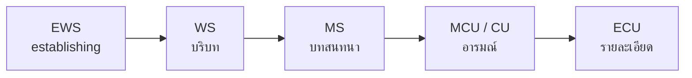
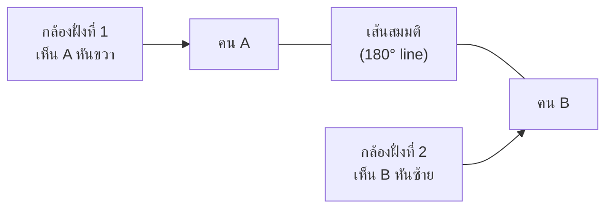

# บทที่ 3: วิดีโอ (Video)

> [!abstract] ภาพรวมบทเรียน
> บทที่ 2 สอนเรื่อง "แสงหนึ่งภาพ" บทนี้ต่อยอดเป็น **"แสงหลายพันภาพต่อเนื่องกัน"**
> เนื้อหาครอบคลุม 3 กลุ่ม: (1) **เวลา** — เฟรมเรต, ชัตเตอร์แองเกิล, slow motion, ปัญหาไฟกระพริบ; (2) **ข้อมูลภาพ** — ความละเอียด, อัตราส่วนภาพ, bitrate, codec, scopes; (3) **ภาษาในงานกล้อง** — ขนาดช็อต, การจัดภาพ, มุมกล้อง, การเคลื่อนกล้อง และกฎ continuity ที่ใช้จริงในกองถ่ายและห้องตัดต่อ
>
> ทุกหัวข้อมีบล็อก **"อ่านค่าให้เป็น"** ปิดท้าย — อธิบายว่าตัวเลข/คำย่อที่เห็นในกล้อง ในเมนู และในโปรแกรมตัดต่อหมายถึงอะไร

> [!info] ผลลัพธ์การเรียนรู้
> 1. อธิบายได้ว่าภาพเคลื่อนไหวเกิดจากอะไร และเลือกเฟรมเรตให้เหมาะกับงานได้
> 2. คำนวณ shutter angle และตั้งชัตเตอร์ตามกฎ 180° ได้
> 3. แก้ปัญหาไฟกระพริบ (50 Hz) และ rolling shutter หน้างานได้
> 4. เลือกความละเอียด อัตราส่วนภาพ bitrate และ codec ให้ตรงกับงานได้
> 5. อ่าน Waveform, Vectorscope และ RGB Parade ได้
> 6. ใช้ขนาดช็อต มุมกล้อง และการเคลื่อนกล้องเพื่อเล่าเรื่องได้
> 7. อธิบายและปฏิบัติตามกฎ 180°, กฎ 30° และ shot-reverse shot ได้

---

## 1. ภาพเคลื่อนไหวเกิดได้ 2 แบบ

### 1.1 ภาพเคลื่อนไหวในวิดีโอ

วิดีโอไม่ใช่ "ภาพที่ขยับ" แต่คือ **ภาพนิ่งหลายภาพต่อเนื่อง** ที่ฉายเร็วพอให้สมองหลอมรวมเป็นการเคลื่อนไหว

| ปรากฏการณ์ | ความหมาย | ผลต่อการรับชม |
| :--- | :--- | :--- |
| Persistence of vision | ตาค้างภาพเดิมไว้ชั่วครู่ (~1/15 วินาที) | เห็นเป็นภาพต่อเนื่อง |
| Phi phenomenon | สมองตีความลำดับภาพว่าเป็นการเคลื่อนที่ | เห็นการเคลื่อนไหวลื่น |
| Flicker fusion | ความถี่สูงพอ ตาไม่เห็นการกะพริบ | 24fps ขึ้นไปเริ่มดูลื่น |

### 1.2 การเคลื่อนไหว 2 แหล่งที่ต่างกัน

| แบบ | เกิดจาก | ตัวอย่าง | ต้องทำอะไรตอนถ่าย |
| :--- | :--- | :--- | :--- |
| **1. วัตถุเคลื่อนที่ในเฟรม** | คน/รถ/น้ำ ขยับเอง กล้องอยู่เฉย | คนเดินผ่านหน้า, น้ำไหล | คุมชัตเตอร์ไม่ให้เบลอเกิน |
| **2. กล้องเคลื่อนที่** | ตัวกล้องเองขยับ | Pan ตามรถ, Dolly เข้าประตู | คุมความเร็วและความนิ่งของกล้อง |

> [!important] จุดที่ต้องเข้าใจ
> ทั้งสองอย่างเกิดพร้อมกันได้ และ **ชัตเตอร์ควบคุม "ความเบลอ" ของทั้งสองแบบ**
> ชัตเตอร์ช้า → วัตถุที่ขยับเบลอเป็นทาง (motion blur) และกล้องที่ขยับก็ทำให้ทั้งภาพเบลอ

### 1.3 ภาพเคลื่อนไหว 2 แบบตามการผลิต

| แบบ | ผลิตอย่างไร | ต้นทุน/เวลา | งานที่เหมาะ |
| :--- | :--- | :--- | :--- |
| **Live action** (ถ่ายจริง) | บันทึกการเคลื่อนไหวจริงด้วยกล้อง | เร็ว ค่าใช้จ่ายกลาง | งานอีเวนต์, สารคดี, โฆษณา |
| **Frame-by-frame** (สร้างทีละเฟรม) | สร้างภาพทีละเฟรมแล้วเรียงต่อ | ช้า แพง | แอนิเมชัน, โมชันกราฟิก, VFX |

> [!note] เชื่อมกับบทที่ 1
> Frame-by-frame คือพื้นฐานของ **Animation** และ **Motion Graphics** ที่เรียนในบทที่ 1 ส่วน Live action คือวัตถุดิบหลักที่เข้าสู่ห้องตัดต่อ

**อ่านค่าให้เป็น — ตัวเลขในหัวข้อนี้หมายถึงอะไร**

| ค่า | ความหมาย | ตัวอย่างการอ่าน |
| :--- | :--- | :--- |
| 24 fps | 24 ภาพที่ฉายใน 1 วินาที | ภาพยนตร์ |
| 1/15 วินาที | ระยะที่ตาค้างภาพเดิมไว้ | ต่ำกว่านี้จะเห็นภาพกระพริบ |
| 1/50 s | เวลาต่อ 1 เฟรมที่ 50fps | 20 มิลลิวินาที |
| Live action | บันทึกการเคลื่อนไหวจริง | ถ่ายคนเดิน |
| Frame-by-frame | สร้างภาพทีละเฟรม | แอนิเมชัน 12–24 ภาพ/วินาที |

> [!note] fps กับ "ความคม" ไม่เกี่ยวกัน
> เพิ่ม fps ทำให้ **การเคลื่อนไหวลื่นขึ้น** ไม่ได้ทำให้ภาพคมขึ้น
> ความคมมาจากความละเอียด เลนส์ และการโฟกัส

---

## 2. เฟรมเรต: ทำไม 24 / 25 / 30 / 60 และ Slow Motion

### 2.1 เฟรมเรต (Frame Rate) คืออะไร

**fps (frames per second)** = จำนวนภาพนิ่งที่ฉายใน 1 วินาที

| fps | มาตรฐาน | ใช้กับงาน | ลักษณะการรับชม |
| :--: | :--- | :--- | :--- |
| 23.976 / 24 | Cinema | ภาพยนตร์, ซีรีส์, โฆษณาแนวภาพยนตร์ | ดู "หนัง" มี motion blur ธรรมชาติ |
| 25 | PAL (ไทย, ยุโรป) | ทีวีไทย, งานทั่วไป | มาตรฐานที่ปลอดภัยที่สุดในไทย |
| 29.97 / 30 | NTSC (สหรัฐ, ญี่ปุ่น) | งานที่ต้องส่งต่างประเทศ | ลื่นกว่า 24 เล็กน้อย |
| 50 | PAL ×2 | กีฬา, วิดีโอที่ต้อง slow motion | ลื่นมาก |
| 60 | NTSC ×2 | กีฬา, เกม, หน้าจอ | ลื่นที่สุดในงานทั่วไป |
| 120 / 240 | High-speed | Slow motion คุณภาพสูง | ต้องใช้กล้องเฉพาะ |

> [!warning] ประเทศไทยใช้ระบบ 50 Hz
> ไฟฟ้าบ้านเราเป็น **50 Hz** → หลอดไฟกระพริบ 100 ครั้ง/วินาที
> ถ้าถ่ายที่ 30fps ในห้องที่ใช้หลอดฟลูออเรสเซนต์ จะเห็น **แถบกระพริบ** (flicker)
> ทางแก้ที่ง่ายที่สุด: **ถ่ายที่ 25 หรือ 50 fps** และชัตเตอร์ 1/50 หรือ 1/100

### 2.2 เลือกเฟรมเรตอย่างไร

| โจทย์ | เลือก | เหตุผล |
| :--- | :--- | :--- |
| ละคร/หนังสั้น | 24 หรือ 25 | ได้อารมณ์ภาพยนตร์ |
| ข่าว/รายงาน/สัมภาษณ์ | 25 | มาตรฐานทีวีไทย |
| คลิป TikTok / Reels | 25 หรือ 30 | ตามแพลตฟอร์ม ไม่ต้องสูง |
| กีฬา/เต้น/เกม | 50 หรือ 60 | เห็นการเคลื่อนไหวละเอียด |
| ต้องทำ slow motion | 50–120 ขึ้นไป | มีเฟรมให้ยืด |

> [!important] กฎการส่งงาน
> ถ้าตัดต่อรวมกับฟุตเทจอื่น **ทุกคลิปควรเป็นเฟรมเรตเดียวกัน**
> ถ้าจำเป็นต้องผสม ให้แปลง (conform) ให้ตรง timeline ก่อน ไม่ใช่ปล่อยให้โปรแกรมเดา

### 2.3 Slow Motion

Slow motion เกิดจาก **ถ่ายเร็วกว่า แล้วเล่นช้ากว่า**

$$\text{อัตรายืด} = \frac{fps_{\text{ถ่าย}}}{fps_{\text{timeline}}}$$

| ถ่ายที่ | Timeline | ยืดกี่เท่า | ตัวอย่างการใช้ |
| :--: | :--: | :--: | :--- |
| 50 | 25 | 2× | น้ำกระเซ็น, คนกระโดด |
| 60 | 30 | 2× | กีฬาทั่วไป |
| 120 | 24 | 5× | ละอองน้ำ, การชน |
| 240 | 24 | 10× | ระเบิด, กระสุน (ต้องกล้องเฉพาะ) |

> [!tip] Slow motion ที่ดีต้องมี light ให้พอ
> เพราะชัตเตอร์สั้นมาก (เช่น 1/250 ที่ 120fps) แสงเข้าน้อย
> ถ้าแสงไม่พอ ต้องเพิ่ม ISO หรือเปิด f กว้างขึ้น — และระวัง noise

> [!note] Speed ramp
> การเปลี่ยนความเร็วกลางคลิป (ช้า → เร็ว) ทำได้ในโปรแกรมตัดต่อ แต่ **ต้องถ่ายที่เฟรมเรตสูงไว้ก่อน** ไม่งั้นตอนทำ slow จะกระตุก

**อ่านค่าให้เป็น — ตัวเลขในหัวข้อนี้หมายถึงอะไร**

| ค่า | ความหมาย | ตัวอย่างการอ่าน |
| :--- | :--- | :--- |
| 24 | 24 ภาพ/วินาที (มาตรฐานฟิล์ม) | ภาพยนตร์ |
| 23.976 | 24 × 1000/1001 เลี่ยงปัญหาคลื่นเสียงรบกวนระบบ NTSC เดิม | Blu-ray ส่วนใหญ่ |
| 25 | 25 ภาพ/วินาที (PAL) | ไทย/ยุโรป |
| 29.97 | 30 × 1000/1001 | NTSC, งานส่งอเมริกา |
| 50 / 60 | 2 เท่าของ 25/30 | กีฬา, slow motion |
| 120 | 120 ภาพ/วินาที | slow motion 5× ที่ 24fps |

> [!important] ตัวเลข .976 กับ .97 คืออะไร
> เป็นการชะลอความเร็วลง 0.1% เพื่อให้สัญญาณสี NTSC กับเสียงไม่ชนกัน
> ในงานตัดต่อ **เลือก 23.976 ให้ตรงกับฟุตเทจ** อย่าสลับกับ 24 เด็ดขาด จะเกิดเสียงไม่ตรงภาพ

---

## 3. Shutter Angle และกฎ 180°

### 3.1 Shutter Angle คืออะไร

กล้องฟิล์มใช้ **ม่านหมุน** ที่เปิดเป็นมุมองศา ส่วนกล้องดิจิทัลแปลงมุมนั้นเป็นเวลาเปิดรับแสง

$$\text{เวลาเปิดรับแสง} = \frac{\text{angle}}{360°} \times \frac{1}{fps}$$

| Angle | เวลาเปิดรับแสง (25fps) | ลักษณะ |
| :--: | :--- | :--- |
| 360° | 1/25 | เบลอที่สุด (ไม่มีม่านปิด) |
| 180° | 1/50 | **มาตรฐาน** — motion blur ธรรมชาติ |
| 90° | 1/100 | คมขึ้น เบลอน้อย |
| 45° | 1/200 | คมกริบ เหมาะฉากต่อสู้ |

### 3.2 กฎ 180°

**"ชัตเตอร์ = 1 / (2 × fps)"**

| fps | ชัตเตอร์ตามกฎ 180° |
| :--: | :--- |
| 24 | 1/48 (ใช้ 1/50) |
| 25 | 1/50 |
| 30 | 1/60 |
| 50 | 1/100 |
| 60 | 1/120 |
| 120 | 1/250 |

> [!important] ทำไมต้อง 180°
> เพราะเป็นค่าที่ทำให้ **การเบลอจากการเคลื่อนไหวใกล้เคียงกับที่ตามนุษย์เห็น**
> ถ้าใช้ชัตเตอร์เร็วเกิน (angle เล็ก) ภาพจะดูละเอียดจน "แข็ง" เหมือนวิดีโอจากกล้องวงจรปิด
> ถ้าใช้ช้าเกิน (angle ใหญ่) จะดูเลอะจนเหมือนภาพฝัน

### 3.3 เมื่อไรควรแหกกฎ 180°

| สถานการณ์ | ใช้ angle | เพราะ |
| :--- | :--: | :--- |
| ฉากสงคราม/ต่อสู้ อยากให้ดุเดือด | 45°–90° | ภาพคม กระชาก |
| ฉากฝัน/แฟลชแบ็ก | 360° | เบลอ เลื่อนไหล |
| ถ่ายในที่มีแสงน้อยมาก | 360° หรือชัตเตอร์ช้าสุด | เก็บแสงให้พอ |
| ต้องดึงเฟรมไปทำ VFX / คัตเอาต์ | 90° ลงไป | เฟรมคมเพื่อ key ได้ง่าย |

**อ่านค่าให้เป็น — ตัวเลขในหัวข้อนี้หมายถึงอะไร**

| ค่า | ความหมาย | ตัวอย่างการอ่าน |
| :--- | :--- | :--- |
| 180° | ม่านเปิดครึ่งรอบการหมุน = ครึ่งหนึ่งของเวลาต่อเฟรม | 25fps → 1/50 |
| 360° | เปิดตลอดเวลา ไม่มีม่านปิด | เบลอสุด |
| 90° | เปิด 1/4 ของเวลาต่อเฟรม | 25fps → 1/100 |
| 1/50 | เวลาเปิดจริง 20 ms | กฎ 180° ที่ 25fps |
| 1/48 | 20.8 ms | กฎ 180° ที่ 24fps |

> [!note] Angle กับเวลาเป็นของคู่กัน
> เปลี่ยน fps แต่คง angle 180° → เวลาเปิดเปลี่ยนตาม
> เปลี่ยน angle แต่คง fps → เวลาเปิดเปลี่ยน เพราะ angle คือ **สัดส่วนของเวลาต่อเฟรม**

---

## 4. ปัญหาหน้างาน: แสงกระพริบ (50 Hz) และ Rolling Shutter

### 4.1 Flicker จากไฟบ้าน 50 Hz

**สาเหตุ:** หลอดไฟ (ฟลูออเรสเซนต์, LED บางรุ่น) กระพริบ 100 ครั้ง/วินาที (2 เท่าของ 50 Hz)
ถ้าชัตเตอร์ไม่สัมพันธ์กับจังหวะกระพริบ แต่ละเฟรมจะได้รับแสงไม่เท่ากัน → เห็นแถบสว่าง-มืดไล่ขึ้นลง

| อาการ | สาเหตุ | วิธีแก้ |
| :--- | :--- | :--- |
| แถบสว่าง–มืดไล่ขึ้นลงในภาพ | ชัตเตอร์ไม่ sync กับไฟ 50 Hz | ตั้งชัตเตอร์ 1/50 หรือ 1/100 |
| ภาพสว่าง-มืดเป็นจังหวะทั้งเฟรม | ถ่าย 30fps ในไฟ 50 Hz | เปลี่ยนไป 25fps |
| เห็นแถบเฉพาะบางโซน | ไฟ LED คุณภาพต่ำ | เปลี่ยนชัตเตอร์/เปิด anti-flicker |
| ภาพกระพริบตอนตัดต่อ | หลายคลิปคนละชัตเตอร์ | ตั้งค่าเดียวกันทุกคลิป |

> [!tip] กติกาจำง่ายสำหรับงานในไทย
> **อยู่ในอาคาร → 25fps + 1/50 · กลางแจ้ง → 25fps + 1/50 ก็ปลอดภัย**
> ถ้าจำเป็นต้องใช้ 30fps ให้ลอง 1/60 และตรวจดูในจอทีละช็อต

> [!warning] หลอด LED บางรุ่นกระพริบไม่คงที่
> ต่อให้ตั้ง 1/50 ก็ยังเห็นแถบ — ให้เปลี่ยนไปใช้หลอดถ่ายภาพ (flicker-free) หรือลดชัตเตอร์ลงอีก

### 4.2 Rolling Shutter

เซนเซอร์ CMOS ส่วนใหญ่ **อ่านข้อมูลทีละแถวจากบนลงล่าง** ใช้เวลาประมาณ 1/30–1/60 วินาทีต่อเฟรม
ถ้าวัตถุหรือกล้องเคลื่อนเร็วระหว่างที่อ่าน → ภาพบิดเบี้ยว

| อาการ | เกิดเมื่อ | วิธีแก้ |
| :--- | :--- | :--- |
| ภาพเอียง (skew) | Pan เร็ว ๆ ตามรถ | Pan ช้าลง / ใช้ gimbal |
| ภาพโก่ง (wobble) | ถือกล้องเดิน/สั่น | ใช้ stabilizer, ลดทางยาวโฟกัส |
| เส้นตรงหักงอ (jello) | กล้องสั่นแรง | ตรึงกล้อง/ขาตั้ง |
| ครึ่งบน-ล่างสว่างไม่เท่า | ถ่ายกับไฟกระพริบ | ปรับชัตเตอร์ให้ sync |
| ใบพัดเฮลิคอปเตอร์บิด | วัตถุหมุนเร็ว | ใช้กล้อง global shutter |

> [!note] Global shutter คือทางออก
> กล้อง cine บางรุ่นมี **global shutter** ที่อ่านทุกพิกเซลพร้อมกัน → ไม่มี skew/wobble
> แต่ราคาสูงและมักมี noise มากกว่า — จึงยังไม่ใช่มาตรฐานของกล้องทั่วไป

**อ่านค่าให้เป็น — ตัวเลขในหัวข้อนี้หมายถึงอะไร**

| ค่า | ความหมาย | ตัวอย่างการอ่าน |
| :--- | :--- | :--- |
| 50 Hz | ความถี่ไฟบ้านไทย (สลับขั้ว 50 รอบ/วินาที) | หลอดไฟกระพริบ 100 ครั้ง/วินาที |
| 100 Hz | อัตรากระพริบจริงของหลอด (2 เท่าของ 50) | คาบละ 10 ms |
| 1/100 | ชัตเตอร์ที่เปิดเท่าคาบไฟพอดี | ปลอด flicker |
| 1/60 | 16.7 ms — ไม่ตรงคาบ 10 ms | เกิดแถบกระพริบ |
| Readout 1/30 s | เวลาที่เซนเซอร์อ่านครบทั้งเฟรม | เร็วพอให้ภาพเอียง |

> [!note] จำง่าย ๆ
> ไฟ 50 Hz = หลอดกระพริบทุก 10 ms
> ชัตเตอร์ 1/100 = 10 ms พอดี → ได้แสงเท่ากันทุกเฟรม
> ชัตเตอร์ 1/60 = 16.7 ms → คร่อมการกระพริบ ไม่เท่ากันทุกเฟรม

---

## 5. ความละเอียด, อัตราส่วนภาพ, Bitrate, Codec

### 5.1 ความละเอียด (Resolution)

| ชื่อ | ขนาดพิกเซล | หมายเหตุ |
| :--- | :--- | :--- |
| 720p (HD) | 1280 × 720 | งานเก่า/เว็บเบา |
| 1080p (Full HD) | 1920 × 1080 | **มาตรฐานงานทั่วไป** |
| 1440p (QHD) | 2560 × 1440 | งาน YouTube |
| 4K UHD | 3840 × 2160 | งานคุณภาพสูง |
| DCI 4K | 4096 × 2160 | มาตรฐานโรงหนัง |
| 8K | 7680 × 4320 | งานพิเศษ/ครอปภายหลัง |

> [!tip] ถ่าย 4K เพื่อส่ง 1080p
> ได้ประโยชน์ 2 อย่าง: **ครอป/ซูมได้** ในห้องตัดต่อ และ **ภาพคมขึ้นเมื่อย่อลง** (downscale)
> แต่กินพื้นที่และต้องใช้คอมพิวเตอร์แรงขึ้น

### 5.2 อัตราส่วนภาพ (Aspect Ratio)

| อัตราส่วน | ตัวเลข | ใช้กับ |
| :--- | :--: | :--- |
| 16:9 | 1.78 | YouTube, ทีวี, งานทั่วไป |
| 9:16 | 0.56 | TikTok, Reels, Shorts |
| 1:1 | 1.00 | Instagram feed, งานสิ่งพิมพ์ |
| 4:5 | 0.80 | Instagram แนวตั้ง |
| 21:9 / 2.39:1 | 2.39 | ภาพยนตร์ (CinemaScope) |
| 4:3 | 1.33 | งานวินเทจ, กล้องเก่า |

> [!important] ถ่ายให้ปลอดภัยไว้ก่อน
> ถ้างานต้องส่งหลายแพลตฟอร์ม ให้ถ่าย **16:9** แล้วเว้นพื้นที่ปลอดภัย (safe area) ตรงกลาง
> เวลาทำ 9:16 จะได้ครอปได้โดยไม่ตัดหัวคน

### 5.3 Bitrate

**Bitrate** = ปริมาณข้อมูลต่อวินาที (Mbps) — ยิ่งสูง คุณภาพยิ่งดี แต่ไฟล์ใหญ่

| งาน | bitrate แนะนำ |
| :--- | :--- |
| 1080p เผยแพร่เว็บ | 8–12 Mbps |
| 1080p คุณภาพสูง | 20–50 Mbps |
| 4K เผยแพร่ YouTube | 35–45 Mbps |
| 4K งานตัดต่อ (ProRes 422) | ~880 Mbps |
| 4K RAW | 1,500+ Mbps |

| ชนิด | ลักษณะ | ข้อดี | ข้อเสีย |
| :--- | :--- | :--- | :--- |
| **CBR** (Constant) | bitrate คงที่ | streaming ลื่น | สิ้นเปลืองกับฉากนิ่ง |
| **VBR** (Variable) | ปรับตามความซับซ้อน | ประหยัดไฟล์ | ประมวลผลหนักกว่า |

### 5.4 Codec และ Chroma Subsampling

| Codec | ประเภท | ใช้กับ | ข้อดี | ข้อเสีย |
| :--- | :--- | :--- | :--- | :--- |
| H.264 / AVC | Interframe | กล้องทั่วไป, เผยแพร่ | ไฟล์เล็ก เข้ากันได้ทุกที่ | ตัดต่อหนัก เครื่องช้า |
| H.265 / HEVC | Interframe | 4K, มือถือ | เล็กลง 50% ที่คุณภาพเท่า | เครื่องเก่าอ่านไม่ไหว |
| ProRes 422 / HQ | Intraframe | งานตัดต่อมืออาชีพ | ตัดต่อลื่น | ไฟล์ใหญ่ |
| DNxHR | Intraframe | งานตัดต่อ Windows | เสถียร | ไฟล์ใหญ่ |
| RAW | ไม่บีบอัด/บีบอัดเล็กน้อย | งานภาพยนตร์ | แก้สีได้สุด | ใหญ่ที่สุด |

**Chroma Subsampling** — การลดข้อมูล "สี" ลง แต่เก็บ "ความสว่าง" ครบ

| แบบ | เก็บสี | เหมาะกับ |
| :--- | :--- | :--- |
| 4:4:4 | ครบทุกพิกเซล | งาน key green screen, VFX |
| 4:2:2 | ครึ่งหนึ่งแนวนอน | งานตัดต่อมืออาชีพ |
| 4:2:0 | ครึ่งทั้งสองแกน | เผยแพร่ทั่วไป, กล้องมือถือ |

> [!danger] กับดักที่เจอบ่อย
> ถ่าย green screen ด้วย **4:2:0** แล้ว key ขอบไม่สะอาด
> เพราะข้อมูลสีถูกบีบอัดจนขอบสีเขียวปนเข้าไปในตัวแบบ → ต้องใช้ 4:2:2 ขึ้นไป

**อ่านค่าให้เป็น — ตัวเลขในหัวข้อนี้หมายถึงอะไร**

| ค่า | ความหมาย | ตัวอย่างการอ่าน |
| :--- | :--- | :--- |
| 1920 × 1080 | จำนวนพิกเซลแนวนอน × แนวตั้ง = 2.07 ล้านพิกเซล | 1080p |
| 3840 × 2160 | 8.3 ล้านพิกเซล | 4K UHD |
| 16:9 | อัตราส่วนกว้าง ÷ สูง = 1.78 | ทีวี/YouTube |
| 9:16 | 0.56 (แนวตั้ง) | TikTok |
| 20 Mbps | 20 ล้านบิต/วินาที = 2.5 MB/วินาที | ไฟล์ 1 นาที ≈ 150 MB |
| 4:2:0 | สีเก็บ 1 ใน 4 ของ 4:4:4 | ไฟล์เล็ก คุณภาพสีต่ำ |
| 10-bit | 1,024 ระดับต่อช่องสี (8-bit = 256) | เกรดสีได้นุ่มกว่า |

> [!tip] แปลง Mbps เป็น MB/s ให้หาร 8
> 100 Mbps = 12.5 MB/s → ถ่าย 10 นาที = 7.5 GB
> ใช้คำนวณพื้นที่การ์ด/ดิสก์ก่อนออกกอง

---

## 6. Scopes: Waveform, Vectorscope, RGB Parade

Scopes คือเครื่องมือวัดภาพ **แบบภาวิสัย (objective)** ใช้แทนสายตา (ซึ่งเพี้ยนได้ตามจอและแสงในห้อง)

### 6.1 Waveform

- แกนนอน = ตำแหน่งซ้าย–ขวาของภาพ
- แกนตั้ง = ความสว่าง (IRE 0–100)
- อ่าน: เส้นที่สูงเกิน 100 = ไหม้ · ต่ำกว่า 0 = ดำสนิท

| เห็นอะไร | หมายถึง | แก้อย่างไร |
| :--- | :--- | :--- |
| ยอดพุ่งแตะ 100 | ไฮไลต์ไหม้ | ลด exposure/highlight |
| กองติด 0 | เงาดำสนิท | ยก shadow ขึ้น |
| ภาพแบนอยู่กลาง 40–60 | คอนทราสต์ต่ำ | เพิ่ม contrast |
| ขอบซ้าย-ขวาสูงไม่เท่ากัน | แสงไม่สม่ำเสมอ | แก้ไฟหน้างาน/ใส่ mask |

### 6.2 Vectorscope

- วงกลม = ความอิ่มตัวของสี (ยิ่งออกจากศูนย์ยิ่งอิ่ม)
- ทิศทาง = เฉดสี (R/M/B/C/G/Y)
- **เส้นผิวคน (skin tone line)** อยู่ราว 11 นาฬิกา

| เห็นอะไร | หมายถึง | แก้อย่างไร |
| :--- | :--- | :--- |
| ผิวคนอยู่บนเส้น skin tone | สีผิวถูกต้อง | ผ่าน |
| ผิวคนเอียงไปทางแดง | ผิวอมแดง | ลด red / ปรับ WB |
| ผิวคนเอียงไปทางเขียว | ผิวอมเขียว (หลอดฟลูออเรสเซนต์) | ปรับ tint ไปทาง magenta |
| กองสีออกนอกวง | สีเกินขอบเขต broadcast | ลด saturation |

### 6.3 RGB Parade

- แยก 3 กราฟ: แดง เขียว น้ำเงิน
- ใช้ดู **White Balance** และ **สีเพี้ยนเฉพาะโซน**

| เห็นอะไร | หมายถึง |
| :--- | :--- |
| สามกราฟสูงเท่ากันในจุดที่เป็นสีขาว | WB ถูกต้อง |
| กราฟน้ำเงินสูงกว่าตลอด | ภาพอมฟ้า (WB เย็นเกิน) |
| กราฟแดงสูงในเงา | เงาอมแดง |
| กราฟตัดขาดที่ด้านบน | ไฮไลต์ช่องสีนั้นไหม้ |

> [!tip] ลำดับดู scopes ที่ถูกต้อง
> 1. **Waveform** ดูก่อน — ความสว่างถูกไหม
> 2. **RGB Parade** ต่อ — สมดุลสีโดยรวมถูกไหม
> 3. **Vectorscope** สุดท้าย — สีผิวและความอิ่มตัว

**อ่านค่าให้เป็น — ตัวเลขในหัวข้อนี้หมายถึงอะไร**

| ค่า | ความหมาย | ตัวอย่างการอ่าน |
| :--- | :--- | :--- |
| 0 IRE | ระดับดำ (0 mV) | ห้ามต่ำกว่านี้ในงาน broadcast |
| 100 IRE | ระดับขาว (700 mV) | เกิน = ไหม้ |
| 0–255 | สเกลภาพนิ่ง 8-bit | ใช้ใน Photoshop |
| 0–1023 | สเกลวิดีโอ 10-bit | งานตัดต่อ |
| 75% bars | แถบสีมาตรฐานสำหรับ calibrate | ใช้ตั้งจอ |
| Skin tone line (~123°) | เส้นอ้างอิงสีผิวบน vectorscope | ผิวคนควรอยู่บนเส้นนี้ |

> [!note] ทำไมต้องมีทั้ง IRE และ 255
> เป็นหน่วยของคนละโลก: **วิดีโอ** วัดเป็นสัญญาณ (IRE/mV) · **ภาพนิ่ง** วัดเป็นค่าพิกเซล (0–255)
> ค่า 100 IRE ≈ 255 ≈ 1.0 — สื่อความหมายเดียวกันคือ "สว่างสุด"

---

## 7. ขนาดช็อต (Shot Size): EWS → ECU

| ขนาด | ชื่อเต็ม | เห็นอะไร | ใช้เมื่อ |
| :--- | :--- | :--- | :--- |
| **EWS** | Extreme Wide Shot | ภาพกว้างมาก คนเป็นจุดเล็ก ๆ | เปิดฉาก บอกสถานที่ |
| **WS / LS** | Wide Shot / Long Shot | เห็นคนทั้งตัว + สภาพแวดล้อม | แนะนำตัวละครในฉาก |
| **MWS / MLS** | Medium Wide / Medium Long | หัวถึงเข่า | เดิน/ท่าทาง |
| **MS** | Medium Shot | หัวถึงเอว | บทสนทนาทั่วไป |
| **MCU** | Medium Close-Up | หัวถึงอก | สัมภาษณ์, อารมณ์เริ่มชัด |
| **CU** | Close-Up | ใบหน้า | อารมณ์ ความรู้สึก |
| **ECU** | Extreme Close-Up | ตา/ปาก/รายละเอียด | เน้นจุดสำคัญ |

> [!important] หลักการเลือกขนาดช็อต
> **"ยิ่งใกล้ ยิ่งอารมณ์ · ยิ่งไกล ยิ่งบริบท"**
> ฉากหนึ่งไม่ควรกระโดดข้ามขนาด เช่น MS → ECU ทันที (ยกเว้นตั้งใจให้กระชาก)

### 7.1 ลำดับช็อตมาตรฐาน (Coverage)

> [!tip] ถ่ายให้ครบก่อนกลับบ้าน
> ทุกฉากควรมีอย่างน้อย **Wide 1 · Medium 1 · Close 1 · Insert 1**
> ถ้าขาด wide จะตัดต่อไม่ได้เลย เพราะไม่มีภาพเชื่อมฉาก

**อ่านค่าให้เป็น — ตัวย่อในหัวข้อนี้หมายถึงอะไร**

| ตัวย่อ | คำเต็ม | ความหมาย |
| :--- | :--- | :--- |
| EWS | Extreme Wide Shot | กว้างสุด เห็นสภาพแวดล้อมทั้งหมด |
| WS / LS | Wide Shot / Long Shot | เห็นคนทั้งตัว |
| MWS / MLS | Medium Wide / Medium Long | หัวถึงเข่า |
| MS | Medium Shot | หัวถึงเอว |
| MCU | Medium Close-Up | หัวถึงอก |
| CU | Close-Up | ใบหน้า |
| ECU | Extreme Close-Up | ตา/ปาก/รายละเอียด |

> [!note] ทำไมต้องมีชื่อขนาดช็อต
> เพราะในกองถ่ายใช้เรียกสื่อสารกันทั้งทีม เช่น "ขอ MCU อีกตัว"
> และในห้องตัดต่อใช้เป็นภาษากลางในการสั่งงาน/edit

---

## 8. กฎการจัดภาพ: Rule of Thirds, Headroom, Lead Room

### 8.1 Rule of Thirds

แบ่งภาพเป็น 3×3 แล้ววางจุดสนใจบน **เส้นตัดหรือจุดตัด**

| วางตัวแบบ | ผล |
| :--- | :--- |
| กลางภาพเป๊ะ | นิ่ง เป็นทางการ แต่จำเจ |
| บนจุดตัด | น่าสนใจ สมดุล |
| ชิดขอบ | อึดอัด ใช้เมื่อตั้งใจ |

> [!note] ใช้กับวิดีโออย่างไร
> ในวิดีโอ บุคคลที่พูดไม่ควรอยู่กลางภาพตลอด ถ้าจะตัดสลับมุม ให้เว้นที่ทางที่เขาหันหน้าไป

### 8.2 Headroom

**Headroom** = ระยะห่างระหว่างหัวกับขอบบนของภาพ

| Headroom | ผล |
| :--- | :--- |
| น้อยเกิน (หัวชิดขอบ) | อึดอัด เหมือนถูกตัดหัว |
| พอดี (หัวอยู่ราว 1/3–1/10 จากขอบบน) | สมดุล |
| มากเกิน | ภาพโล่ง ตัวแบบจมลงล่าง |

> [!warning] กฎที่ต้องจำ
> **ห้ามตัดที่ "ข้อต่อ"** — คอ, ข้อศอก, ข้อมือ, เข่า
> ถ้าจะตัด ให้ตัดกลางต้นแขน/กลางต้นขา หรือเหนือศีรษะไปเลย

### 8.3 Lead Room (Look Space)

ถ้าคนหันหน้าไปทางขวา ต้องเว้นที่ว่างทางขวาให้เขามอง

| วางตัวแบบ | ผล |
| :--- | :--- |
| เว้นที่ทางที่หันไป | รู้สึกอิสระ มีอนาคต |
| เว้นที่ด้านหลังหัว | รู้สึกอึดอัด ถูกกัก |
| หันชนขอบภาพ | รู้สึกติดกับ ต้องการออก |

> [!tip] ใช้ในงานวิดีโอ
> เวลาคนเดินจากซ้ายไปขวา ให้เว้นที่ด้านขวาไว้ — แต่ถ้าเดินเข้ามาในเฟรม ให้เว้นด้านที่เขาจะไป

**อ่านค่าให้เป็น — ตัวเลขในหัวข้อนี้หมายถึงอะไร**

| ค่า | ความหมาย | ตัวอย่างการอ่าน |
| :--- | :--- | :--- |
| 1/3 | เส้นแบ่งภาพที่ 33% และ 66% | จุดตัด 4 จุด |
| Headroom ~5–10% | ระยะหัวถึงขอบบน คิดเป็น % ของความสูงภาพ | 1080p ≈ 54–108 px |
| 1/10 | ระยะเผื่อขั้นต่ำสำหรับงานที่จะครอปภายหลัง | เผื่อทำ 9:16 |
| Safe area 90% | พื้นที่ที่ปลอดภัยจากการถูกตัดขอบจอ | ตัวหนังสือต้องอยู่ในนี้ |
| 30° | มุมเปลี่ยนขั้นต่ำในการสลับช็อต (กฎ 30°) | กัน jump cut |

> [!note] คิดเป็นพิกเซลให้เห็นภาพ
> 1080p สูง 1080 px → headroom 5% = 54 px, 10% = 108 px
> ถ้าหัวชิดขอบบนไม่ถึง 2% (≈20 px) จะดูอึดอัดทันที

---

## 9. มุมกล้อง: Eye-Level, High, Low, Dutch, POV, OTS

| มุมกล้อง | วิธีตั้ง | ให้ความรู้สึก | ใช้กับ |
| :--- | :--- | :--- | :--- |
| **Eye-level** | ระดับสายตาตัวแบบ | เป็นกลาง เป็นมิตร | สัมภาษณ์, บทสนทนา |
| **High angle** | สูงกว่าตัวแบบ มองลง | ตัวแบบเล็ก อ่อนแอ ถูกควบคุม | เด็ก, ผู้ต้องหา, ภาพรวม |
| **Low angle** | ต่ำกว่าตัวแบบ มองขึ้น | ใหญ่ มีอำนาจ น่าเกรงขาม | ฮีโร่, ผู้นำ, ตัวร้าย |
| **Dutch angle** | เอียงกล้อง | วุ่นวาย ไม่มั่นคง อึดอัด | ฉากตื่นเต้น, ตัวละครสติแตก |
| **POV** | ผ่านสายตาตัวละคร | ผู้ชมเป็นตัวละคร | ฉากตกใจ, เกม, VR |
| **OTS** (Over the Shoulder) | ถ่ายข้ามไหล่คนหนึ่งไปอีกคน | อยู่ในบทสนทนา | บทสนทนา 2 คน |

> [!note] ระดับกล้องในงานสัมภาษณ์
> ใช้ **eye-level** เป็นหลัก และตั้งกล้องให้อยู่ระดับตาเมื่อนั่ง
> ถ้ากล้องสูงเกิน คนพูดจะดูถูกกด ดูไม่น่าเชื่อถือ

### 9.1 การจับคู่มุมกล้องในฉากเดียว

| ฉาก | มุมที่ใช้ |
| :--- | :--- |
| บทสนทนา 2 คน | OTS A→B, OTS B→A, MS ทั้งคู่ (master shot) |
| สัมภาษณ์ | MS + CU สลับ |
| ฉากเปิดเรื่อง | EWS / High angle |
| ฉาก confrontation | Dutch + Low angle |

**อ่านค่าให้เป็น — คำในหัวข้อนี้หมายถึงอะไร**

| คำ | ความหมาย | ตัวอย่างการอ่าน |
| :--- | :--- | :--- |
| Eye-level | กล้องสูงระดับสายตาตัวแบบ | กล้องนั่ง = ระดับตาเมื่อนั่ง |
| High angle | กล้องสูงกว่าตัวแบบ มองลง | ยิ่งสูงยิ่งกดตัวแบบ |
| Low angle | กล้องต่ำกว่าตัวแบบ มองขึ้น | ยิ่งต่ำยิ่งทำให้ดูใหญ่ |
| Dutch | เอียงกล้องบนแกนเลนส์ | ปกติ 10°–45° |
| POV | Point of View — มองผ่านตาตัวละคร | กล้องอยู่ตำแหน่งตา |
| OTS | Over The Shoulder — ข้ามไหล่ | เห็นไหล่คนหนึ่งเป็นเฟรมหน้า |

> [!note] Dutch เอียงเท่าไรจึงพอดี
> 5°–10° = รู้สึกไม่สบายใจเล็กน้อย
> 15°–30° = วุ่นวาย ชัดเจน
> 45° ขึ้นไป = แทบอ่านภาพไม่ออก ใช้เฉพาะจังหวะที่ต้องการ

---

## 10. การเคลื่อนกล้อง: Pan, Tilt, Dolly, Track, Handheld, Gimbal

| การเคลื่อน | แกน/วิธี | อุปกรณ์ | ใช้เมื่อ |
| :--- | :--- | :--- | :--- |
| **Pan** | หมุนซ้าย–ขวาบนขาตั้ง | ขาตั้ง | สำรวจฉาก, ตามวัตถุ |
| **Tilt** | เงย–ก้ม | ขาตั้ง | เผยความสูง, กวาดขึ้นลง |
| **Dolly** | เลื่อนเข้าหรือออกจากตัวแบบ | dolly/slider | เน้นอารมณ์, เผยความจริง |
| **Track / Truck** | เลื่อนขนานกับตัวแบบ | slider, ราง | เดินตามคน, ตามรถ |
| **Pedestal** | ยกขึ้น–ลงทั้งตัวกล้อง | ขาตั้ง/จิบ | เปลี่ยนระดับสายตา |
| **Handheld** | ถือมือ | มือ/rig | สารคดี, วิตก, สมจริง |
| **Gimbal** | ถือด้วย stabilizer | gimbal | เดินกล้องลื่น |
| **Crane / Jib** | เงยขึ้น–ลงด้วยแขนกล | crane | เผยภาพกว้าง, เปิดเรื่อง |

> [!important] Dolly ≠ Zoom
> **Zoom** เปลี่ยนเลนส์ (ภาพแบนลง ระยะไม่เปลี่ยน)
> **Dolly** เดินกล้อง (ระยะเปลี่ยน ฉากหลังเลื่อน)
> ถ้าทำพร้อมกันแบบกลับทิศ (dolly in + zoom out) = **Vertigo effect (dolly zoom)** ใช้แสดงความตกใจ

### 10.1 หลักการใช้กล้องเคลื่อนที่

1. **มีเหตุผลเสมอ** — เคลื่อนเพื่อพาผู้ชมไปดูอะไร ไม่ใช่เพราะสวย
2. **เริ่มและจบนิ่ง** — เว้น 2–3 วินาทีหัวท้าย เพื่อให้ตัดต่อได้
3. **ช้าและนิ่ง** — การเคลื่อนกล้องช้าให้ความรู้สึกมีระดับ
4. **อย่าเคลื่อนหลายแกนพร้อมกัน** ถ้าไม่ชำนาญ

> [!warning] ความผิดพลาดที่พบบ่อย
> - Pan เร็วเกินไป → ภาพเบลอและดูเวียนหัว
> - Handheld มากเกินไป → ผู้ชมเมื่อยตา
> - เคลื่อนกล้องตลอดเวลา → ไม่มีจังหวะให้คนดูได้พัก

**อ่านค่าให้เป็น — คำในหัวข้อนี้หมายถึงอะไร**

| คำ | แกน/หน่วย | ความหมาย |
| :--- | :--- | :--- |
| Pan | หมุนรอบแกนตั้ง (ซ้าย–ขวา) | วัดเป็น °/วินาที |
| Tilt | หมุนรอบแกนนอน (เงย–ก้ม) | วัดเป็น °/วินาที |
| Dolly | เลื่อนเข้าออกตามแนวเลนส์ | วัดเป็นเมตร |
| Track / Truck | เลื่อนขนานซ้าย–ขวา | วัดเป็นเมตร |
| Pedestal | ยกขึ้น–ลงทั้งตัวกล้อง | วัดเป็นเซนติเมตร |
| Gimbal 3 แกน | yaw / pitch / roll | กันสั่น 3 ทิศ |
| Dolly zoom | Dolly in + Zoom out พร้อมกัน | เปลี่ยน perspective โดยขนาดตัวแบบคงที่ |

> [!tip] ความเร็ว pan ที่กำลังดี
> 5°–15° ต่อวินาที = นุ่ม อ่านทัน
> เกิน 30°/วินาที = เบลอ ดูเวียนหัว (และเจอ rolling shutter)

---

## 11. Continuity: กฎ 180°, กฎ 30°, Shot-Reverse Shot

### 11.1 กฎ 180° (180-Degree Rule)

ในฉากสนทนา ให้จินตนาการเส้นสมมติระหว่างคน 2 คน **ห้ามข้ามเส้นนี้**

| ฝั่งกล้อง | ผล |
| :--- | :--- |
| อยู่ฝั่งเดียวกันตลอด | ทิศทางการมองสอดคล้อง ดูง่าย |
| ข้ามเส้นกลางฉาก | คนดูสับสน ทิศกลับทันที |

> [!note] ถ้าจำเป็นต้องข้ามเส้น
> ต้องมี **ช็อตเชื่อม** (เช่น ถ่ายรถวิ่งผ่าน, กล้องแพนตาม, หรือให้ตัวละครเดินข้าม) เพื่อให้คนดู "รีเซ็ต" ทิศทาง

### 11.2 กฎ 30° (30-Degree Rule)

เมื่อตัดสลับมุมกล้องของตัวแบบเดียวกัน **ต้องเปลี่ยนมุมอย่างน้อย 30°**

| เปลี่ยนมุม | ผล |
| :--- | :--- |
| น้อยกว่า 30° | ภาพกระโดด (jump cut) ดูเหมือนภาพสะดุด |
| 30° ขึ้นไป | ดูเป็นคนละมุม สบายตา |

### 11.3 Shot-Reverse Shot

ลำดับมาตรฐานของฉากสนทนา

| ลำดับ | ช็อต | หน้าที่ |
| :--: | :--- | :--- |
| 1 | Master shot (MS ทั้งคู่) | บอกตำแหน่งและบริบท |
| 2 | OTS ไปที่ A | ฟัง A พูด |
| 3 | OTS ไปที่ B | เห็นปฏิกิริยา B |
| 4 | CU A | เน้นอารมณ์ |
| 5 | Insert (มือ/วัตถุ) | รายละเอียด |
| 6 | กลับ Master | ปิดฉาก |

> [!important] Eyeline match
> สายตาของ A ต้องมองไปทางเดียวกับที่ B อยู่ และระดับสายตาต้องใกล้กัน
> ถ้าสายตาไม่ตรง คนดูจะรู้สึก "ไม่เชื่อ" ทันทีโดยไม่รู้ตัว

**อ่านค่าให้เป็น — ตัวเลขในหัวข้อนี้หมายถึงอะไร**

| ค่า | ความหมาย | ตัวอย่างการอ่าน |
| :--- | :--- | :--- |
| 180° | เส้นสมมติที่ลากผ่านคน 2 คน ห้ามกล้องข้าม | ครึ่งวงกลมซีกหนึ่ง |
| 30° | มุมต่างขั้นต่ำเมื่อสลับช็อตตัวเดียวกัน | ต่ำกว่านี้ = jump cut |
| OTS | ช็อตข้ามไหล่ คู่ตรงข้าม | ใช้ในบทสนทนา |
| Eyeline | ระดับสายตาของคู่สนทนา | ต้องตรงกันทั้งสองช็อต |
| Master shot | ช็อต Wide ที่เห็นทั้งฉาก | ใช้เป็นหลักก่อนตัดสลับ |

> [!note] ทำไมต้อง 30° ไม่ใช่ 20°
> เพราะตาคนจับความต่างของมุมได้ตั้งแต่ประมาณ 30° ขึ้นไป
> ถ้าน้อยกว่านั้น สมองจะตีความว่า "ภาพเดิมสะดุด" ไม่ใช่ "มุมใหม่"

---

## 12. ตารางสรุปค่าใช้งานจริง (ตั้งกล้องวิดีโอ)

| งาน | fps | ชัตเตอร์ | f | ISO | หมายเหตุ |
| :--- | :--: | :--- | :--: | :--: | :--- |
| สัมภาษณ์ในห้อง (ไฟ 50 Hz) | 25 | 1/50 | 2.8–4 | 400–800 | กัน flicker |
| กลางแจ้ง แดดจัด | 25 | 1/50 | 8–11 | 100 | ใช้ ND ถ้าสว่างเกิน |
| กลางแจ้ง ต้องการเบลอหลัง | 25 | 1/50 | 2.8 | 100 | ใส่ ND filter |
| กีฬา/เต้น | 50 | 1/100 | 4 | 400–1600 | ลื่น + หยุดการเคลื่อนไหว |
| Slow motion 2× | 50 | 1/100 | 2.8 | 400 | ตัดที่ timeline 25fps |
| กลางคืน ถนน | 25 | 1/50 | 1.8 | 1600–3200 | ระวังนอยซ์ |
| TikTok แนวตั้ง | 25–30 | 1/50–1/60 | 2.8 | 400 | 9:16 + safe area |

---

## 13. ข้อผิดพลาดที่พบบ่อย

| # | อาการ | สาเหตุ | วิธีแก้ |
| :--: | :--- | :--- | :--- |
| 1 | เห็นแถบกระพริบในภาพ | 30fps ในไฟ 50 Hz | เปลี่ยนเป็น 25fps + 1/50 |
| 2 | ภาพเอียงตอน pan | rolling shutter | Pan ช้าลง/ใช้ gimbal |
| 3 | ภาพกระตุกตอน slow motion | ถ่าย fps ต่ำกว่าที่ต้องใช้ | ถ่าย 50–120fps |
| 4 | คลิปต่อกันแล้วสีเพี้ยน | คนละ WB / คนละ codec | ล็อกค่าให้เหมือนกัน |
| 5 | ตัดต่อแล้วเครื่องหน่วง | ใช้ H.264 4K โดยตรง | ทำ proxy หรือแปลงเป็น ProRes |
| 6 | Key green screen ขอบไม่สะอาด | 4:2:0 | ถ่าย 4:2:2 ขึ้นไป |
| 7 | คนดูสับสนทิศทาง | ข้ามเส้น 180° | ถ่ายช็อตเชื่อมหรือกลับไปฝั่งเดิม |
| 8 | ภาพดูสะดุดตอนสลับมุม | เปลี่ยนมุมน้อยกว่า 30° | เปลี่ยนมุมให้มากกว่า 30° |
| 9 | ไฮไลต์ไหม้ทั้งคลิป | ไม่ได้ดู waveform | เปิด scopes ตั้งแต่ต้น |
| 10 | ส่งงานแล้วถูกบีบคุณภาพ | bitrate ต่ำ / อัปโหลดซ้ำ | ใช้ 20+ Mbps สำหรับ 1080p |

---

## 14. แบบฝึกหัดท้ายบท

> [!question] คำถามทบทวน 10 ข้อ
> 1. วิดีโอคืออะไร และ persistence of vision เกี่ยวข้องอย่างไร
> 2. การเคลื่อนไหวในวิดีโอเกิดได้ 2 แหล่งอะไรบ้าง
> 3. ทำไมงานในประเทศไทยจึงนิยมถ่ายที่ 25fps
> 4. ถ่ายที่ 120fps แล้วนำไปตัดบน timeline 24fps จะช้าลงกี่เท่า
> 5. กฎ 180° คืออะไร และคำนวณชัตเตอร์ที่ 25fps ได้เท่าไร
> 6. Flicker เกิดจากอะไร และแก้อย่างไร
> 7. Rolling shutter ทำให้เกิดอาการอะไรบ้าง (ยกมา 2 ข้อ)
> 8. 4:2:0 ต่างจาก 4:2:2 อย่างไร และส่งผลกับงาน green screen อย่างไร
> 9. Waveform, Vectorscope, RGB Parade ใช้ตรวจอะไรตามลำดับ
> 10. กฎ 30° ใช้แก้ปัญหาอะไร

> [!success]- เฉลย
> 1. วิดีโอคือภาพนิ่งหลายภาพต่อเนื่อง ฉายเร็วพอให้สมองหลอมรวมเป็นการเคลื่อนไหว (persistence of vision + phi phenomenon)
> 2. (1) วัตถุเคลื่อนที่ในเฟรม (2) กล้องเคลื่อนที่
> 3. ระบบไฟฟ้า 50 Hz ทำให้หลอดไฟกระพริบ 100 ครั้ง/วินาที การถ่าย 25/50fps จึง sync กับไฟและไม่เกิด flicker
> 4. 120 ÷ 24 = **5 เท่า**
> 5. ชัตเตอร์ควรเป็น 1/(2×fps) เพื่อ motion blur ธรรมชาติ · ที่ 25fps = **1/50**
> 6. หลอดไฟกระพริบไม่ sync กับชัตเตอร์ · แก้โดยใช้ 25fps และชัตเตอร์ 1/50 หรือ 1/100
> 7. ภาพเอียง (skew), ภาพโก่ง (wobble), เส้นหักงอ (jello)
> 8. 4:2:0 เก็บข้อมูลสีเพียง 1/4 ของ 4:4:4 · ทำให้ขอบสีเขียวปนกับตัวแบบ key ยาก ขอบไม่สะอาด
> 9. Waveform = ความสว่าง · RGB Parade = สมดุลสี · Vectorscope = สีผิวและความอิ่มตัว
> 10. ปัญหาภาพกระโดด (jump cut) เมื่อตัดสลับมุมกล้องของตัวแบบเดียวกันโดยเปลี่ยนมุมน้อยเกินไป

> [!todo] งานที่ต้องส่ง
> ใบงาน "ทดลองเฟรมเรตและชัตเตอร์" — ถ่ายคลิปเดียวกัน 3 เวอร์ชัน (25fps 1/50 · 25fps 1/500 · 50fps 1/100) แล้วเปรียบเทียบ motion blur และความลื่น พร้อมสรุปว่าควรใช้แบบใดกับงานอะไร

---

## 15. สรุป

| หัวข้อ | จำสั้น ๆ |
| :--- | :--- |
| ภาพเคลื่อนไหว | ภาพนิ่งต่อเนื่อง + การหลอมรวมของตา/สมอง |
| เฟรมเรต | 24 หนัง · 25 ไทย/ทีวี · 50–60 กีฬา · 120+ slow |
| Slow motion | ยืด = fps ถ่าย ÷ fps timeline |
| Shutter angle | เวลา = angle/360 × 1/fps · กฎ 180° = 1/(2×fps) |
| Flicker | ไฟ 50 Hz → ใช้ 25fps + 1/50 |
| Rolling shutter | อ่านทีละแถว → ภาพเอียง/โก่ง |
| Resolution | 1080p มาตรฐาน · 4K เพื่อครอป |
| Bitrate/codec | intraframe ตัดต่อลื่น · interframe ไฟล์เล็ก |
| Scopes | Waveform (สว่าง) → Parade (สี) → Vector (ผิว) |
| Shot size | EWS → ECU ยิ่งใกล้ยิ่งอารมณ์ |
| จัดภาพ | thirds · headroom · lead room · ห้ามตัดข้อต่อ |
| มุมกล้อง | สูง=เล็ก · ต่ำ=ใหญ่ · Dutch=วุ่นวาย |
| เคลื่อนกล้อง | มีเหตุผล เริ่ม-จบนิ่ง เคลื่อนช้า |
| Continuity | 180° (ทิศทาง) · 30° (กัน jump cut) · OTS |

---

## 16. เอกสารอ้างอิง

- Adobe. *Premiere Pro User Guide — Frame Rate, Codecs & Export*.
- Blackmagic Design. *DaVinci Resolve Reference Manual — Scopes*.
- ITU-R. *Recommendation BT.709 / BT.2020*.
- ASC (American Society of Cinematographers). *Cinematography Handbook*.
- Brown, B. *Cinematography: Theory and Practice*. Focal Press.

---

## โน้ตที่เกี่ยวข้อง

- [[บทที่ 2 - ภาพนิ่งและการรับแสง]] — บทก่อน (แสง f/ชัตเตอร์/ISO)
- [[บทที่ 1 - ความรู้เบื้องต้นเกี่ยวกับสื่อดิจิทัล]] — ภาพรวมสื่อและกระบวนการผลิต
- [[รหัสวิชาและชื่อวิชา (2-2569)]]
