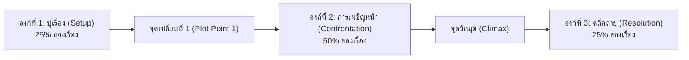
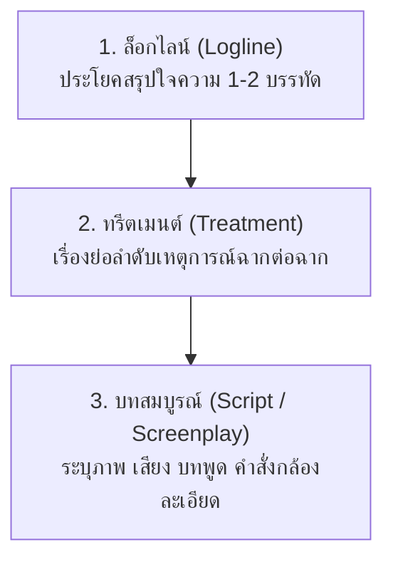
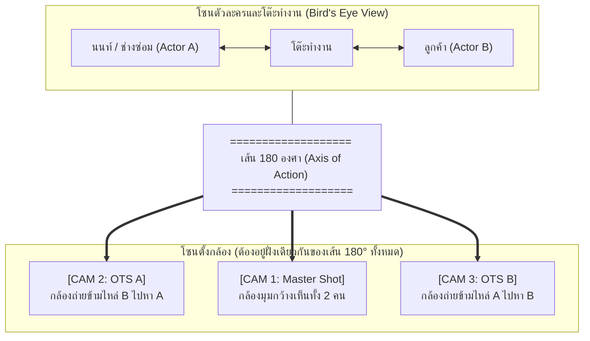
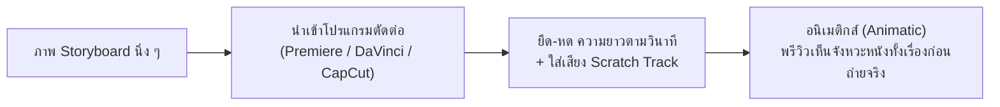

# บทที่ 4: การวางโครงเรื่อง การเขียนบท และสตอรีบอร์ด (Story Structure, Scriptwriting & Storyboard)

> [!abstract] ภาพรวมบทเรียน
> ใน [[บทที่ 3 - วิดีโอ]] เราได้ทำความเข้าใจมิติทางเทคนิคของภาพเคลื่อนไหว ทั้งเฟรมเรต ค่าชัตเตอร์ ความละเอียด และภาษาภาพพื้นฐานกันไปแล้ว
> 
> แต่ในความเป็นจริงของอุตสาหกรรมสื่อ **"งานวิดีโอที่ภาพสวย แสงเป๊ะ อุปกรณ์ราคาแพง แต่ไม่มีคนดูจนจบ"** เกิดขึ้นบ่อยมาก เพราะสิ่งสำคัญที่สุดของวิดีโอไม่ใช่แค่ภาพที่ปรากฏบนจอ แต่คือ **"สาระและเรื่องราว (Content & Story)"** ที่ตรึงคนดูไว้ตั้งแต่ต้นจนจบ
> 
> บทนี้จะพานักศึกษาเจาะลึกกระบวนการ **ก่อนการผลิต (Pre-Production)** ที่เป็นหัวใจของคนทำงานตัดต่อและผลิตสื่อมืออาชีพ:
> 1. **นิยามและโครงสร้างเนื้อหา (Content & Story Structure):** แยกแยะระหว่างประเด็น เนื้อเรื่อง และสาระสำคัญ พร้อมเรียนรู้โครงสร้างการเล่าเรื่องแบบ 3 องค์ และแบบคอนเทนต์ยุคใหม่ (Hook - Hold - Payoff)
> 2. **กระบวนการเขียนบทระดับมืออาชีพ (Scriptwriting):** จากแนวคิดสั้น ๆ (Logline) สู่เรื่องย่อ (Treatment) จนถึงบทถ่ายทำจริง ทั้งแบบ Master Scene Format (ภาพยนตร์) และ Two-Column Script (คอนเทนต์/โฆษณา)
> 3. **การออกแบบสตอรีบอร์ด (Storyboard):** องค์ประกอบมาตรฐาน สัญลักษณ์แทนการเคลื่อนไหวของวัตถุและกล้อง (Camera Motion) เทคนิคการวางเวลา (Timing)
> 4. **การวางแผนภาษาภาพเพื่อการตัดต่อ (Continuity & Camera Blocking):** กฎ 180 องศา, การทำผังกล้อง (Floor Plan), Match on Action, Handles หัว-ท้าย และสัญลักษณ์ Transitions
> 5. **การแปลงสู่รายการถ่ายทำจริงและอนิเมติกส์ (Shot List & Animatic):** การจัดกลุ่มช็อตเพื่อประหยัดเวลาออกกอง และการนำภาพร่างมาร้อยเรียงบนไทม์ไลน์เพื่อเช็กจังหวะก่อนถ่ายจริง

> [!info] ผลลัพธ์การเรียนรู้ประจำบท
> เมื่อเรียนจบบทนี้ นักศึกษาต้องสามารถ:
> 1. อธิบายความแตกต่างระหว่าง Topic, Plot, และ Core Message ในงานวิดีโอได้อย่างถูกต้อง
> 2. วางโครงสร้างการเล่าเรื่องโดยใช้หลัก 3-Act Structure สำหรับภาพยนตร์ และหลัก Hook-Hold-Payoff สำหรับคลิปสั้นหรือคอนเทนต์ออนไลน์ได้
> 3. เขียนบทถ่ายทำมาตรฐาน (Master Scene Format และ 2-Column Script) ที่มีองค์ประกอบคำสั่งภาพและเสียงครบถ้วน
> 4. ออกแบบและวาด Storyboard ที่ระบุขนาดภาพ มุมกล้อง ทิศทางการเคลื่อนไหว และเวลากำกับได้อย่างเป็นระบบ
> 5. วาดผังการตั้งกล้อง (Floor Plan) ตามกฎ 180 องศา เพื่อป้องกันปัญหาภาพข้ามเส้นในขั้นตอนการตัดต่อ
> 6. แปลง Storyboard เป็นตาราง Shot List ที่จัดลำดับการถ่ายทำได้อย่างมีประสิทธิภาพ
> 7. อธิบายหลักการทำ Animatic และการวางแผนถ่ายเผื่อหัว-ท้าย (Handles) เพื่อความลื่นไหลในการตัดต่อ (Continuity) ได้

---

## 1. เนื้อหา (Content) และเนื้อเรื่อง (Story) ในงานวิดีโอ

ก่อนที่จะหยิบกล้องถ่าย หรือเปิดโปรแกรมตัดต่อ ปัญหาใหญ่ที่สุดของมือใหม่คือ **"ไม่รู้ว่าจะเล่าอะไร หรือเล่าสะเปะสะปะ"** บ่อยครั้งเราได้ยินคำว่า "คอนเทนต์" (Content) จนชินหู แต่แท้จริงแล้วคำนี้ประกอบด้วยอะไรบ้างในเชิงทฤษฎีสื่อสารมวลชน

```
[หัวข้อ/ประเด็น] (Topic) ---> เกี่ยวกับอะไร?
       |
       v
[โครงเรื่อง/การเล่า] (Plot / Story) ---> เล่ายังไง ใครทำอะไร เกิดอะไรขึ้น?
       |
       v
[แก่นสาระสำคัญ] (Core Message) ---> ดูจบแล้วคนดูได้อะไร รู้สึกอะไร?
```

### 1.1 การแยกแยะ 3 องค์ประกอบของเนื้อหา

เพื่อไม่ให้เกิดความสับสน เราต้องแยก 3 คำนี้ออกจากกันให้ชัดเจน:

| ระดับของเนื้อหา                        | ความหมาย                                                                        | คำถามตั้งต้น                               | ตัวอย่างในงานจริง                                                                                                                 |
| :------------------------------------- | :------------------------------------------------------------------------------ | :----------------------------------------- | :-------------------------------------------------------------------------------------------------------------------------------- |
| **1. หัวข้อ / ประเด็น (Topic)**        | ขอบเขตหรือสิ่งที่ต้องการพูดถึง เป็นเพียง "ป้ายชื่อ" ยังไม่มีอารมณ์หรือการกระทำ  | เรื่องนี้เกี่ยวกับอะไร?                    | "การประกอบคอมพิวเตอร์เล่นเกมงบ 20,000 บาท"                                                                                        |
| **2. โครงเรื่อง (Story / Plot)**       | ลำดับเหตุการณ์ ตัวละคร และความขัดแย้งที่ถูกจัดวางเพื่อให้เรื่องดำเนินไปข้างหน้า | เกิดอะไรขึ้นกับใคร แล้วผลลัพธ์เป็นอย่างไร? | "นักศึกษาคนหนึ่งมีงบจำกัด ต้องเลือกสเปกคอมให้คุ้มที่สุด แต่เจอปัญหาไฟไม่พอและการ์ดจอติดเคส จึงต้องหาวิธีแก้ปัญหาจนเปิดเครื่องติด" |
| **3. แก่นสาระ (Core Message / Theme)** | ความรู้สึก คุณค่า หรือข้อคิดตกผลึกที่คนดูได้รับหลังจากดูจบ                      | ดูคลิปนี้จบแล้วได้อะไรกลับไปในชีวิต?       | "การจัดงบประมาณที่ดีไม่ได้อยู่ที่ของแพง แต่อยู่ที่ความเข้ากันได้ของอุปกรณ์และความรู้ความเข้าใจ"                                   |

> [!note] กฎเหล็กของสื่อภาพเคลื่อนไหว
> วิดีโอไม่ใช่เอกสารวิชาการที่เอาข้อความมาวางให้อ่านตรง ๆ แต่วิดีโอคือ **"ประสบการณ์ทางสายตาและอารมณ์" (Visual & Emotional Experience)** การบอกคนดูว่า "สิ่งนี้สำคัญ" ไม่ทรงพลังเท่ากับการ "แสดงให้เห็นผ่านเหตุการณ์" ว่าสิ่งนั้นสร้างผลกระทบอย่างไร

---

### 1.2 ทำไมคนดูถึงหยุดดู? (จิตวิทยาการรับรู้ของผู้ชม)

ในยุคดิจิทัล ความสนใจของมนุษย์สั้นลงเรื่อย ๆ (Attention Span สั้นลงเหลือไม่กี่วินาที) ผู้ชมตัดสินใจว่าจะดูต่อหรือปัดทิ้งภายในเวลาเพียง **1.5 ถึง 3 วินาทีแรก**

สาเหตุหลักที่ผู้ชมกดออกจากวิดีโอ มี 3 ประการ:
1. **เริ่มเรื่องช้า (Slow Exposition):** มีไตเติลอินโทรโลโก้หมุน ๆ นาน 10 วินาที หรือทักทายสวัสดีทอล์กยาวโดยไม่เข้าเรื่อง
2. **ไม่รู้ว่าตัวเองจะได้อะไร (No Clear Promise):** ผู้ชมไม่เห็นประโยชน์ ไม่เห็นความขัดแย้ง และไม่รู้ว่ากำลังจะดูอะไร
3. **เนื้อหาแบนราบ ไม่มีจุดเปลี่ยน (Flat Narrative):** อารมณ์นิ่งตั้งแต่ต้นจนจบ ข้อมูลไหลเรื่อย ๆ เหมือนอ่านหนังสือเรียน

การทำวิดีโอแบบมืออาชีพจึงต้องอาศัย **"การวางโครงเรื่อง" (Story Structure)** มาเป็นพิมพ์เขียวควบคุมความสนใจของคนดู

---

## 2. ทฤษฎีการวางโครงเรื่อง (Story Structure)

การเล่าเรื่องที่ดีไม่ได้เกิดจากความบังเอิญ แต่เกิดจากการคำนวณจังหวะอารมณ์ของมนุษย์อย่างเป็นระบบ โดยมี 2 รูปแบบหลักที่ใช้กันทั่วโลก:

```
[รูปแบบที่ 1: โครงสร้าง 3 องค์ (Three-Act Structure)]
องก์ที่ 1: ปูเรื่อง (Setup) ---> องก์ที่ 2: เผชิญอุปสรรค (Confrontation) ---> องก์ที่ 3: คลี่คลาย (Resolution)
(เหมาะสำหรับ: ภาพยนตร์, หนังสั้น, สารคดี, มิวสิกวิดีโอเล่าเรื่อง)

[รูปแบบที่ 2: โครงสร้างคอนเทนต์ยุคใหม่ (Hook - Hold - Payoff)]
Hook (ตรึงให้อยู่) ---> Problem (เปิดปัญหา) ---> Journey/Solution (วิธีแก้) ---> Payoff/CTA (สรุปและผลลัพธ์)
(เหมาะสำหรับ: YouTube, TikTok, Reels, วิดีโอโฆษณา, คอนเทนต์รีวิว)
```

---

### 2.1 โครงสร้าง 3 องก์ (Three-Act Structure) สำหรับภาพยนตร์และหนังสั้น

โครงสร้างคลาสสิกที่พัฒนามาจากบทละครของอริสโตเติล และเป็นแกนหลักของภาพยนตร์ฮอลลีวูดทุกเรื่อง:



#### องค์ประกอบในแต่ละองก์:
1. **องก์ที่ 1: การเปิดเรื่อง (Act I: Setup - ประมาณ 25% ของเวลา)**
   - **สถานะปกติ (Ordinary World):** แนะนำตัวละครหลัก สภาพแวดล้อม และชีวิตประจำวันก่อนเกิดเรื่อง
   - **เหตุการณ์จุดชนวน (Inciting Incident):** เหตุการณ์ที่เข้ามาทำลายความสงบสุข ทำให้ตัวละครต้องตัดสินใจหรือออกเดินทาง
   - **จุดหักเหที่ 1 (Plot Point 1):** จุดที่ตัวละครตัดสินใจก้าวเข้าสู่ปัญหาแบบถอยหลังกลับไม่ได้แล้ว

2. **องก์ที่ 2: การเผชิญหน้าและอุปสรรค (Act II: Confrontation - ประมาณ 50% ของเวลา)**
   - **อุปสรรคที่ยากขึ้นเรื่อย ๆ (Rising Action):** ตัวละครพยายามแก้ปัญหา แต่ยิ่งทำ ปัญหายิ่งบานปลาย
   - **จุดกึ่งกลางเรื่อง (Midpoint):** เหตุการณ์สำคัญที่เปลี่ยนทิศทางของเรื่อง จากการเป็นฝ่าย "ตั้งรับ" กลายเป็นฝ่าย "เริ่มสู้"
   - **จุดมืดมนที่สุด (Dark Night of the Soul):** ความล้มเหลวครั้งใหญ่ ดูเหมือนไม่มีทางชนะ อาวุธพัง หรือสูญเสียคนสำคัญ

3. **องก์ที่ 3: การคลี่คลายและบทสรุป (Act III: Resolution - ประมาณ 25% ของเวลา)**
   - **จุดไคลแม็กซ์ (Climax):** การเผชิญหน้าครั้งสุดท้าย ปัญหาทุกอย่างปะทะกันถึงขีดสุด เป็นจุดที่ตื่นเต้นที่สุดของเรื่อง
   - **บทสรุปและโลกใหม่ (Resolution / New Normal):** ผลลัพธ์หลังเหตุการณ์ผ่านพ้น ตัวละครได้เรียนรู้และเติบโตขึ้น ชีวิตเข้าสู่สมดุลใหม่

---

### 2.2 โครงสร้าง Hook - Hold - Payoff สำหรับวิดีโอคอนเทนต์และโฆษณา

สำหรับคลิปออนไลน์ความยาว 1–10 นาที โครงสร้าง 3 องก์อาจช้าเกินไป มืออาชีพจึงปรับมาใช้ระบบ **Hook - Hold - Payoff**:

```
[0-3 วินาทีแรก] HOOK: คำพูด ภาพ หรือเสียงที่ทำให้หยุดนิ้วโป้ง
       |
[ช่วงกลางคลิป] HOLD: การส่งมอบข้อมูลเป็นชั้น ๆ ซ่อนเงื่อนงำ มีจังหวะขึ้นลง
       |
[ช่วงท้ายคลิป] PAYOFF: เฉลยคำตอบ ผลลัพธ์ที่คุ้มค่า และการสั่งให้ลงมือทำ (CTA)
```

1. **Hook (0–3 วินาทีแรก):**
   - หน้าที่: หยุดการเลื่อนหน้าจอ (Stop the Scroll)
   - วิธีทำ: เปิดด้วยคำถามชวนตกใจ, ผลลัพธ์สุดท้ายที่น่าทึ่ง, ปัญหาที่คนดูเจอทุกวัน หรือภาพมุมมองแปลกตา
   - ข้อห้าม: ห้ามใส่โลโก้วิ่งผ่าน หรือทักทายเยิ่นเย้อ

2. **Hold / Retention (ช่วงลำตัวคลิป):**
   - หน้าที่: ตรึงไม่ให้คนดูปัดออกกลางทาง
   - วิธีทำ: ใช้หลัก "Breadcrumbing" (โปรยเศษขนมปัง) คือบอกข้อมูลทีละส่วน ไม่เฉลยทั้งหมดในทันที และเปลี่ยนภาพทุก ๆ 3–5 วินาที (เช่น B-Roll, กราฟิก, ซูมเข้า-ออก) เพื่อรีเซ็ตความสนใจของสายตา

3. **Payoff & CTA (ช่วงบทสรุป):**
   - หน้าที่: ตอบแทนเวลาที่คนดูสละให้ และชี้นำการกระทำ
   - วิธีทำ: เฉลยผลลัพธ์ที่สัญญาไว้ใน Hook สรุปบทเรียน และปิดท้ายด้วย Call-to-Action (CTA) เพียงอย่างเดียว เช่น "กดบันทึกคลิปนี้ไว้ใช้ตอนเลือกซื้อ"

---

## 3. ขั้นตอนการเขียนบทระดับมืออาชีพ (Development Process)

ก่อนจะเป็นบทพูดที่มีบทสนทนาและคำสั่งกล้อง มืออาชีพมีขั้นตอนการทำงาน 3 ระดับ เพื่อไม่ให้หลงทาง:



### 3.1 ล็อกไลน์ (Logline)

ล็อกไลน์คือการสรุปเรื่องราวทั้งหมดให้จบภายใน **1–2 ประโยค** โดยต้องบอก 4 สิ่งนี้ให้ได้:
1. ใครคือตัวละครหลัก (Protagonist)
2. เป้าหมายคืออะไร (Goal)
3. อุปสรรคหรือศัตรูคืออะไร (Conflict / Antagonist)
4. เดิมพันคืออะไร ถ้าทำไม่สำเร็จจะเกิดอะไรขึ้น (Stakes)

> [!tip] สูตรการเขียน Logline
> *"เมื่อ [เหตุการณ์จุดชนวน] เกิดขึ้น [ตัวละครหลัก] ต้อง [เป้าหมาย] ไม่เช่นนั้น [เดิมพัน/ความเสียหายที่จะเกิด]"*
>
> **ตัวอย่างหนังสั้นนักศึกษา:**  
> *"เมื่อโปรเจกต์จบไฟล์สุดท้ายหายไปในคืนก่อนส่งงาน นักศึกษาคอมพิวเตอร์หัวรั้นต้องแข่งกับเวลา 6 ชั่วโมงเพื่อกู้ข้อมูลจากฮาร์ดดิสก์ที่เสีย ก่อนที่เขาจะหมดสิทธิ์สำเร็จการศึกษา"*

---

### 3.2 รูปแบบการเขียนบท (Script Formats)

ในงานวิดีโอมีรูปแบบบทที่นิยมใช้ 2 แบบ ขึ้นอยู่กับลักษณะงาน:

#### รูปแบบ A: Master Scene Format (บทแบบภาพยนตร์ / หนังสั้น)
เน้นบรรยายฉาก การกระทำ และบทสนทนาของตัวละคร มีองค์ประกอบหลัก 3 ส่วน:
1. **Scene Heading (Slugline):** บอกสถานที่และเวลา เช่น `INT. ห้องแล็บคอมพิวเตอร์ - กลางคืน`
   - `INT.` = Interior (ภายในอาคาร) / `EXT.` = Exterior (ภายนอกอาคาร)
   - สถานที่
   - เวลา (DAY / NIGHT)
2. **Action Line:** บรรยายสิ่งที่ตาเห็นและหูได้ยิน เขียนด้วยภาษาปัจจุบัน กระชับ ไม่บรรยายความรู้สึกในใจ
3. **Character & Dialogue:** ชื่อตัวละครอยู่กึ่งกลาง ตามด้วยคำพูด

```text
======================================================================
ตัวอย่าง Master Scene Format:
======================================================================

INT. ห้องซ่อมคอมพิวเตอร์ TC204 - กลางคืน

ไฟนีออนบนเพดานกระพริบติด ๆ ดับ ๆ เกิดเสียงหึ่งเบา ๆ 
นนท์ (20 ปี) นักศึกษา ปวส. นั่งกุมขมับอยู่หน้าจอคอมพิวเตอร์ที่ดับสนิท
บนโต๊ะมีไขควง มัลติมิเตอร์ และสายไฟระเกะระกะ

นนท์ถอนหายใจยาว ก่อนจะหยิบสายไฟขึ้นมาตรวจดูรอยไหม้

                      นนท์
           (พึมพำกับตัวเอง เสียงสั่น)
    อย่าเพิ่งพังตอนนี้สิวะ... เหลืออีกแค่สองชั่วโมงอาจารย์จะตรวจแล้ว

เสียงประตูห้องเปิดออกดัง เอี๊ยด! นนท์สะดุ้งหันขวับไปมองที่ประตู
```

---

#### รูปแบบ B: Two-Column Script (บทแบบ 2 คอลัมน์ สำหรับคอนเทนต์ / โฆษณา)
เป็นรูปแบบที่นิยมที่สุดในสายงานโทรทัศน์ วิดีโอโฆษณา ยูทูบ และสื่อองค์กร เพราะแบ่งชัดเจนระหว่าง **"สิ่งที่เห็น (Video)"** กับ **"สิ่งที่ได้ยิน (Audio)"**:

|  เวลา (Time)  | ฝั่งภาพ (Video / Visual)                                                                                                    | ฝั่งเสียง (Audio / Sound)                                                                                                                            |
| :-----------: | :-------------------------------------------------------------------------------------------------------------------------- | :--------------------------------------------------------------------------------------------------------------------------------------------------- |
| **0:00–0:03** | **[Extreme Close-up]** มือถือที่หน้าจอแตกละเอียด วางอยู่บนโต๊ะไม้<br>กล้องสั่นไหวเล็กน้อย (Handheld)                        | **SFX:** เสียงกระจกแตกดัง เพล้ง! ตามด้วยเสียงสัญญาณคลื่นรบกวน<br>**Host (VO):** "ถ้าโทรศัพท์ตกน้ำหรือจอแตก สิ่งแรกที่ห้ามทำเด็ดขาดคือสิ่งนี้..."     |
| **0:03–0:08** | **[Medium Shot]** พิธีกรยืนถือโทรศัพท์เครื่องดังกล่าวในสตูดิโอ สีหน้าจริงจัง<br>มีกราฟิกกากบาทสีแดงขนาดใหญ่โผล่ขึ้นมากลางจอ | **Host:** "คน 90% ชอบเอาไดร์เป่าผมมาเป่าลมร้อน ซึ่งความจริงมันจะทำให้แผงวงจรข้างในพังถาวรทันทีครับ"                                                  |
| **0:08–0:15** | **[B-Roll / Macro Shot]** ภาพขยายบอร์ดอิเล็กทรอนิกส์ แสดงเม็ดกาวและตะกั่วที่ละลายเมื่อโดนความร้อนสูง                        | **Music:** เพลงจังหวะตื่นเต้นเบาลง เน้นเสียงอธิบายชัดเจน<br>**Host (VO):** "ลมร้อนจะละลายกาวกันน้ำและดันความชื้นให้ยิ่งซึมลึกเข้าไปในชิปประมวลผล..." |

---

## 4. สตอรีบอร์ด (Storyboard) คืออะไร และทำไมต้องมี?

หลังจากมีบทแล้ว ก่อนจะนำกล้องออกไปถ่ายจริง เราต้องนำบทนั้นมาแปลงเป็นภาพร่างที่เรียงต่อกัน ซึ่งเรียกว่า **สตอรีบอร์ด (Storyboard)**

> [!info] นิยามของ Storyboard
> **สตอรีบอร์ด** คือ ชุดของภาพวาดหรือภาพถ่ายที่จัดเรียงตามลำดับเวลา เพื่อจำลองภาพของวิดีโอที่จะถ่ายทำจริง โดยทำหน้าที่เหมือน **"หนังสือการ์ตูนของบทหนัง"** ช่วยให้ผู้กำกับ ตากล้อง นักแสดง และคนตัดต่อ เห็นภาพตรงกัน 100% ก่อนจะเริ่มเสียเงินและเวลาในการถ่ายทำ

### 4.1 ประโยชน์ของ Storyboard ในสายงานมืออาชีพ
1. **แก้ปัญหาบนกระดาษถูกกว่าแก้หน้างาน:** การลบภาพวาด 1 ช่องใช้เวลา 5 วินาที แต่การสั่งถ่ายใหม่ (Reshoot) ที่กองถ่าย ต้องเสียค่านักแสดง ค่าสถานที่ และเวลาทั้งวัน
2. **คำนวณงบประมาณและเวลาได้แม่นยำ:** เมื่อเห็นทุกช็อต จะรู้ทันทีว่าต้องใช้นักแสดงกี่คน พร็อพอะไรบ้าง และต้องใช้เวลาถ่ายแต่ละฉากนานเท่าใด
3. **สื่อสารข้ามสายงานได้อย่างราบรื่น:** ตากล้องรู้ว่าต้องตั้งเลนส์อะไร ช่างไฟรู้ว่าต้องตั้งไฟทิศไหน และคนตัดต่อรู้ว่าต้องเตรียมฟุตเทจมาต่อกันอย่างไร

---

## 5. องค์ประกอบมาตรฐานของ Storyboard 1 เฟรม

Storyboard ที่ได้มาตรฐานอุตสาหกรรม ใน 1 ช่องภาพ (Panel) ต้องประกอบด้วยข้อมูลสำคัญ 6 ส่วนเสมอ:

| ส่วนประกอบใน 1 ช่อง Storyboard | รายละเอียดและตัวอย่างข้อมูล |
| :--- | :--- |
| **1. พื้นที่ภาพ (Visual Frame)** | **[ กรอบภาพ 16:9 หรือ 9:16 ]**<br>• ภาพสเก็ตช์ตัวละคร วัตถุ และสภาพแวดล้อมฉากหลัง<br>• เส้นประ Eyeline ระบุทิศทางสายตา<br>• สัญลักษณ์ลูกศร Motion ระบุทิศทางการเคลื่อนไหว |
| **2. หมายเลขและเวลา** | **Scene:** 1 \| **Shot:** 2 \| **Panel:** 1 \| **Duration:** 4s \| **Lens:** 50mm |
| **3. ข้อมูลกล้องและมุมภาพ** | **Shot Type:** Medium Close-up (MCU) \| **Angle:** Eye-Level |
| **4. การเคลื่อนกล้อง** | **Camera Movement:** Pan Right ตามตัวละคร |
| **5. เหตุการณ์/การกระทำ** | **Action:** นนท์ลุกจากเก้าอี้แล้วเดินไปที่ตู้เซฟฝั่งขวา |
| **6. เสียงประกอบ** | **Audio / Dialogue:** นนท์: *"มันต้องอยู่ในนี้แน่ ๆ"* \| **SFX:** เสียงเปิดตู้เซฟ |

### รายละเอียดองค์ประกอบทั้ง 6:
1. **กรอบภาพ (Aspect Ratio Frame):** กรอบสี่เหลี่ยมที่มีสัดส่วนตรงกับวิดีโอจริง เช่น 16:9 (แนวนอนมาตรฐาน YouTube/TV) หรือ 9:16 (แนวตั้ง TikTok/Reels)
2. **ภาพวาดจำลอง (Visual Sketch):** แสดงตัวละคร ตำแหน่งการยืน และฉากหลัง โดยไม่จำเป็นต้องวาดสวยเหมือนงานศิลปะ แค่เน้นความเข้าใจใน **ขนาดสัดส่วน (Scale) และทิศทาง (Direction)**
3. **หมายเลขกำกับ (Numbering):**
   - **Scene:** เลขฉาก (สถานที่เดียวกัน เวลาเดียวกัน)
   - **Shot:** เลขช็อตของกล้องในฉากนั้น
   - **Panel:** ลำดับภาพย่อย (กรณีใน 1 ช็อตมีการขยับกล้องจนภาพเปลี่ยน)
4. **ข้อมูลกล้อง (Camera Specifications):**
   - **ขนาดภาพ (Shot Size):** เช่น ECU, CU, MCU, MS, MLS, WS, EWS
   - **มุมกล้อง (Camera Angle):** เช่น Eye-level, High Angle, Low Angle, Dutch Angle
5. **การเคลื่อนไหวและเวลา (Action & Timing):**
   - อธิบายว่าตัวละครทำอะไร
   - ระบุความยาวของช็อตเป็นวินาที เช่น `3s` หรือ `5s`
6. **เสียงประกอบ (Audio):** บทพูด (Dialogue), เสียงบรรยาย (Voice Over: VO), เสียงเอฟเฟกต์ (SFX) และเสียงดนตรี (BGM)

---

## 6. สัญลักษณ์และภาษาภาพสำหรับแสดง Motion บน Storyboard

ปัญหาที่พบบ่อยที่สุดของนักศึกษาคือ **"วาดรูปภาพนิ่งลงไปในช่อง แต่คนดูไม่รู้ว่ากล้องขยับยังไง หรือตัวละครเดินไปทางไหน"**

มืออาชีพจึงใช้ **"ระบบสัญลักษณ์ลูกศรและกรอบซ้อน" (Arrow & Framing Conventions)** เพื่อบอกการเคลื่อนไหว (Motion) ดังนี้:

### 6.1 การแยกแยะประเภทลูกศร

| ประเภทลูกศร                                  | รูปร่างลักษณะ             | ความหมาย                                        | ตัวอย่างการใช้งาน                        |
| :------------------------------------------- | :------------------------ | :---------------------------------------------- | :--------------------------------------- |
| **ลูกศรทึบ (Solid Arrow)**                   | เส้นทึบปลายแหลม `--->`    | **ตัวละครหรือวัตถุเคลื่อนที่** (Subject Motion) | ตัวละครเดินจากซ้ายไปขวา, รถวิ่งผ่านกล้อง |
| **ลูกศรกลวง / เส้นคู่ (Open/Outline Arrow)** | ลูกศรโปร่งขนาดใหญ่ `===>` | **กล้องเคลื่อนที่** (Camera Movement)           | กล้องเลื่อนตามคน (Track), กล้องแพน (Pan) |
| **ลูกศร 4 มุม (Corner Arrows)**              | ลูกศรชี้ที่มุมของกรอบภาพ  | **การซูมหรือดอลลี่เข้า-ออก** (Zoom / Dolly)     | ซูมเข้าหาใบหน้าตัวละคร                   |

---

### 6.2 สัญลักษณ์การเคลื่อนกล้องแบบต่าง ๆ

| ประเภทการเคลื่อนกล้อง | สัญลักษณ์บน Storyboard | หลักการวาดและทิศทาง |
| :--- | :--- | :--- |
| **Pan Left / Pan Right** | `<====== PAN L` หรือ `PAN R ======>` | วาดลูกศรกลวงแนวนอนพาดผ่านกลางเฟรม ชี้ไปทางซ้ายหรือขวาตามทิศทางหมุนหน้ากล้อง |
| **Tilt Up / Tilt Down** | `^ TILT UP` หรือ `v TILT DOWN` | วาดลูกศรกลวงแนวตั้งพาดกลางเฟรม ชี้ขึ้นหรือชี้ลงตามทิศทางก้ม-เงยกล้อง |
| **Dolly In / Push In** | ลูกศร 4 มุมชี้เข้าหากรอบเล็กด้านใน | วาดกรอบสี่เหลี่ยมเล็กซ้อนข้างในกรอบใหญ่ แล้วลากลูกศรจากมุมทั้งสี่ชี้พุ่งเข้าหากรอบเล็ก |
| **Dolly Out / Pull Out** | ลูกศร 4 มุมชี้ออกจากกรอบเล็กไปยังกรอบใหญ่ | วาดกรอบสี่เหลี่ยมเล็ก แล้วลากลูกศรจากกรอบเล็กพุ่งออกไปยังขอบทั้งสี่ของกรอบใหญ่ |
| **Tracking / Truck** | `========================>` ด้านล่างเฟรม | วาดลูกศรกลวงยาวใต้ฐานกรอบภาพ ชี้ตามทิศทางที่ตัวกล้องเคลื่อนที่ไปพร้อมตัวละคร |

---

## 7. เทคนิคการวาด Storyboard สำหรับคนวาดรูปไม่เก่ง (From Stickman to Pro)

หลายคนกลัวการทำ Storyboard เพราะคิดว่าตัวเองวาดรูปไม่เป็น แต่ในวงการโปรดักชัน **"ความชัดเจน สำคัญกว่าความสวยงาม"**

### 7.1 กฎ 4 ข้อในการวาดแบบเข้าใจง่าย:
1. **ใช้คนก้านกล้วยแบบมีมิติ (Block Figures):** แทนที่จะวาดเส้นตรงเส้นเดียว ให้วาดลำตัวเป็นสี่เหลี่ยมหรือวงรี เพื่อให้เห็นว่าตัวละครหันหน้าไปทางไหน (มีด้านหน้า ด้านข้าง ด้านหลัง)
2. **สร้างมิติความลึก 3 ระยะ (Depth of Field):**
   - **Foreground (ระยะหน้า):** วาดชิดขอบกรอบ มีขนาดใหญ่ (เช่น ไหล่หรือขอบโต๊ะ)
   - **Midground (ระยะกลาง):** จุดที่ตัวละครหลักทำกิจกรรม
   - **Background (ระยะหลัง):** ฉากหลัง ประตู หน้าต่าง อาคาร
3. **กำหนดเส้นระดับสายตา (Horizon / Eye-Level Line):** ลากเส้นแนวนอนจาง ๆ 1 เส้นเสมอ เพื่อกำหนดว่ากล้องกำลังมองมุมกด (อยู่เหนือเส้น) หรือมุมเงย (อยู่ใต้เส้น)
4. **ใส่ลูกศรระบุทิศทางสายตา (Eyeline):** ลากเส้นประเล็ก ๆ จากตาของตัวละครว่ากำลังมองไปที่วัตถุชิ้นไหน เพื่อให้เวลาตัดต่อสามารถต่อช็อตได้อย่างสมบูรณ์

---

## 8. แนวปฏิบัติที่ดีที่สุด: มิติเวลา (Timing & Shot Duration) และการจัดการความละเอียดของเนื้อหา (Content Density)

คำถามที่นักศึกษาตัดต่อวิดีโอมักสงสัยเสมอเวลาลงมือวาด Storyboard คือ:
1. **"ใน Storyboard ช็อตนี้ควรให้ยาวกี่วินาที?"**
2. **"ฉากหนึ่งควรยาวแค่ไหนถึงจะไม่น่าเบื่อ?"**
3. **"เนื้อหาควรใส่ละเอียดแค่ไหนใน 1 ช็อต ถึงจะไม่แน่นเกินไปจนคนดูมึนหัว?"**

ในระดับมืออาชีพ การกำหนดเวลา (Timing) และความหนาแน่นของข้อมูล (Content Density) มีหลักเกณฑ์ทางจิตวิทยาและการรับรู้ของสายตามนุษย์รองรับอย่างชัดเจน:

### 8.1 เกณฑ์มาตรฐานเวลาต่อ 1 ช็อต (Duration per Shot Guidelines)

ความยาวของช็อตมีความสัมพันธ์โดยตรงกับ **"ขนาดภาพ" (Shot Size)** และ **"ปริมาณข้อมูลทางสายตาที่สมองต้องประมวลผล"**:

| ขนาดภาพ / ประเภทช็อต                         |  เวลามาตรฐานต่อช็อต  | เหตุผลทางจิตวิทยาการรับรู้                                                                            | ข้อควรระวัง                                                                                    |
| :------------------------------------------- | :------------------: | :---------------------------------------------------------------------------------------------------- | :--------------------------------------------------------------------------------------------- |
| **Extreme Wide Shot (EWS) / Wide Shot (WS)** |   **4 – 6 วินาที**   | คนดูต้องใช้เวลากวาดสายตามองทั้งภูมิประเทศ สภาพแวดล้อม ห้อง หรือบริบทของฉาก (Establishing)             | อย่าตัดเร็วกว่า 3 วินาที เพราะคนดูจะยังไม่ทันรับรู้ว่า "เรื่องนี้เกิดขึ้นที่ไหน"               |
| **Medium Shot (MS) / Medium Close-up (MCU)** |  **2.5 – 4 วินาที**  | พอดีกับประโยคพูดสั้น 1–2 ประโยค หรือการขยับท่าทางช่วงลำตัว เป็นจังหวะมาตรฐานของการสนทนา               | หากแช่นานเกิน 5 วินาทีโดยไม่มีบทพูด คนดูจะเริ่มรู้สึกว่าภาพนิ่งจนอืด                           |
| **Close-up (CU)**                            |  **1.5 – 3 วินาที**  | สมองมนุษย์จับสีหน้า แววตา และอารมณ์ได้เร็วมาก การแช่ CU นานจะสร้างความรู้สึกอึดอัด กดดัน              | ใช้เน้นจุดสำคัญของบทสนทนา หรือการตัดสินใจ ไม่ควรใช้พร่ำเพรื่อ                                  |
| **Extreme Close-up (ECU) / Insert Shot**     |   **1 – 2 วินาที**   | สายตาจับจ้องที่จุดเดียว เช่น นิ้วกดสวิตช์, ตัวหนังสือบนจอ, ปากกากำลังเซ็นชื่อ สมองรับรู้ได้แทบจะทันที | ถ้าไม่มีข้อความให้อ่าน แช่เพียง 1–1.5 วินาทีก็เพียงพอแล้ว                                      |
| **Action Shot / Dynamic Cut**                | **0.5 – 1.5 วินาที** | เน้นการเคลื่อนไหวฉับไว การต่อสู้ การขับรถไล่ล่า เพื่อเร่งอัตราการเต้นของหัวใจ                         | อย่าตัดสั้นต่อเนื่องเกิน 10 ช็อตโดยไม่มีช็อตพัก (Breathing Shot) เพราะคนดูจะเหนื่อยล้าทางสายตา |

---

### 8.2 กฎการคำนวณเวลาอ่านตัวหนังสือในภาพ (The 1.5x Reading Rule)

เมื่อใดก็ตามที่มีตัวหนังสือปรากฏบนจอ ไม่ว่าจะเป็น:
- ข้อความแจ้งเตือน Error บนจอคอมพิวเตอร์
- ข้อความแชตในสมาร์ตโฟน
- ป้ายชื่อสถานที่ หรือเอกสารในมือตัวละคร

> [!tip] สูตรคำนวณเวลาสำหรับช็อตที่มีตัวหนังสือ
> **เวลาของช็อต = (เวลาที่คนทั่วไปอ่านข้อความนั้นในใจจบแบบปกติ) $\times 1.5$**
>
> - **ตัวอย่าง:** ข้อความบนหน้าจอเขียนว่า *"System Alert: Battery Voltage Low (10.2V)"*
>   - ลองอ่านในใจอย่างสบาย ๆ ใช้เวลาประมาณ **2 วินาที**
>   - นำมาคูณ 1.5 $\rightarrow$ ช็อตนี้ใน Storyboard ต้องกำหนดความยาวไว้อย่างน้อย **3 วินาที**
>   - *เหตุผล:* คนดูต้องใช้เวลา 0.5 วินาทีแรกในการมองหาว่าตัวหนังสืออยู่ตรงไหน + ใช้เวลาอ่าน + ใช้เวลาทำความเข้าใจความหมาย หากตัดก่อนหน้านี้ คนดูจะอ่านไม่ทันและรู้สึกหงุดหงิด

---

### 8.3 ความยาวของ 1 ฉาก (Scene Duration) และจังหวะหายใจ (Breathing Room / Pacing)

ความยาวของ 1 ฉาก (Scene คือเหตุการณ์ที่เกิดขึ้นในสถานที่เดียว เวลาเดียวกัน) ขึ้นอยู่กับรูปแบบของงาน:

#### 1. วิดีโอคอนเทนต์สั้น (Short-form: TikTok / Reels / Shorts / Ads)
- **ความยาวทั้งคลิป:** 30 – 60 วินาที
- **ความยาวต่อช็อตเฉลี่ย:** **1.2 – 2.2 วินาที**
- **จังหวะ:** เปลี่ยนภาพเกือบทุก 2 วินาที สลับระหว่างภาพคนพูด (A-Roll) กับภาพประกอบการกระทำ (B-Roll) และกราฟิก เพื่อตรึงสายตาไม่ให้ปัดหนี

#### 2. วิดีโอยาวบน YouTube / รายการสารคดี / วิดีโอสอนเทคนิค
- **ความยาวต่อฉากย่อย:** **1.5 – 3 นาที** ต่อ 1 หัวข้อย่อย
- **จังหวะการตัดสลับ (Cut Frequency):** ควรเปลี่ยนขนาดภาพ มุมกล้อง หรือตัดเข้า B-Roll ทุก ๆ **3 – 5 วินาที** เพื่อรีเซ็ตความสนใจของสายตา (Visual Reset)

#### 3. ภาพยนตร์และหนังสั้น (Narrative Fiction)
- **ความยาวต่อฉาก:** เฉลี่ย **1.5 – 3 นาที** (ประมาณ 2–3 หน้าบท Master Scene Format)
- **จังหวะหนัก-เบา (Pacing):** หนังที่ดีต้องมี **"จังหวะหายใจ" (Breathing Room)**:
  - หลังฉากวิกฤต หรือฉากระเบิดอารมณ์ที่ตัดต่อเร็ว $\rightarrow$ ต้องตามด้วยฉากกว้าง (Wide Shot) หรือช็อตทอดอารมณ์ที่ยาว 4–5 วินาที เพื่อให้คนดูได้ตกผลึกอารมณ์และพร้อมรับเหตุการณ์ถัดไป

---

### 8.4 การจัดการความละเอียดและความหนาแน่นของเนื้อหา (Content Density & Granularity)

ปัญหาคลาสสิกที่ทำให้งานวิดีโอดูล้นหรือดูไม่รู้เรื่อง คือการ **"ยัดข้อมูลมากเกินไปในเวลาจำกัด" (Cognitive Overload)**

#### 1. กฎเหล็ก "1 ช็อต = 1 ข้อมูลหลัก" (One Idea per Shot)
ใน 1 ช่อง Storyboard ควรสื่อสารข้อความสำคัญเพียง **1 อย่างเท่านั้น**:

```
[ตัวอย่างที่ผิด: Cognitive Overload]
1 ช็อตเดียว: ตัวละครพูดทฤษฎีซับซ้อน + หน้าจอข้างหลังมีกราฟิกตัวเลขวิ่ง + แบ็กกราวด์มีคนเดินทะเลาะกัน
===> ผลลัพธ์: คนดูไม่รู้จะมองจุดไหน สมองปฏิเสธการรับรู้ทั้งหมด

[ตัวอย่างที่ถูก: แตกเป็น 3 ช็อตตามลำดับการรับรู้]
- ช็อตที่ 1 (MCU - 3s): ตัวละครพูดเน้นประเด็นสำคัญเพียงประโยคเดียว
- ช็อตที่ 2 (Insert/Graphic - 2s): ภาพกราฟิกเจาะตัวเลขสรุปชัดเจน
- ช็อตที่ 3 (CU - 2s): สังเกตสีหน้าและปฏิกิริยาของตัวละคร
```

#### 2. ระดับความลึกของเนื้อหาตามประเภทวิดีโอ (Information Granularity)

| ประเภทงาน | ระดับความละเอียดของเนื้อหา (Granularity) | วิธีการนำเสนอในบทและ Storyboard |
| :--- | :--- | :--- |
| **คลิปสั้น / โฆษณา (Short-form)** | **ระดับผิวสัมผัส + จุดว้าว (Surface & Takeaway)** | ไม่ลงลึกเชิงทฤษฎี เน้น 1 ปัญหา 1 ทางออก เช่น "แบตเตอรี่บวม อย่าเจาะเด็ดขาด เพราะสารเคมีจะติดไฟทันที" |
| **วิดีโอสอน / สื่อการเรียนรู้ (Tutorial / How-to)** | **ระดับขั้นบันไดต่อเนื่อง (Step-by-Step)** | ต้องละเอียดทุกขั้นตอน **ห้ามกระโดดข้ามขั้นตอนวิกฤต** เช่น ช็อตเสียบสายไฟ, ช็อตตั้งค่ามิเตอร์, ช็อตสังเกตไฟสถานะ |
| **ภาพยนตร์ / หนังสั้น (Narrative Fiction)** | **ระดับซับเท็กซ์ (Subtext & Action)** | ใช้หลัก **"Show, Don't Tell"** (แสดงให้เห็น แทนการพูดอธิบาย) เช่น แทนที่จะให้ตัวละครพูดว่า "ฉันกลัวมาก" ให้วาด Storyboard เจาะที่มือสั่นระริกขณะกำลังจับหัวแร้งบัดกรี |

#### 3. สัดส่วน A-Roll ต่อ B-Roll (Visual Information Ratio)
- **A-Roll (ฟุตเทจหลัก/ภาพคนพูด):** ไม่ควรปล่อยให้แช่ค้างหน้าเดิมเกิน **4–6 วินาที** ติดต่อกัน
- **B-Roll (ฟุตเทจเสริม/ภาพเจาะอุปกรณ์/ภาพบรรยากาศ):** ควรมีสัดส่วนอย่างน้อย **40% – 60%** ของวิดีโอทั้งหมด การสลับ B-Roll ที่คมชัดจะช่วยเพิ่มความหนาแน่นของเนื้อหา (Information Density) โดยไม่ต้องเพิ่มเวลาพูดให้ยืดเยื้อ

---

## 9. ตัวอย่างการแปลงจาก "บท" สู่ "Storyboard" (Case Study)

เพื่อให้นักศึกษาเห็นภาพขั้นตอนทั้งหมด ลองดูตัวอย่างฉากสั้น ๆ 1 ฉาก โดยนำเกณฑ์เวลาในหัวข้อที่ 8 มาใช้งานจริง:

### ขั้นที่ 1: บทที่เขียนไว้ (Two-Column Script)
- **Scene:** 1 / Shot 1–4
- **เรื่อง:** การสาธิตการกู้ข้อมูลฉุกเฉิน
- **ช็อตที่ 1 (3 วินาที):** Wide Shot - นนท์นั่งเครียดหน้าคอมในห้องมืด (กำหนด 3s เพื่อให้คนดูรับรู้สภาพแวดล้อมห้อง)
- **ช็อตที่ 2 (4 วินาที):** Medium Close-up + Push In - กล้องเคลื่อนเข้าหาจอคอมพิวเตอร์ที่ขึ้นข้อความ Error สีแดง (กำหนด 4s ตามกฎ 1.5x เพื่อให้อ่านข้อความทัน)
- **ช็อตที่ 3 (2 วินาที):** Close-up - นิ้วมือกดปุ่มสวิตช์เปิดเครื่องสำรองไฟ (กำหนด 2s พอดีกับการกระทำแบบกระชับ)
- **ช็อตที่ 4 (3 วินาที):** Medium Shot + Tilt Up - นนท์เงยหน้ามองด้วยประกายตา (กำหนด 3s เพื่อส่งอารมณ์ความหวัง)

---

### ขั้นที่ 2: แปลงเป็น Storyboard Sheet (ตัวอย่าง 4 เฟรม)

| ข้อมูลกำกับช็อต | เฟรมที่ 1 (Frame 1) | เฟรมที่ 2 (Frame 2) | เฟรมที่ 3 (Frame 3) | เฟรมที่ 4 (Frame 4) |
| :--- | :--- | :--- | :--- | :--- |
| **ภาพจำลอง (Visual)** | นนท์นั่งกุมขมับบนโต๊ะคอมพิวเตอร์ในห้องมืด | หน้าจอมอนิเตอร์ขึ้นบลูสกรีนและข้อความ System Error | นิ้วมือเอื้อมไปกดปุ่มสวิตช์ Power บนปลั๊กไฟ | นนท์ค่อย ๆ เงยหน้ามองจอคอมพิวเตอร์ด้วยความหวัง |
| **ข้อมูลฉากและกล้อง** | **Scene:** 1 \| **Shot:** 1<br>**ขนาดภาพ:** Wide Shot (WS)<br>**มุมกล้อง:** Eye-Level | **Scene:** 1 \| **Shot:** 2<br>**ขนาดภาพ:** MCU $\rightarrow$ CU<br>**มุมกล้อง:** Eye-Level | **Scene:** 1 \| **Shot:** 3<br>**ขนาดภาพ:** Close-up (CU)<br>**มุมกล้อง:** Eye-Level | **Scene:** 1 \| **Shot:** 4<br>**ขนาดภาพ:** Medium Shot (MS)<br>**มุมกล้อง:** Eye-Level |
| **การเคลื่อนกล้อง (Motion)** | **Static** (กล้องนิ่งบนขาตั้ง) | **Dolly In / Push In**<br>*(ลูกศร 4 มุมชี้เข้าหาจอ)* | **Static** (กล้องนิ่งเจาะมือ)<br>*(ลูกศรทึบชี้ตามนิ้วมือ)* | **Tilt Up** (เงยกล้องขึ้นตามหน้า)<br>*(ลูกศรกลวงชี้ขึ้น)* |
| **เวลา (Duration)** | **3.0 วินาที** *(สะสม 0:03.0)* | **4.0 วินาที** *(สะสม 0:07.0)* | **2.0 วินาที** *(สะสม 0:09.0)* | **3.0 วินาที** *(สะสม 0:12.0)* |
| **เสียงประกอบ (Audio / SFX)** | **SFX:** เสียงพัดลมระบายความร้อนคอมพิวเตอร์หมุนหึ่ง ๆ | **SFX:** เสียงระบบเตือน Beep สั้น ๆ ดับวูบ | **SFX:** เสียงกดสวิตช์ดังกริ๊กหนักแน่น | **Music:** ดนตรีสังเคราะห์ทำนองแห่งความหวังค่อย ๆ ดังขึ้น |

---

## 10. การวางแผนภาษาภาพเพื่อการตัดต่อ (Continuity, Camera Blocking & Transitions)

การวาด Storyboard ให้สวยงามเพียงอย่างเดียวไม่ได้การันตีว่าฟุตเทจที่ได้จะนำมาตัดต่อได้ราบรื่น ปัญหาใหญ่ที่คนตัดต่อ (Editor) มักบ่นถึงตากล้องและผู้กำกับคือ **"ถ่ายมาตัดต่อไม่ได้"** ไม่ว่าจะเป็นภาพข้ามเส้น ท่าทางไม่ต่อเนื่อง หรือไม่มีพื้นที่หัว-ท้ายให้ดึงทรานสิชัน

ในฐานะนักศึกษาตัดต่อวิดีโอระดับ ปวส. ต้องเข้าใจ **"ภาษาของการตัดต่อ"** ตั้งแต่อยู่บนหน้ากระดาษ Storyboard:

### 9.1 การคิดเผื่อคนตัดต่อ: เผื่อหัว-ท้าย (Handles / Preroll & Postroll)

ข้อผิดพลาดอันดับ 1 ของมือใหม่คือ:
- ตากล้องกดปุ่ม Record ปุ๊บ $\rightarrow$ ตะโกน "แอ็กชัน" ทันที
- ตัวละครพูดคำสุดท้ายจบปุ๊บ $\rightarrow$ ตากล้องกด Stop หยุดบันทึกทันที

> [!warning] หายนะในห้องตัดต่อ: ขาด Handles
> เมื่อไม่มีภาพนิ่งก่อนและหลังแอ็กชัน คนตัดต่อจะไม่สามารถใส่เอฟเฟกต์เชื่อมฉาก (เช่น Cross Dissolve, Dip to Black) ได้เลย เพราะโปรแกรมต้องการเนื้อฟุตเทจส่วนเกิน (เรียกว่า **Handles**) อย่างน้อย 1–2 วินาที (25–50 เฟรม) ในการดึงภาพมาซ้อนกัน หากไม่มี ภาพจะกระตุกค้างหรือชนขอบคลิปทันที

**กฎเหล็ก 3 วินาทีสำหรับตากล้องและผู้กำกับ:**
1. กด Record $\rightarrow$ นับในใจ 1, 2, 3 (Preroll) $\rightarrow$ สั่ง "แอ็กชัน!"
2. นักแสดงเล่นจบ $\rightarrow$ ให้นักแสดง **ค้างท่าเดิมและสีหน้าเดิมไว้** $\rightarrow$ นับในใจ 1, 2, 3 (Postroll) $\rightarrow$ สั่ง "คัต!"

---

### 9.2 ความต่อเนื่องทางการตัดต่อ (Continuity Editing)

งานตัดต่อแบบเล่าเรื่องต้องการความแนบเนียน (Invisible Editing) คือคนดูไม่สะดุดว่าภาพถูกตัดต่อ การจะทำได้ต้องวางแผนใน Storyboard 3 เรื่อง:

#### 1. Match on Action (การตัดต่อเชื่อมต่อการกระทำ)
คือการเปลี่ยนขนาดภาพหรือมุมกล้อง **ในขณะที่การกระทำกำลังเกิดขึ้นกลางคัน** สมองของคนดูจะจดจ่อกับการเคลื่อนไหวจนมองข้ามรอยต่อคัตไป
- **ตัวอย่าง:**
  - **ช็อตที่ 1 (Wide Shot):** นนท์เดินเข้ามาที่โต๊ะ แล้วเริ่มเอื้อมมือลงไปจับเมาส์
  - **ช็อตที่ 2 (Close-up):** กล้องเจาะที่มือในจังหวะที่มือกำลังจับเมาส์และคลิก
- **วิธีถ่ายทำจริง (Coverage):** ต้องให้นักแสดงเล่นท่าทางซ้ำซ้อนกัน (Overlap Action) คือ ในช็อต Wide ให้เดินมาจับเมาส์จนเสร็จ และในช็อต Close-up ให้เริ่มตั้งแต่ก่อนมือจะแตะเมาส์ แล้วจับเมาส์ เพื่อให้คนตัดต่อมีจุดคัตที่สมบูรณ์แบบ

#### 2. Eyeline Match (การต่อทิศทางสายตา)
เมื่อตัดสลับระหว่างคนสองคนที่คุยกัน ทิศทางที่ตากล้องถ่ายต้องรับกัน:
- ถ้าตัวละคร A นั่งฝั่งซ้ายของจอและมองไปทาง "ขวา"
- เมื่อตัดสลับไปที่ตัวละคร B ตัวละคร B ต้องนั่งฝั่งขวาของจอและมองมาทาง "ซ้าย"
- หากทั้งคู่มองไปทางขวาเหมือนกัน คนดูจะรู้สึกทันทีว่าเขากำลังมองคนอื่น ไม่ได้มองหน้ากัน

---

### 9.3 กฎ 180 องศา (180-Degree Rule / Axis of Action) และผังการวางกล้อง (Floor Plan)

กฎ 180 องศา คือเส้นสมมติที่ลากเชื่อมระหว่างตัวละครสองคน (หรือทิศทางการเคลื่อนที่ของวัตถุ) เรียกว่า **เส้นแอ็กชัน (Axis of Action)**

```
             [ ฝั่งต้องห้าม: กล้องข้ามเส้น (Crossing the Line) ]
                                   X (กล้อง C: ผิด!)
    - - - - - - - - - - - - - - - - - - - - - - - - - - - - - - - - - - - - เส้น 180 องศา
                   [ ตัวละคร A ]       <=====>       [ ตัวละคร B ]
                         \                             /
                          \                           /
                  (กล้อง A: เจาะ B)           (กล้อง B: เจาะ A)
                                    \       /
                                  (กล้อง Master: WS)
             [ ฝั่งที่ถูกต้อง: กล้องทุกตัวต้องอยู่ฝั่งเดียวกันของเส้น ]
```

- **หลักการ:** กล้องทุกตัว (กล้องหลัก, กล้องเจาะตัวละคร A, กล้องเจาะตัวละคร B) **ต้องตั้งอยู่ฝั่งเดียวกันของเส้น 180 องศาเสมอ**
- **ผลลัพธ์ถ้าข้ามเส้น (Crossing the Line):** หากตากล้องเอากล้องตัวหนึ่งข้ามไปตั้งอีกฝั่ง ตำแหน่งซ้าย-ขวาบนหน้าจอจะสลับด้านทันที ตัวละครที่เคยมองไปทางขวาจะกลายเป็นมองไปทางซ้าย ทำให้คนดูสับสนทิศทางอย่างรุนแรง

#### ตัวอย่างการเขียนผังการตั้งกล้อง (Camera Blocking & Floor Plan)
บน Storyboard มืออาชีพจะแนบภาพผังมุมมองจากด้านบน (Bird's Eye View) ควบคู่ไปด้วย เพื่อให้เห็นตำแหน่งและทิศทางการตั้งกล้องชัดเจน:



---

### 9.4 ไวยากรณ์การเปลี่ยนฉากบนสตอรีบอร์ด (Transition Grammar)

ในการตัดต่อ การเชื่อมภาพแต่ละช็อตมีความหมายทางภาษาภาพที่ไม่เหมือนกัน บน Storyboard จะต้องระบุสัญลักษณ์เหล่านี้ระหว่างรอยต่อของเฟรม:

| คำสั่ง Transition | สัญลักษณ์บน Storyboard | ความหมายเชิงภาพยนตร์ | การนำไปใช้ในห้องตัดต่อ |
| :--- | :---: | :--- | :--- |
| **CUT TO:** | เส้นคั่นธรรมดา `\|` | เปลี่ยนภาพทันทีใน 1 เฟรม (ไม่มีเวลาเชื่อม) | ใช้ใน 90% ของการเล่าเรื่องปกติ เหตุการณ์ดำเนินต่อเนื่อง |
| **DISSOLVE TO:** | เส้นกากบาทไขว้ `X` ระหว่างกรอบ | ภาพเดิมค่อย ๆ จางหายไปพร้อมภาพใหม่ค่อย ๆ ปรากฏซ้อนขึ้นมา | แสดงการผ่านไปของเวลา (Time Elapsed), การเปลี่ยนสถานที่ หรือความทรงจำ |
| **FADE OUT / FADE IN:** | สามเหลี่ยมทึบชี้เข้าจุดมืด | ภาพค่อย ๆ มืดดับสนิท (Fade to Black) หรือขาวโพลน (Fade to White) แล้วสว่างขึ้นใหม่ | แสดงการจบบท จบฉากใหญ่ การหมดสติ หรือการเริ่มต้นวันใหม่ |
| **WIPE:** | ลูกศรพร้อมเส้นแบ่งรูดผ่านกรอบภาพ | ภาพใหม่เลื่อนมาปาดกวาดภาพเก่าออกไปจากจอ | ให้อารมณ์การเปลี่ยนฉากแบบฉับไว สไตล์คอมิกส์ ย้อนยุค หรือการเปรียบเทียบ Before/After |
| **MATCH CUT:** | วาดรูปทรงที่เหมือนกันใน 2 เฟรม | ตัดต่อเชื่อมระหว่าง 2 วัตถุที่มีรูปทรง ทิศทาง หรือเสียงคล้ายกัน | สื่อความหมายเชิงสัญลักษณ์ เช่น ล้อรถยนต์หมุน $\rightarrow$ ตัดไปที่นาฬิกาแขวนผนังหมุน |
| **J-CUT & L-CUT:** | กำกับแถบเสียง `Audio Lead` | เสียงของช็อตถัดไปดังเข้ามาก่อนที่ภาพจะเปลี่ยน (J-Cut) หรือภาพเปลี่ยนแล้วแต่เสียงเดิมยังดังกังวานอยู่ (L-Cut) | สร้างความลื่นไหลของการสนทนา ไม่ให้ภาพกับเสียงตัดพร้อมกันทื่อ ๆ |

---

## 11. การแปลง Storyboard เป็น Shot List สำหรับออกกองจริง (Shot List Creation)

หลังจาก Storyboard ผ่านการตรวจแล้ว สิ่งที่ต้องทำต่อไปไม่ใช่การแบกกล้องออกไปถ่ายทันที แต่คือการสร้าง **Shot List (รายการช็อตถ่ายทำ)**

### 11.1 ทำไมต้องแปลง Storyboard เป็น Shot List?
ลองดูตัวอย่าง: ใน Storyboard ฉากที่ 1 มี 4 ช็อต:
- **ช็อตที่ 1:** มุมกว้าง (Wide Shot) เห็นทั้งห้องทำงาน
- **ช็อตที่ 2:** โคลสอัป (Close-up) เจาะหน้าจอคอมพิวเตอร์
- **ช็อตที่ 3:** โคลสอัป (Close-up) เจาะมือนนท์กำลังบัดกรีแผงวงจร
- **ช็อตที่ 4:** มีเดียมช็อต (Medium Shot) นนท์ถอนหายใจ

> [!danger] ความผิดพลาดหากถ่ายเรียงตาม Storyboard (1 $\rightarrow$ 2 $\rightarrow$ 3 $\rightarrow$ 4)
> 1. ถ่ายช็อต 1: ตั้งกล้องมุมกว้าง จัดไฟสว่างทั้งห้อง ใช้เลนส์ 24mm
> 2. ถ่ายช็อต 2: ยกขากล้อง ย้ายไปจ่อหน้าจอ เปลี่ยนเป็นเลนส์ Macro จัดไฟเฉพาะจุดใหม่
> 3. ถ่ายช็อต 3: ย้ายกล้องลงมาจ่อที่มือ เปลี่ยนมุมไฟเพื่อหลบเงาตากล้อง
> 4. ถ่ายช็อต 4: ยกกล้องถอยกลับไปตั้งมุมเดิม จัดไฟสว่างทั้งห้องใหม่อีกรอบ!
> 
> **ผลลัพธ์:** เสียเวลาย้ายกล้องและจัดไฟใหม่ 4 ครั้ง ใช้เวลาถ่ายทำ 3 ชั่วโมงทั้งที่มีแค่ 4 ช็อต!

### 11.2 การจัดกลุ่มช็อตถ่ายทำแบบมืออาชีพ (Batch Shooting)
มืออาชีพจะนำ Storyboard มารวมกลุ่มใหม่ตาม **การตั้งค่ากล้องและไฟ (Setup)**:
- **Setup A (มุมกว้างทั้งห้อง / เลนส์ 24mm):** ถ่ายช็อต 1 และ ช็อต 4 รวดเดียวให้นักแสดงเล่นบทให้จบ
- **Setup B (มุมเจาะบนโต๊ะ / เลนส์ 50mm Macro):** ย้ายกล้องเข้ามาครั้งเดียว ถ่ายเก็บช็อต 2 (หน้าจอ) และ ช็อต 3 (มือบัดกรี) ให้หมด

---

### 11.3 ตัวอย่างตาราง Shot List มาตรฐาน

| Shot # (ในบท) | Shoot Order (ลำดับถ่ายจริง) | Scene | ขนาดภาพ (Size) | มุมกล้อง (Angle) | การขยับ (Movement) | เลนส์ / อุปกรณ์ | รายละเอียดการกระทำ (Action) | เสียง (Audio) | ประมาณเวลา |
| :---: | :---: | :---: | :---: | :---: | :---: | :---: | :--- | :--- | :---: |
| **1** | **1** | 1 | WS | Eye-Level | Static | 24mm / ขาตั้งกล้อง | นนท์นั่งกุมขมับหน้าคอมพิวเตอร์ในห้องมืด | SFX เสียงพัดลมเคส | 3s |
| **4** | **2** | 1 | MS | Low Angle | Tilt Up | 35mm / ขาตั้งกล้อง | นนท์เงยหน้ามองขึ้นมาด้วยแววตามีหวัง | BGM เพลงเริ่มดัง | 3s |
| **2** | **3** | 1 | CU | Eye-Level | Push In | 50mm / สไลเดอร์ราง | หน้าจอคอมพิวเตอร์แสดงข้อความ Error สีแดง | SFX Beep สั้น ๆ | 4s |
| **3** | **4** | 1 | ECU | High Angle | Static | 85mm Macro / ขาตั้ง | นิ้วมือกดสวิตช์ Power สีแดงบนแผงวงจร | SFX เสียงคลิกสวิตช์ | 2s |

---

## 12. อนิเมติกส์ (Animatic) — การพรีวิวตัดต่อบนไทม์ไลน์ก่อนออกกอง

เมื่อได้ Storyboard และเวลาโดยประมาณแล้ว ขั้นตอนสุดท้ายก่อนออกกองถ่ายทำของโปรดักชันภาพยนตร์ โฆษณา และมิวสิกวิดีโอ คือการทำ **อนิเมติกส์ (Animatic)**

> [!info] นิยามของ Animatic
> **Animatic (หรือ Storyboard Reel)** คือ การนำภาพนิ่งแต่ละช่องของ Storyboard สแกนหรือถ่ายรูปเข้าไปวางเรียงบนไทม์ไลน์ในโปรแกรมตัดต่อ (Premiere Pro, DaVinci Resolve หรือ CapCut) แล้วปรับความยาวของแต่ละรูปให้ตรงกับวินาทีที่กำหนด พร้อมใส่เสียงพากย์ เสียงประกอบ และดนตรีชั่วคราว



### 12.1 ขั้นตอนการสร้าง Animatic:
1. **Import ภาพ:** นำภาพ Storyboard เข้าสู่โปรแกรมตัดต่อ วางเรียงตามลำดับ Scene และ Shot
2. **ปรับสเกลและโมชันคร่าว ๆ (Keyframe Motion):** ถ้าช็อตไหนใน Storyboard มีการ Pan หรือ Zoom ให้ใช้ฟังก์ชัน Scale / Position ในโปรแกรมตัดต่อ ขยับภาพนิ่งนั้นให้เห็นทิศทาง
3. **อัดเสียงพากย์ชั่วคราว (Scratch Track):** ให้เพื่อนหรือตัวเองใช้ไมโครโฟนมือถืออ่านบทพูดตามจังหวะจริงลงไปในแทร็กเสียง
4. **วางเพลงและเอฟเฟกต์เสียงชั่วคราว (Temp Music & SFX):** วางจังหวะดนตรีเพื่อตรวจดูว่าบรรยากาศตรงกับที่คิดไว้หรือไม่
5. **ทดสอบเปิดดูและจับเวลา:** ตรวจสอบว่ามีช็อตไหนที่ "ยาวเกินไปจนน่าเบื่อ" หรือ "สั้นเกินไปจนคนดูอ่านข้อความไม่ทัน" แล้วตัดทอนความยาวบนไทม์ไลน์ทันที

---

## 13. กิจกรรมปฏิบัติการประจำบท (Workshop & Assignment)

> [!abstract] การบ้านและใบงานปฏิบัติการประจำบท
> สำหรับรายละเอียดโจทย์และเกณฑ์การประเมินแบบละเอียด สามารถเปิดดูได้ที่:
> - [[การบ้าน บทที่ 4 - ออกแบบบทและสตอรีบอร์ด 12 เฟรมด้วย Posemy.art และ Canva]]

> [!info] สรุปเป้าหมายใบงานปฏิบัติการที่ 4: ออกแบบบทและสตอรีบอร์ด 12 เฟรม
> **คำสั่ง:** ให้นักศึกษาฝึกกระบวนการ Pre-Production ตั้งแต่ต้นจนจบ โดยผลิตสตอรีบอร์ดความยาวรวม **15 – 30 วินาที** จำนวน **12 เฟรม (12 ช็อต)** พอดี:
> 1. **วางโครงเรื่อง 3 องก์ (Three-Act Structure):** ปูเรื่อง (1–3), เผชิญอุปสรรค (4–8), และคลี่คลาย (9–12)
> 2. **เขียนบท Two-Column Script:** ระบุภาพ เสียง และเวลากำกับชัดเจน
> 3. **จัดท่าทางตัวละคร 3D ใน Posemy.art:** ใช้ https://posemy.art/app/ จัดมุมกล้อง ท่าทาง และบันทึกภาพ 12 ช็อต
> 4. **รวมและจัดเลย์เอาต์บน Canva:** ประกอบลงใน Storyboard Sheet พร้อมใส่ลูกศร Motion และข้อมูลกำกับทุกเฟรม แล้ว Export เป็น PDF นำส่งตรวจ

### รายการชิ้นงานที่ต้องส่ง:
1. **ล็อกไลน์ (Logline):** 1–2 ประโยค ระบุตัวละครหลัก เป้าหมาย อุปสรรค และเดิมพัน
2. **บทถ่ายทำ (Two-Column Script):** แบ่งคอลัมน์ Video และ Audio อย่างน้อย 6–8 ช็อต พร้อมระบุขนาดภาพและมุมกล้อง
3. **สตอรีบอร์ด (Storyboard Sheet):** วาดภาพร่างลงในแบบฟอร์ม 6–8 ช่อง ระบุ:
   - สัญลักษณ์ลูกศรแสดง Motion (ตัวละคร / การเคลื่อนกล้อง)
   - ขนาดช็อต มุมกล้อง และความยาวเวลา (Duration) ตามเกณฑ์เวลามาตรฐาน
   - คำสั่งทรานสิชันรอยต่อระหว่างช็อต (Cut, Dissolve, Fade)
4. **ผังการตั้งกล้อง (Floor Plan Diagram):** วาดมุมมองด้านบนแสดงตำแหน่งนักแสดง โต๊ะ กล้องหลัก และเส้น 180 องศา (Axis of Action)
5. **ตารางรายการช็อต (Shot List):** จัดเรียงลำดับการถ่ายทำจริง (Shoot Order) เพื่อประหยัดเวลาการตั้งกล้อง

---

## 14. สรุปท้ายบทเรียน (Summary Checklist)

ก่อนที่ทีมจะอนุมัติให้ออกกองถ่ายทำได้ ให้ตรวจสอบตนเองตามเช็กลิสต์ 6 มิติของงานตัดต่อ:

1. **เช็กโครงสร้างการเล่าเรื่อง (Story):**
   - มีการวางจังหวะ Hook เปิดเรื่อง ดึงดูดความสนใจใน 3 วินาทีแรกหรือไม่?
   - มีจุดขัดแย้ง และบทสรุปที่ชัดเจนตอบโจทย์แก่นเรื่องหรือไม่?
2. **เช็กความสมบูรณ์ของบท (Script):**
   - ระบุสิ่งที่เห็น (Visual) และสิ่งที่ได้ยิน (Audio) แยกจากกันชัดเจนหรือไม่?
3. **เช็กสตอรีบอร์ดและมิติภาพ (Storyboard):**
   - มีลูกศรระบุทิศทางการเดินของตัวละครและทิศทางการเคลื่อนกล้องครบถ้วนหรือไม่?
   - ระบุขนาดภาพ มุมกล้อง และเวลาของแต่ละช็อตอย่างสมเหตุสมผลหรือไม่?
4. **เช็กมิติเวลาและความหนาแน่นของเนื้อหา (Timing & Content Density):**
   - แต่ละช็อตยาวสมเหตุสมผลตามขนาดภาพ (ภาพกว้าง 4–6s, ภาพเจาะ 1–2s) หรือไม่?
   - ช็อตที่มีตัวหนังสือได้คูณเวลาอ่าน 1.5 เท่าเพื่อให้คนดูอ่านทันใช่หรือไม่?
   - ยึดกฎ 1 ช็อต = 1 ความคิดหลัก ไม่ยัดเยียดข้อมูลจนเกิด Cognitive Overload ใช่หรือไม่?
   - มีสัดส่วน B-Roll เสริมความเข้าใจอย่างน้อย 40–60% หรือไม่?
5. **เช็กความต่อเนื่องทางการตัดต่อ (Editing Continuity):**
   - มีการคุมกฎ 180 องศาเพื่อไม่ให้ภาพข้ามเส้นหรือไม่?
   - มีการวางแผน Match on Action ให้ท่าทางต่อเนื่องข้ามช็อตหรือไม่?
   - กำชับทีมตากล้องเรื่องการเผื่อหัว-ท้าย (Handles 2–3 วินาที) หรือยัง?
6. **เช็กแผนการออกกอง (Production Plan):**
   - แปลง Storyboard เป็น Shot List ที่จัดกลุ่มตามมุมกล้องและแสงเพื่อประหยัดเวลาแล้วหรือยัง?

---

## เอกสารอ้างอิงและอ่านเพิ่มเติม
- [[บทที่ 3 - วิดีโอ]] — มิติเวลา เฟรมเรต ชัตเตอร์แองเกิล และขนาดภาพมุมกล้อง
- [[บทที่ 2 - ภาพนิ่งและการรับแสง]] — ทฤษฎีการควบคุมแสง ISO, รูรับแสง และชัตเตอร์สปีด
- Steven D. Katz. (1991). *Film Directing Shot by Shot: Visualizing from Concept to Screen*. Michael Wiese Productions.
- David Trottier. (2019). *The Screenwriter's Bible: A Complete Guide to Writing, Formatting, and Selling Your Script*. Silman-James Press.
- Blain Brown. (2021). *Cinematography: Theory and Practice: For Cinematographers and Directors*. Routledge.
