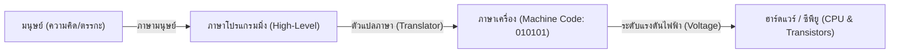
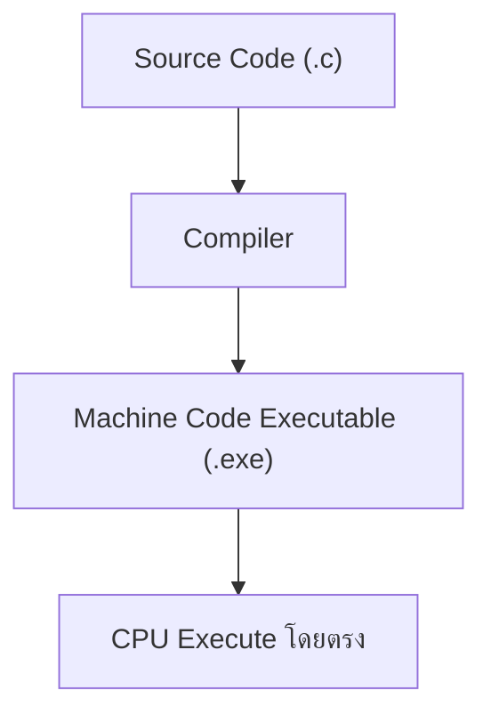
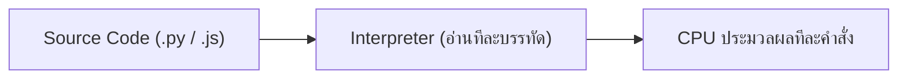
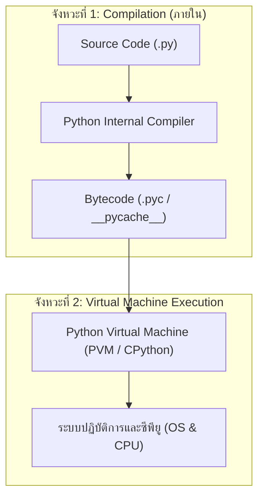

# บทที่ 1: ปฐมบทการเขียนโปรแกรม ตัวแปลภาษา และกำเนิดภาษาไพธอน

> [!abstract] สรุปจุดเน้นประจำบทเรียน
> บทเรียนนี้มุ่งเน้นการปูพื้นฐานทางความคิด (Mindset) และหลักการวิทยาการคอมพิวเตอร์ระดับสถาปัตยกรรม ก่อนลงมือพิมพ์โค้ด โดยเชื่อมโยงระหว่าง **ฮาร์ดแวร์ (ระดับกระแสไฟฟ้า/เลขฐานสอง)** สู่ **ภาษาระดับสูง (High-Level Language)** ผ่านกลไกตัวแปลภาษา (Compiler vs. Interpreter) และเจาะลึกเบื้องหลังการประมวลผลของ Python (Bytecode & PVM)

---

## 1. จุดประกายความคิด (Motivation: ทำไมช่างคอมฯ ยุคนี้ต้องเขียนโค้ด?)

> [!quote] คำคมกระตุ้นความคิด
> *"Hardware is the bone and muscle of computing, but Software is the soul and intellect."*  
> — ฮาร์ดแวร์หากปราศจากซอฟต์แวร์ ก็เป็นเพียงเศษเหล็กและซิลิคอนที่ไร้จิตวิญญาณ

### 1.1 ความจริงของสายงานเทคโนโลยีคอมพิวเตอร์ในปัจจุบัน
สำหรับนักศึกษาแผนกช่างเทคโนโลยีคอมพิวเตอร์ หลายคนมักมองว่าตนเองถนัดงานประกอบเครื่อง ซ่อมแซมบอร์ด ติดตั้งระบบปฏิบัติการ หรือเดินสายเครือข่าย แต่ในโลกเทคโนโลยียุคใหม่:
1. **Infrastructure as Code (IaC):** ระบบเซิร์ฟเวอร์และคลาวด์ไม่ได้ตั้งค่าด้วยมืออีกต่อไป แต่ควบคุมด้วยสคริปต์อัตโนมัติ
2. **Network Automation:** อุปกรณ์ Switch, Router ในองค์กรขนาดใหญ่ ไม่ได้คลิกคอนฟิกทีละเครื่อง แต่ใช้ Python ควบคุมผ่าน SSH/API
3. **Smart Hardware & IoT:** ไมโครคอนโทรลเลอร์ เซนเซอร์ และอุปกรณ์อุตสาหกรรม ต้องพึ่งพาโปรแกรมสั่งการรับ-ส่งข้อมูล
4. **AI & Data Integration:** ทุกสาขาอาชีพต้องเชื่อมต่อโมเดลปัญญาประดิษฐ์ (AI) เข้ากับงานของตนเอง ซึ่ง Python คือภาษามาตรฐานสากลอันดับ 1 ของโลกในด้านนี้

### 1.2 การเขียนโปรแกรมคือ "พลังทวีคูณ" (Force Multiplier)
- **ช่างทั่วไป:** ทำงานแบบ Manual ทำงาน 1 ชิ้น ใช้เวลา 1 ชั่วโมง ทำ 100 ชิ้น ใช้ 100 ชั่วโมง
- **ช่างที่เขียนโปรแกรมเป็น:** ใช้เวลาเขียนสคริปต์ 2 ชั่วโมง สั่งให้คอมพิวเตอร์ทำงาน 1,000 ชิ้นอัตโนมัติใน 5 นาที

---

## 2. ภาษาโปรแกรมมิ่งคืออะไร? (What is a Programming Language?)

### 2.1 มุมมองเชิงกายภาพ: คอมพิวเตอร์คิดอย่างไร?
คอมพิวเตอร์เป็นอุปกรณ์อิเล็กทรอนิกส์ หัวใจหลักคือ **CPU (Central Processing Unit)** ซึ่งสร้างขึ้นจากทรานซิสเตอร์ (Transistor) นับพันล้านตัว ทำหน้าที่เป็นสวิตช์เปิด-ปิดกระแสไฟฟ้า:
- **ไม่มีกระแสไฟ (Low Voltage ~ 0V):** แทนสถานะปิด หรือสัญลักษณ์เลข **`0`**
- **มีกระแสไฟ (High Voltage ~ 3.3V/5V):** แทนสถานะเปิด หรือสัญลักษณ์เลข **`1`**

คอมพิวเตอร์ไม่เข้าใจคำว่า "สวัสดี", ไม่เข้าใจคำว่า "บวกเลข", และไม่เข้าใจภาษาอังกฤษ แต่คอมพิวเตอร์เข้าใจเพียงสถานะทางไฟฟ้าที่ถูกเข้ารหัสเป็น **รหัสภาษาเครื่อง (Machine Code)** ซึ่งเป็นชุดเลขฐานสอง (`01001000 01101001`)



### 2.2 ลำดับวิวัฒนาการของภาษาคอมพิวเตอร์ (Language Generations)

| ระดับภาษา                   | ชื่อรุ่น                   | รูปแบบคำสั่ง                     | ตัวอย่างคำสั่ง                            |           ความสะดวกของมนุษย์            |        ประสิทธิภาพการรัน         |
| :-------------------------- | :------------------------- | :------------------------------- | :---------------------------------------- | :-------------------------------------: | :------------------------------: |
| **ระดับต่ำสุด (Low-level)** | 1st Gen: Machine Language  | เลขฐานสองล้วน (Binary)           | `10110000 01100001`                       |      ยากที่สุด (มนุษย์แทบจำไม่ได้)      |  เร็วที่สุด (เข้าถึง CPU ทันที)  |
| **ระดับต่ำ (Low-level)**    | 2nd Gen: Assembly Language | รหัสช่วยจำ (Mnemonics)           | `MOV AL, 61h`<br>`ADD AX, BX`             | ยาก (ต้องรู้โครงสร้าง Register และ CPU) | เร็วมาก (ใกล้เคียง Machine Code) |
| **ระดับสูง (High-level)**   | 3rd Gen: C, Java, Python   | โครงสร้างไวยากรณ์คล้ายภาษาอังกฤษ | `print("Hello World")`<br>`total = a + b` |     **ง่ายที่สุด (อ่านเข้าใจง่าย)**     |        ต้องผ่านตัวแปลภาษา        |

> [!tip] Abstraction Layer (การซ่อนความซับซ้อน)
> ภาษาโปรแกรมมิ่งระดับสูงเกิดขึ้นเพื่อทำหน้าที่เป็น **Abstraction Layer** ซ่อนความซับซ้อนของวงจรอิเล็กทรอนิกส์และโครงสร้างสถาปัตยกรรมฮาร์ดแวร์ไว้ เพื่อให้มนุษย์สามารถโฟกัสที่ **"ตรรกะการแก้ปัญหา (Logic & Problem Solving)"** ได้อย่างเต็มที่

---

## 3. ทฤษฎีตัวแปลภาษา: Compiler vs. Interpreter

เนื่องจากมนุษย์เขียนโค้ดด้วยภาษาระดับสูง (Source Code) แต่ CPU เข้าใจเฉพาะรหัสภาษาเครื่อง (Machine Code) จึงจำเป็นต้องมี **"ตัวแปลภาษา" (Language Processor)** ทำหน้าที่เป็นตัวกลาง

ในวงการวิทยาการคอมพิวเตอร์ ตัวแปลภาษาแบ่งออกเป็น 2 แนวคิดหลัก:

### 3.1 คอมไพเลอร์ (Compiler) — "นักแปลหนังสือทั้งเล่ม"
- **หลักการทำงาน:** อ่านซอร์สโค้ด (Source Code) ทั้งโปรแกรมตั้งแต่ต้นจนจบในคราวเดียว ตรวจสอบไวยากรณ์ (Syntax Analysis) หากถูกต้องทั้งหมดจะทำการแปลง (Compile) และเชื่อมโยง (Link) โค้ดทั้งหมดออกมาเป็น **ไฟล์ไบนารีที่รันได้โดยตรง (Executable File เช่น `.exe` บน Windows หรือ Binary Executable บน Linux)**
- **ลักษณะการทำงาน:**
  1. มีขั้นตอนการสร้างไฟล์สำเร็จรูปแยกต่างหาก (Build/Compile Time)
  2. เมื่อคอมไพล์เสร็จ สามารถนำไฟล์ `.exe` ไปรันได้ทันทีโดยไม่ต้องใช้ซอร์สโค้ดและไม่ต้องติดตั้งตัวคอมไพเลอร์ในเครื่องปลายทาง
  3. หากมีข้อผิดพลาด (Syntax Error) แม้แต่บรรทัดเดียว โปรแกรมจะไม่ยอมสร้างไฟล์ผลลัพธ์
- **ภาษาตัวอย่าง:** C, C++, Rust, Go, Fortran



### 3.2 อินเทอร์พรีเตอร์ (Interpreter) — "ล่ามแปลสดประโยคต่อประโยค"
- **หลักการทำงาน:** อ่านคำสั่งจากซอร์สโค้ดทีละบรรทัด (Line-by-line) แปลงบรรทัดนั้นเป็นคำสั่งเครื่อง แล้วส่งให้ CPU ประมวลผลทันที หากคำสั่งบรรทัดใดผ่าน ก็จะทำงานต่อไปจนกว่าจะเจอบรรทัดที่เกิดข้อผิดพลาด
- **ลักษณะการทำงาน:**
  1. ไม่มีการสร้างไฟล์รันล่วงหน้าแบบ `.exe`
  2. ทุกครั้งที่จะรันโปรแกรม เครื่องปลายทางต้องมีตัวโปรแกรมอินเทอร์พรีเตอร์ (Interpreter Runtime) ติดตั้งอยู่เสมอ
  3. แก้ไขโค้ดแล้วรันดูผลลัพธ์ได้ทันที เหมาะกับการทดลองและพัฒนาอย่างรวดเร็ว
- **ภาษาตัวอย่าง:** JavaScript, PHP, Ruby, Bash Script



### 3.3 ตารางเปรียบเทียบเชิงลึก: Compiler vs. Interpreter

| หัวข้อเปรียบเทียบ                           | คอมไพเลอร์ (Compiler)                            | อินเทอร์พรีเตอร์ (Interpreter)                         |
| :------------------------------------------ | :----------------------------------------------- | :----------------------------------------------------- |
| **กระบวนการแปล**                            | แปลทั้งไฟล์ให้เสร็จสิ้นก่อนเริ่มรัน              | แปลและรันไปพร้อมกันทีละบรรทัด                          |
| **ไฟล์ผลลัพธ์**                             | ได้ไฟล์ Machine Code รันได้เอง (`.exe`)          | ไม่สร้างไฟล์รันแยก (ใช้โค้ดต้นฉบับคู่กับ Runtime)      |
| **ความเร็วในการทำงาน (Execution Speed)**    | **เร็วกว่ามาก** เพราะซีพียูรัน Machine Code ตรงๆ | **ช้ากว่า** เพราะต้องเสียเวลาแปลซ้ำทุกครั้งที่รัน      |
| **ความสะดวกในการพัฒนา (Development Cycle)** | ช้ากว่า (ต้องรอ Compile ใหม่ทุกครั้งที่แก้โค้ด)  | **เร็วกว่ามาก** (แก้โค้ดปุ๊บ กดรันดูผลได้ทันที)        |
| **การตรวจจับ Error**                        | พบข้อผิดพลาดทั้งหมดก่อนเริ่มรัน (Compile-time)   | พบข้อผิดพลาดเมื่อโปรแกรมวิ่งไปถึงบรรทัดนั้น (Runtime)  |
| **การคุ้มครองทรัพย์สินทางปัญญา**            | สูง (แจกจ่ายเฉพาะไฟล์ไบนารี แปลกลับยาก)          | ต่ำ (ต้องส่งซอร์สโค้ดต้นฉบับให้เครื่องปลายทางรัน)      |
| **การทำงานข้ามระบบ (Portability)**          | ไฟล์ผลลัพธ์ผูกติดกับ OS/CPU ที่คอมไพล์           | ไฟล์โค้ดนำไปรันได้ทุก OS ที่มี Interpreter ติดตั้งอยู่ |

---

## 4. เจาะลึกเบื้องหลัง: จริงๆ แล้ว Python เป็น Compiler หรือ Interpreter?

> [!important] ความจริงที่ผู้เรียนส่วนใหญ่เข้าใจผิด!
> ตำราทั่วไปมักสอนอย่างย่อว่า *"Python เป็นภาษาประเภท Interpreter"*  
> **แต่ในความเป็นจริงทางเทคนิค: Python เป็นระบบลูกผสม (Hybrid Architecture)!**

Python มีกระบวนการทำงาน 2 จังหวะที่ซ่อนอยู่เบื้องหลัง:



### ขั้นตอนที่ 1: การคอมไพล์เป็น Bytecode (Python Internal Compilation)
เมื่อเราสั่งรันไฟล์ `main.py` ตัวแปลภาษา Python (CPython) จะคอมไพล์โค้ดภาษาอังกฤษที่เราเขียนให้กลายเป็นรหัสระดับกลางที่เรียกว่า **ไบต์โค้ด (Bytecode)** ซึ่งเป็นรหัสเฉพาะของระบบเสมือน Python
- ไฟล์ Bytecode นี้จะถูกเก็บแคชไว้ในโฟลเดอร์ `__pycache__/` มีนามสกุลเป็น `.pyc`
- Bytecode ช่วยให้การรันโปรแกรมในครั้งถัดไปไม่ต้องเสียเวลาคอมไพล์ซ้ำ หากไฟล์ต้นฉบับไม่มีการแก้ไข

### ขั้นตอนที่ 2: การประมวลผลผ่าน Python Virtual Machine (PVM)
**PVM** คือตัว Interpreter ตัวจริงของ Python โดยจะอ่านคำสั่งใน Bytecode ทีละคำสั่ง แล้วแปลงเป็น Machine Code ส่งต่อไปยังซีพียูจริงของเครื่องคอมพิวเตอร์

> [!tip] ทำไม Python ถึงออกแบบสถาปัตยกรรมแบบนี้?
> 1. **Write Once, Run Anywhere:** ไฟล์ Bytecode ไม่ผูกติดกับยี่ห้อของ CPU ไม่ว่าจะเป็น Intel x86, AMD64 หรือ ARM (Apple Silicon / Raspberry Pi) ตราบใดที่มี PVM เวอร์ชันนั้นๆ ติดตั้งอยู่
> 2. **Performance Optimization:** การแปลง Source Code เป็น Bytecode ล่วงหน้า ช่วยตัดขั้นตอนการวิเคราะห์ไวยากรณ์ (Syntax Parsing) ที่กินเวลาออกไป ทำให้รันได้เร็วกว่า Pure Interpreter แบบดั้งเดิม

---

## 5. กำเนิดและปรัชญาของภาษาไพธอน (History & Philosophy)

### 5.1 ใครเป็นคนสร้าง และสร้างขึ้นมาทำไม?
- **ผู้สร้าง:** **คีโด ฟัน รอสซึม (Guido van Rossum)** โปรแกรมเมอร์ชาวเนเธอร์แลนด์ (ได้รับฉายาว่า *BDFL - Benevolent Dictator For Life* แห่งวงการ Python)
- **ช่วงเวลากำเนิด:** เริ่มต้นพัฒนาในสัปดาห์วันหยุดคริสต์มาสช่วงปลายปี **1989** และเปิดตัวเวอร์ชันแรก (0.9.0) สู่สาธารณะในปี **1991** ที่สถาบันวิจัย CWI (Centrum Wiskunde & Informatica) ประเทศเนเธอร์แลนด์
- **แรงบันดาลใจ:** คีโดต้องการสร้างภาษาที่:
  1. แก้ไขข้อบกพร่องของภาษา **ABC** (ภาษาสำหรับสอนเขียนโค้ดที่มีโครงสร้างดีแต่อ่านและเชื่อมต่อระบบยาก)
  2. เขียนง่าย สะอาดตา อ่านเข้าใจได้ทันที ไม่ต้องมีเครื่องหมายกวนใจแบบภาษา **C** (ไม่ต้องใส่เซมิโคลอน `;` ทุกบรรทัด หรือปีกกา `{ }` ซับซ้อน)
  3. จัดการระบบอัตโนมัติ (Automate Tasks) ได้ดีเยี่ยม เหมาะกับการเป็น "ภาษากาว" (Glue Language) เชื่อมต่อโปรแกรมอื่น

### 5.2 ที่มาของชื่อ "Python" (ความจริงที่ไม่เกี่ยวกับงู)
หลายคนเห็นโลโก้ภาษา Python เป็นรูปงูสีน้ำเงินและสีเหลือง จึงคิดว่าคีโดรักงูหลาม แต่แท้จริงแล้ว:
- คีโดเป็นแฟนคลับของคณะตลกแนวเสียดสีชื่อดังของสถานีโทรทัศน์ BBC ของอังกฤษที่มีชื่อว่า **"Monty Python's Flying Circus"**
- เขาต้องการตั้งชื่อภาษาให้ดู **สั้น แปลกใหม่ ลึกลับ และมีความสนุกสนาน ไม่เคร่งเครียด** จึงหยิบคำว่า **Python** มาตั้งเป็นชื่อภาษา

### 5.3 ปรัชญาแห่งไพธอน (The Zen of Python - PEP 20)
ภาษาไพธอนมีแนวคิดการออกแบบที่ชัดเจนมากที่สุดภาษาหนึ่งในโลก หากเปิดโปรแกรม Python แล้วพิมพ์คำสั่ง:
```python
import this
```
โปรแกรมจะแสดงบทกลอนปรัชญา 19 ข้อ ซึ่งมีหลักคิดสำคัญที่นักศึกษาต้องยึดถือ ได้แก่:
1. **Beautiful is better than ugly:** โค้ดที่สวยงาม สะอาดตา ย่อมดีกว่าโค้ดที่รกรุงรัง
2. **Explicit is better than implicit:** แสดงเจตนาของการเขียนโค้ดให้ชัดเจน ดีกว่าแอบทำซ่อนไว้
3. **Simple is better than complex:** เรียบง่าย ดีกว่าซับซ้อน
4. **Readability counts:** "ความอ่านง่ายของโค้ดคือหัวใจที่สำคัญที่สุด" (เพราะในชีวิตการทำงานจริง เราอ่านโค้ดบ่อยกว่าเขียนโค้ดใหม่ถึง 10 เท่า)

### 5.4 ปัจจัยที่ทำให้ Python กลายเป็นภาษายอดนิยมอันดับ 1 ของโลก
1. **Batteries Included:** ติดตั้ง Python มาตรฐาน จะได้ไลบรารีพื้นฐานครบครัน ตั้งแต่จัดการไฟล์, คำนวณคณิตศาสตร์, ไปจนถึงจัดการเน็ตเวิร์ก
2. **Syntax ที่ใกล้เคียงภาษาอังกฤษ:** บังคับจัดย่อหน้า (Indentation) ทำให้โค้ดของทุกคนมีมาตรฐานและอ่านเข้าใจง่ายเหมือนกัน
3. **มหาอำนาจแห่งโอเพนซอร์สและ AI:** วงการ Data Science, Machine Learning, Deep Learning (TensorFlow, PyTorch) พัฒนาบน Python เป็นหลัก
4. **ใช้งานได้หลากหลาย (Versatile):** เขียนได้ตั้งแต่สคริปต์สแกนพอร์ตเน็ตเวิร์กเล็กๆ, สั่งงานบอร์ดสมองกลฝังตัว (MicroPython), ทำเว็บเซิร์ฟเวอร์, จนถึงขับเคลื่อนโมเดล AI ระดับโลก

---

## 6. แนวทางจัดกิจกรรมในชั้นเรียน (Active Learning & Lesson Script)

### ช่วงที่ 1: ขั้นนำเข้าสู่บทเรียน (Hook & Motivation — 20 นาที)
1. **กิจกรรมทายผลลัพธ์ฮาร์ดแวร์:**
   - ครูถือบอร์ดไมโครคอนโทรลเลอร์หรือหยิบแรมคอมพิวเตอร์ขึ้นมา แล้วถามนักศึกษาว่า *"ถ้าเราป้อนไฟเข้าไปเฉยๆ อุปกรณ์ตัวนี้จะทำอะไรได้บ้าง?"*
   - นำไปสู่ข้อสรุปว่า: ฮาร์ดแวร์คือร่าง ซอฟต์แวร์คือวิญญาณ
2. **เปิดสถิติตลาดแรงงาน:**
   - ฉายชาร์ตดัชนี TIOBE Index / GitHub Octoverse ชี้ให้เห็นว่า Python ครองแชมป์ความนิยมอันดับ 1 ในอุตสาหกรรมไอที

### ช่วงที่ 2: ขั้นถ่ายทอดความรู้และทดลองสด (Live Concept Demo — 50 นาที)
1. **กิจกรรมจำลองบทบาท "Compiler vs. Interpreter":**
   - ครูเลือกนักศึกษาอาสาสมัคร 2 คนมาหน้าห้อง
   - ครูแจกแผ่นกระดาษที่มีข้อความภาษาต่างประเทศ (เช่น ภาษาอังกฤษ 5 บรรทัด)
   - **คนที่ 1 (ตัวแทน Compiler):** ให้อ่านและเขียนคำแปลภาษาไทยทั้งหมดลงบนกระดาษแผ่นใหม่ให้เสร็จ เมื่อแปลเสร็จสมบูรณ์จึงเดินเอาไปส่งให้อาจารย์ตรวจ (ชี้ให้เห็นว่าเสียเวลาแปลรอบแรก แต่ได้เอกสารแปลพร้อมใช้งานทันที)
   - **คนที่ 2 (ตัวแทน Interpreter):** ให้อ่านทีละบรรทัดแล้วตะโกนแปลสดออกมาทันทีทีละข้อ (ชี้ให้เห็นว่าเริ่มทำงานได้เร็ว แต่ถ้าสั่งให้ทำซ้ำรอบสองก็ต้องยืนอ่านแปลใหม่อีกรอบ)
   - แกล้งใส่คำสั่งที่ผิดไวยากรณ์ไว้ที่บรรทัดที่ 4 เพื่อดูว่า:
     - Compiler จะฟ้อง Error ตั้งแต่ตอนแปล ไม่ยอมออกผลลัพธ์
     - Interpreter จะแปลและแสดงผลบรรทัดที่ 1, 2, 3 ได้ปกติ จนกระทั่งมาสะดุดหยุดทำงานที่บรรทัดที่ 4!

2. **เปิดม่านความลับ `__pycache__`:**
   - ครูเขียนไฟล์ `demo.py` สั้นๆ แล้วสั่งรัน
   - เปิดโฟลเดอร์ไฟล์ให้นักศึกษาดูว่ามีโฟลเดอร์ชื่อ `__pycache__` โผล่ขึ้นมาพร้อมไฟล์ `.pyc`
   - พิสูจน์ให้นักศึกษาเห็นว่า Python มีขั้นตอนการ Compile ซ่อนอยู่จริง ไม่ใช่แค่ Interpreter เพียวๆ

### ช่วงที่ 3: ขั้นสรุปและสะท้อนความคิด (Exit Ticket / Formative Check — 20 นาที)
แจกแบบสอบถามสั้น 3 ข้อเพื่อประเมินความเข้าใจก่อนเลิกคาบ:
1. ทำไมคอมพิวเตอร์ถึงประมวลผลคำสั่งภาษาไทยหรือภาษาอังกฤษตรงๆ ไม่ได้?
2. หากนักศึกษาต้องการเขียนโปรแกรมควบคุมยานอวกาศหรือระบบเบรก ABS ในรถยนต์ที่ต้องการความเร็วระดับเสี้ยววินาที นักศึกษาจะเลือกภาษาที่เป็น Compiler หรือ Interpreter เพราะเหตุใด?
3. โฟลเดอร์ `__pycache__` ในโปรเจกต์ Python เกิดขึ้นจากขั้นตอนใด และมีประโยชน์อย่างไร?

---

## 7. แหล่งอ้างอิงและเอกสารอ่านต่อ

- [[31909-1007 การเขียนโปรแกรมด้วยภาษาไพธอน]] — โน้ตโครงสร้างวิชาฉบับเต็ม
- [[แผนหน่วยการเรียน 31909-1007 การเขียนโปรแกรมด้วยภาษาไพธอน]] — แผนการสอนรายสัปดาห์
- Python Software Foundation (PSF) Official Documentation: [https://docs.python.org/3/](https://docs.python.org/3/)
- PEP 20 — The Zen of Python: [https://peps.python.org/pep-0020/](https://peps.python.org/pep-0020/)
