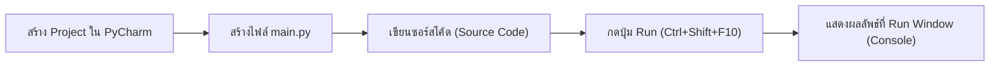
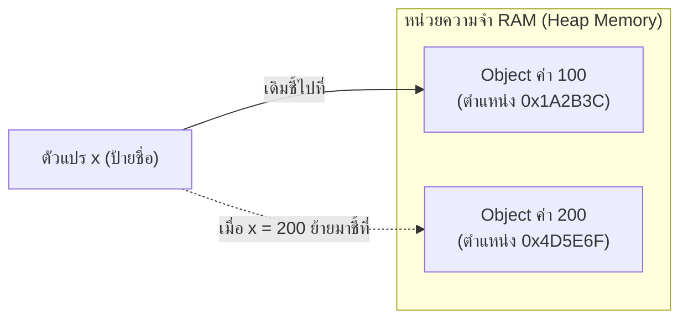

# บทที่ 2: พื้นฐานการเขียนโปรแกรม ตัวแปร ชนิดข้อมูล และการประมวลผล

> [!abstract] สรุปสาระสำคัญประจำบทเรียน
> บทเรียนนี้พานักศึกษาเริ่มต้นเขียนโค้ดภาษา Python ผ่านไฟล์ `.py` บนสภาพแวดล้อมมืออาชีพ **PyCharm** โดยเจาะลึกตั้งแต่โครงสร้างไฟล์, พารามิเตอร์ลับของฟังก์ชัน `print()`, กลไกการทำงานของตัวแปรในระดับหน่วยความจำ (RAM) ผ่านแนวคิด **Name Tag & Reference (`id()`)**, ความจริงของชนิดข้อมูลพื้นฐาน (`int`, `float`, `str`, `bool`), การรับข้อมูลและการแปลงชนิดข้อมูล (Type Casting), ตัวดำเนินการทางคณิตศาสตร์, จนถึงการจัดรูปแบบข้อความด้วย **f-strings** พร้อมโจทย์ประยุกต์สายงานช่างคอมพิวเตอร์และฮาร์ดแวร์

---

## 1. การเริ่มต้นสภาพแวดล้อมการทำงานด้วย PyCharm

สำหรับสายงานพัฒนาซอฟต์แวร์ระดับวิชาชีพ การเขียนโค้ดลงในไฟล์สคริปต์ (`.py`) โดยตรงผ่าน IDE (Integrated Development Environment) ที่สมบูรณ์แบบอย่าง **PyCharm** ช่วยสร้างทักษะการจัดการโปรเจกต์และการดีบักโค้ดที่ถูกต้องตั้งแต่เริ่มต้น



### 1.1 โครงสร้างของไฟล์ซอร์สโค้ด `.py`
ไฟล์ภาษาไพธอนเป็นไฟล์ข้อความธรรมดา (Plain Text) ที่บันทึกด้วยรหัสภาษา UTF-8 และมีนามสกุลไฟล์เป็น `.py` โดยมีกฎเกณฑ์สำคัญที่ต้องยึดถือ:
1. **การคอมเมนต์ (Comments):** ข้อความที่เขียนเพื่อให้มนุษย์อ่านและตัวแปลภาษาจะข้ามไป ไม่ถูกประมวลผล
   - คอมเมนต์บรรทัดเดียว: ใช้เครื่องหมายชาร์ป (`#`)
   - ข้อความอธิบายแบบหลายบรรทัด: นิยมใช้ Docstring หรือเครื่องหมายคำพูด 3 ตัว (`""" ... """`)
2. **การจัดย่อหน้า (Indentation):** ไพธอนใช้ระยะเว้นวรรค (Indent) เพื่อกำหนดขอบเขตบล็อกคำสั่ง (ห้ามผสม Tab กับ Space แนะนำเคาะ Space 4 ครั้งตามมาตรฐาน PEP 8 ซึ่ง PyCharm จะช่วยจัดการให้อัตโนมัติ)
3. **ความไวต่ออักษรพิมพ์เล็ก-ใหญ่ (Case Sensitivity):** ตัวแปรชื่อ `data`, `Data`, และ `DATA` ถือเป็นคนละตัวแปรกันอย่างสิ้นเชิง

---

## 2. เจาะลึกฟังก์ชันแสดงผล `print()` (Anatomy of `print()`)

คำสั่งแรกในชีวิตโปรแกรมเมอร์ทุกคนคือการแสดงผลข้อความออกทางหน้าจอ:

```python
print("Hello, Computer Technology!")
```

แต่ในระดับมืออาชีพ ฟังก์ชัน `print()` มีพารามิเตอร์ควบคุมพฤติกรรมการแสดงผลที่ทรงพลังมาก ซึ่งหลายคนมองข้าม:

```python
print(*objects, sep=' ', end='\n', file=None, flush=False)
```

### 2.1 พารามิเตอร์ `sep` (Separator: ตัวคั่นระหว่างข้อมูล)
โดยปกติเมื่อเราส่งข้อมูลหลายค่าคั่นด้วยเครื่องหมายจุลภาค (`,`) ไพธอนจะเว้นวรรค 1 ช่องให้อัตโนมัติ แต่เราสามารถเปลี่ยนตัวคั่นนี้ได้ผ่าน `sep`:

```python
# ผลลัพธ์ปกติ (sep=' ' โดยปริยาย)
print("CPU", "RAM", "SSD")
# แสดงผล: CPU RAM SSD

# ปรับแต่งตัวคั่นสำหรับงานระบบและเน็ตเวิร์ก
print("192", "168", "1", "1", sep=".")
# แสดงผล: 192.168.1.1

print("RX", "TX", "GND", sep=" -> ")
# แสดงผล: RX -> TX -> GND
```

### 2.2 พารามิเตอร์ `end` (End: ตัวปิดท้ายบรรทัด)
โดยปกติหลังจบคำสั่ง `print()` จะมีการขึ้นบรรทัดใหม่เสมอ (`end='\n'`) แต่เราสามารถสั่งให้พิมพ์ต่อท้ายในบรรทัดเดิมได้:

```python
print("กำลังโหลดระบบ BIOS...", end="")
print("สำเร็จ!")
# แสดงผล: กำลังโหลดระบบ BIOS...สำเร็จ! (อยู่บรรทัดเดียวกัน)
```

### 2.3 รหัสควบคุมการแสดงผล (Escape Sequences)
- `\n` : ขึ้นบรรทัดใหม่ (Line Feed)
- `\t` : เว้นระยะแท็บแนวนอน (Tab Spacing นิยมใช้จัดตารางข้อมูล)
- `\\` : พิมพ์เครื่องหมาย Backslash (สำคัญมากเวลาพิมพ์ Path ไดรฟ์ Windows เช่น `C:\\Windows\\System32`)
- `\"` หรือ `\'` : พิมพ์เครื่องหมายคำพูดลงในข้อความ

---

## 3. ตัวแปรในระดับหน่วยความจำ: "ป้ายชื่อผูกกับอ็อบเจกต์" (Name Tag & Reference)

> [!important] ความเข้าใจที่ถูกต้องของภาษาไพธอน
> ในภาษา C หรือ Pascal ตัวแปรเปรียบเสมือน **"กล่องใส่ของ (Box)"** ที่จองเนื้อที่ในแรมไว้ล่วงหน้า แล้วเรานำค่าไปเทใส่กล่อง  
> **แต่ใน Python ทุกสิ่งทุกอย่างคืออ็อบเจกต์ (Object) ในหน่วยความจำ (Heap) และตัวแปรเป็นเพียง "ป้ายชื่อ (Name Tag / Pointer)" ที่ผูกโยงเข้าหาอ็อบเจกต์นั้น!**



### 3.1 พิสูจน์ด้วยฟังก์ชัน `id()` และ `type()`
ไพธอนเตรียมฟังก์ชันสำหรับตรวจสอบสถาปัตยกรรมภายในของตัวแปร:
- `type(x)` : ตรวจสอบชนิดข้อมูลของอ็อบเจกต์ที่ตัวแปรนั้นชี้อยู่
- `id(x)` : ส่งคืนหมายเลขระบุตัวตน (Identity) ซึ่งในระบบมาตรฐาน CPython คือ **ที่อยู่หน่วยความจำจริง (Memory Address)** ของอ็อบเจกต์

```python
x = 100
print(f"ค่าของ x: {x}, ชนิดข้อมูล: {type(x)}, ตำแหน่งในแรม: {id(x)}")

# เปลี่ยนค่าของ x
x = 200
print(f"ค่าของ x ใหม่: {x}, ชนิดข้อมูล: {type(x)}, ตำแหน่งในแรม: {id(x)}")
```

> [!note] สิ่งที่สังเกตเห็นจากการทดลอง
> ตัวแปรชื่อ `x` ตัวเดิม แต่เมื่อเปลี่ยนค่าเป็น `200` หมายเลข `id(x)` จะเปลี่ยนตำแหน่งไปทันที! นี่คือหลักฐานยืนยันว่า `x` ไม่ใช่กล่องเดิมที่เอาค่า 200 มาทับ แต่เป็นการสร้างอ็อบเจกต์ตัวใหม่ขึ้นมา แล้วย้ายป้ายชื่อ `x` ไปแปะที่อ็อบเจกต์ใหม่แทน

### 3.2 กฎการตั้งชื่อตัวแปรและมาตรฐาน PEP 8
1. ประกอบด้วยตัวอักษรภาษาอังกฤษ ตัวเลข และเครื่องหมายขีดล่าง (`_`) เท่านั้น
2. **ห้ามขึ้นต้นด้วยตัวเลข** เช่น `2ram` ผิดไวยากรณ์ (ต้องเป็น `ram_slot2`)
3. ห้ามใช้คำสงวนของภาษา (Reserved Words เช่น `if`, `while`, `class`, `def`, `import`, `return`)
4. **มาตรฐานสากล (Snake Case):** ใช้ตัวพิมพ์เล็กคั่นด้วยเครื่องหมายขีดล่าง เช่น `cpu_temperature`, `network_speed_mbps`

---

## 4. เจาะลึกชนิดข้อมูลพื้นฐาน (Primitive Data Types)

ภาษาไพธอนเป็นภาษาแบบ **Dynamic Typing** หมายความว่าเราไม่ต้องประกาศชนิดข้อมูลล่วงหน้า (เช่น ไม่ต้องเขียน `int x = 10;` แบบภาษา C) ตัวแปลภาษาจะตรวจสอบชนิดข้อมูลให้เองโดยอัตโนมัติขณะรันไทม์

### 4.1 จำนวนเต็ม (`int` - Integer)
- เก็บค่าจำนวนเต็มบวก จำนวนเต็มลบ และศูนย์
- **จุดเด่นพิเศษของ Python 3:** ระบบจำนวนเต็มของไพธอนเป็นแบบ **Arbitrary Precision** หมายความว่าไม่มีข้อจำกัดขนาด 32-bit (สูงสุด 2 พันล้าน) หรือ 64-bit เหมือนภาษาอื่น! มันสามารถขยายขนาดความจุตามปริมาณแรมของเครื่องได้ ไม่เกิดปัญหา Overflow แม้จะคำนวณเลขหลักหมื่นหลักล้าน

```python
huge_number = 99999999999999999999999999999999999999999999999999
print(huge_number * 2)  # ไพธอนคำนวณได้ถูกต้อง ไม่เกิด Error
```

### 4.2 จำนวนจริงทศนิยม (`float` - Floating Point)
- เก็บค่าตัวเลขที่มีจุดทศนิยม หรือตัวเลขในรูปสัญกรณ์วิทยาศาสตร์ เช่น `1.5e3` ($1.5 \times 10^3 = 1500.0$)
- ทำงานตามมาตรฐานสากล **IEEE 754 Double Precision (64-bit)**
- **ประเด็นที่ช่างคอมฯ ต้องรู้:** เนื่องจากคอมพิวเตอร์แปลงเลขฐานสิบเป็นฐานสองในแรม บางค่าทศนิยมจึงไม่สามารถแปลงได้อย่างแม่นยำ 100%:

```python
result = 0.1 + 0.2
print(result)
# ผลลัพธ์: 0.30000000000000004 (ไม่ได้เท่ากับ 0.3 เป๊ะ เพราะข้อจำกัดฐานสองระดับฮาร์ดแวร์!)
```

### 4.3 ข้อความ (`str` - String)
- ข้อความตัวอักษรที่อยู่ในเครื่องหมายคำพูดเดี่ยว (`'...'`) หรือคำพูดคู่ (`"..."`)
- รองรับมาตรฐาน **Unicode (UTF-8)** อย่างสมบูรณ์ จึงสามารถพิมพ์ภาษาไทย ภาษาต่างประเทศ หรืออีโมจิได้โดยตรง
- ข้อมูลชนิด String ใน Python เป็น **Immutable** (ไม่สามารถแก้ไขตัวอักษรบางตำแหน่งในอ็อบเจกต์เดิมได้)

### 4.4 ค่าความจริงเชิงตรรกะ (`bool` - Boolean)
- มีเพียง 2 สถานะคือ `True` (จริง) หรือ `False` (เท็จ) — *ตัวอักษรตัวแรกต้องเป็นตัวพิมพ์ใหญ่เสมอ*
- ในสถาปัตยกรรมภายในของ CPython คลาส `bool` เป็นคลาสลูกที่สืบทอดมาจาก `int` โดยตรง:
  - `True` มีค่าทางคณิตศาสตร์เท่ากับ `1`
  - `False` มีค่าทางคณิตศาสตร์เท่ากับ `0`

---

## 5. การรับข้อมูล (`input`) และการแปลงชนิดข้อมูล (Type Casting)

### 5.1 หลุมพรางที่คลาสสิกที่สุดของฟังก์ชัน `input()`
ฟังก์ชัน `input()` ใช้สำหรับรับค่าที่ผู้ใช้พิมพ์เข้ามาผ่านแป้นพิมพ์:

> [!caution] กฎเหล็กที่ต้องจำ
> ข้อมูลที่ได้จากฟังก์ชัน `input()` จะมีชนิดข้อมูลเป็น **ข้อความ (`str`) เสมอทุกครั้ง** แม้ว่าผู้ใช้จะพิมพ์ตัวเลขล้วนก็ตาม!

ลองพิจารณาข้อผิดพลาดนี้:
```python
price = input("กรุณาป้อนราคาอุปกรณ์: ")  # สมมติผู้ใช้พิมพ์ 500
vat = price * 0.07 
```

### 5.2 การแปลงชนิดข้อมูลอย่างปลอดภัย (Explicit Type Casting)
เราต้องแปลงข้อความให้กลายเป็นตัวเลขก่อนนำไปคำนวณ:
- `int(data)` : แปลงข้อความเป็นจำนวนเต็ม
- `float(data)` : แปลงข้อความเป็นทศนิยม
- `str(data)` : แปลงตัวเลขกลับเป็นข้อความ
- `bool(data)` : แปลงค่าเป็นความจริง (ค่าว่าง `""`, ตัวเลข `0`, และ `None` จะกลายเป็น `False` นอกนั้นเป็น `True`)

**รูปแบบการเขียนที่ถูกต้อง:**
```python
price_str = input("กรุณาป้อนราคาอุปกรณ์ (บาท): ")
price = float(price_str)
vat = price * 0.07
print("ภาษีมูลค่าเพิ่ม:", vat)

# หรือเขียนรวบยอดในบรรทัดเดียว
ram_capacity = int(input("ป้อนขนาด RAM (GB): "))
```

---

## 6. ตัวดำเนินการทางคณิตศาสตร์ (Arithmetic Operators)

ไพธอนมีตัวดำเนินการคำนวณที่ละเอียดและครอบคลุมมากกว่าภาษาตระกูล C:

| สัญลักษณ์ | ชื่อตัวดำเนินการ                  | ตัวอย่าง  |   ผลลัพธ์   | ข้อควรจำสำหรับช่าง                                                  |
| :-------: | :-------------------------------- | :-------: | :---------: | :------------------------------------------------------------------ |
|    `+`    | การบวก (Addition)                 | `10 + 3`  |    `13`     | หากใช้กับ String จะเป็นการต่อข้อความ                                |
|    `-`    | การลบ (Subtraction)               | `10 - 3`  |     `7`     |                                                                     |
|    `*`    | การคูณ (Multiplication)           | `10 * 3`  |    `30`     | หากใช้กับ String เช่น `"A" * 3` จะได้ `"AAA"`                       |
|    `/`    | การหารจริง (True Division)        | `10 / 3`  | `3.3333...` | **ผลลัพธ์จะเป็น `float` เสมอ** แม้จะหารลงตัว เช่น `4 / 2` ได้ `2.0` |
|   `//`    | การหารปัดเศษทิ้ง (Floor Division) | `10 // 3` |     `3`     | ตัดทศนิยมทิ้งทั้งหมด เหมาะกับการคำนวณหาจำนวนเต็มชิ้น/สล็อต          |
|    `%`    | การหารเอาเฉพาะเศษ (Modulo)        | `10 % 3`  |     `1`     | สำคัญมาก ใช้เช็กเลขคู่/คี่ หรือวนรอบตัวเลข                          |
|   `**`    | การยกกำลัง (Exponentiation)       | `2 ** 10` |   `1024`    | ช่างคอมฯ ใช้คำนวณหน่วยไบนารี เช่น $2^{10} = 1024$ (1 KB)            |

### ลำดับความสำคัญของตัวดำเนินการ (Operator Precedence - PEMDAS)
1. **วงเล็บ `( )`** ทำงานก่อนเสมอ (แนะนำให้ใส่วงเล็บเมื่อไม่แน่ใจ เพื่อให้อ่านโค้ดง่าย)
2. **ยกกำลัง `**`**
3. **คูณและหาร `*`, `/`, `//`, `%`** (ทำจากซ้ายไปขวา)
4. **บวกและลบ `+`, `-`** (ทำจากซ้ายไปขวา)

---

## 7. การจัดรูปแบบข้อความระดับมืออาชีพด้วย f-strings (PEP 498)

ในอดีต ไพธอนเคยใช้เครื่องหมาย `%` (คล้าย `printf` ในภาษา C) หรือคำสั่ง `.format()` แต่มาตรฐานปัจจุบันตั้งแต่ Python 3.6 เป็นต้นมา กำหนดให้ใช้ **Formatted String Literals (f-strings)** ซึ่งทำงานเร็วที่สุดและอ่านโค้ดเข้าใจง่ายที่สุด

ไวยากรณ์: วางตัวอักษร `f` หรือ `F` ไว้หน้าเครื่องหมายคำพูด แล้วนำตัวแปรหรือนิพจน์คณิตศาสตร์ไปใส่ในวงเล็บปีกกา `{ }`

```python
cpu_model = "Intel Core i7-14700"
clock_speed_ghz = 5.4
cores = 20

print(f"หน่วยประมวลผล: {cpu_model} ความเร็วสูงสุด {clock_speed_ghz} GHz (มี {cores} Cores)")
```

### การควบคุมทศนิยมและการจัดตารางด้วย f-strings
- `{val:.2f}` : แสดงผลทศนิยม 2 ตำแหน่ง พร้อมปัดเศษให้อัตโนมัติ
- `{val:,}` : ใส่เครื่องหมายจุลภาคคั่นหลักพันให้อัตโนมัติ (Comma Separator)
- `{val:10}` : กำหนดความกว้างของช่องแสดงผล 10 ตัวอักษร (ชิดขวาหรือชิดซ้ายได้ เหมาะกับการพิมพ์ใบเสร็จ)

```python
storage_bytes = 1073741824
storage_gb = storage_bytes / (1024 ** 3)
price = 2890.50

print(f"ความจุ: {storage_gb:.0f} GB")
print(f"ราคาจำหน่าย: {price:,.2f} บาท")
```

---

## 8. กิจกรรมปฏิบัติการประจำบท (Hands-on Labs)

### ใบงานปฏิบัติการที่ 1: โปรแกรมแปลงหน่วยความจุคอมพิวเตอร์ (Storage Unit Converter)
**โจทย์:** ให้นักศึกษาเขียนโปรแกรมรับค่าขนาดพื้นที่จัดเก็บข้อมูลจากผู้ใช้ในหน่วย **กิกะไบต์ (Gigabyte: GB)** แล้วคำนวณแปลงเป็น:
1. เมกะไบต์ (Megabyte: MB) โดย $1 \text{ GB} = 1,024 \text{ MB}$
2. กิโลไบต์ (Kilobyte: KB) โดย $1 \text{ GB} = 1,024^2 \text{ KB}$
3. ไบต์ (Byte: B) โดย $1 \text{ GB} = 1,024^3 \text{ Byte}$
4. บิต (Bit: b) โดย $1 \text{ Byte} = 8 \text{ Bit}$

```python
# lab2_storage_converter.py
print("=" * 45)
print("   โปรแกรมคำนวณและแปลงหน่วยความจุคอมพิวเตอร์")
print("=" * 45)

# รับข้อมูลจากผู้ใช้
gb_input = float(input("กรุณาป้อนขนาดพื้นที่จัดเก็บ (GB): "))

# ประมวลผลคำนวณ
mb = gb_input * 1024
kb = gb_input * (1024 ** 2)
bytes_total = gb_input * (1024 ** 3)
bits_total = bytes_total * 8

# แสดงผลลัพธ์อย่างเป็นระเบียบด้วย f-strings
print("-" * 45)
print(f"ขนาดเริ่มต้น    : {gb_input:,.2f} GB")
print(f"เทียบเท่าในหน่วย MB : {mb:,.2f} MB")
print(f"เทียบเท่าในหน่วย KB : {kb:,.2f} KB")
print(f"เทียบเท่าในหน่วย Byte : {bytes_total:,.0f} Bytes")
print(f"เทียบเท่าในหน่วย Bit  : {bits_total:,.0f} Bits")
print("=" * 45)
```

---

### ใบงานปฏิบัติการที่ 2: โปรแกรมคำนวณเวลาดาวน์โหลดข้อมูลผ่านเครือข่าย (Network Transfer Time)
**โจทย์:** ช่างระบบเครือข่ายต้องการทราบระยะเวลาที่ต้องใช้ในการดาวน์โหลดไฟล์ติดตั้ง Windows ISO ขนาด $5.4 \text{ GB}$ ผ่านสัญญาณอินเทอร์เน็ตความเร็วที่ผู้ใช้ป้อนเข้ามาในหน่วย **Mbps (Megabits per second)**

```python
# lab2_network_speed.py
print("=" * 50)
print("     โปรแกรมคำนวณเวลาถ่ายโอนข้อมูลผ่านเครือข่าย")
print("=" * 50)

# กำหนดขนาดไฟล์เป็น GB
file_size_gb = float(input("ป้อนขนาดไฟล์ที่ต้องการส่ง (GB): "))
bandwidth_mbps = float(input("ป้อนความเร็วอินเทอร์เน็ตเครือข่าย (Mbps): "))

# แปลงขนาดไฟล์จาก GB เป็น Megabits (Mb)
# 1 GB = 1024 MB
# 1 MB = 8 Mb (Megabits)
file_size_mb = file_size_gb * 1024
file_size_megabits = file_size_mb * 8

# คำนวณเวลาเป็นวินาที
seconds_total = file_size_megabits / bandwidth_mbps
minutes = seconds_total // 60
seconds_remainder = seconds_total % 60

print("-" * 50)
print(f"ขนาดไฟล์รวม           : {file_size_megabits:,.2f} Megabits")
print(f"ความเร็วแบนด์วิดท์       : {bandwidth_mbps:,.2f} Mbps")
print(f"เวลาที่ใช้ทั้งหมด (วินาที) : {seconds_total:.2f} วินาที")
print(f"คิดเป็นเวลาโดยประมาณ   : {minutes:.0f} นาที {seconds_remainder:.0f} วินาที")
print("=" * 50)
```

---

## 9. สรุปและประเมินผลความเข้าใจ (Check for Understanding)

### คำถามตรวจสอบความเข้าใจ (Formative Check)
1. เหตุใดคำสั่ง `print(id(50))` และ `x = 50; print(id(x))` จึงแสดงหมายเลขตำแหน่งหน่วยความจำที่ตรงกันเป๊ะ?
2. หากพิมพ์คำสั่ง `print("10" + "20")` กับ `print(10 + 20)` จะได้ผลลัพธ์ต่างกันอย่างไร และเพราะเหตุใด?
3. สัญลักษณ์ตัวดำเนินการ `/` แตกต่างจาก `//` อย่างไรในภาษาไพธอน? จงยกตัวอย่าง
4. หากผู้ใช้ป้อนข้อความ `"ABC"` เข้ามาในคำสั่ง `score = int(input())` จะเกิดอะไรขึ้นกับโปรแกรม และมีสาเหตุมาจากอะไร?

---

## 10. เอกสารอ้างอิงและโน้ตที่เกี่ยวข้อง

- [[บทที่ 1 - ปฐมบทการเขียนโปรแกรมและกำเนิดไพธอน]] — พื้นฐานทฤษฎีตัวแปลภาษาและสถาปัตยกรรม Python
- [[31909-1007 การเขียนโปรแกรมด้วยภาษาไพธอน]] — ข้อมูลหลักสูตรและรายวิชา
- [[แผนหน่วยการเรียน 31909-1007 การเขียนโปรแกรมด้วยภาษาไพธอน]] — โครงสร้างหน่วยและแผนการสอน 18 สัปดาห์
- [[ปฏิบัติการสัปดาห์ที่ 1 - ติดตั้ง Python และเขียนโปรแกรมแรก]] — คู่มือปฏิบัติทีละขั้น: ติดตั้ง, รัน 3 วิธี, ใบงาน 4 ชุดพร้อมเฉลย, ตาราง error
- PEP 8 — Style Guide for Python Code: [https://peps.python.org/pep-0008/](https://peps.python.org/pep-0008/)
- Python Data Model (Objects, Values and Types): [https://docs.python.org/3/reference/datamodel.html](https://docs.python.org/3/reference/datamodel.html)
