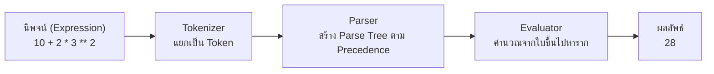
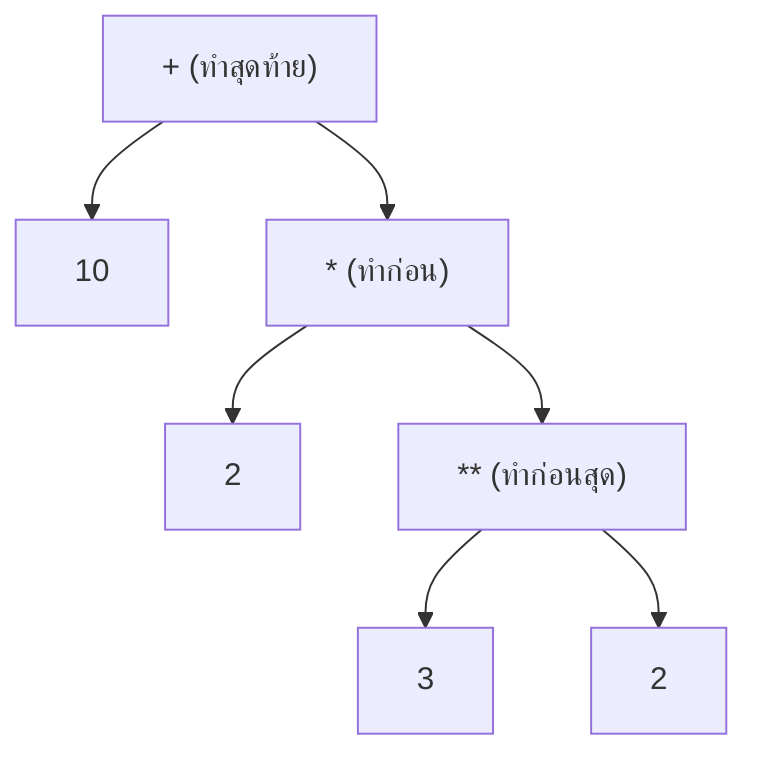
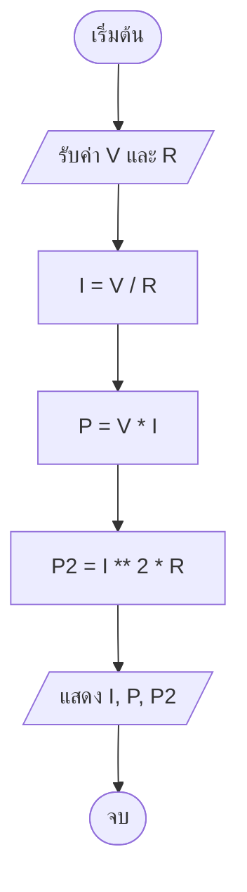

# บทที่ 3: ตัวดำเนินการ ลำดับความสำคัญ และตรรกศาสตร์

> [!abstract] สรุปสาระสำคัญประจำบทเรียน
> บทเรียนนี้ต่อยอดจาก "การเก็บข้อมูล" ในบทที่ 2 มาสู่ "การประมวลผลข้อมูล" โดยเจาะลึกกลไกของ **ตัวดำเนินการ (Operators)** ทั้ง 5 กลุ่ม ได้แก่ คณิตศาสตร์, เปรียบเทียบ, ตรรกะ, กำหนดค่า และการเข้าถึงข้อมูล พร้อมอธิบาย **ลำดับความสำคัญ (Precedence) และ Associativity** ในระดับที่อธิบายได้ว่าทำไม `2 ** 3 ** 2` จึงได้ 512 และทำไม `-17 // 5` จึงได้ -4 รวมถึงกลไก **Short-Circuit Evaluation**, ธรรมชาติของ `bool` ที่สืบทอดจาก `int`, กับดักของเลขทศนิยมตามมาตรฐาน IEEE 754 และการประยุกต์ใช้กับงานช่างคอมพิวเตอร์จริง ตั้งแต่กฎของโอห์ม ค่าไฟ ไปจนถึงการแปลงหน่วยเวลา

---

## 1. บทนำ: ตัวดำเนินการคือหัวใจของการประมวลผล

ในบทที่ 2 เราเรียนรู้ว่าโปรแกรมเก็บข้อมูลไว้ในตัวแปรได้อย่างไร แต่ข้อมูลที่เก็บไว้จะไม่มีประโยชน์เลยถ้าไม่ถูกนำมาคำนวณ เปรียบเทียบ หรือตัดสินใจ

ในระดับฮาร์ดแวร์ การคำนวณทั้งหมดเกิดขึ้นที่ **ALU (Arithmetic Logic Unit)** ภายในซีพียู ซึ่งรองรับการดำเนินการพื้นฐาน 2 กลุ่มใหญ่

| กลุ่ม | ตัวอย่างคำสั่งระดับเครื่อง | ใช้ในภาษา Python |
| :--- | :--- | :--- |
| **Arithmetic** (คำนวณ) | ADD, SUB, MUL, DIV | `+` `-` `*` `/` `//` `%` `**` |
| **Logic** (ตรรกะ) | AND, OR, NOT, CMP | `and` `or` `not` `==` `!=` `<` `>` |

> [!important] แนวคิดหลักของบทนี้
> ภาษา Python ไม่ได้มีตัวดำเนินการ "เยอะกว่าภาษาอื่น" แต่มี **กฎที่ชัดเจนและสม่ำเสมอ** กว่า
> เมื่อเข้าใจกฎ 2 ข้อนี้ จะทำนายผลลัพธ์ของนิพจน์ใด ๆ ได้โดยไม่ต้องรันโปรแกรม
> 1. **ลำดับความสำคัญ (Precedence)** — ตัวไหนทำก่อน
> 2. **ทิศทางการประเมิน (Associativity)** — ตัวที่ความสำคัญเท่ากันทำจากซ้ายหรือขวา



---

## 2. ตัวดำเนินการทางคณิตศาสตร์ (Arithmetic Operators)

### 2.1 ภาพรวมทั้งเจ็ดตัว

| ตัวดำเนินการ | ชื่อเต็ม | ตัวอย่าง | ผลลัพธ์ | ชนิดผลลัพธ์ |
| :--: | :--- | :--- | :--: | :--- |
| `+` | Addition | `17 + 5` | 22 | `int` |
| `-` | Subtraction | `17 - 5` | 12 | `int` |
| `*` | Multiplication | `17 * 5` | 85 | `int` |
| `/` | True Division | `17 / 5` | 3.4 | **`float` เสมอ** |
| `//` | Floor Division | `17 // 5` | 3 | `int` หรือ `float` |
| `%` | Modulo | `17 % 5` | 2 | `int` หรือ `float` |
| `**` | Exponentiation | `2 ** 10` | 1024 | `int` หรือ `float` |

```python
print(17 + 5)     # 22
print(17 - 5)     # 12
print(17 * 5)     # 85
print(17 / 5)     # 3.4
print(17 // 5)    # 3
print(17 % 5)     # 2
print(2 ** 10)    # 1024
```

> [!warning] กับดักที่พบบ่อยที่สุดของ `/`
> `6 / 3` ได้ **`2.0`** ไม่ใช่ `2`
> ตัวดำเนินการ `/` ถูกออกแบบให้คืนค่า `float` เสมอ เพื่อไม่ให้เกิดการปัดเศษเงียบ ๆ (Silent Truncation) แบบในภาษา C
> ถ้าต้องการจำนวนเต็มให้ใช้ `//` หรือ `int()`

### 2.2 `/` กับ `//` ต่างกันที่ปรัชญา

| ประเด็น | `/` (True Division) | `//` (Floor Division) |
| :--- | :--- | :--- |
| ชนิดผลลัพธ์ | `float` เสมอ | ตามชนิดของตัวตั้ง/ตัวหาร |
| การปัดเศษ | ไม่ปัด (เก็บทศนิยม) | **ปัดลง (Floor)** |
| เหมาะกับ | ราคา, ค่าเฉลี่ย, อัตราส่วน | จำนวนชิ้น, สล็อต, ชั่วโมงเต็ม |
| ตัวอย่างงานช่าง | ค่าไฟเฉลี่ยต่อวัน | จำนวนรอบที่วิ่งครบ |

```python
# ต้องการทราบว่ามี 17 สาย LAN จะจัดเป็นชุดละ 5 เส้น ได้กี่ชุด
print(17 / 5)    # 3.4  (ไม่มีความหมายในทางปฏิบัติ)
print(17 // 5)   # 3    (ได้ 3 ชุดเต็ม)
print(17 % 5)    # 2    (เหลืออีก 2 เส้น)
```

### 2.3 `//` คือ "ปัดลง" ไม่ใช่ "ตัดทิ้ง"

นี่คือความเข้าใจผิดที่ทำให้โปรแกรมคำนวณเงินและอุณหภูมิผิดพลาดได้

| นิพจน์ | `//` (Floor) | `int(x / y)` (Truncate) |
| :--- | :--: | :--: |
| `17 // 5` | 3 | 3 |
| `-17 // 5` | **-4** | -3 |
| `17 // -5` | **-4** | -3 |
| `-17 // -5` | 3 | 3 |

```python
print(-17 // 5)          # -4
print(int(-17 / 5))      # -3
```

> [!note] ทำไมต้องปัดลง
> เพราะ `//` ถูกออกแบบให้สอดคล้องกับ `%` ตามสมการของยุคลิด (ดูหัวข้อ 2.4) ถ้าใช้การตัดทิ้ง สมการนั้นจะใช้ไม่ได้กับจำนวนลบ
> **ในงานช่างที่ค่าติดลบแทบไม่เกิด** (แรงดันติดลบ, อุณหภูมิติดลบ) ต้องระวังเป็นพิเศษ

### 2.4 สมการยุคลิด: ความสัมพันธ์ระหว่าง `//` กับ `%`

```text
ตัวตั้ง = (ตัวหาร × ผลหารปัดลง) + เศษ
a      = (b     × (a // b))     + (a % b)
```

```python
a, b = 17, 5
print(a == b * (a // b) + (a % b))   # True
print(divmod(a, b))                   # (3, 2)
```

`divmod()` คืนค่าทั้งสองพร้อมกันในรูปทูเพิล ซึ่งมีประโยชน์เมื่อต้องใช้ทั้งผลหารและเศษ

```python
quotient, remainder = divmod(3725, 60)
print(quotient, remainder)    # 62 5
```

### 2.5 `%` กับจำนวนลบ: เศษมีเครื่องหมายตามตัวหาร

| นิพจน์     | ผลลัพธ์ | ตรวจสอบด้วยสมการ        |
| :--------- | :-----: | :---------------------- |
| `10 % 3`   |    1    | `3×3 + 1 = 10`          |
| `-10 % 3`  |  **2**  | `3×(-4) + 2 = -10`      |
| `10 % -3`  | **-2**  | `(-3)×(-4) + (-2) = 10` |
| `-10 % -3` | **-1**  | `(-3)×3 + (-1) = -10`   |

```python
print(-10 % 3)    # 2  (ไม่ใช่ -1)
print(10 % -3)    # -2
```

> [!tip] กฎที่จำง่าย
> **เศษมีเครื่องหมายเดียวกับตัวหารเสมอ** (ใน Python)
> ถ้าต้องการเศษที่เป็นบวกเสมอ ให้ใช้ `abs(a) % abs(b)` หรือบวกตัวหารเข้าไปหนึ่งรอบ

```python
value = -7
print(value % 360)          # 353  (มุมติดลบแปลงเป็น 0–359 องศา)
```

### 2.6 `**` และทิศทางการประเมิน

| กรณี | ผลลัพธ์ | คำอธิบาย |
| :--- | :--: | :--- |
| `2 ** 10` | 1024 | จำนวนเต็ม |
| `2 ** -1` | 0.5 | เลขชี้กำลังลบให้เศษส่วน (`float`) |
| `0 ** 0` | 1 | นิยามของ Python |
| `2 ** 3 ** 2` | **512** | ทำจากขวาไปซ้าย = `2 ** 9` |
| `-2 ** 2` | **-4** | ลบทำหลังยกกำลัง |
| `(-2) ** 2` | 4 | วงเล็บเปลี่ยนผล |

```python
print(2 ** -1)       # 0.5
print(2 ** 3 ** 2)   # 512
print(-2 ** 2)       # -4
print((-2) ** 2)     # 4
```

> [!important] เกร็ดที่ช่างคอมฯ ควรรู้
> จำนวนเต็มของ Python เป็นแบบ **Arbitrary Precision** (บทที่ 2) จึงคำนวณ `2 ** 100` ได้แม่นยำสมบูรณ์
> ```python
> print(2 ** 100)   # 1267650600228229401496703205376
> print(2 ** 64)    # 18446744073709551616 (เกินขอบเขต 64-bit ของภาษาซี)
> ```

### 2.7 ตัวดำเนินการเดียวกันแต่คนละความหมาย (Operator Overloading)

`+` และ `*` ถูกนิยามใหม่เมื่อใช้กับชนิดข้อมูลอื่น

```python
print("RX" + "TX")     # RXTX      (ต่อข้อความ)
print("A" * 3)         # AAA       (ทำซ้ำ)
print("-" * 20)        # --------------------  (ใช้ทำเส้นคั่น)
```

> [!warning] ผสมชนิดไม่ได้
> `"อายุ " + 18` → `TypeError`
> ต้องแปลงก่อน: `"อายุ " + str(18)` หรือใช้ f-string ซึ่งดีที่สุด

---

## 3. ลำดับความสำคัญและทิศทางการประเมิน (Precedence & Associativity)

### 3.1 ตารางลำดับความสำคัญฉบับสมบูรณ์

| ลำดับ | ตัวดำเนินการ | ความหมาย | ทิศทาง |
| :--: | :--- | :--- | :--- |
| 1 | `( )` `[ ]` `{ }` | วงเล็บ, index, dict | ซ้าย → ขวา |
| 2 | `**` | ยกกำลัง | **ขวา → ซ้าย** |
| 3 | `+x` `-x` `~x` | บวก/ลบหน้าเลข, NOT ระดับบิต | ขวา → ซ้าย |
| 4 | `*` `/` `//` `%` | คูณ หาร | ซ้าย → ขวา |
| 5 | `+` `-` | บวก ลบ | ซ้าย → ขวา |
| 6 | `<<` `>>` | เลื่อนบิต | ซ้าย → ขวา |
| 7 | `&` | AND ระดับบิต | ซ้าย → ขวา |
| 8 | `^` | XOR ระดับบิต | ซ้าย → ขวา |
| 9 | `&#124;` | OR ระดับบิต | ซ้าย → ขวา |
| 10 | `<` `<=` `>` `>=` `==` `!=` `in` `is` | เปรียบเทียบ | ซ้าย → ขวา (ต่อเนื่องได้) |
| 11 | `not x` | นิเสธเชิงตรรกะ | ขวา → ซ้าย |
| 12 | `and` | และ | ซ้าย → ขวา |
| 13 | `or` | หรือ | ซ้าย → ขวา |
| 14 | `=` `+=` `-=` ฯลฯ | กำหนดค่า | ขวา → ซ้าย |

> [!tip] วิธีจำแบบใช้งานจริง
> **วงเล็บ → ยกกำลัง → คูณหาร → บวกลบ → เปรียบเทียบ → `not` → `and` → `or` → กำหนดค่า**
> ระดับบิต (`&` `|` `^` `<<` `>>`) จะใช้ตอนเรียนเรื่องพอร์ตและรีจิสเตอร์ในสัปดาห์ที่ 16

### 3.2 Parse Tree: เห็นภาพว่าอะไรทำก่อน

นิพจน์ `10 + 2 * 3 ** 2` ถูกแปลงเป็นต้นไม้ดังนี้ (อ่านจากใบขึ้นไปหาราก)



ผลลัพธ์: `3 ** 2 = 9` → `2 * 9 = 18` → `10 + 18 = 28`

### 3.3 ตัวอย่างที่ต้องเห็นความต่าง

```python
print(10 + 2 * 3 ** 2)      # 28
print((10 + 2) * 3 ** 2)    # 108
print(2 + 3 * 4 - 6 / 2)    # 11.0
print(100 / 10 * 2)         # 20.0  (ซ้ายไปขวา)
print(100 / (10 * 2))       # 5.0
```

### 3.4 แบบฝึกคำนวณบนกระดาน

| นิพจน์ | คำตอบ |
| :--- | :--: |
| `2 + 3 * 4` | 14 |
| `(2 + 3) * 4` | 20 |
| `2 * 3 ** 2` | 18 |
| `(2 * 3) ** 2` | 36 |
| `10 - 4 / 2 + 3` | 11.0 |
| `10 % 3 * 2` | 2 |
| `2 ** 2 ** 3` | 256 |
| `-5 + 2 * -3` | -11 |

> [!note] เฉลยข้อที่มักผิด
> `10 % 3 * 2` → `%` อยู่ระดับเดียวกับ `*` จึงทำซ้ายไปขวา: `(10 % 3) * 2 = 1 * 2 = 2`
> `2 ** 2 ** 3` → ขวาไปซ้าย: `2 ** 8 = 256` (ไม่ใช่ `4 ** 3 = 64`)

### 3.5 หลักการเขียนโค้ดที่อ่านง่าย

> [!important] กฎของทีมพัฒนา
> แม้ Python จะรู้ลำดับความสำคัญอยู่แล้ว **ให้ใส่วงเล็บเมื่อนิพจน์มีตัวดำเนินการ 3 ชนิดขึ้นไป**
> เพราะโค้ดถูกอ่านมากกว่าถูกเขียน — และการใส่วงเล็บไม่ทำให้โปรแกรมช้าลงเลย

```python
# อ่านยาก
average = a + b / 2

# อ่านง่ายและตรงเจตนา
average = (a + b) / 2
```

---

## 4. ตัวดำเนินการเปรียบเทียบ (Comparison Operators)

### 4.1 ทั้งหกตัวและการคืนค่า

| ตัวดำเนินการ | ความหมาย | ตัวอย่าง | ผลลัพธ์ |
| :--: | :--- | :--- | :--: |
| `==` | เท่ากัน | `5 == 5` | `True` |
| `!=` | ไม่เท่ากัน | `5 != 3` | `True` |
| `>` | มากกว่า | `5 > 3` | `True` |
| `<` | น้อยกว่า | `5 < 3` | `False` |
| `>=` | มากกว่าหรือเท่ากัน | `5 >= 5` | `True` |
| `<=` | น้อยกว่าหรือเท่ากัน | `5 <= 4` | `False` |

ผลลัพธ์เป็นชนิด `bool` เสมอ และ `bool` ใน Python เป็นคลาสลูกของ `int` (บทที่ 2)

```python
print(5 == 5)      # True
print(5 != 3)      # True
print(5 > 3)       # True
print(type(5 > 3)) # <class 'bool'>
```

### 4.2 กฎการเปรียบเทียบที่ต้องระวัง

| กรณี | ผลลัพธ์ | เหตุผล |
| :--- | :--: | :--- |
| `10 == 10.0` | `True` | เปรียบเทียบ **ค่า** ไม่เปรียบเทียบชนิด |
| `1 == True` | `True` | เพราะ `True` มีค่าเท่ากับ 1 |
| `0 == False` | `True` | เพราะ `False` มีค่าเท่ากับ 0 |
| `"10" == 10` | `False` | ข้อความกับตัวเลขคนละชนิด |
| `5 = 5` | `SyntaxError` | `=` คือกำหนดค่า |
| `"a" < "b"` | `True` | ข้อความเปรียบเทียบตามรหัส Unicode |

```python
print(10 == 10.0)   # True
print("10" == 10)   # False
print(1 == True)    # True
```

### 4.3 การเปรียบเทียบต่อเนื่อง (Chained Comparison)

Python ตีความ `a <= b <= c` เป็น `(a <= b) and (b <= c)` โดยประเมิน `b` เพียงครั้งเดียว

```python
voltage = 225
print(210 <= voltage <= 240)     # True

temperature = 90
print(0 < temperature < 85)      # False
```

> [!tip] ข้อได้เปรียบเหนือภาษาซี
> ภาษา C เขียน `210 <= v && v <= 240` และมีโอกาสพิมพ์ `v` ผิดพลาด
> Python เขียนตรง ๆ ตามสัญกรณ์คณิตศาสตร์ และอ่านออกทันที

### 4.4 การเปรียบเทียบข้อความ

ข้อความเปรียบเทียบตาม **รหัส Unicode** ทีละตัวอักษร (Lexicographic)

```python
print("apple" < "banana")   # True  (a มาก่อน b)
print("Z" < "a")            # True  (Z = 90, a = 97)
print("ก" < "ข")            # True  (รหัสไทยเรียงตามพยัญชนะ)
print("abc" == "abc")       # True
print("abc" == "ABC")       # False (ตัวพิมพ์มีผล)
```

> [!caution] กับดักภาษาไทย
> การเรียงลำดับข้อความไทยตามรหัส Unicode **ไม่ตรงกับพจนานุกรมไทย** (เพราะสระและวรรณยุกต์ถูกเข้ารหัสแยก)
> ถ้าต้องการเรียงคำไทยให้ถูกต้องจริง ต้องใช้ไลบรารีเฉพาะทาง — ในวิชานี้ให้ถือว่าเป็นการเปรียบเทียบระดับรหัส

### 4.5 `==` กับ `is` (เกริ่นนำ)

| ตัวดำเนินการ | เปรียบเทียบอะไร | ตัวอย่าง |
| :--- | :--- | :--- |
| `==` | **ค่า** (Value Equality) | `[1,2] == [1,2]` → `True` |
| `is` | **ตัวตน** (Identity / ตำแหน่งในแรม) | `a is b` → True เมื่อชี้อ็อบเจกต์เดียวกัน |

เชื่อมกับ `id()` ในบทที่ 2 ได้ทันที

```python
a = [1, 2]
b = [1, 2]
print(a == b)   # True  (ค่าเหมือนกัน)
print(a is b)   # False (คนละอ็อบเจกต์)

c = a
print(a is c)   # True  (ป้ายชื่อเดียวกัน)
```

> [!note] กฎการใช้งาน
> เปรียบเทียบ **ค่า** ใช้ `==` เสมอ
> ใช้ `is` เฉพาะเมื่อเทียบกับ `None` เช่น `if result is None:` (จะใช้บ่อยตั้งแต่สัปดาห์ที่ 5)

---

## 5. ตรรกศาสตร์และตัวดำเนินการเชิงตรรกะ (Logical Operators)

### 5.1 สามตัวที่ต้องใช้คล่อง

| ตัวดำเนินการ | ชื่อ | จริงเมื่อ |
| :--- | :--- | :--- |
| `and` | Conjunction (และ) | **ทั้งสองข้าง** เป็นจริง |
| `or` | Disjunction (หรือ) | ข้างใดข้างหนึ่งเป็นจริง |
| `not` | Negation (นิเสธ) | กลับค่าความจริงของ operand |

### 5.2 ตารางความจริง (Truth Table)

| A | B | `A and B` | `A or B` | `not A` |
| :--: | :--: | :--: | :--: | :--: |
| True | True | True | True | False |
| True | False | False | True | False |
| False | True | False | True | True |
| False | False | False | False | True |

```python
voltage_ok = True
temp_ok = False

print(voltage_ok and temp_ok)    # False
print(voltage_ok or temp_ok)     # True
print(not voltage_ok)            # False
```

### 5.3 ลำดับความสำคัญของตรรกะ

```text
not  >  and  >  or
```

```python
print(True or False and False)      # True  (and ก่อน or)
print((True or False) and False)    # False
print(not 5 > 3)                    # False (คือ not (5 > 3))
```

> [!warning] กับดักที่ออกข้อสอบบ่อย
> `not 5 > 3` **ไม่ใช่** `(not 5) > 3`
> เพราะการเปรียบเทียบ (ลำดับ 10) ทำก่อน `not` (ลำดับ 11) จึงหมายถึง `not (5 > 3)` = `not True` = `False`

### 5.4 Short-Circuit Evaluation (การลัดวงจร)

Python ประเมิน **จากซ้ายไปขวา** และหยุดทันทีเมื่อรู้ผลแล้ว

| นิพจน์ | พฤติกรรม |
| :--- | :--- |
| `A and B` | ถ้า `A` เป็นเท็จ → คืน `A` ทันที **ไม่ประเมิน B** |
| `A or B` | ถ้า `A` เป็นจริง → คืน `A` ทันที **ไม่ประเมิน B** |

```python
resistance = 0
safe = resistance != 0 and 220 / resistance > 1
print(safe)     # False (ไม่เกิด ZeroDivisionError)
```

> [!important] ประโยชน์จริงในงานช่าง
> ใช้ป้องกันการหารด้วยศูนย์ก่อนที่จะเรียน `if` ในสัปดาห์ที่ 5
> รูปแบบนี้เรียกว่า **Guard Condition** และพบได้ทั่วไปในโค้ดระดับProduction

### 5.5 Python คืนค่า Operand ไม่ใช่แค่ True/False

นี่คือความต่างสำคัญจากภาษา C และ Java

```python
print(5 and 3)               # 3
print(0 and 3)               # 0
print(5 or 3)                # 5
print(0 or "ค่าเริ่มต้น")     # ค่าเริ่มต้น
print(not "")                # True
```

| นิพจน์ | กติกา | ตัวอย่าง |
| :--- | :--- | :--- |
| `A and B` | ถ้า `A` เท็จ คืน `A`; ถ้า `A` จริง คืน `B` | `5 and 3` → `3` |
| `A or B` | ถ้า `A` จริง คืน `A`; ถ้า `A` เท็จ คืน `B` | `0 or 3` → `3` |

> [!tip] เทคนิคที่พบบ่อย
> `name = input("ชื่อ: ") or "ไม่ระบุ"` — ถ้าผู้ใช้กด Enter เปล่า จะได้ค่าเริ่มต้นทันที
> แต่ระวัง: ค่านี้ยังไม่ใช่ `True`/`False` ถ้าต้องการบูลีนให้ห่อด้วย `bool()`

### 5.6 Truthiness: ค่าใดถือว่าเป็นเท็จ

| ค่า | bool | หมายเหตุ |
| :--- | :--: | :--- |
| `0`, `0.0`, `0j` | False | ศูนย์ทุกชนิด |
| `""` | False | ข้อความว่าง |
| `None` | False | ค่าไม่มี |
| `[]`, `()`, `{}`, `set()` | False | คอนเทนเนอร์ว่าง |
| `"0"` | **True** | ข้อความ "0" ไม่ใช่ค่าว่าง |
| `" "` | True | ช่องว่างก็ยังเป็นข้อความ |
| `-5` | True | จำนวนลบไม่ใช่ศูนย์ |

```python
print(bool(0))       # False
print(bool(""))      # False
print(bool("0"))     # True
print(bool(-5))      # True
```

### 5.7 กฎของเดอมอร์แกน (De Morgan's Laws)

ใช้แปลงเงื่อนไขให้อ่านง่ายขึ้น

```text
not (A and B)  ≡  (not A) or (not B)
not (A or B)   ≡  (not A) and (not B)
```

```python
A, B = True, False
print(not (A and B) == ((not A) or (not B)))   # True
print(not (A or B) == ((not A) and (not B)))   # True
```

> [!note] ใช้ตอนไหน
> เมื่อต้องกลับเงื่อนไขที่ซับซ้อน เช่น "ไม่ใช่ว่าทั้งแรงดันและอุณหภูมิปกติ"
> `not (voltage_ok and temp_ok)` เขียนใหม่ได้เป็น `voltage < 210 or voltage > 240 or temp > 75` (หลังจากแทนค่าจริง)

---

## 6. ตัวดำเนินการกำหนดค่าแบบผสม (Compound Assignment)

| เขียนสั้น | ความหมาย | ผลเมื่อ `x = 10` |
| :--- | :--- | :--: |
| `x += 5` | `x = x + 5` | 15 |
| `x -= 3` | `x = x - 3` | 7 |
| `x *= 2` | `x = x * 2` | 20 |
| `x /= 4` | `x = x / 4` | 2.5 |
| `x //= 3` | `x = x // 3` | 3 |
| `x %= 3` | `x = x % 3` | 1 |
| `x **= 2` | `x = x ** 2` | 100 |

```python
x = 10
x += 5      # 15
x *= 2      # 30
x -= 4      # 26
x //= 2     # 13
print(x)    # 13
```

> [!warning] กับดักชนิดข้อมูล
> `x /= 4` เปลี่ยนชนิดของ `x` เป็น `float` ทันที (`10 / 4 = 2.5`)
> ถ้าต้องการคงจำนวนเต็มให้ใช้ `//=`

> [!note] เกี่ยวกับประสิทธิภาพ
> `x += 1` กับ `x = x + 1` ให้ผลเหมือนกันทุกประการใน Python
> ให้เลือกตามความอ่านง่าย ไม่ใช่ตามความเร็ว

---

## 7. ฟังก์ชันคณิตศาสตร์ที่ใช้บ่อย

### 7.1 ฟังก์ชันในตัว (Built-in)

| ฟังก์ชัน | หน้าที่ | ตัวอย่าง | ผลลัพธ์ |
| :--- | :--- | :--- | :--: |
| `abs(x)` | ค่าสัมบูรณ์ | `abs(-7)` | 7 |
| `round(x, n)` | ปัดเศษทศนิยม | `round(3.14159, 2)` | 3.14 |
| `min(...)` | ค่าน้อยที่สุด | `min(5, 2, 9)` | 2 |
| `max(...)` | ค่ามากที่สุด | `max(5, 2, 9)` | 9 |
| `pow(a, b)` | ยกกำลัง | `pow(2, 10)` | 1024 |
| `pow(a, b, m)` | ยกกำลังแล้ว mod | `pow(2, 10, 1000)` | 24 |
| `divmod(a, b)` | หารเอาผลหารและเศษ | `divmod(17, 5)` | (3, 2) |
| `int(x)` | แปลงเป็นจำนวนเต็ม (ตัดทิ้ง) | `int(3.99)` | 3 |
| `float(x)` | แปลงเป็นทศนิยม | `float(3)` | 3.0 |

### 7.2 `int()` ไม่ใช่ `round()` และไม่ใช่ `math.floor()`

| ค่า | `int()` | `round()` | `math.floor()` | `math.ceil()` |
| :--- | :--: | :--: | :--: | :--: |
| `3.7` | 3 | 4 | 3 | 4 |
| `3.2` | 3 | 3 | 3 | 4 |
| `-3.7` | **-3** | -4 | **-4** | -3 |
| `-3.2` | **-3** | -3 | **-4** | -3 |

```python
import math

print(int(3.99))          # 3  (ตัดทิ้ง)
print(round(3.99))        # 4  (ปัดเศษ)
print(math.floor(-3.2))   # -4 (ปัดลง)
print(math.ceil(-3.2))    # -3 (ปัดขึ้น)
```

> [!caution] จุดที่นักเรียนตอบผิดบ่อยที่สุด
> `int(-3.7)` ได้ `-3` (เข้าหาศูนย์) แต่ `math.floor(-3.7)` ได้ `-4` (ลง)
> ถ้าโจทย์บอก "ปัดลง" ต้องใช้ `math.floor()` ไม่ใช่ `int()`

### 7.3 โมดูล `math`

```python
import math

print(math.sqrt(16))     # 4.0
print(math.sqrt(2))      # 1.4142135623730951
print(math.floor(3.7))   # 3
print(math.ceil(3.2))    # 4
print(math.pi)           # 3.141592653589793
print(math.isclose(0.1 + 0.2, 0.3))   # True
```

| ฟังก์ชัน | ใช้ทำอะไร |
| :--- | :--- |
| `math.sqrt(x)` | ถอดรากที่สอง |
| `math.floor(x)` / `math.ceil(x)` | ปัดลง / ปัดขึ้น |
| `math.isclose(a, b)` | เปรียบเทียบทศนิยมอย่างปลอดภัย |
| `math.pi` | ค่า π |
| `math.fabs(x)` | ค่าสัมบูรณ์แบบทศนิยม |

### 7.4 ตัวอย่าง: วงจรแบ่งแรงดัน (Voltage Divider)

$$V_{out} = V_{in} \times \frac{R_2}{R_1 + R_2}$$

```python
vin = 12.0          # โวลต์
r1 = 10000          # โอห์ม
r2 = 4700           # โอห์ม

vout = vin * r2 / (r1 + r2)
print(f"แรงดันขาออก = {vout:.3f} V")   # 3.837 V
```

> [!note] สังเกตวงเล็บ
> ถ้าเขียน `vin * r2 / r1 + r2` จะได้ `12 × 4700 / 10000 + 4700 = 4705.64` ซึ่งผิดมหาศาล
> โจทย์ฟิสิกส์ทุกข้อที่ต้องหารด้วยผลบวก **ต้องใส่วงเล็บที่ตัวส่วนเสมอ**

---

## 8. กับดักเชิงตัวเลขและตรรกะที่โปรแกรมไม่แจ้ง Error

ข้อผิดพลาดที่อันตรายที่สุดไม่ใช่โปรแกรมพัง แต่คือ **โปรแกรมรันได้แต่คำตอบผิด**

### 8.1 ทศนิยมตามมาตรฐาน IEEE 754

```python
print(0.1 + 0.2)               # 0.30000000000000004
print(0.1 + 0.2 == 0.3)        # False
print(round(0.1 + 0.2, 2))     # 0.3
```

> [!note] สาเหตุระดับฮาร์ดแวร์
> เลขฐานสิบ `0.1` แปลงเป็นเลขฐานสองได้ไม่ลงตัว (เช่นเดียวกับ `1/3` ในฐานสิบ)
> คอมพิวเตอร์จึงเก็บค่าประมาณไว้ ทำให้ผลบวกคลาดเคลื่อนระดับ `1e-17`
> **ห้ามเปรียบเทียบทศนิยมด้วย `==` โดยตรง**

### 8.2 วิธีเปรียบเทียบทศนิยมที่ถูกต้อง

```python
import math

a = 0.1 + 0.2
print(round(a, 2) == 0.3)          # True
print(math.isclose(a, 0.3))        # True
print(abs(a - 0.3) < 1e-9)         # True (เขียนเอง)
```

### 8.3 ลืมวงเล็บในสูตร

```python
score1, score2 = 80, 90

print(score1 + score2 / 2)     # 125.0 (ผิด)
print((score1 + score2) / 2)   # 85.0  (ถูก)
```

### 8.4 ใช้ `=` แทน `==`

```python
# print(5 = 5)      # SyntaxError
print(5 == 5)       # True
```

### 8.5 คาดหวังว่า `and` คืน `True`/`False`

```python
print(5 and 3)             # 3
print(bool(5 and 3))       # True
```

### 8.6 ลืมว่าตัวหารเป็นศูนย์

```python
voltage = 220
resistance = 0
# print(voltage / resistance)   # ZeroDivisionError

# ตรวจก่อนด้วย Guard Condition
print(resistance != 0 and voltage / resistance > 1)   # False
```

> [!tip] ลำดับการตรวจเมื่อคำตอบผิด
> 1. **ชนิดข้อมูล** ของอินพุต (`type()`)
> 2. **สูตร** ตรงกับที่คำนวณด้วยมือหรือไม่
> 3. **วงเล็บ** ครบหรือไม่
> 4. **ลำดับความสำคัญ** ตรงกับเจตนาหรือไม่
> 5. ทดลองด้วยค่าที่ง่าย ๆ (เช่น 1, 2, 10) เพื่อดูแนวโน้ม

---

## 9. การประยุกต์ในงานช่างคอมพิวเตอร์

### 9.1 กฎของโอห์มและกำลังไฟฟ้า

$$I = \frac{V}{R} \qquad P = V \times I = I^2 R = \frac{V^2}{R}$$

```python
# ohm_law.py
voltage = float(input("แรงดันไฟฟ้า (V): "))
resistance = float(input("ความต้านทาน (โอห์ม): "))

current = voltage / resistance
power = voltage * current

print(f"กระแสไฟฟ้า I = {current:.3f} A")
print(f"กำลังไฟฟ้า P = {power:.3f} W")
print(f"ตรวจสอบ P = I²R = {current ** 2 * resistance:.3f} W")
```

**ผลรัน**

```text
แรงดันไฟฟ้า (V): 220
ความต้านทาน (โอห์ม): 44
กระแสไฟฟ้า I = 5.000 A
กำลังไฟฟ้า P = 1100.000 W
ตรวจสอบ P = I²R = 1100.000 W
```

> [!note] ตรวจคำตอบด้วยมือ
> `I = 220 / 44 = 5 A` · `P = 220 × 5 = 1,100 W` · `I²R = 25 × 44 = 1,100 W`

### 9.2 ค่าไฟฟ้ารายเดือน

```text
หน่วยไฟ (kWh) = กำลังไฟ (วัตต์) × ชั่วโมง/วัน × จำนวนวัน ÷ 1000
ค่าไฟ (บาท)  = หน่วยไฟ × ราคาต่อหน่วย
```

```python
watt = 450
hours_per_day = 8
days = 30
rate = 4.5

kwh = watt * hours_per_day * days / 1000
cost = kwh * rate

print(f"ใช้ไฟ {kwh:,.2f} kWh")
print(f"ค่าไฟ {cost:,.2f} บาท")
```

**ผลลัพธ์:** `108.00 kWh` และ `486.00 บาท`

### 9.3 แปลงวินาทีเป็น ชั่วโมง:นาที:วินาที

```python
total = 3725

hours = total // 3600
minutes = (total % 3600) // 60
seconds = total % 60

print(f"{hours} ชั่วโมง {minutes} นาที {seconds} วินาที")
# 1 ชั่วโมง 2 นาที 5 วินาที
```

### 9.4 ตรวจสภาพระบบด้วยตรรกะ (ยังไม่ใช้ `if`)

```python
voltage = 220.0
temperature = 65.0

voltage_ok = 210 <= voltage <= 240
temp_ok = 40 <= temperature <= 75

print(f"แรงดันปกติ: {voltage_ok}")
print(f"อุณหภูมิปกติ: {temp_ok}")
print(f"ระบบพร้อมใช้งาน: {voltage_ok and temp_ok}")
print(f"ต้องแจ้งเตือน: {temperature > 85 or voltage < 190}")
```

### 9.5 ตรวจพอร์ตและหมายเลขคู่/คี่

```python
port = 8080

print(port % 2 == 0)      # True  (พอร์ตเลขคู่)
print(port % 10 == 0)     # True  (ลงท้ายด้วย 0)
print(port % 100)         # 80    (สองหลักท้าย)
```

---

## 10. กิจกรรมปฏิบัติการประจำบท (Hands-on Labs)

### 10.1 ใบงานที่ 2: ค่าโอห์มและกำลังไฟฟ้า (ตามโครงการสอน)

> [!note] สถานการณ์โจทย์
> ศูนย์ซ่อมเครื่องใช้ไฟฟ้าของวิทยาลัยรับ **เครื่องทำน้ำอุ่น 220 V** เข้ามาตรวจสภาพ
> ช่างวัดความต้านทานของขดลวดได้ **44 Ω** แต่ไม่รู้ว่าขณะทำงานเครื่องใช้กระแสกี่แอมแปร์
> และกินกำลังไฟเท่าไร — ข้อมูลนี้จำเป็นต่อการตัดสินใจว่าสายไฟและเบรกเกอร์ขนาด 16 A เดิมยังรับไหวหรือไม่

> [!todo] โจทย์
> รับ **แรงดัน (V)** และ **ความต้านทาน (Ω)** แล้วคำนวณ `I`, `P` และตรวจสอบด้วย `P = I²R`
> **สถานะโจทย์:** บังคับ (6 คะแนน)
> **ส่งงาน:** ผังงาน 1 แผ่น + ไฟล์ `.py` + ภาพหน้าจอผลรัน



```python
# lab3_ohm.py
voltage = float(input("แรงดันไฟฟ้า (V): "))
resistance = float(input("ความต้านทาน (โอห์ม): "))

current = voltage / resistance
power = voltage * current
check = current ** 2 * resistance

print(f"กระแสไฟฟ้า I = {current:.3f} A")
print(f"กำลังไฟฟ้า P = {power:.3f} W")
print(f"ตรวจสอบ P = I²R = {check:.3f} W")
```

| เกณฑ์ | คะแนน |
| :--- | :--: |
| ผังงานครบขั้นตอนและมีทิศทางชัดเจน | 2 |
| รับค่าและแปลงชนิดถูกต้อง | 1 |
| สูตรถูกทั้งสามสูตร | 2 |
| จัดรูปแบบผลลัพธ์ด้วย f-string | 1 |

### 10.2 ใบงาน 3B: ค่าแรงช่างและค่า OT

> [!note] สถานการณ์โจทย์
> ร้านซ่อมคอมพิวเตอร์จ้างช่างประจำ **ค่าแรงชั่วโมงละ 120 บาท** ช่วงเปิดเทอมมีงานด่วนเข้ามาทุกสัปดาห์
> ช่างต้องทำงานล่วงเวลา (OT) ซึ่งร้านจ่ายเพิ่มเป็น **1.5 เท่า**
> เจ้าของร้านต้องคำนวณยอดจ่ายให้ถูกต้องก่อนโอนเงินเข้าบัญชีทุกสิ้นเดือน

> [!todo] โจทย์
> รับค่าแรงต่อชั่วโมง, ชั่วโมงทำงานปกติ และชั่วโมง OT แล้วแสดงค่าแรงปกติ, ค่า OT และยอดรวม
> **สถานะโจทย์:** บังคับ (3 คะแนน)

```python
# lab3b_wage.py
rate = float(input("ค่าแรงต่อชั่วโมง (บาท): "))
normal_hours = float(input("ชั่วโมงทำงานปกติ: "))
ot_hours = float(input("ชั่วโมง OT: "))

OT_RATE = 1.5

normal_pay = rate * normal_hours
ot_pay = rate * OT_RATE * ot_hours

print(f"ค่าแรงปกติ: {normal_pay:,.2f} บาท")
print(f"ค่า OT: {ot_pay:,.2f} บาท")
print(f"รวมทั้งสิ้น: {normal_pay + ot_pay:,.2f} บาท")
```

**ตัวอย่าง:** 120 บาท/ชม., 8 ชม., OT 2 ชม. → `960.00` + `360.00` = **`1,320.00` บาท**

### 10.3 ใบงาน 3C: ตรวจสอบช่วงแรงดันตามมาตรฐาน

> [!note] สถานการณ์โจทย์
> ห้องเซิร์ฟเวอร์ของวิทยาลัยติดตั้ง UPS และเซนเซอร์วัดแรงดันกับอุณหภูมิของซีพียู
> ก่อนติดตั้งระบบแจ้งเตือนจริง (ซึ่งจะเรียนในสัปดาห์ที่ 5) นักศึกษาต้องเขียนโปรแกรมตรวจสอบเบื้องต้นก่อน
> ว่าแต่ละค่าอยู่ในเกณฑ์หรือไม่ โดยแรงดันที่ถือว่าปกติคือ **210–240 V** และอุณหภูมิต้อง **ไม่เกิน 75 °C**
> ถ้าแรงดันต่ำกว่า 190 V หรือสูงกว่า 250 V หรืออุณหภูมิเกิน 85 °C ถือว่าต้องแจ้งเตือนทันที

> [!todo] โจทย์
> รับแรงดันและอุณหภูมิ แล้วแสดงผลเป็น `True` / `False` 4 บรรทัด (แรงดันปกติ / อุณหภูมิปกติ / ระบบพร้อมใช้งาน / ต้องแจ้งเตือน)
> **สถานะโจทย์:** บังคับ (4 คะแนน)

```python
# lab3c_check.py
voltage = float(input("แรงดันที่วัดได้ (V): "))
temperature = float(input("อุณหภูมิ CPU (°C): "))

in_range = 210 <= voltage <= 240
cool_enough = temperature <= 75
alert = voltage < 190 or voltage > 250 or temperature > 85

print(f"แรงดันอยู่ในเกณฑ์: {in_range}")
print(f"อุณหภูมิอยู่ในเกณฑ์: {cool_enough}")
print(f"ระบบพร้อมใช้งาน: {in_range and cool_enough}")
print(f"ต้องแจ้งเตือนทันที: {alert}")
```

### 10.4 ใบงาน 3D: ค่าไฟรายเดือนของเครื่องใช้ไฟฟ้า

> [!note] สถานการณ์โจทย์
> หอพักนักศึกษาแห่งหนึ่งมีค่าไฟสูงขึ้นทุกเดือน แต่ไม่มีใครรู้ว่าเครื่องใช้ไฟฟ้าชิ้นใดกินไฟมากที่สุด
> นักศึกษาจึงต้องเขียนโปรแกรมประเมินว่าเครื่องใช้ไฟฟ้า 1 ชิ้น (เช่น พัดลม 45 W, ตู้เย็น 100 W, ชุดคอมฯ 450 W)
> ใช้งานวันละกี่ชั่วโมง จะกินไฟเดือนละกี่หน่วย และคิดเป็นเงินเท่าไร เพื่อใช้วางแผนลดค่าใช้จ่าย

> [!todo] โจทย์
> รับกำลังไฟ (วัตต์), ชั่วโมงใช้งานต่อวัน, จำนวนวัน และราคาไฟต่อหน่วย
> แล้วแสดงกระแสไฟฟ้าโดยประมาณ, หน่วยไฟรวม, ค่าไฟรวม และค่าไฟเฉลี่ยต่อวัน
> **สถานะโจทย์:** บังคับ (3 คะแนน)

```python
# lab3d_energy.py
watt = float(input("กำลังไฟของอุปกรณ์ (วัตต์): "))
hours = float(input("ใช้งานวันละ (ชั่วโมง): "))
days = int(input("จำนวนวัน: "))
rate = float(input("ราคาไฟ (บาท/kWh): "))

kwh = watt * hours * days / 1000
cost = kwh * rate
current = watt / 220

print(f"กระแสไฟฟ้าโดยประมาณ: {current:.2f} A")
print(f"ใช้ไฟทั้งหมด: {kwh:,.2f} kWh")
print(f"ค่าไฟรวม: {cost:,.2f} บาท")
print(f"เฉลี่ยต่อวัน: {cost / days:,.2f} บาท")
```

### 10.5 เกณฑ์ประเมินรวม (20 คะแนน)

| รายการ | คะแนน |
| :--- | :--: |
| ใบงานที่ 2 (โอห์ม + กำลังไฟ) | 6 |
| ใบงาน 3B (ค่าแรง + OT) | 3 |
| ใบงาน 3C (ตรวจสอบช่วงค่า) | 4 |
| ใบงาน 3D (ค่าไฟ) | 3 |
| แบบฝึกหัด / Exit Ticket | 4 |

> [!warning] การหักคะแนน
> * ไม่ได้รันโปรแกรมจริง (ส่งแต่โค้ด) — หักข้อละ 1 คะแนน
> * ใช้ `=` แทน `==` ในนิพจน์เปรียบเทียบ — หัก 1 คะแนน
> * ไม่แปลงชนิดข้อมูลจาก `input()` จนโปรแกรม error — หัก 1 คะแนน
> * คัดลอกโค้ดกัน — 0 คะแนนทั้งคู่

---

## 11. แนวทางจัดกิจกรรมในชั้นเรียน (Lesson Script 4 ชั่วโมง)

| ช่วง | เวลา | กิจกรรม |
| :--- | :---: | :--- |
| 1 | 20 นาที | ทบทวนบทที่ 2 + เกมคำนวณในหัว 5 ข้อ |
| 2 | 40 นาที | บรรยายตัวดำเนินการคณิตศาสตร์ + สาธิต `//` กับ `%` บนกระดาน |
| 3 | 40 นาที | Precedence + Parse Tree + แบบฝึกคำนวณ |
| 4 | 10 นาที | พัก |
| 5 | 30 นาที | เปรียบเทียบ + ตรรกศาสตร์ + ตารางความจริง |
| 6 | 35 นาที | ใบงานที่ 2 (ผังงาน + โค้ด) |
| 7 | 40 นาที | ใบงาน 3B–3D |
| 8 | 20 นาที | เฉลย + ตรวจงาน |
| 9 | 5 นาที | สรุป + Exit Ticket |

### 11.1 คำถามนำเข้าบทเรียน

> [!question] คำถามที่ 1
> "ถ้าโปรแกรมคำนวณค่าไฟได้ 486 บาท แต่ใบเสร็จจริงเรียกเก็บ 48.6 บาท ปัญหาน่าจะอยู่ที่ใด"
>
> **แนวคำตอบ:** แปลงหน่วยผิด (วัตต์→กิโลวัตต์), ลำดับความสำคัญ, หรือลบค่าผิดตำแหน่ง
>
> **ประเด็นขมวด:** โปรแกรมที่รันได้แต่คำตอบผิดอันตรายกว่าโปรแกรมที่พัง เพราะไม่มีใครรู้ว่าผิด

> [!question] คำถามที่ 2
> "ทำไม `17 / 5` กับ `17 // 5` ให้คำตอบต่างกัน และในงานช่างเราจะเลือกใช้ตัวไหน"
>
> **แนวคำตอบ:** ขึ้นกับว่าต้องการ "อัตราส่วน" หรือ "จำนวนเต็มที่ใช้งานได้จริง"

### 11.2 คำถามระหว่างสอน

> [!question] คำถามที่ 3
> "`2 ** 3 ** 2` ได้ 64 หรือ 512 เพราะเหตุใด"
>
> **แนวคำตอบ:** 512 เพราะยกกำลังประเมินจากขวาไปซ้าย (Associativity)

> [!question] คำถามที่ 4
> "`5 and 3` ได้อะไร และถ้าต้องการ `True` ต้องทำอย่างไร"
>
> **แนวคำตอบ:** ได้ `3`; ใช้ `bool(5 and 3)` จึงได้ `True`

### 11.3 Exit Ticket

> [!question] คำถามที่ 5
> "จงเขียนนิพจน์ 1 บรรทัดที่ตรวจว่าแรงดันอยู่ในช่วง 210–240 V **และ** อุณหภูมิไม่เกิน 75 °C แล้วให้ผลเป็น `True`/`False`"
>
> **แนวคำตอบ:**
> ```python
> print(210 <= voltage <= 240 and temperature <= 75)
> ```

---

## 12. แบบฝึกหัดท้ายบท (15 ข้อ)

1. `17 // 5` และ `17 % 5` ได้เท่าไร
2. `-17 // 5` และ `-17 % 5` ได้เท่าไร
3. `2 ** 3 ** 2` ได้เท่าไร เพราะเหตุใด
4. `-3 ** 2` ได้เท่าไร
5. `6 / 3` ได้ผลลัพธ์ชนิดใด
6. `10 == 10.0` ได้อะไร
7. `not True and False` ได้อะไร
8. `True and 0 or "ok"` ได้อะไร
9. `divmod(17, 5)` ได้อะไร
10. `2 + 3 * 4 ** 2` ได้เท่าไร
11. `5 > 3 > 1` ได้อะไร
12. ถ้า `x = 10` แล้ว `x += 5` ตามด้วย `x *= 2` ได้เท่าไร
13. `bool("0")` ได้อะไร เพราะเหตุใด
14. `int(-3.9)` กับ `math.floor(-3.9)` ต่างกันอย่างไร
15. `math.isclose(0.1 + 0.2, 0.3)` ได้อะไร และทำไมต้องใช้

> [!note] เฉลย
> 1. `3`, `2` · 2. `-4`, `3` · 3. `512` (ขวาไปซ้าย) · 4. `-9` · 5. `float` (`2.0`) · 6. `True` · 7. `False` · 8. `"ok"` · 9. `(3, 2)` · 10. `50` · 11. `True` · 12. `30` · 13. `True` เพราะข้อความ "0" ไม่ใช่ค่าว่าง · 14. `-3` กับ `-4` (ตัดทิ้ง vs ปัดลง) · 15. `True` เพราะทศนิยมลอยตัวเปรียบเทียบตรง ๆ ไม่ปลอดภัย

---

## 13. สรุปและคำถามทบทวน (Check for Understanding)

> [!abstract] สรุป 6 ข้อ
> 1. `/` คืน `float` เสมอ; `//` คือ **ปัดลง**; `%` คือเศษที่มีเครื่องหมายตามตัวหาร
> 2. `**` ประเมินจาก **ขวาไปซ้าย** และมีลำดับสูงกว่าเครื่องหมายลบ
> 3. ลำดับความสำคัญ: วงเล็บ → ยกกำลัง → คูณหาร → บวกลบ → เปรียบเทียบ → `not` → `and` → `or`
> 4. `and` / `or` ทำ **Short-Circuit** และคืน **operand** ไม่ใช่ `True`/`False`
> 5. `bool` สืบทอดจาก `int` — `True == 1`, `False == 0`, `True + True == 2`
> 6. ห้ามเปรียบเทียบทศนิยมด้วย `==` ให้ใช้ `round()` หรือ `math.isclose()`

### คำถามทบทวน

1. เหตุใด `-17 // 5` จึงได้ `-4` ขณะที่ `int(-17 / 5)` ได้ `-3`
2. จงอธิบายว่า `5 and 3` ได้ `3` ได้อย่างไร
3. ถ้าต้องการตรวจว่าค่า `x` อยู่ในช่วง 0–100 ควรเขียนอย่างไร
4. เพราะเหตุใด `0.1 + 0.2 == 0.3` จึงเป็น `False`
5. `A and B` กับ `A or B` อย่างไหนที่ประเมิน `B` บ่อยกว่า เพราะเหตุใด

---

## 14. เอกสารอ้างอิงและโน้ตที่เกี่ยวข้อง

- [[บทที่ 2 - พื้นฐานการเขียนโปรแกรม ตัวแปร ชนิดข้อมูล และการประมวลผล]] — ตัวแปร ชนิดข้อมูล `input()` และ f-strings
- [[บทที่ 1 - ปฐมบทการเขียนโปรแกรมและกำเนิดไพธอน]] — ตัวแปลภาษาและสถาปัตยกรรม Python
- [[ปฏิบัติการสัปดาห์ที่ 1 - ติดตั้ง Python และเขียนโปรแกรมแรก]] — คู่มือติดตั้งและใบงานพื้นฐาน
- [[ใบงานที่ 3 - โปรแกรมออกใบเสร็จร้านคอมพิวเตอร์]] — ใบงานประเมินผล (20 คะแนน): ใบเสร็จ + ส่วนลด + VAT
- [[31909-1007 การเขียนโปรแกรมด้วยภาษาไพธอน]] — ข้อมูลรายวิชาและสมรรถนะ
- [[แผนหน่วยการเรียน 31909-1007 การเขียนโปรแกรมด้วยภาษาไพธอน]] — แผนการสอน 18 สัปดาห์
- [[ตารางสอน ครูฝึกสอน 2 (2-2569)]] — ภาระงานสอนรายสัปดาห์
- Python Operator Precedence: [https://docs.python.org/3/reference/expressions.html#operator-precedence](https://docs.python.org/3/reference/expressions.html#operator-precedence)
- Built-in Functions: [https://docs.python.org/3/library/functions.html](https://docs.python.org/3/library/functions.html)
- Floating Point Arithmetic: Issues and Limitations: [https://docs.python.org/3/tutorial/floatingpoint.html](https://docs.python.org/3/tutorial/floatingpoint.html)
