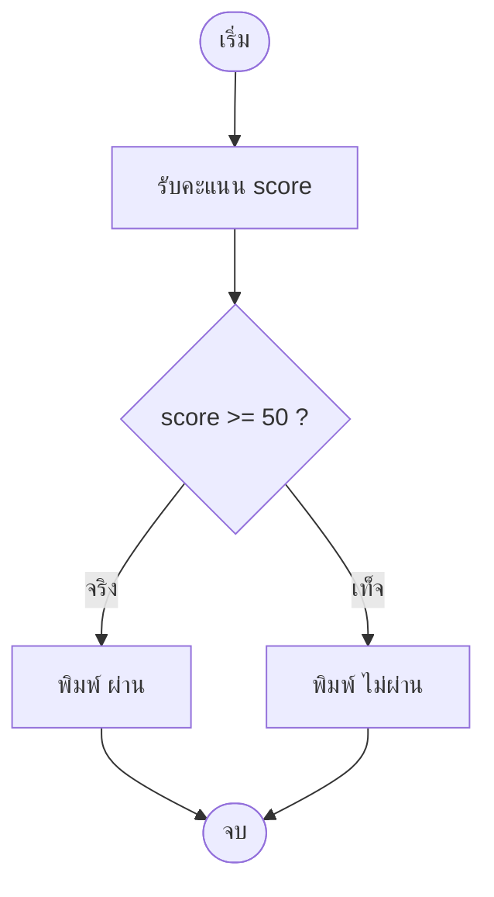

# บทที่ 4 — โครงสร้างควบคุมแบบเลือกทำ (if / if-else)

*(Decision Making: Flowchart → if → if-else → Nested → elif)*

> [!info] ข้อมูลบทเรียน
> | รายการ | รายละเอียด |
> | :--- | :--- |
> | รายวิชา | `31909-1007` การเขียนโปรแกรมด้วยภาษาไพธอน |
> | กลุ่มเรียน / ห้อง | 1สทค1 / 1441 |
> | เวลา | 4 ชั่วโมง (08.00–12.00) |
> | หน่วยการเรียนรู้ | หน่วยที่ 3 — โครงสร้างควบคุม |
> | ต่อจาก | [[บทที่ 3 - ตัวดำเนินการ ลำดับความสำคัญ และตรรกศาสตร์]] |
> | ผลงานในคาบ | แล็บ 4A–4E (ตรวจในคาบ) + Exit Ticket 3 ข้อ |

> [!abstract] เป้าหมายของบทนี้
> 1. อธิบายได้ว่าเมื่อไรโปรแกรมต้อง "ตัดสินใจ"
> 2. อ่านและวาด **ผังงานแบบมีการตัดสินใจ (Decision Flowchart)** ได้
> 3. เขียน `if` ได้ถูกต้องตามไวยากรณ์ (colon + ย่อหน้า)
> 4. เขียน `if / else` เลือกทางใดทางหนึ่งได้
> 5. ใช้เงื่อนไขซ้อน (`nested if`) และเข้าใจว่าเมื่อไรควรใช้ `and` แทน
> 6. รู้จัก `if / elif / else` ในระดับใช้งานได้ (จะลงลึกสัปดาห์หน้า)
> 7. อ่านและแก้ error ที่เกิดจากเงื่อนไขได้ (IndentationError, `=` vs `==`, TypeError)

> [!note] ทำไมบทนี้สำคัญที่สุดของเทอม
> ตั้งแต่บทนี้เป็นต้นไป โปรแกรมจะไม่ได้ทำตามลำดับบรรทัดอย่างเดียวอีกต่อไป
> มันจะ **เลือกทำ** ตามข้อมูลที่ได้รับ — นี่คือจุดที่โปรแกรมเริ่ม "คิดเป็น"
> ถ้าบทนี้ไม่แน่น บทที่ 5 (ลูป) และบทที่ 6 (ฟังก์ชัน) จะไปต่อไม่ได้เลย

---

## 1. ทำไมโปรแกรมต้อง "ตัดสินใจ"

### 1.1 โปรแกรมเส้นตรง vs โปรแกรมที่มีเงื่อนไข

| แบบ                     | ลักษณะ                               | ตัวอย่าง                           |
| :---------------------- | :----------------------------------- | :--------------------------------- |
| **เส้นตรง (Sequence)**  | ทำบรรทัด 1 → 2 → 3 จบ                | รับชื่อผู้ใช้ แล้วพิมพ์คำทักทาย    |
| **เลือกทำ (Selection)** | ตรวจเงื่อนไขก่อน แล้วเลือกทำบางอย่าง | ถ้ายอดเงินพอ ก็อนุมัติการถอน       |
| **ทำซ้ำ (Iteration)**   | ทำซ้ำจนเงื่อนไขเปลี่ยน               | วนแสดงรายการผู้ใช้ทีละคน (บทที่ 5) |

> [!tip] ภาษาคนก่อน ภาษาโค้ดทีหลัง
> ก่อนเขียนโค้ด ให้พูดประโยคเงื่อนไขออกมาเป็นภาษาไทยก่อน
> "**ถ้า** คะแนนตั้งแต่ 50 ขึ้นไป **ก็** พิมพ์ว่าผ่าน **ไม่ใช่ก็** พิมพ์ว่าไม่ผ่าน"
> ประโยคนี้แปลงเป็นโค้ดได้ตรงตัวทุกคำ

### 1.2 ตัวอย่างจากงานพัฒนาซอฟต์แวร์จริง

| สถานการณ์               | เงื่อนไข                       | ผลที่ต่างกัน               |
| :---------------------- | :----------------------------- | :------------------------- |
| ตรวจสิทธิ์เข้าสู่ระบบ   | รหัสผ่านถูก และบัญชีไม่ถูกล็อก | เข้าหน้าถัดไป / แจ้ง error |
| ตรวจข้อมูลสมัครสมาชิก   | อายุ 13–120 ปี                 | บันทึกได้ / แจ้งให้แก้ไข   |
| แสดงเมนูตามสิทธิ์ผู้ใช้ | `role == "admin"`              | เห็นเมนูจัดการ / ไม่เห็น   |
| ตรวจสถานะการเรียก API   | `status == 200`                | แสดงข้อมูล / แจ้ง error    |
| เตือนพื้นที่จัดเก็บ     | ใช้ไป ≥ 90% ของโควตา           | เตือน / ไม่เตือน           |

---

## 2. ผังงานกับการตัดสินใจ (Decision Flowchart)

### 2.1 สัญลักษณ์ที่ต้องรู้

|                สัญลักษณ์                | ชื่อ         | ใช้ทำอะไร        | ตัวอย่างข้อความ   |
| :-------------------------------------: | :----------- | :--------------- | :---------------- |
|                  วงรี                   | Terminal     | เริ่ม / จบ       | `เริ่ม`, `จบ`     |
|            สี่เหลี่ยมผืนผ้า             | Process      | คำสั่งทั่วไป     | `อ่านคะแนน score` |
| **ข้าวหลามตัด (สี่เหลี่ยมขนมเปียกปูน)** | **Decision** | **ตรวจเงื่อนไข** | `score >= 50 ?`   |
|           สี่เหลี่ยมด้านขนาน            | Input/Output | รับเข้า / แสดงผล | `พิมพ์ "ผ่าน"`    |
|                  ลูกศร                  | Flow         | ทิศทางการทำงาน   | —                 |


### 2.2 ผังงานตัวอย่าง: ผ่าน / ไม่ผ่าน



### 2.3 แปลงผังงานเป็นโค้ด

| ในผังงาน                    | ในโค้ด Python                  |
| :-------------------------- | :----------------------------- |
| ข้าวหลามตัด `score >= 50 ?` | `if score >= 50:`              |
| ลูกศร "จริง"                | บล็อกใต้ `if` (ย่อหน้า 4 เคาะ) |
| ลูกศร "เท็จ"                | บล็อกใต้ `else:`               |

```python
score = 72

if score >= 50:
    print("ผ่าน")
else:
    print("ไม่ผ่าน")
```

**ผลลัพธ์**

```text
ผ่าน
```

> [!note] กฎการอ่านผังงาน
> อ่านจากบนลงล่าง · ที่ข้าวหลามตัด **ต้องตอบได้แค่ จริง หรือ เท็จ** เท่านั้น
> ถ้ายังตอบไม่ได้ว่า "จริงหรือเท็จ" แปลว่าเงื่อนไขยังเขียนไม่ชัด

---

## 3. โครงสร้าง `if`

### 3.1 รูปแบบ

```python
if เงื่อนไข:
    คำสั่งที่จะทำเมื่อเงื่อนไขเป็นจริง
```

### 3.2 ตัวอย่างแรก

```python
response_time = 850        # มิลลิวินาที

if response_time > 500:
    print("API ตอบช้าเกินเกณฑ์")
    print("ควรตรวจ query และเพิ่ม index")

print("จบโปรแกรม")
```

**ผลลัพธ์**

```text
API ตอบช้าเกินเกณฑ์
ควรตรวจ query และเพิ่ม index
จบโปรแกรม
```

> [!important] สังเกต 3 อย่าง
> 1. `print("จบโปรแกรม")` **ไม่มี** ย่อหน้า → ทำทุกครั้ง ไม่ว่าเงื่อนไขจะเป็นจริงหรือไม่
> 2. บรรทัดที่ย่อหน้าใต้ `if` ทำเฉพาะเมื่อเงื่อนไขจริง
> 3. สองบรรทัดใต้ `if` ต้องย่อหน้าเท่ากันเป๊ะ

### 3.3 กฎ 4 ข้อที่ต้องจำ

|  #  | กฎ                             | ถูก                 | ผิด                       |
| :-: | :----------------------------- | :------------------ | :------------------------ |
|  1  | เงื่อนไขต้องลงท้ายด้วย `:`     | `if score >= 50:`   | `if score >= 50`          |
|  2  | บล็อกต้องย่อหน้า (4 เคาะ)      | บรรทัดถัดไปเว้นหน้า | เขียนชิดขอบ               |
|  3  | ย่อหน้าเท่ากันทุกบรรทัดในบล็อก | ทุกบรรทัด 4 เคาะ    | บรรทัดหนึ่ง 4 อีกบรรทัด 6 |
|  4  | ต้องมีคำสั่งอย่างน้อย 1 บรรทัด | `print(...)`        | บล็อกว่าง                 |

### 3.4 ทำไม Python ถึงบังคับย่อหน้า

ภาษา C หรือ Java ใช้ `{ }` ครอบบล็อก แต่ Python ใช้ **การย่อหน้า** เป็นไวยากรณ์
ถ้าย่อหน้าผิด โปรแกรมจะ error ทันที ไม่ใช่แค่ "ไม่สวย"

```python
# ถูก
if True:
    print("A")
    print("B")

# ผิด — IndentationError
if True:
print("A")
```

> [!danger] ข้อผิดพลาดอันดับ 1 ของมือใหม่
> `IndentationError: expected an indented block after 'if' statement on line 3`
> แปลว่า **ลืมย่อหน้า** — กด Tab หรือเว้นวรรค 4 ครั้งที่บรรทัดใต้ `if`

### 3.5 ใช้ `pass` เมื่อยังไม่อยากเขียนอะไร

```python
if score >= 50:
    pass          # ยังไม่ต้องทำอะไร แต่ต้องมีอย่างน้อย 1 บรรทัด
```

> [!tip] `pass` มีไว้ทำอะไร
> เป็นคำสั่ง "ไม่ทำอะไร" ใช้เมื่อร่างโครงก่อน
> ถ้าลบบรรทัดทิ้งจนบล็อกว่าง จะได้ `IndentationError`

---

## 4. เงื่อนไขคืออะไร (Truthy / Falsy)

### 4.1 เงื่อนไขต้องให้ค่า `True` หรือ `False`

```python
print(50 >= 40)      # True
print("a" == "b")    # False
print(not False)     # True
```

### 4.2 ค่าที่ Python ถือว่า "เท็จ"

| ค่า | ชนิด | หมายเหตุ |
| :--- | :--- | :--- |
| `False` | bool | เท็จตรง ๆ |
| `0`, `0.0` | number | ศูนย์ถือว่าเท็จ |
| `""` | str | สตริงว่าง |
| `[]`, `{}`, `()` | list/dict/tuple | กล่องว่าง |
| `None` | NoneType | ยังไม่มีค่า |

ทุกค่าที่ไม่อยู่ในตารางนี้ถือว่า **จริง**

```python
name = ""

if name:
    print("สวัสดี " + name)
else:
    print("ยังไม่ได้กรอกชื่อ")
```

**ผลลัพธ์**

```text
ยังไม่ได้กรอกชื่อ
```

> [!warning] กับดักจาก `input()`
> `input()` คืนค่าเป็น **ข้อความเสมอ** แม้ผู้ใช้พิมพ์ `0`
> `"0"` เป็นสตริงที่ไม่ว่าง → เป็นจริง!
> ถ้าต้องตรวจเลข ต้องแปลงก่อน: `score = int(input(...))`

---

## 5. ตัวดำเนินการที่ใช้ในเงื่อนไข

### 5.1 เปรียบเทียบ (ทบทวนบทที่ 3)

| ตัวดำเนินการ | ความหมาย | ตัวอย่าง | ผล |
| :--: | :--- | :--- | :--: |
| `==` | เท่ากัน | `5 == 5` | True |
| `!=` | ไม่เท่ากัน | `5 != 3` | True |
| `>` | มากกว่า | `7 > 3` | True |
| `<` | น้อยกว่า | `7 < 3` | False |
| `>=` | มากกว่าหรือเท่ากับ | `5 >= 5` | True |
| `<=` | น้อยกว่าหรือเท่ากับ | `4 <= 5` | True |

### 5.2 ตรรกะ

| ตัวดำเนินการ | จริงเมื่อ | ตัวอย่าง |
| :--- | :--- | :--- |
| `and` | จริงทั้งสองข้าง | `age >= 18 and has_id` |
| `or` | จริงอย่างน้อยหนึ่งข้าง | `is_weekend or is_holiday` |
| `not` | ตรงข้าม | `not is_full` |

### 5.3 ตรวจช่วงค่าด้วยการเขียนต่อกัน (Chained Comparison)

```python
port = 8080

if 1024 <= port <= 65535:
    print("พอร์ตใช้งานได้ (ไม่ต้องใช้สิทธิ์ผู้ดูแลระบบ)")
```

> [!tip] เขียนแบบนี้สั้นและถูกที่สุด
> ไม่ต้องเขียน `if port >= 1024 and port <= 65535:` ก็ได้
> แต่ถ้าไม่คุ้น ให้เขียนแบบ `and` ก็ถูกเหมือนกัน — **ห้ามเขียน** `if 1024 and 65535:` (นั่นจะจริงเสมอ)

### 5.4 ตรวจข้อความด้วย `in`

```python
app_version = "v2.3.1-beta"

if "beta" in app_version:
    print("เป็นเวอร์ชันทดสอบ — ห้ามปล่อยขึ้น production")
```

---

## 6. `if / else` — เลือกทางใดทางหนึ่ง

### 6.1 รูปแบบ

```python
if เงื่อนไข:
    ทำเมื่อจริง
else:
    ทำเมื่อเท็จ
```

> [!important] `if/else` เลือกทำ **เพียงทางเดียวเสมอ**
> ไม่มีทางที่ทำทั้งสองบล็อก และไม่มีทางที่ข้ามทั้งสองบล็อก

### 6.2 ตัวอย่าง: ตรวจความยาวรหัสผ่าน

```python
password = input("ตั้งรหัสผ่าน: ")

if len(password) >= 8:
    print("รหัสผ่านผ่านเกณฑ์ความยาว")
else:
    print("รหัสผ่านสั้นเกินไป — ต้องมีอย่างน้อย 8 ตัวอักษร")
```

**ทดลอง 3 ค่า**

| ป้อน | ผลลัพธ์ |
| :--: | :--- |
| `abc123` | รหัสผ่านสั้นเกินไป — ต้องมีอย่างน้อย 8 ตัวอักษร |
| `abc12345` | รหัสผ่านผ่านเกณฑ์ความยาว |
| `P@ssw0rd!` | รหัสผ่านผ่านเกณฑ์ความยาว |

### 6.3 ตัวอย่าง: ค่าบริการพื้นที่จัดเก็บเกินโควตา

```python
storage_gb = float(input("พื้นที่ใช้งาน (GB): "))
base_price = 199

if storage_gb > 100:
    extra = (storage_gb - 100) * 5
    total = base_price + extra
    print(f"เกินโควตา {storage_gb - 100:.0f} GB คิดเพิ่ม {extra:.2f} บาท")
    print(f"ค่าบริการรวม {total:.2f} บาท")
else:
    print("อยู่ในโควตาปกติ")
    print(f"ค่าบริการ {base_price:.2f} บาท")
```

### 6.4 ระวังการกลับเงื่อนไข

| ต้องการ | เขียนถูก | เขียนผิด |
| :--- | :--- | :--- |
| ผ่านเมื่อ ≥ 50 | `if score >= 50:` | `if score < 50:` แล้วสลับบล็อก |
| ไม่ผ่านเมื่อ < 50 | `else:` | `if score <= 49:` (ผิดถ้ามีทศนิยม) |

> [!tip] หลักง่าย ๆ
> ให้เขียนเงื่อนไขของ **กรณีปกติ/กรณีที่ควรเกิด** ไว้ใน `if`
> แล้วปล่อยกรณีที่เหลือให้ `else` — อ่านง่ายและพลาดน้อยกว่า

---

## 7. เงื่อนไขซ้อน (`nested if`)

### 7.1 รูปแบบ

```python
if เงื่อนไขนอก:
    if เงื่อนไขใน:
        ทำเมื่อจริงทั้งคู่
    else:
        นอกจริง ในเท็จ
else:
    นอกเท็จ
```

### 7.2 ตัวอย่าง: ตรวจสิทธิ์ใช้งานช่วงทดลอง (Trial)

```python
days_since_signup = 12
has_license = False

if days_since_signup <= 30:
    if has_license:
        print("ใช้งานเวอร์ชันเต็มได้")
    else:
        print("อยู่ในช่วงทดลอง — สมัครไลเซนส์เพื่อใช้ต่อ")
else:
    print("หมดช่วงทดลอง — ต้องซื้อไลเซนส์ก่อนใช้งาน")
```

**ผลลัพธ์**

```text
อยู่ในช่วงทดลอง — สมัครไลเซนส์เพื่อใช้ต่อ
```

### 7.3 เขียนแบบเดียวกันด้วย `and`

```python
if days_since_signup <= 30 and has_license:
    print("ใช้งานเวอร์ชันเต็มได้")
elif days_since_signup <= 30:
    print("อยู่ในช่วงทดลอง — สมัครไลเซนส์เพื่อใช้ต่อ")
else:
    print("หมดช่วงทดลอง — ต้องซื้อไลเซนส์ก่อนใช้งาน")
```

| แบบ | ข้อดี | ข้อเสีย |
| :--- | :--- | :--- |
| **nested** | บอกเหตุผลแยกกรณีได้ชัด | ย่อหน้าลึก อ่านยากเมื่อซ้อน 3 ชั้น |
| **`and` + `elif`** | แบน อ่านง่าย | เงื่อนไขยาวขึ้น |

> [!warning] กฎง่าย ๆ
> ซ้อนได้ไม่เกิน **2 ชั้น** ถ้าซ้อน 3 ชั้นขึ้นไป ให้เปลี่ยนไปใช้ `and`/`or` หรือแยกเป็นฟังก์ชัน (บทที่ 6)

---

## 8. `if / elif / else` — หลายทางเลือก

### 8.1 รูปแบบ

```python
if เงื่อนไข 1:
    ...
elif เงื่อนไข 2:
    ...
elif เงื่อนไข 3:
    ...
else:
    ...
```

### 8.2 ตัวอย่าง: ตัดเกรด

```python
score = int(input("คะแนน (0-100): "))

if score >= 80:
    grade = "A"
elif score >= 70:
    grade = "B"
elif score >= 60:
    grade = "C"
elif score >= 50:
    grade = "D"
else:
    grade = "F"

print(f"เกรด: {grade}")
```

### 8.3 กฎที่ห้ามลืม: เรียงจากมากไปน้อย

| ลำดับ | score=85 | ผล |
| :--- | :--- | :--- |
| `>= 80` ก่อน ✅ | ตรงเงื่อนไขแรก | A (ถูก) |
| `>= 50` ก่อน ❌ | ตรงเงื่อนไขแรกทันที | D (ผิด) |

> [!note] สัปดาห์หน้าจะลงลึก
> บทนี้ให้เขียน `elif` ได้ในระดับใช้งาน
> สัปดาห์หน้าจะเรียน **Nested if เชิงซ้อน**, **match-case**, และการออกแบบผังงานหลายทางเต็มรูปแบบ

---

## 9. ตัวอย่างงานจริง 4 สถานการณ์

### 9.1 ตรวจสิทธิ์การเข้าถึงตามบทบาท (Role)

```python
# check_role.py
role = input("role (admin / editor / viewer): ").lower()

if role == "admin":
    print("เข้าถึงได้: จัดการผู้ใช้, ตั้งค่าระบบ, ลบข้อมูล")
elif role == "editor":
    print("เข้าถึงได้: สร้างและแก้ไขเนื้อหา")
elif role == "viewer":
    print("เข้าถึงได้: ดูเนื้อหาเท่านั้น")
else:
    print("ไม่รู้จักสิทธิ์นี้ — ปฏิเสธการเข้าถึง")
```

### 9.2 ตรวจข้อมูลสมัครสมาชิก (Validation)

```python
# validate_signup.py
username = input("ชื่อผู้ใช้: ")
age = int(input("อายุ: "))
accepted = input("ยอมรับข้อตกลง (y/n): ").lower() == "y"

if len(username) >= 3 and 13 <= age <= 120 and accepted:
    print("สมัครสมาชิกสำเร็จ")
else:
    print("ข้อมูลไม่ผ่านเกณฑ์ — ตรวจชื่อผู้ใช้/อายุ/ข้อตกลง")
```

**ทดลอง**

| username | age | accepted | ผล |
| :-- | :--: | :--: | :--- |
| `nat` | 17 | y | สมัครสมาชิกสำเร็จ |
| `na` | 17 | y | ข้อมูลไม่ผ่านเกณฑ์ |
| `nat` | 12 | y | ข้อมูลไม่ผ่านเกณฑ์ |
| `nat` | 17 | n | ข้อมูลไม่ผ่านเกณฑ์ |

> [!tip] ทำไมต้อง `.lower() == "y"`
> ผู้ใช้อาจพิมพ์ `Y` หรือ `y` ก็ได้ — แปลงเป็นตัวเล็กก่อนแล้วเทียบ
> ถ้าเทียบตรง ๆ `== "y"` แล้วผู้ใช้พิมพ์ `Y` จะได้ผลผิด

### 9.3 ค่าบริการตามจำนวนผู้ใช้ (Tiered Pricing)

```python
# plan_price.py
users = int(input("จำนวนผู้ใช้: "))

if users <= 5:
    price = 0
elif users <= 20:
    price = 299
elif users <= 50:
    price = 799
else:
    price = 1499

print(f"ผู้ใช้ {users} คน — ค่าบริการ {price} บาท/เดือน")
```

### 9.4 ตรวจโควตาพื้นที่จัดเก็บ

```python
# storage_check.py
total_gb = float(input("โควตาทั้งหมด (GB): "))
used_gb = float(input("ใช้ไป (GB): "))

used_percent = used_gb / total_gb * 100

if used_percent >= 90:
    print(f"ใช้ไป {used_percent:.1f}% — ควรลบไฟล์เก่าหรือเพิ่มโควตา")
elif used_percent >= 70:
    print(f"ใช้ไป {used_percent:.1f}% — เริ่มใกล้เต็ม")
else:
    print(f"ใช้ไป {used_percent:.1f}% — ปกติ")
```

> [!danger] ระวังการหารด้วยศูนย์
> ถ้าผู้ใช้กรอกโควตา `0` จะได้ `ZeroDivisionError`
> บทที่ 6 จะสอน `try-except` — ตอนนี้ให้เพิ่ม `if total_gb <= 0: print("ข้อมูลไม่ถูกต้อง")` ก่อนคำนวณ

---

## 10. Error ที่พบบ่อย

| ข้อความ error | สาเหตุ | วิธีแก้ |
| :--- | :--- | :--- |
| `IndentationError: expected an indented block` | ลืมย่อหน้าใต้ `if` | ย่อหน้า 4 เคาะ |
| `IndentationError: unexpected indent` | ย่อหน้าเกินทั้งที่ไม่มี `if` | ลดย่อหน้ากลับ |
| `SyntaxError: expected ':'` | ลืม `:` ท้ายเงื่อนไข | เติม `:` |
| `SyntaxError: invalid syntax` ที่ `if x = 5:` | ใช้ `=` แทน `==` | เปลี่ยนเป็น `==` |
| `TypeError: '>' not supported between 'str' and 'int'` | เอาข้อความไปเทียบตัวเลข | แปลงด้วย `int()` / `float()` |
| `NameError: name 'Score' is not defined` | พิมพ์ชื่อตัวแปรตัวใหญ่ | ใช้ชื่อให้ตรงตัวพิมพ์ |
| โปรแกรมทำงานแต่ผลผิด | เงื่อนไขกลับด้าน / ลำดับ `elif` ผิด | ไล่ด้วยค่าทดสอบ 3 ค่า |

### 10.1 วิธีไล่หาสาเหตุ

```python
score = int(input("คะแนน: "))

print(f"[DEBUG] score = {score} และ type = {type(score)}")   # ดูค่าจริงก่อน

if score >= 50:
    print("ผ่าน")
else:
    print("ไม่ผ่าน")
```

> [!tip] กฎการดีบักด้วย `print`
> 1. พิมพ์ค่าที่สงสัย **ก่อน** `if`
> 2. ถ้าค่าไม่ตรงที่คิด → ปัญหาอยู่ก่อนหน้า (input/แปลงชนิด)
> 3. ถ้าค่าถูกแต่ผลผิด → ปัญหาอยู่ที่เงื่อนไข

---

## 11. แนวปฏิบัติที่ดี

| หลัก | ไม่ดี | ดี |
| :--- | :--- | :--- |
| ตั้งชื่อเงื่อนไขให้อ่านออก | `if x >= 80 and y == False:` | `is_passed = x >= 80`<br>`if is_passed:` |
| แยกเงื่อนไขยาวเป็นตัวแปร | `if a and b or c and not d:` | `eligible = a and b` |
| หลีกเลี่ยงการเทียบกับ `True` | `if is_ready == True:` | `if is_ready:` |
| ระวังทศนิยม | `if voltage == 5.0:` | `if abs(voltage - 5.0) < 0.01:` |
| ไม่ซ้อนลึกเกิน 2 ชั้น | nested 3 ชั้น | ใช้ `and` หรือแยกฟังก์ชัน |
| คอมเมนต์เหตุผล ไม่ใช่คำสั่ง | `# ถ้า score >= 50` | `# เกณฑ์ผ่านของวิชานี้คือ 50` |

> [!note] ทำไม `voltage == 5.0` ถึงอันตราย
> ทศนิยมในคอมพิวเตอร์เก็บได้ไม่เป๊ะ (`0.1 + 0.2 != 0.3`)
> ถ้าเทียบตรง ๆ อาจได้ `False` ทั้งที่ควรเป็น `True` — ใช้ผลต่างน้อยกว่าเกณฑ์แทน

---

## 12. Hands-on Labs

### Lab 4A — ผ่าน / ไม่ผ่าน (10 นาที)

```python
# lab4a_pass.py
score = int(input("คะแนน: "))

if score >= 50:
    print(f"คะแนน {score} — ผ่าน")
else:
    print(f"คะแนน {score} — ไม่ผ่าน")
```

ทดสอบ: `50`, `49`, `100`

### Lab 4B — ตรวจรหัสผ่าน (15 นาที)

รับรหัสผ่าน 1 ค่า แล้วตรวจ 2 เงื่อนไข: ยาวอย่างน้อย 8 ตัวอักษร และไม่มีช่องว่าง
(ใบ้: `len(password) >= 8` และ `" " not in password`)

### Lab 4C — ตรวจข้อมูลนำเข้า (15 นาที)

รับอายุและชื่อผู้ใช้ แล้วรายงานว่า "ผ่าน" หรือ "ไม่ผ่าน" พร้อมบอกว่าตกเงื่อนไขใด (ชื่อ ≥ 3 ตัว, อายุ 13–120)

### Lab 4D — ตรวจสิทธิ์ตามบทบาท (15 นาที)

รับ `role` แล้วแสดงเมนูที่เข้าถึงได้ 4 กรณี: admin / editor / viewer / ค่าอื่น

### Lab 4E (โบนัส) — ตรวจเลขคู่/คี่และช่วง

```python
# lab4e_bonus.py
number = int(input("เลขจำนวนเต็ม: "))

if 1 <= number <= 100:
    if number % 2 == 0:
        print(f"{number} เป็นเลขคู่ และอยู่ในช่วง 1-100")
    else:
        print(f"{number} เป็นเลขคี่ และอยู่ในช่วง 1-100")
else:
    print(f"{number} อยู่นอกช่วง 1-100")
```

> [!tip] ต่อยอด
> ถ้าอยากลองโจทย์ที่ต้องคิดมากขึ้น (ใช้เนื้อหาบทที่ 1–4 ทั้งหมด) → [[แล็บท้าทาย 1 - รวมบทที่ 1-4]]

---

## 13. Lesson Script 4 ชั่วโมง

### 13.1 แผนเวลา

| เวลา | นาที | กิจกรรม | สื่อ |
| :--- | :--: | :--- | :--- |
| 08.00–08.10 | 10 | ทบทวนบทที่ 3 + จุดประสงค์ | คำถามปากเปล่า |
| 08.10–08.40 | 30 | ผังงาน Decision + สัญลักษณ์ | กระดาน / mermaid |
| 08.40–09.20 | 40 | `if` + กฎ 4 ข้อ + แล็บ 4A | เครื่องคอมพิวเตอร์ |
| 09.20–09.30 | 10 | พัก | — |
| 09.30–10.10 | 40 | `if/else` + แล็บ 4B | — |
| 10.10–10.50 | 40 | Nested + `and` + ตัวอย่างงานจริง | สไลด์/โค้ดสด |
| 10.50–11.40 | 50 | แล็บ 4C–4E + เดินตรวจ | — |
| 11.40–12.00 | 20 | สรุป + Exit Ticket | กระดาษ |

### 13.2 คำถามเปิดคาบ

1. `print(5 >= 3)` ได้อะไร และเพราะอะไร
2. `and` กับ `or` ต่างกันอย่างไร
3. ถ้าเขียน `if score >= 50` แล้วลืม `:` จะเกิดอะไร

### 13.3 สาธิตสด (10 นาที)

1. เขียนผังงาน "ผ่าน/ไม่ผ่าน" บนกระดาน
2. แปลงเป็นโค้ดทีละบรรทัด พร้อมชี้ว่าลูกศร "จริง/เท็จ" ไปอยู่บรรทัดไหน
3. ลองรันด้วย `40` และ `75` ให้เห็นทั้งสองทาง

### 13.4 จุดที่ต้องเดินดูเป็นพิเศษ

| อาการ | สาเหตุที่พบบ่อย | แก้อย่างไร |
| :--- | :--- | :--- |
| รันแล้ว error ทันที | ลืม `:` หรือลืมย่อหน้า | ชี้บรรทัดที่ error |
| ทดสอบแล้วได้ทางเดียว | ใส่วงเล็บผิด / ใช้ `=` | ให้พิมพ์ค่าออกมาดู |
| ตัวเลขเทียบไม่ได้ | ลืม `int()` | เติมการแปลงชนิด |

### 13.5 Exit Ticket (3 ข้อ)

1. เขียน `if` ตรวจว่า `price` มากกว่า 500 แล้วพิมพ์ "แพง"
2. เขียน `if/else` ตรวจว่าอุณหภูมิเกิน 80 หรือไม่
3. บอกว่าโค้ดนี้ผิดตรงไหน

```python
if score >= 50
print("ผ่าน")
```

---

## 14. สรุป

| แนวคิด | สาระสำคัญ |
| :--- | :--- |
| **Decision** | โปรแกรมเลือกทำตามเงื่อนไข (จริง/เท็จ) |
| **`if`** | ทำเมื่อเงื่อนไขจริง ไม่จริงก็ข้าม |
| **`if/else`** | เลือกทำหนึ่งในสองทาง |
| **nested if** | ซ้อนเงื่อนไข ไม่เกิน 2 ชั้น |
| **`elif`** | หลายทางเลือก เรียงจากแคบไปกว้าง |
| **Indentation** | ย่อหน้า 4 เคาะ คือไวยากรณ์ ไม่ใช่ความสวย |
| **Truthy/Falsy** | `0`, `""`, `None`, `[]` ถือว่าเท็จ |

---

## 15. Check for Understanding

1. `if` กับ `if/else` ต่างกันอย่างไร
2. ทำไมต้องมี `:` ท้ายเงื่อนไข
3. ถ้าลืมย่อหน้าจะเกิด error อะไร
4. `if 0 <= x <= 10:` ตรวจอะไร
5. ทำไม `elif` ต้องเรียงเงื่อนไขจากมากไปน้อย
6. `input()` คืนค่าชนิดใด และทำไมต้องแปลงก่อนเทียบตัวเลข

> [!success]- เฉลย (คลิกเพื่อเปิด)
> 1. `if` ทำเมื่อจริงเท่านั้น ไม่จริงคือไม่ทำอะไร · `if/else` ต้องทำทางใดทางหนึ่งเสมอ
> 2. เป็นเครื่องหมายบอกจุดจบของเงื่อนไข ภาษา Python บังคับ
> 3. `IndentationError: expected an indented block`
> 4. ว่าค่าอยู่ในช่วง 0 ถึง 10 (รวมขอบ)
> 5. เพราะ Python หยุดที่เงื่อนไขแรกที่เป็นจริง เงื่อนไขกว้างจะกินทุกกรณี
> 6. คืนค่าเป็น `str` เสมอ ต้องแปลงด้วย `int()` หรือ `float()` ก่อนเทียบตัวเลข

---

## 16. ก้าวต่อไป

> [!tip] บทที่ 5
> * `if / elif / else` เชิงลึก + **Nested if** หลายชั้น
> * ออกแบบ **Decision Flowchart** ที่ซับซ้อนขึ้น
> * `match-case` (โครงสร้างเลือกทำแบบใหม่ของ Python 3.10+)
> * ใบงานที่ 4 — ผังงานการตัดสินใจ

---

## 17. เอกสารอ้างอิง

1. Python Software Foundation. *The Python Tutorial — More Control Flow Tools*.
2. Python Software Foundation. *Built-in Types — Truth Value Testing*.
3. PEP 8. *Style Guide for Python Code — Indentation*.
4. Downey, A. *Think Python* — Chapter 5: Conditionals and Recursion.

---

## 18. โน้ตที่เกี่ยวข้อง

* [[บทที่ 3 - ตัวดำเนินการ ลำดับความสำคัญ และตรรกศาสตร์]] — บทก่อน
* [[บทที่ 2 - พื้นฐานการเขียนโปรแกรม ตัวแปร ชนิดข้อมูล และการประมวลผล]] — ตัวแปร/ชนิดข้อมูล/f-string
* [[ใบงานที่ 3 - โปรแกรมออกใบเสร็จร้านคอมพิวเตอร์]] — งานที่ใช้ทบทวนก่อนขึ้นบทนี้
* [[แผนหน่วยการเรียน 31909-1007 การเขียนโปรแกรมด้วยภาษาไพธอน]] — แผน 18 สัปดาห์
* [[31909-1007 การเขียนโปรแกรมด้วยภาษาไพธอน]] — ข้อมูลรายวิชา
