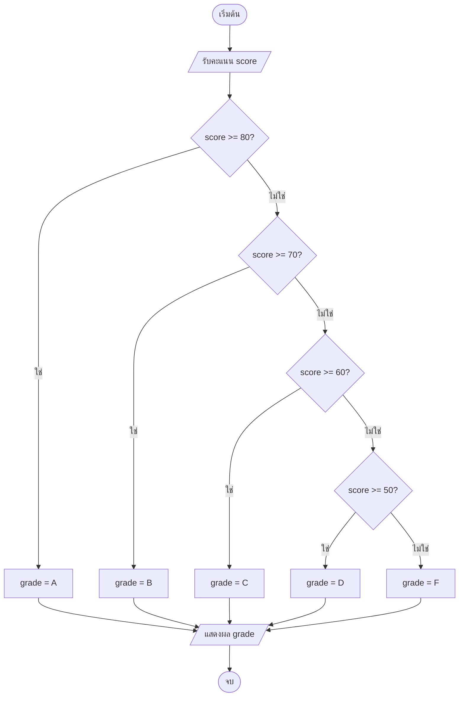
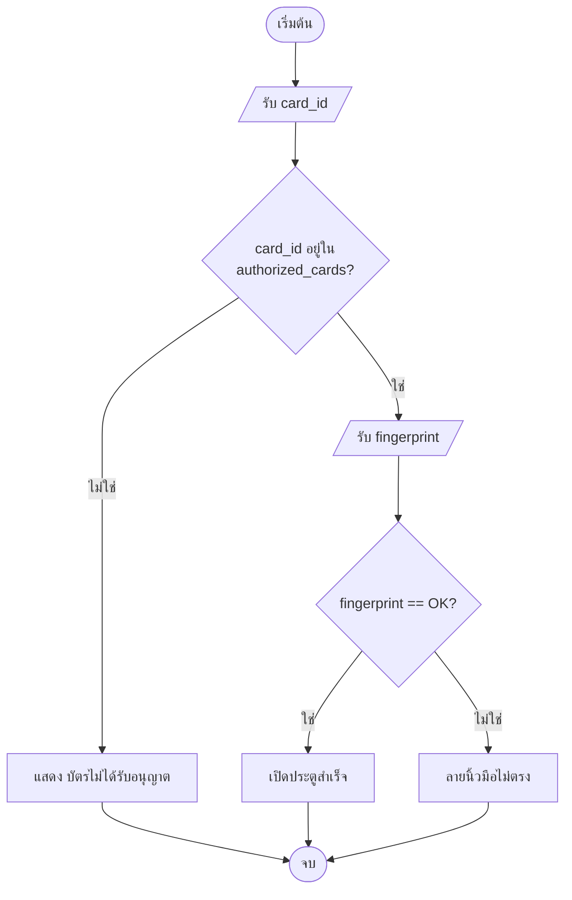

# บทที่ 5 — โครงสร้างควบคุมแบบเลือกทำขั้นสูง (if-elif-else / match-case)

*(Multi-Branch Decision: elif Chain → Nested if → match-case → ใบงานตัดเกรดและสถานะ CPU)*

> [!info] ข้อมูลบทเรียน
>
> | รายการ | รายละเอียด |
> | :--- | :--- |
> | รายวิชา | 31909-1007 การเขียนโปรแกรมด้วยภาษาไพธอน |
> | ระดับ | ปวส. 1 (สาขาเทคโนโลยีคอมพิวเตอร์) |
> | สัปดาห์ / หน่วย | สัปดาห์ที่ 6 / หน่วยที่ 3 |
> | เวลาเรียน | 4 ชั่วโมง (ทฤษฎี 2 + ปฏิบัติ 2) |
> | ต่อจาก | [[บทที่ 4 - โครงสร้างควบคุมแบบเลือกทำ (if else)]] |
> | ใบงาน | ใบงานที่ 5 — ตัดเกรดนักศึกษา + จำแนกสถานะ CPU |

> [!abstract] เป้าหมายของบทนี้
> เมื่อเรียนจบบทนี้แล้ว นักศึกษาสามารถ:
> 1. เขียน `if / elif / else` ที่มีหลายเงื่อนไขได้ถูกต้อง และรู้วิธีเรียงลำดับเงื่อนไขจากแคบไปกว้าง
> 2. วิเคราะห์ได้ว่า Nested `if` แบบไหนควรยุบรวมด้วย `and` / `or` และแบบไหนควรซ้อนไว้เหมือนเดิม
> 3. ออกแบบและอ่าน Decision Flowchart แบบหลายทางเลือก แล้วแปลงเป็นโค้ด Python ได้
> 4. ใช้ `match-case` (Python 3.10+) แทน `if-elif` ที่เทียบค่าเจาะจงหลายตัวเลือกได้
> 5. เขียนโปรแกรมตัดเกรดนักศึกษาและจำแนกสถานะ CPU พร้อมตรวจสอบค่าขอบเขต (Boundary Testing) ได้
> 6. หลีกเลี่ยงกับดักเรื่องลำดับเงื่อนไข การย่อหน้า และชนิดข้อมูลที่ทำให้โปรแกรมทำงานผิดพลาด

> [!note] ทำไมบทนี้สำคัญ
> ในงานจริง โปรแกรมแทบไม่มีแค่ 2 ทางเลือก (ใช่/ไม่ใช่) — ระบบตัดเกรดมี 8 ระดับ (A ถึง F และ มส.), ระบบตู้ ATM มีเมนูหลายรายการ, ระบบมอนิเตอร์เครื่องคอมพิวเตอร์ต้องแยกสถานะ ปกติ / เตือน / วิกฤต การเข้าใจ `if-elif-else`, Nested `if` และ `match-case` อย่างถ่องแท้จึงเป็นพื้นฐานสำคัญของการเขียนโปรแกรมตัดสินใจที่แม่นยำ

---

## 1. ทบทวน: จาก if-else สู่ elif

### 1.1 ปัญหาของการเขียน if แยกหลายชุดโดยไม่ใช้ elif

ในบทที่ 4 เราใช้ `if / else` สำหรับปัญหาที่มี **2 ทางเลือก** แต่เมื่อเจอปัญหาที่มี **3 ทางเลือกขึ้นไป** เช่น ระบบตัดเกรด A, B, C, D, F มือใหม่หลายคนมักเผลอเขียน `if` ต่อกันหลายอันแบบนี้:

```python
# ❌ วิธีนี้ผิด — Python ตรวจทุก if แยกกัน แม้เงื่อนไขแรกจะเป็นจริงไปแล้ว
score = 85

if score >= 80:
    print("ได้เกรด A")
if score >= 70:          # 85 >= 70 ก็ยังเป็น True!
    print("ได้เกรด B")
if score >= 60:          # 85 >= 60 ก็ยังเป็น True อีก!
    print("ได้เกรด C")
```

```text
ได้เกรด A
ได้เกรด B    ← ผิด! พิมพ์ซ้อนออกมาทั้ง 3 บรรทัด
ได้เกรด C
```

**ทำไมถึงเกิดแบบนี้?**
เพราะ `if` ที่เขียนชิดซ้ายเสมอกันถือเป็น **คนละคำสั่งกัน** เมื่อจบคำสั่ง `if` แรก Python ก็เดินหน้าตรวจ `if` ที่สองและสามต่อทันที ไม่ได้หยุดแม้จะได้คำตอบแล้ว

> [!warning] กับดักมือใหม่ที่พบบ่อยที่สุด
> การเขียน `if` แยกกันหลายชุด **ไม่ใช่** การเลือกทำเพียงทางเดียว (Mutually Exclusive) — ถ้าต้องการให้เลือกทำงาน **เพียง 1 สาขาเท่านั้น** จากหลายๆ ทางเลือก ต้องเชื่อมด้วย `elif`

### 1.2 elif คืออะไร

`elif` ย่อมาจากคำว่า **else if** — แปลตรงตัวว่า *"ถ้าเงื่อนไขก่อนหน้าไม่เป็นจริง แล้วค่อยลองตรวจเงื่อนไขนี้"*

ลองนึกภาพ **ด่านคัดแยกพัสดุอัตโนมัติ** บนสายพาน:
- ด่านที่ 1: "น้ำหนัก 20 กก. ขึ้นไป → ส่งช่องรถบรรทุก" (ถ้าเข้าช่องนี้แล้ว **จบเลย** ไม่ไหลไปด่านอื่นต่อ)
- ด่านที่ 2 (`elif`): ถ้าไม่ใช่ด่าน 1 และ "น้ำหนัก 5 กก. ขึ้นไป → ส่งช่องรถกระบะ"
- ด่านสุดท้าย (`else`): ที่เหลือทั้งหมด → "ส่งช่องมอเตอร์ไซค์"

พัสดุ 1 กล่อง **เข้าได้เพียง 1 ช่องเท่านั้น** ทันทีที่เจอเงื่อนไขแรกที่เป็นจริง (`True`) Python จะทำคำสั่งในบล็อกนั้นแล้ว **กระโดดข้าม `elif` และ `else` ที่เหลือทั้งหมดทันที**

---

## 2. โครงสร้าง if / elif / else

### 2.1 รูปแบบไวยากรณ์

```python
if เงื่อนไขที่_1:
    # ทำงานเมื่อเงื่อนไขที่ 1 เป็น True
elif เงื่อนไขที่_2:
    # ทำงานเมื่อเงื่อนไขที่ 1 เป็น False และเงื่อนไขที่ 2 เป็น True
elif เงื่อนไขที่_3:
    # ทำงานเมื่อเงื่อนไขที่ 1, 2 เป็น False และเงื่อนไขที่ 3 เป็น True
else:
    # ทำงานเมื่อไม่มีเงื่อนไขใดข้างบนเป็น True เลย (ใส่หรือไม่ใส่ก็ได้)
```

> [!important] กฎสำคัญ 5 ข้อของ if / elif / else
>
> | ข้อ | กฎที่ต้องจำ | ตัวอย่างที่ถูก | ตัวอย่างที่ผิด |
> | :--: | :--- | :--- | :--- |
> | 1 | มี `if` ได้ **1 ตัว** อยู่บนสุดเสมอ | `if x > 0:` | `elif x > 0:` (ไม่มี if นำหน้า) |
> | 2 | `elif` มีได้ **ไม่จำกัดจำนวน** | `elif x == 0:` | — |
> | 3 | `else` มีได้ไม่เกิน **1 ตัว** และต้องอยู่ **ท้ายสุด** | `else:` | วาง `else:` ไว้ก่อน `elif` |
> | 4 | `else` **ห้ามใส่เงื่อนไข** (รับทุกกรณีที่เหลือ) | `else:` | `else x < 0:` |
> | 5 | Python ตรวจจาก **บนลงล่าง** หยุดทันทีที่เจอ `True` แรก | — | — |

### 2.2 ตัวอย่างแรก: ระบบตัดเกรด 5 ระดับ

```python
# grade_simple.py — ระบบตัดเกรด 5 ระดับ
score = int(input("กรอกคะแนน (0-100): "))

if score >= 80:
    grade = "A"
elif score >= 70:
    grade = "B"
elif score >= 60:
    grade = "C"
elif score >= 50:
    grade = "D"
else:
    grade = "F"

print(f"คะแนน {score} → เกรด {grade}")
```

**ลองไล่การทำงานทีละบรรทัดเมื่อกรอกคะแนน `75`:**
1. ตรวจ `score >= 80` → `75 >= 80` ได้ `False` → ข้ามบล็อก `A`
2. ตรวจ `elif score >= 70` → `75 >= 70` ได้ `True` → กำหนด `grade = "B"`
3. **กระโดดข้าม** `elif score >= 60`, `elif score >= 50` และ `else` ทันที
4. ลงมาทำ `print(...)`

```text
กรอกคะแนน (0-100): 75
คะแนน 75 → เกรด B
```

### 2.3 Flowchart ของ if-elif-else



---

## 3. การเรียงลำดับเงื่อนไข: หัวใจของ elif

### 3.1 หลักการเรียงจาก "แคบไปกว้าง"

> [!tip] กฎทองการเรียง elif
> ให้เรียงเงื่อนไขที่ **แคบหรือเจาะจงที่สุด** ไว้บนสุด แล้วไล่ลงไปหาเงื่อนไขที่ **กว้างขึ้น** — เพราะถ้าเอาเงื่อนไขกว้างไว้ข้างบน มันจะดักจับข้อมูลไปหมดจนเงื่อนไขด้านล่างไม่มีวันได้ทำงาน

**ตัวอย่าง: จำแนกช่วงอุณหภูมิ CPU**

```python
# cpu_temp.py — จำแนกสถานะ CPU จากอุณหภูมิ
temp = float(input("อุณหภูมิ CPU (°C): "))

# ✅ ถูก — เรียงจากช่วงที่เข้มงวด/ร้อนที่สุดลงมา
if temp >= 90:
    status = "🔴 วิกฤต — ระบบอาจดับเพื่อป้องกันความเสียหาย"
elif temp >= 75:
    status = "🟠 ร้อนมาก — ควรลดภาระงาน"
elif temp >= 60:
    status = "🟡 ร้อนปานกลาง — ตรวจสอบพัดลม"
elif temp >= 40:
    status = "🟢 ปกติ — ทำงานได้ดี"
else:
    status = "🔵 เย็นมาก — ตรวจสอบ Sensor"

print(f"อุณหภูมิ {temp}°C → {status}")
```

```text
อุณหภูมิ CPU (°C): 82
อุณหภูมิ 82°C → 🟠 ร้อนมาก — ควรลดภาระงาน
```

**ดูตัวอย่างที่เรียงลำดับผิด (Logic Error — โค้ดไม่พังแต่คำตอบผิด!):**

```python
# ❌ ผิด — เอา >= 40 ซึ่งกว้างที่สุดไว้บนสุด
if temp >= 40:
    status = "ปกติ"           # ถ้า temp = 95, 95 >= 40 เป็น True → ตอบ "ปกติ" ทันที!
elif temp >= 60:
    status = "ร้อนปานกลาง"   # Dead code — ไม่มีทางวิ่งมาถึงบรรทัดนี้
elif temp >= 75:
    status = "ร้อนมาก"        # Dead code — ไม่มีทางวิ่งมาถึงบรรทัดนี้
```

> [!note] แล้วถ้าอยากเรียงจากน้อยไปมากล่ะ? ทำได้ไหม?
> ทำได้! แต่ต้องเปลี่ยนเครื่องหมายเป็น `<` เช่น:
> `if temp < 40:` → `elif temp < 60:` → `elif temp < 75:` → `elif temp < 90:` → `else:`
> สังเกตว่า `< 40` ก็คือช่วงที่ **แคบกว่า** `< 60` อยู่ดี — หลักการ "แคบไปกว้าง" ยังคงเป็นจริงเสมอ!

### 3.2 ตาราง Boundary Test — วิธีตรวจว่าเรียงเงื่อนไขถูกหรือยัง

โปรแกรมเมอร์มืออาชีพจะไม่ทดสอบแค่ค่ากลางๆ อย่าง `85` หรือ `50` แต่จะทดสอบที่ **จุดรอยต่อ (Boundary)** ทุกจุดด้วยหลัก **N - 1, N, N + 1** เพื่อเช็กว่าเครื่องหมาย `>=` กับ `>` ไม่ได้ใส่ผิด

| ค่าทดสอบ (temp) | จุดที่เช็ก | ผลที่คาดหวัง | ผลที่ได้จริง | สถานะ |
| :--: | :--- | :--- | :--- | :--: |
| 95 | ช่วงบนสุด | วิกฤต | วิกฤต | ✓ |
| **90** | ขอบล่างของวิกฤต (`>= 90`) | วิกฤต | วิกฤต | ✓ |
| **89.9** | ต่ำกว่าขอบ 90 เล็กน้อย | ร้อนมาก | ร้อนมาก | ✓ |
| **75** | ขอบล่างของร้อนมาก (`>= 75`) | ร้อนมาก | ร้อนมาก | ✓ |
| **74** | ต่ำกว่าขอบ 75 | ร้อนปานกลาง | ร้อนปานกลาง | ✓ |
| **60** | ขอบล่างของร้อนปานกลาง (`>= 60`) | ร้อนปานกลาง | ร้อนปานกลาง | ✓ |
| **40** | ขอบล่างของปกติ (`>= 40`) | ปกติ | ปกติ | ✓ |
| **39** | ต่ำกว่าขอบ 40 | เย็นมาก | เย็นมาก | ✓ |

---

## 4. Nested if — เงื่อนไขซ้อนใน

### 4.1 Nested if คืออะไร

**Nested if** คือการวางโครงสร้าง `if` (หรือ `if-elif-else`) ซ้อนเข้าไป **ภายใน** บล็อกของ `if` หรือ `else` อีกตัวหนึ่ง

ใช้เมื่อเงื่อนไขที่ 2 **จะตรวจได้ก็ต่อเมื่อเงื่อนไขที่ 1 ผ่านก่อน** เปรียบเหมือน **ประตูรักษาความปลอดภัย 2 ชั้น**:
- ชั้นที่ 1: แตะบัตรพนักงาน — ถ้าบัตรผ่าน ค่อยเดินเข้าไปสแกนลายนิ้วมือ
- ชั้นที่ 2 (อยู่ข้างในชั้นที่ 1): สแกนลายนิ้วมือ — ถ้าผ่าน ประตูถึงจะเปิด
- ถ้าบัตรไม่ผ่านตั้งแต่ชั้นแรก ก็ **ไม่ต้องถามหาลายนิ้วมือ** เลย

```python
# security.py — ระบบรักษาความปลอดภัย 2 ชั้น
card_id = input("สแกนบัตร (ID): ")
authorized_cards = ["A001", "A002", "B005"]   # รายการรหัสบัตรที่อนุญาต

if card_id in authorized_cards:               # ชั้นที่ 1
    print("✅ บัตรผ่าน — กรุณาสแกนนิ้ว")
    fingerprint = input("สแกนนิ้ว (OK/FAIL): ")

    if fingerprint == "OK":                   # ชั้นที่ 2 (Nested if)
        print("🔓 เปิดประตูสำเร็จ — ยินดีต้อนรับ")
    else:
        print("❌ ลายนิ้วมือไม่ตรง — ประตูไม่เปิด")

else:                                         # else ของชั้นที่ 1
    print("🚫 บัตรไม่ได้รับอนุญาต")
```

> [!important] ระวังเรื่องการย่อหน้า (Indentation) ใน Nested if
> Python ใช้ระยะย่อหน้า (4 ช่องว่าง) เพื่อตัดสินว่า `else` ตัวไหนเป็นคู่ของ `if` ตัวไหน:
> - `if fingerprint == "OK":` กับ `else:` คู่ของมัน ย่อหน้าเข้ามา **8 ช่อง** (อยู่ใต้ `if` ชั้นแรก)
> - `if card_id in ...:` กับ `else:` คู่ของมัน อยู่ **ชิดซ้าย** (0 ช่อง)

### 4.2 Flowchart ของ Nested if



### 4.3 Nested if ร่วมกับ elif: ระบบตัดเกรด ปวส. แบบเต็ม (8 ระดับ + มส.)

ในระบบ ปวส. จริง นักศึกษาต้องมีเวลาเข้าเรียนไม่น้อยกว่า 75% (เช่น 54 จาก 72 ชั่วโมง) ก่อน จึงจะนำคะแนนมาตัดเกรด A, B+, B, C+, C, D+, D, F ได้ — นี่คือตัวอย่างชัดเจนของการใช้ `if-else` ชั้นนอกคู่กับ `if-elif-else` ชั้นใน:

```python
# grade_full.py — ระบบตัดเกรดแบบมีเกณฑ์เวลาเรียน
score = float(input("กรอกคะแนน (0-100): "))
attended = int(input("เข้าเรียนกี่ชั่วโมง (จากทั้งหมด 72 ชั่วโมง): "))

if attended >= 54:                       # ชั้นที่ 1: ผ่านเกณฑ์เวลาเรียน (>= 75%)
    if score >= 80:                      # ชั้นที่ 2: ตัดเกรดตามช่วงคะแนน
        grade, gpa = "A",  4.0
    elif score >= 75:
        grade, gpa = "B+", 3.5
    elif score >= 70:
        grade, gpa = "B",  3.0
    elif score >= 65:
        grade, gpa = "C+", 2.5
    elif score >= 60:
        grade, gpa = "C",  2.0
    elif score >= 55:
        grade, gpa = "D+", 1.5
    elif score >= 50:
        grade, gpa = "D",  1.0
    else:
        grade, gpa = "F",  0.0
else:                                    # ไม่ผ่านเกณฑ์เวลาเรียน
    grade, gpa = "มส.", 0.0
    print(f"⚠️ เข้าเรียนเพียง {attended} ชั่วโมง — ต่ำกว่าเกณฑ์ 54 ชั่วโมง")

print(f"\nคะแนน {score} | เข้าเรียน {attended} ชั่วโมง")
print(f"ผลการเรียน: {grade} (GPA: {gpa})")
```

```text
กรอกคะแนน (0-100): 77
เข้าเรียนกี่ชั่วโมง (จากทั้งหมด 72 ชั่วโมง): 60

คะแนน 77 | เข้าเรียน 60 ชั่วโมง
ผลการเรียน: B+ (GPA: 3.5)
```

---

## 5. เมื่อไรควรเปลี่ยน Nested if เป็น and / or

### 5.1 ปัญหา "Pyramid of Doom" (โค้ดพีระมิด)

การซ้อน `if` ลึกเกิน 3–4 ชั้น ทำให้โค้ดเอียงขวาเข้าไปเรื่อยๆ จนอ่านยากและจับคู่ `else` ลำบาก:

```python
# ❌ Pyramid of Doom — ซ้อน 4 ชั้นโดยไม่จำเป็น
if is_logged_in:
    if has_permission:
        if not is_banned:
            if score >= 60:
                print("เข้าถึงเนื้อหาได้")
```

### 5.2 แปลง Nested if เป็น and

ถ้าทุกเงื่อนไขต้องเป็น `True` พร้อมกัน และ **ไม่มี `else` แยกต่างหาก** ในแต่ละชั้น เราสามารถยุบทุกชั้นให้เหลือบรรทัดเดียวด้วย `and`:

```python
# ✅ อ่านง่ายกว่ามากในบรรทัดเดียว
if is_logged_in and has_permission and not is_banned and score >= 60:
    print("เข้าถึงเนื้อหาได้")
```

> [!important] เกณฑ์ตัดสินใจ: ยุบด้วย and/or vs ซ้อน Nested if
>
> | ลักษณะของเงื่อนไข | ควรทำอย่างไร |
> | :--- | :--- |
> | ทุกชั้นต้องเป็นจริงหมด และมีผลลัพธ์ปลายทางเดียว | ✅ ยุบด้วย `and` |
> | แค่ตรวจว่าตรงเงื่อนไขใดเงื่อนไขหนึ่ง | ✅ ยุบด้วย `or` |
> | แต่ละชั้นมีข้อความแจ้ง Error หรือ `else` ต่างกัน | ❌ ซ้อน Nested `if` ไว้ (หรือใช้ `if-elif` ตรวจสอบทีละด่าน) |

**ตัวอย่างการเปลี่ยน Nested `if` ที่มี Error ต่างกัน ให้กลายเป็น `if-elif` แบบแบน (Flat Guard Clauses):**

```python
# ✅ แบนลง อ่านง่ายขึ้น โดยไม่ต้องซ้อนลึก
if not is_logged_in:
    print("❌ กรุณาเข้าสู่ระบบก่อน")
elif not has_permission:
    print("❌ คุณไม่มีสิทธิ์เข้าถึงส่วนนี้")
elif is_banned:
    print("🚫 บัญชีของคุณถูกระงับ")
else:
    print("✅ ยินดีต้อนรับ!")
```

---

## 6. match-case — โครงสร้างใหม่ Python 3.10+

### 6.1 match-case คืออะไร

`match-case` เป็นโครงสร้างควบคุมแบบเลือกทำที่เพิ่มเข้ามาใน **Python 3.10** (ปี 2021) เพื่อใช้จับคู่ค่าของตัวแปรกับรูปแบบต่างๆ คล้ายกับ `switch-case` ในภาษา C, Java หรือ JavaScript

**เปรียบเทียบง่ายๆ:**
- `if-elif` เหมาะกับการถามเป็น **ช่วงหรือคำถามเชิงตรรกะ** เช่น "คะแนนมากกว่าหรือเท่ากับ 80 ไหม?"
- `match-case` เหมาะกับการเลือกจาก **รายการที่ระบุค่าตายตัว** เหมือนกดเบอร์เมนูก๋วยเตี๋ยว: กด `"1"` ได้เล็กน้ำ, กด `"2"` ได้บะหมี่แห้ง

### 6.2 รูปแบบไวยากรณ์

```python
match ตัวแปรที่ต้องการตรวจ:
    case ค่าที่_1:
        # คำสั่งเมื่อตัวแปรตรงกับ ค่าที่_1
    case ค่าที่_2:
        # คำสั่งเมื่อตัวแปรตรงกับ ค่าที่_2
    case _:
        # default — ทำงานเมื่อไม่ตรงกับ case ใดเลย (เหมือน else)
```

> [!note] ความหมายของ `case _:`
> เครื่องหมายขีดล่าง `_` (Underscore) ใน `case _:` ทำหน้าที่เป็น **Wildcard** (จับคู่ทุกค่าที่เหลือ) เหมือน `else:` ใน `if-elif` และต้องวางไว้เป็น `case` สุดท้ายเสมอ

### 6.3 ตัวอย่าง: เมนูโปรแกรมตู้ ATM

```python
# atm_menu.py — เมนู ATM ด้วย match-case
print("=== ตู้ ATM จำลอง ===")
print("1. ตรวจยอดเงิน")
print("2. ถอนเงิน")
print("3. โอนเงิน")
print("4. เติมเงินมือถือ")
print("0. ออกจากระบบ")

choice = input("\nเลือกรายการ: ")   # input() คืนค่าเป็น str เสมอ

match choice:
    case "1":
        print("💰 ยอดเงินคงเหลือ: 12,500 บาท")
    case "2":
        amount = int(input("กรอกจำนวนเงินที่ต้องการถอน: "))
        print(f"💵 กรุณารับธนบัตร {amount:,} บาท")
    case "3":
        dest = input("กรอกเลขบัญชีปลายทาง: ")
        print(f"📤 โอนสำเร็จไปยังบัญชี {dest}")
    case "4":
        phone = input("กรอกหมายเลขโทรศัพท์: ")
        print(f"📱 เติมเงินสำเร็จ หมายเลข {phone}")
    case "0":
        print("👋 ขอบคุณที่ใช้บริการ")
    case _:
        print("❌ ตัวเลือกไม่ถูกต้อง กรุณาเลือก 0-4")
```

> [!tip] สังเกต `"1"` กับ `1`
> ในตัวอย่างนี้ `choice` รับค่าจาก `input()` โดยไม่ได้ครอบ `int()` ดังนั้น `choice` จึงเป็นชนิดข้อความ (`str`) — ใน `case` จึงต้องใส่เครื่องหมายคำพูด `case "1":` (ไม่ใช่ `case 1:`) และข้อดีคือถ้าผู้ใช้พิมพ์ตัวอักษร `"abc"` เข้ามา โปรแกรมจะไม่แครชด้วย `ValueError` แต่จะตกไปที่ `case _:` อย่างปลอดภัย!

### 6.4 รวมหลายค่าใน case เดียวด้วยเครื่องหมาย `|` (OR)

ถ้าหลายตัวเลือกให้ผลลัพธ์เหมือนกัน ใช้เครื่องหมาย `|` คั่นระหว่างค่าได้เลย:

```python
# day_type.py — จำแนกวันทำงานและวันหยุด
day = input("กรอกชื่อวัน (ภาษาอังกฤษ): ").strip().lower()

match day:
    case "monday" | "tuesday" | "wednesday" | "thursday" | "friday":
        print("📅 วันทำงาน — ตั้งใจเรียนและทำงานกัน!")
    case "saturday" | "sunday":
        print("🎉 วันหยุด — พักผ่อนให้เต็มที่")
    case _:
        print("❓ ไม่รู้จักชื่อวันนี้ กรุณาตรวจสอบตัวสะกด")
```

### 6.5 การใช้ Guard (`if` ต่อท้าย `case`)

นอกจากเทียบค่าตรงๆ แล้ว `match-case` ยังสามารถเพิ่มเงื่อนไข `if` ต่อท้าย `case` ได้ด้วย (เรียกว่า **Guard**):

```python
# http_status.py — ตัวอย่าง match-case ร่วมกับ Guard
code = int(input("กรอก HTTP Status Code: "))

match code:
    case 200:
        print("✅ 200 OK — สำเร็จ")
    case 404:
        print("🔍 404 Not Found — ไม่พบหน้าเว็บ")
    case c if 500 <= c < 600:
        print(f"🔥 {c} Server Error — เซิร์ฟเวอร์มีปัญหา")
    case _:
        print(f"ℹ️ Status Code: {code}")
```

### 6.6 เปรียบเทียบ if-elif vs match-case

| ประเด็น | if-elif-else | match-case |
| :--- | :--- | :--- |
| เวอร์ชัน Python ที่รองรับ | ทุกเวอร์ชัน | **Python 3.10+ เท่านั้น** |
| งานที่ถนัดที่สุด | ช่วงค่า (`>=`, `<`, เงื่อนไขผสม `and`/`or`) | ค่าตายตัว (เมนู, คำสั่ง, สถานะ, รหัส) |
| รวมหลายเงื่อนไข | ใช้ `or` | ใช้ `\|` (Pipe) |
| กรณีอื่นๆ ทั้งหมด | `else:` | `case _:` |
| ต้องใส่ `break` ไหม | ไม่ต้อง | ไม่ต้อง (ต่างจากภาษา C/Java ที่ต้องใส่ `break`) |

> [!warning] ตรวจสอบเวอร์ชัน Python ก่อนใช้ match-case
> ```python
> import sys
> print(sys.version)   # ต้องเป็น 3.10 ขึ้นไป
> ```
> หากเครื่องในห้องแล็บยังเป็น Python 3.8 หรือ 3.9 การใช้ `match-case` จะขึ้น `SyntaxError` ทันที ให้ใช้ `if-elif-else` แทน

---

## 7. ตัวอย่างงานจริง 4 สถานการณ์

### 7.1 ระบบตัดเกรดนักศึกษา (ตามหลักสูตร ปวส.)

โปรแกรมนี้รับชื่อ คะแนน และชั่วโมงเข้าเรียน จากนั้นตรวจสอบความถูกต้องของข้อมูล (Validation) ก่อนตัดเกรดด้วย Nested `if` และ `if-elif-else`:

```python
# grade_system.py — ระบบตัดเกรดสมบูรณ์แบบ ปวส.
print("=" * 45)
print("   ระบบตัดเกรดนักศึกษา วิทยาลัยเทคนิค")
print("=" * 45)

name = input("ชื่อนักศึกษา: ")
score = float(input("คะแนนรวม (0.0 - 100.0): "))
attend_hours = int(input("ชั่วโมงเข้าเรียน (จาก 72 ชั่วโมง): "))

# ด่านที่ 1: ตรวจสอบความถูกต้องของช่วงข้อมูล
if score < 0 or score > 100 or attend_hours < 0 or attend_hours > 72:
    print("❌ ข้อมูลไม่ถูกต้อง (คะแนนต้องอยู่ระหว่าง 0-100 และเวลาเรียน 0-72 ชั่วโมง)")
elif attend_hours < 54:
    # ด่านที่ 2: ขาดเรียนเกิน 25% → ได้ มส. โดยอัตโนมัติ
    grade = "มส."
    gpa   = 0.0
    pct   = round(attend_hours / 72 * 100, 1)
    print(f"\n⚠️ {name} เข้าเรียน {attend_hours} ชั่วโมง ({pct}%)")
    print("   ต้องเข้าเรียนอย่างน้อย 54 ชั่วโมง (75%)")
    print(f"   ผลการเรียน: {grade} (GPA {gpa})")
else:
    # ด่านที่ 3: ผ่านเวลาเรียน → ตัดเกรดตามคะแนน
    if score >= 80:
        grade, gpa = "A",  4.0
    elif score >= 75:
        grade, gpa = "B+", 3.5
    elif score >= 70:
        grade, gpa = "B",  3.0
    elif score >= 65:
        grade, gpa = "C+", 2.5
    elif score >= 60:
        grade, gpa = "C",  2.0
    elif score >= 55:
        grade, gpa = "D+", 1.5
    elif score >= 50:
        grade, gpa = "D",  1.0
    else:
        grade, gpa = "F",  0.0

    status = "✅ ผ่าน" if gpa >= 1.0 else "❌ ไม่ผ่าน"
    print(f"\n📋 ผลการเรียนของ {name}")
    print(f"   คะแนน      : {score}")
    print(f"   เข้าเรียน  : {attend_hours}/72 ชั่วโมง")
    print(f"   เกรด       : {grade} (GPA {gpa})")
    print(f"   สถานะ      : {status}")
```

**ตาราง Test Cases สำหรับตรวจโปรแกรม:**

| ชื่อ | คะแนน | เข้าเรียน | เกรดที่คาด | GPA | หมายเหตุ |
| :--- | :--: | :--: | :--: | :--: | :--- |
| แอม | 92 | 70 | A | 4.0 | เกิน 80 |
| บอม | 76 | 60 | B+ | 3.5 | ช่วง 75–79.9 |
| แจน | 63 | 55 | C | 2.0 | ช่วง 60–64.9 |
| นัท | 48 | 65 | F | 0.0 | ต่ำกว่า 50 |
| โอ | 85 | 40 | มส. | 0.0 | คะแนนสูงแต่เวลาเรียนไม่ถึง 54 |
| — | 150 | 50 | ❌ ข้อมูลไม่ถูกต้อง | — | คะแนนเกิน 100 |

---

### 7.2 ระบบจำแนกสถานะ CPU (เตรียมพร้อมสู่งานจริงกับ psutil)

ในหน่วยที่ 8 นักศึกษาจะได้ดึงค่าอุณหภูมิและภาระงาน CPU จริงจากไลบรารี `psutil` — แต่ก่อนจะถึงตอนนั้น เราต้องเขียนตรรกะจำแนกสถานะให้แม่นยำเสียก่อน:

```python
# cpu_monitor.py — จำแนกสถานะ CPU จากอุณหภูมิและ % การใช้งาน
print("🖥️  CPU Health Monitor")
print("-" * 35)

temp  = float(input("อุณหภูมิ CPU (°C): "))
usage = float(input("% การใช้งาน CPU: "))

# 1) จำแนกอุณหภูมิ (อิสระชุดที่ 1)
if temp >= 90:
    temp_status = "🔴 วิกฤต"
    temp_action = "ปิดโปรแกรมหนักทันที และตรวจระบบระบายความร้อน"
elif temp >= 75:
    temp_status = "🟠 ร้อนมาก"
    temp_action = "ลดภาระงาน และตรวจรอบพัดลม"
elif temp >= 60:
    temp_status = "🟡 ร้อนปานกลาง"
    temp_action = "ตรวจสอบฝุ่นและซิลิโคน (Thermal Paste)"
elif temp >= 40:
    temp_status = "🟢 ปกติ"
    temp_action = "ทำงานได้ตามปกติ"
else:
    temp_status = "🔵 เย็นผิดปกติ"
    temp_action = "ตรวจสอบ Temperature Sensor"

# 2) จำแนก % การใช้งาน (อิสระชุดที่ 2 — จึงขึ้น if ใหม่ ไม่ใช้ elif ต่อจากชุดแรก!)
if usage >= 95:
    usage_status = "🔴 โอเวอร์โหลด"
elif usage >= 80:
    usage_status = "🟠 ใช้งานหนัก"
elif usage >= 50:
    usage_status = "🟡 ใช้งานปานกลาง"
else:
    usage_status = "🟢 ใช้งานน้อย"

print("\n📊 ผลการตรวจสอบ")
print(f"   อุณหภูมิ  : {temp}°C → {temp_status}")
print(f"   การใช้งาน : {usage}% → {usage_status}")
print(f"   คำแนะนำ   : {temp_action}")

# 3) เงื่อนไขร่วม: เตือนพิเศษเมื่อทั้งร้อนและโหลดสูงพร้อมกัน
if temp >= 75 and usage >= 80:
    print("\n⚠️ เตือนพิเศษ: CPU ทำงานหนักพร้อมกับอุณหภูมิสูง!")
    print("   แนะนำให้ตรวจสอบ Task Manager เพื่อปิดโปรเซสที่ค้าง")
```

> [!note] สังเกตการแบ่งชุด `if` ในโปรแกรมนี้
> โปรแกรมนี้มีชุด `if` แยกกัน 3 ชุด เพราะ **วัดคนละเรื่องกัน** (ชุด 1 วัดอุณหภูมิ, ชุด 2 วัดการใช้งาน %, ชุด 3 วัดเหตุการณ์ร่วม) — เราใช้ `elif` ภายในชุดเดียวกันเท่านั้น แต่ระหว่างชุดที่วัดคนละเรื่อง ให้ขึ้น `if` ใหม่!

---

### 7.3 ระบบ Login หลายระดับสิทธิ์ (ผสม if-elif + match-case)

```python
# login_system.py — ระบบ Login 3 ระดับ
print("🔐 ระบบจัดการสิทธิ์ผู้ใช้")

# ข้อมูลผู้ใช้ตัวอย่าง (Dictionary — จะเรียนละเอียดในบทที่ 8)
users = {
    "admin":   {"password": "admin1234", "role": "admin"},
    "teacher": {"password": "teacher01", "role": "staff"},
    "student": {"password": "pass0001",  "role": "student"},
}

username = input("Username: ")
password = input("Password: ")

if username not in users:
    print("❌ ไม่พบชื่อผู้ใช้นี้ในระบบ")
elif users[username]["password"] != password:
    print("❌ รหัสผ่านไม่ถูกต้อง")
else:
    role = users[username]["role"]
    print(f"\n✅ เข้าสู่ระบบสำเร็จ — สวัสดี {username}")

    match role:
        case "admin":
            print("👑 สิทธิ์: ผู้ดูแลระบบ — เข้าถึงและตั้งค่าได้ทุกส่วน")
        case "staff":
            print("👩‍🏫 สิทธิ์: อาจารย์/เจ้าหน้าที่ — บันทึกเกรดนักศึกษาได้")
        case "student":
            print("🎓 สิทธิ์: นักศึกษา — ดูผลการเรียนได้เท่านั้น")
        case _:
            print("❓ สิทธิ์: ไม่ทราบระดับ — กรุณาติดต่อ Admin")
```

---

### 7.4 เครื่องคำนวณค่าไฟฟ้า (แบบขั้นบันได)

การคิดค่าไฟฟ้าหรือภาษีเงินได้ไม่ได้นำหน่วยทั้งหมดไปคูณเรตสูงสุดทีเดียว แต่จะคิด **แบบขั้นบันได** (150 หน่วยแรกเรตหนึ่ง ส่วนที่เกินไปคูณอีกเรตหนึ่ง):

```python
# electric_bill.py — คำนวณค่าไฟแบบขั้นบันได (ตัวอย่างอัตราสมมติ 3 ขั้น)
print("⚡ คำนวณค่าไฟฟ้าแบบขั้นบันได")

units = float(input("กรอกจำนวนหน่วยที่ใช้ (kWh): "))

if units < 0:
    print("❌ จำนวนหน่วยต้องไม่ติดลบ")
else:
    if units <= 150:
        # ขั้นที่ 1: 0-150 หน่วยแรก หน่วยละ 3.2484 บาท
        bill = units * 3.2484
        tier = "ขั้นที่ 1 (0–150 หน่วย)"
    elif units <= 400:
        # ขั้นที่ 2: 150 หน่วยแรก + ส่วนที่เกิน 150 คิดหน่วยละ 4.2218 บาท
        bill = (150 * 3.2484) + ((units - 150) * 4.2218)
        tier = "ขั้นที่ 2 (151–400 หน่วย)"
    else:
        # ขั้นที่ 3: 150 หน่วยแรก + 250 หน่วยถัดมา + ส่วนที่เกิน 400 คิดหน่วยละ 4.4217 บาท
        bill = (150 * 3.2484) + (250 * 4.2218) + ((units - 400) * 4.4217)
        tier = "ขั้นที่ 3 (เกิน 400 หน่วย)"

    vat   = bill * 0.07
    total = bill + vat

    print("\n📄 ใบแจ้งค่าไฟฟ้า (ประมาณการ)")
    print(f"   การใช้งาน  : {units} kWh ({tier})")
    print(f"   ค่าไฟฐาน   : {bill:,.2f} บาท")
    print(f"   VAT 7%     : {vat:,.2f} บาท")
    print(f"   รวมทั้งสิ้น: {total:,.2f} บาท")
```

> [!tip] ทำไมต้องครอบคำนวณ VAT ไว้ใน `else:`?
> ถ้าไม่ครอบไว้ เวลาผู้ใช้กรอก `-10` โปรแกรมจะเข้าไปทำ `if units < 0:` แล้วข้ามบล็อก `bill` ไป ทำให้เกิด `NameError: name 'bill' is not defined` ตอนคำนวณ `vat = bill * 0.07`!

---

## 8. ข้อผิดพลาดที่พบบ่อย

| ข้อผิดพลาด | สาเหตุ | ตัวอย่างที่ผิด | วิธีแก้ |
| :--- | :--- | :--- | :--- |
| `SyntaxError: invalid syntax` | ลืม `:` หลัง `elif` หรือ `else` | `elif x > 0` | `elif x > 0:` |
| `IndentationError` | ย่อหน้าของ `elif`/`else` ไม่ตรงกับ `if` | `elif` เยื้องเข้าหรือออกไม่เท่ากัน | จัดให้ตรงคอลัมน์เดียวกับ `if` คู่ของมัน |
| ผลลัพธ์ผิด แต่ไม่ Error | เรียงเงื่อนไขกว้างไว้ก่อนแคบ | `if x >= 50:` ก่อน `elif x >= 80:` | เรียงจากมากไปน้อย (แคบไปกว้าง) |
| แสดงผลซ้ำหลายบรรทัด | ใช้ `if` แยกชุดแทน `elif` | `if ...` ตามด้วย `if ...` | เปลี่ยนชุดถัดไปเป็น `elif` |
| `SyntaxError` ที่ `else` | วาง `else:` ไว้กลางกลุ่มหรือใส่เงื่อนไข | `else x < 0:` | เอาเงื่อนไขออก แล้ววาง `else:` ไว้ท้ายสุด |
| `SyntaxError` จาก `match` | ใช้ Python เวอร์ชันต่ำกว่า 3.10 | — | อัปเกรด Python 3.10+ หรือใช้ `if-elif` |
| `case` ไม่ทำงาน | ประเภทข้อมูลไม่ตรง (`str` vs `int`) | `choice = input()` แต่เขียน `case 1:` | ใส่ `"1"` หรือแปลง `int(input())` ให้ตรงกัน |

### 8.1 เทคนิคไล่หา Bug ด้วย print

เมื่อโค้ดไม่ Error แต่เข้าไปผิดสาขา ให้พิมพ์ค่าตัวแปรและชนิดข้อมูลออกมาก่อนเข้า `if`:

```python
score = int(input("คะแนน: "))
print(f"DEBUG -> score = {score}, type = {type(score)}")

if score >= 80:
    print("A")
```

---

## 9. แนวปฏิบัติที่ดี (Best Practices)

| หลักการ | ❌ ไม่ดี | ✅ ดี |
| :--- | :--- | :--- |
| เรียงเงื่อนไขจากแคบไปกว้าง | `if x >= 50: ... elif x >= 80:` | `if x >= 80: ... elif x >= 50:` |
| จัดการกรณีผิดพลาดเสมอ | ไม่มี `else:` / `case _:` | ใส่ `else:` หรือ `case _:` เตือนผู้ใช้เสมอ |
| หลีกเลี่ยง Nested `if` ลึกเกิน 3 ชั้น | `if` ซ้อนกัน 4–5 ชั้น | ยุบด้วย `and` หรือเขียนแบบ `if-elif` เรียงลำดับ |
| ทดสอบ Boundary ทุกขอบ | ทดสอบแค่ค่ากลางๆ (เช่น 85) | ทดสอบที่ขอบ N-1, N, N+1 (เช่น 79, 80, 81) |
| เลือกเครื่องมือให้เหมาะกับงาน | ใช้ `match-case` กับช่วงตัวเลขซับซ้อน | ใช้ `if-elif` กับช่วงค่า และ `match-case` กับค่าเจาะจง |

---

## 10. Hands-on Labs (ฝึกปฏิบัติในคาบ & ใบงานที่ 5)

### Lab 5A — ตัดเกรดอย่างง่าย (15 นาที)

**โจทย์:** เขียนโปรแกรมรับคะแนน (`float` หรือ `int`) และแสดงเกรด A / B / C / D / F

| คะแนน | เกรด |
| :--: | :--: |
| 80–100 | A |
| 70–79 | B |
| 60–69 | C |
| 50–59 | D |
| 0–49 | F |

```python
# lab5a_grade.py
# TODO: รับคะแนนและตัดเกรดด้วย if-elif-else
# ทดสอบค่าขอบเขต: 80, 79, 70, 69, 60, 59, 50, 49
```

**ตัวอย่างผลลัพธ์:**
```text
กรอกคะแนน: 85
ได้เกรด: A
```

---

### Lab 5B — จำแนกสถานะแบตเตอรี่ (20 นาที)

**โจทย์:** เขียนโปรแกรมรับ % แบตเตอรี่ของโน้ตบุ๊ค (0–100) แล้วแสดงสถานะและคำแนะนำ

| % แบตเตอรี่ | สถานะ | คำแนะนำ |
| :--: | :--- | :--- |
| 80–100 | 🟢 เต็ม | ไม่ต้องชาร์จ |
| 50–79 | 🟡 ปกติ | ชาร์จเมื่อสะดวก |
| 20–49 | 🟠 ต่ำ | ควรชาร์จเร็วๆ นี้ |
| 1–19 | 🔴 วิกฤต | ชาร์จทันที! |
| 0 | ⚫ หมด | เสียบปลั๊กก่อนเปิดเครื่อง |

```python
# lab5b_battery.py
# TODO: รับ % แบตเตอรี่ แล้วตรวจความถูกต้อง (0-100) ก่อนจำแนกด้วย if-elif-else
# ทดสอบ Boundary: -1, 0, 1, 19, 20, 49, 50, 79, 80, 100, 101
```

---

### Lab 5C — เมนู ATM ด้วย match-case (25 นาที)

**โจทย์:** เขียนโปรแกรมเมนู ATM อย่างง่ายด้วย `match-case`

```text
=== ตู้ ATM ===
1. ตรวจยอดเงิน
2. ถอนเงิน
3. โอนเงิน
0. ออกจากระบบ
เลือก: _
```

```python
# lab5c_atm.py
# TODO: สร้างเมนู ATM ด้วย match-case
# case "1" → แสดงยอดเงินสมมติ (เช่น 10,000 บาท)
# case "2" → รับจำนวนเงินที่ต้องการถอน ถ้า <= ยอดเงินให้ถอนได้ ถ้ามากกว่าให้แจ้งยอดไม่พอ (Nested if!)
# case "3" → รับเลขบัญชีปลายทาง แล้วแสดงผลการโอน
# case "0" → แสดงข้อความขอบคุณ
# case _   → แจ้งว่าตัวเลือกไม่ถูกต้อง
```

---

### Lab 5D (ใบงานที่ 5) — ตัดเกรดนักศึกษา & จำแนกสถานะ CPU (35 นาที)

**โจทย์ตามใบงานที่ 5:** ให้เขียนโปรแกรม **2 ไฟล์** ดังนี้:
1. `ws5_grade.py`: โปรแกรมตัดเกรด 8 ระดับ (A, B+, B, C+, C, D+, D, F) พร้อมตรวจสิทธิ์สอบ (เข้าเรียน >= 75% จึงจะตัดเกรด ถ้าไม่ถึงให้ได้ `มส.`) และดักกรณีกรอกคะแนน < 0 หรือ > 100
2. `ws5_cpu_status.py`: โปรแกรมจำแนกสถานะการทำงานของ CPU โดยรับ:
   - อุณหภูมิ CPU (°C)
   - % การใช้งาน CPU
   - % แบตเตอรี่ (ต่อยอดจาก Lab 5B)
   แล้วแสดงสรุปสถานะทั้งหมด พร้อมแจ้งเตือนพิเศษหาก CPU ทั้งร้อน (`>= 75°C`) และใช้งานหนัก (`>= 80%`) พร้อมกัน

---

### Lab 5E (โบนัส) — เครื่องคำนวณค่าดัชนีมวลกาย BMI (25 นาที)

**โจทย์:** เขียนโปรแกรมรับน้ำหนัก (kg) และส่วนสูง (cm) แล้วแปลงส่วนสูงเป็นเมตร คำนวณ BMI และจำแนกเกณฑ์

```python
# lab5e_bmi.py
# สูตร BMI = น้ำหนัก(kg) / (ส่วนสูง(m) ** 2)
# เกณฑ์: < 18.5 = น้ำหนักน้อย, 18.5-22.9 = สมส่วน, 23.0-24.9 = ท้วม, 25.0-29.9 = อ้วน, >= 30 = อ้วนมาก
# TODO: รับน้ำหนักและส่วนสูง → คำนวณ BMI → จำแนกด้วย if-elif-else
```

---

## 11. Lesson Script — แผนการสอน 4 ชั่วโมง

### 11.1 ตารางเวลา (4 คาบ × 50 นาที)

| คาบที่ | ช่วงเวลา | กิจกรรม | เนื้อหา |
| :--: | :--- | :--- | :--- |
| 1 | 0:00–0:50 | ทบทวน + บรรยาย | ทบทวน `if-else` → ชี้ให้เห็นปัญหาของการใช้ `if` ซ้ำ → ไวยากรณ์ `elif` + กฎ 5 ข้อ → ตัวอย่างตัดเกรด |
| 2 | 0:50–1:40 | บรรยาย + สาธิต | การเรียงเงื่อนไขแคบไปกว้าง → Boundary Test → Nested `if` → การยุบ Nested `if` ด้วย `and` |
| 3 | 1:40–2:30 | บรรยาย + Lab | `match-case` (3.10+) + เมนู ATM → นักศึกษาทำ Lab 5A + 5B |
| 4 | 2:30–3:20 | ปฏิบัติ + ประเมิน | นักศึกษาทำ Lab 5C + ใบงานที่ 5 (Lab 5D) → เดินตรวจ + Exit Ticket |

### 11.2 คำถามเปิดคาบ (5 นาที)

> เปิดโค้ดบนจอ แล้วถามนักศึกษาว่า: ถ้ากรอกคะแนน `85` โค้ดนี้จะแสดงผลอะไร?
> ```python
> score = 85
> if score >= 50:
>     print("D")
> if score >= 70:
>     print("B")
> if score >= 80:
>     print("A")
> ```
> *(เฉลย: พิมพ์ D, B และ A ออกมาทั้ง 3 บรรทัด — เพราะใช้ `if` แยกชุด ไม่ใช่ `elif`)*

### 11.3 จุดที่ต้องเดินดูเป็นพิเศษระหว่างคาบปฏิบัติ

- **ลำดับ `elif`:** ดูว่ามีใครเอา `>= 50` ขึ้นก่อน `>= 80` หรือไม่
- **Boundary Test:** ให้นักศึกษาลองกรอกค่าขอบ เช่น `50`, `49`, `80`, `79` ไม่ใช่แค่ค่ากลางช่วง
- **ชนิดข้อมูลใน `match-case`:** เช็กว่าใครรับ `input()` (ได้ `str`) แล้วเขียน `case 1:` (เทียบ `int`) โดยลืมใส่เครื่องหมายคำพูด

### 11.4 Exit Ticket (3 ข้อ — 10 นาทีสุดท้าย)

1. `if` แยกกันหลายชุด ต่างจาก `if-elif-else` อย่างไรในการทำงาน?
2. ทำไมในการตัดเกรดด้วย `>=` ต้องเรียง `>= 80` ไว้ก่อน `>= 70`?
3. สถานการณ์แบบใดควรเลือกใช้ `match-case` แทน `if-elif` และเครื่องหมาย `_` ใน `case _:` หมายถึงอะไร?

---

## 12. สรุป

| แนวคิด | สาระสำคัญ |
| :--- | :--- |
| `elif` | ใช้เชื่อมทางเลือกตั้งแต่ 3 ทางขึ้นไป ตรวจจากบนลงล่างและหยุดทันทีที่เจอ `True` แรก |
| ลำดับเงื่อนไข | เรียงจากเงื่อนไขที่แคบ/เจาะจงไปหาเงื่อนไขที่กว้างเสมอ |
| Boundary Test | ทดสอบค่าตรงรอยต่อ N-1, N, N+1 เพื่อจับความผิดพลาดของเครื่องหมาย `>` / `>=` |
| Nested `if` | ใช้เมื่อเงื่อนไขชั้นในขึ้นอยู่กับผลของชั้นนอก ควรซ้อนไม่เกิน 2–3 ชั้น |
| `and`/`or` แทน Nested | ยุบรวมได้เมื่อทุกเงื่อนไขต้องผ่านพร้อมกันและไม่มี `else` แยกต่างหาก |
| `match-case` | ใช้ได้ใน Python 3.10+ เหมาะกับการจับคู่ค่าตายตัว ใช้ `\|` รวมหลายค่าใน case เดียว |
| `case _:` | ทำหน้าที่เหมือน `else:` ใน `match-case` เพื่อรับทุกกรณีที่เหลือ |

---

## 13. Check for Understanding

1. โค้ดด้านล่างจะพิมพ์อะไร เมื่อ `x = 65`?
   ```python
   if x >= 60:
       print("C")
   elif x >= 70:
       print("B")
   elif x >= 80:
       print("A")
   ```

2. จงแก้ไขโค้ดในข้อ 1 ให้ตัดเกรดได้ถูกต้อง (เพิ่มกรณีต่ำกว่า 60 ด้วย)

3. โค้ดด้านล่างเป็น Nested `if` — จงเขียนใหม่ให้กระชับขึ้นโดยใช้ `and`:
   ```python
   if age >= 18:
       if has_id:
           print("เข้าได้")
   ```

4. ทำไมในโค้ด `choice = input("เลือก: ")` แล้วใช้ `case 1:` ถึงไม่ทำงานตามที่คาด? ต้องแก้จุดไหน?

5. จงเขียนโปรแกรมรับตัวเลข 1–7 แล้วแสดงชื่อวันในสัปดาห์ (1 = วันจันทร์ ... 7 = วันอาทิตย์) โดยใช้ `match-case`

6. การทดสอบ Boundary Testing คืออะไร และช่วยป้องกัน Bug แบบไหน?

> [!success]- เฉลย (คลิกเพื่อเปิด)
>
> **ข้อ 1:** พิมพ์ `C` — แม้ `65` จะมากกว่าหรือเท่ากับ `60` จริง แต่ถ้าเปลี่ยน `x = 85` โค้ดนี้ก็จะยังพิมพ์ `C` อยู่ดีเพราะ `if x >= 60:` ดักไปก่อนแล้ว! (สำหรับ `x = 65` คำตอบเป็น `C` อยู่แล้ว แต่โค้ดมี Bug กับค่าตั้งแต่ 70 ขึ้นไป)
>
> **ข้อ 2:** สลับลำดับจากมากไปน้อยและเพิ่ม `else`:
> ```python
> if x >= 80:
>     print("A")
> elif x >= 70:
>     print("B")
> elif x >= 60:
>     print("C")
> else:
>     print("ต่ำกว่า C")
> ```
>
> **ข้อ 3:**
> ```python
> if age >= 18 and has_id:
>     print("เข้าได้")
> ```
>
> **ข้อ 4:** เพราะ `input()` คืนค่าเป็นข้อความ (`str` เช่น `"1"`) ไม่ใช่ตัวเลข (`int` เช่น `1`) ดังนั้น `"1" == 1` จึงไม่ตรงกัน แก้ได้ 2 วิธีคือ เปลี่ยนเป็น `case "1":` หรือครอบ `int(input("เลือก: "))` (กรณีหลังต้องระวังผู้ใช้พิมพ์ตัวอักษร)
>
> **ข้อ 5:**
> ```python
> day = int(input("กรอกตัวเลข 1-7: "))
> match day:
>     case 1: print("วันจันทร์")
>     case 2: print("วันอังคาร")
>     case 3: print("วันพุธ")
>     case 4: print("วันพฤหัสบดี")
>     case 5: print("วันศุกร์")
>     case 6: print("วันเสาร์")
>     case 7: print("วันอาทิตย์")
>     case _: print("ตัวเลขไม่ถูกต้อง")
> ```
>
> **ข้อ 6:** คือการทดสอบที่จุดรอยต่อของเงื่อนไข เช่น เกณฑ์ `>= 80` ต้องลองทดสอบทั้ง `79`, `80`, `81` เพื่อยืนยันว่าไม่ได้พิมพ์เครื่องหมายผิดเป็น `> 80` (ซึ่งจะทำให้คนได้ 80 ถูกลดเป็นเกรด B)

---

## 14. ก้าวต่อไป

> [!tip] บทที่ 6 — โครงสร้างการวนซ้ำ (while & for loops)
> - `while` loop: วนซ้ำตราบเท่าที่เงื่อนไขยังเป็น True
> - `for` loop และ `range()`: วนซ้ำตามจำนวนรอบที่กำหนด
> - `break` และ `continue`: การหยุดหรือข้ามรอบการวนซ้ำ
> - การเขียน Flowchart แบบวงวน (Loop Flowchart)
> - **ใบงานที่ 6:** โปรแกรมรับคะแนนสอบหลายวิชาและคำนวณค่าเฉลี่ย

---

## 15. เอกสารอ้างอิง

1. Python Software Foundation. (2024). *Compound statements — The if statement*. https://docs.python.org/3/reference/compound_stmts.html#the-if-statement
2. Python Software Foundation. (2024). *Compound statements — The match statement*. https://docs.python.org/3/reference/compound_stmts.html#the-match-statement
3. PEP 634 — Structural Pattern Matching: Specification. https://peps.python.org/pep-0634/
4. Lutz, M. (2013). *Learning Python* (5th ed.). O'Reilly Media. Chapter 12: if Tests and Syntax Rules.
5. สำนักงานคณะกรรมการการอาชีวศึกษา. *โครงการสอนรายวิชา 31909-1007 การเขียนโปรแกรมด้วยภาษาไพธอน* (หลักสูตร ปวส.).

---

## 16. โน้ตที่เกี่ยวข้อง

- [[บทที่ 4 - โครงสร้างควบคุมแบบเลือกทำ (if else)]]
- [[บทที่ 3 - ตัวดำเนินการ ลำดับความสำคัญ และตรรกศาสตร์]]
- [[31909-1007 การเขียนโปรแกรมด้วยภาษาไพธอน]]
