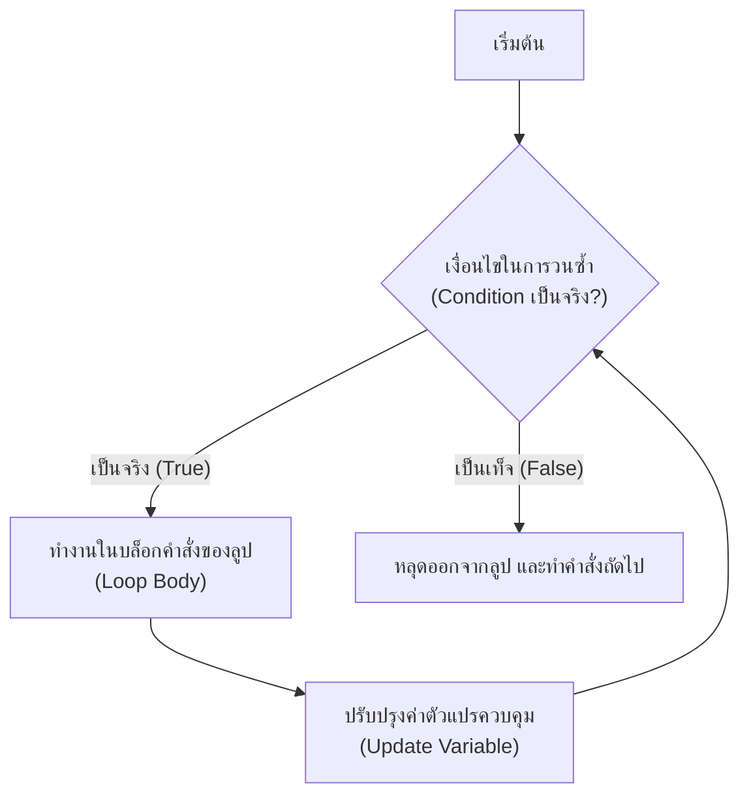
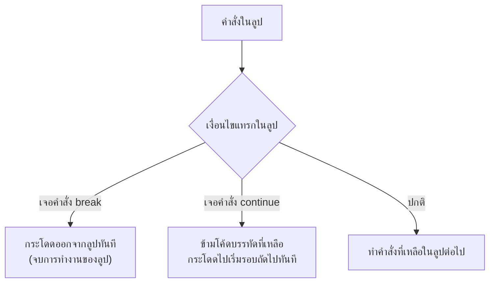
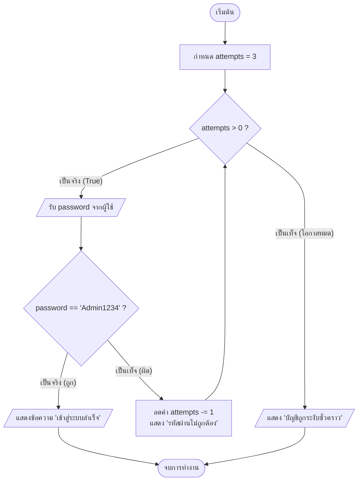

# บทที่ 6 — โครงสร้างควบคุมแบบทำซ้ำ (while loop, break, continue)

*(Looping Structure: การทำซ้ำด้วยเงื่อนไข -> ควบคุมการหลุดลูปด้วย break -> ข้ามรอบด้วย continue -> ผังงาน Looping Flowchart)*

> [!NOTE]
> **ข้อมูลบทเรียนประจำสัปดาห์**
>
> | รายการ | รายละเอียด |
> | :--- | :--- |
> | รายวิชา | `31909-1007` การเขียนโปรแกรมด้วยภาษาไพธอน (Python Programming) |
> | ระดับชั้น | ประกาศนียบัตรวิชาชีพชั้นสูง (ปวส.) ชั้นปีที่ 1 สาขาวิชาเทคโนโลยีคอมพิวเตอร์ |
> | สัปดาห์ / หน่วยการเรียน | สัปดาห์ที่ 7 / หน่วยที่ 4 (โครงสร้างการวนซ้ำและผังงานการทำงานซ้ำ) |
> | เวลาจัดการเรียนรู้ | 4 ชั่วโมง (ทฤษฎี 2 คาบ และปฏิบัติ 2 คาบ: 08.00–12.00 น.) |
> | ห้องเรียน | ห้องปฏิบัติการ 1441 |
> | ต่อจาก | [[บทที่ 5 - โครงสร้างควบคุมแบบเลือกทำขั้นสูง (if elif else match-case)]] |
> | ปูทางสู่ | สัปดาห์ที่ 8: โครงสร้างการวนซ้ำแบบจำกัดรอบ (for loop) และฟังก์ชัน `range()` |
> | ภาระงานปฏิบัติการ | **ใบงานที่ 6** — ระบบตรวจสอบรหัสผ่าน 3 ครั้ง และระบบเมนูช่างคอมพิวเตอร์ |

> [!IMPORTANT]
> **เป้าหมายการเรียนรู้ประจำบท**
> เมื่อเรียนจบบทนี้แล้ว นักศึกษาสามารถ:
> 1. อธิบายความจำเป็นและประโยชน์ของโครงสร้างการวนซ้ำ (Repetition / Looping) ในงานเขียนโปรแกรมได้
> 2. อธิบายองค์ประกอบ 3 ส่วนที่จำเป็นของลูป (Initialization, Condition, Update) ได้อย่างถูกต้อง
> 3. เขียนโปรแกรมภาษาไพธอนโดยใช้คำสั่ง **`while`** ในรูปแบบนับรอบ (Counter-Controlled) และรูปแบบใช้ค่ายุติ (Sentinel-Controlled) ได้
> 4. วิเคราะห์สาเหตุของ **Infinite Loop (ลูปไม่รู้จบ)** และบอกวิธีป้องกันรวมถึงการหยุดการทำงานได้อย่างถูกต้อง
> 5. ประยุกต์ใช้คำสั่ง **`break`** เพื่อหยุดลูปก่อนกำหนด และคำสั่ง **`continue`** เพื่อข้ามรอบการทำงานได้ตามตรรกะที่ต้องการ
> 6. เข้าใจและใช้งานบล็อกคำสั่ง **`while-else`** ร่วมกับการตรวจสอบเงื่อนไขความปลอดภัยได้
> 7. ออกแบบและอ่านผังงานการทำงานซ้ำ (**Looping Flowchart**) ตามมาตรฐาน ANSI แล้วแปลงเป็นโค้ดไพธอนได้อย่างแม่นยำ

---

## 1. ทำไมต้องมีการวนซ้ำ (The Need for Looping)

### 1.1 ปัญหาของการเขียนโปรแกรมแบบเดิม (Manual Copy-Paste)

ในบทที่ 1 ถึงบทที่ 5 โค้ดของเราทำงานแบบ **ไหลลงจากบนลงล่าง (Sequential)** หรือ **เลือกทำทางใดทางหนึ่งแล้วจบ (Selection: if-else)** 

สมมุติว่าครูสั่งให้นักศึกษาเขียนโปรแกรมพิมพ์ข้อความ *"ยินดีต้อนรับสู่วิทยาลัยเทคนิคลพบุรี"* ออกมา **5 ครั้ง**:

```python
# วิธีเดิม: พิมพ์คำสั่งซ้ำกัน 5 บรรทัด
print("ยินดีต้อนรับสู่วิทยาลัยเทคนิคลพบุรี")
print("ยินดีต้อนรับสู่วิทยาลัยเทคนิคลพบุรี")
print("ยินดีต้อนรับสู่วิทยาลัยเทคนิคลพบุรี")
print("ยินดีต้อนรับสู่วิทยาลัยเทคนิคลพบุรี")
print("ยินดีต้อนรับสู่วิทยาลัยเทคนิคลพบุรี")
```

วิธีนี้อาจจะยังพอทำได้ แต่ถ้าโจทย์เปลี่ยนเป็น:
* *"จงพิมพ์ข้อความนี้ **1,000 ครั้ง**"*
* *"จงอ่านค่าจากเซนเซอร์ตรวจจับอุณหภูมิห้องเซิร์ฟเวอร์ **ไปเรื่อยๆ จนกว่าไฟจะดับ**"*
* *"จงให้ผู้ใช้กรอกรหัสผ่าน **จนกว่าจะถูกต้อง แต่ไม่เกิน 3 ครั้ง**"*

การเขียน Copy-Paste คำสั่งเดิมซ้ำๆ หลายพันบรรทัดย่อมเป็นไปไม่ได้ โค้ดจะยาวมหาศาล แก้ไขยาก และเกิดข้อผิดพลาดได้ง่าย

### 1.2 คอมพิวเตอร์ = เครื่องจักรทำงานซ้ำที่ไม่รู้จักเหน็ดเหนื่อย

จุดเด่นที่สุดของคอมพิวเตอร์ที่เหนือกว่ามนุษย์ ไม่ใช่ความคิดสร้างสรรค์ แต่คือ **"ความสามารถในการทำงานซ้ำๆ (Repetition) นับล้านครั้งด้วยความเร็วคงที่และไม่มีวันเบื่อหรือเมื่อยล้า"**

ในภาษาไพธอน เรามีคำสั่งสำหรับสั่งให้โปรแกรมย้อนกลับไปทำชุดคำสั่งเดิมซ้ำๆ เรียกว่า **Loop (วงวน / โครงสร้างการวนซ้ำ)** โดยในบทนี้เราจะเรียนรู้ลูปพื้นฐานที่ทรงพลังที่สุด นั่นคือ **`while loop`**



---

## 2. ไวยากรณ์และกฎ 3 ประการของ while loop

### 2.1 ไวยากรณ์คำสั่ง (Syntax)

คำว่า **`while`** ในภาษาอังกฤษแปลว่า *"ในขณะที่..."* 
ดังนั้น โครงสร้างนี้จึงมีความหมายว่า **"ในขณะที่เงื่อนไขยังคงเป็นจริง (True) ให้ทำคำสั่งในบล็อกซ้ำไปเรื่อยๆ แต่เมื่อใดที่เงื่อนไขกลายเป็นเท็จ (False) ให้หยุดทำทันที"**

```python
while เงื่อนไข_boolean:
    คำสั่งที่ 1 (ต้องย่อหน้าเข้ามา 4 ช่อง)
    คำสั่งที่ 2
    คำสั่งอัปเดตตัวแปร
```

### 2.2 กฎ 3 ประการของลูปที่สมบูรณ์ (The 3 Essentials of Loop Control)

ในการสร้างลูปที่ทำงานได้อย่างถูกต้องและไม่ค้าง นักศึกษาต้องสร้างให้ครบ **3 องค์ประกอบ** เสมอ:

1. **การกำหนดค่าเริ่มต้น (Initialization):** ประกาศตัวแปรนับรอบก่อนเข้าลูป
2. **การตรวจสอบเงื่อนไข (Condition):** เงื่อนไขเปรียบเทียบในบรรทัด `while` ว่าเมื่อไรควรทำต่อ
3. **การปรับปรุงค่าตัวแปร (Update):** การเพิ่มหรือลดค่าตัวแปรภายในลูป เพื่อให้เงื่อนไขมีโอกาสกลายเป็นเท็จได้ในที่สุด

```python
# ตัวอย่างที่ 1: พิมพ์ตัวเลข 1 ถึง 5
count = 1                # 1. Initialization (เริ่มต้นที่ 1)

while count <= 5:        # 2. Condition (ทำซ้ำตราบเท่าที่ count ยังไม่เกิน 5)
    print("รอบที่:", count)
    count = count + 1    # 3. Update (เพิ่มค่าทีละ 1 หรือเขียนว่า count += 1)

print("จบลูปแล้ว!")
```

**ผลลัพธ์ของโปรแกรม:**
```text
รอบที่: 1
รอบที่: 2
รอบที่: 3
รอบที่: 4
รอบที่: 5
จบลูปแล้ว!
```

> [!NOTE]
> **การแกะรอยการทำงานทีละรอบ (Trace Table / Walkthrough):**
> * **ก่อนเริ่ม:** `count = 1`
> * **รอบที่ 1:** ตรวจสอบ `1 <= 5` เป็น True -> พิมพ์ `รอบที่: 1` -> อัปเดต `count = 1 + 1 = 2`
> * **รอบที่ 2:** ตรวจสอบ `2 <= 5` เป็น True -> พิมพ์ `รอบที่: 2` -> อัปเดต `count = 2 + 1 = 3`
> * **รอบที่ 3:** ตรวจสอบ `3 <= 5` เป็น True -> พิมพ์ `รอบที่: 3` -> อัปเดต `count = 3 + 1 = 4`
> * **รอบที่ 4:** ตรวจสอบ `4 <= 5` เป็น True -> พิมพ์ `รอบที่: 4` -> อัปเดต `count = 4 + 1 = 5`
> * **รอบที่ 5:** ตรวจสอบ `5 <= 5` เป็น True -> พิมพ์ `รอบที่: 5` -> อัปเดต `count = 5 + 1 = 6`
> * **รอบที่ 6:** ตรวจสอบ `6 <= 5` เป็น **False** -> หลุดออกจากลูปทันที -> พิมพ์ `จบลูปแล้ว!`

---

### 2.3 ตัวอย่างเพิ่มเติม: การนับถอยหลังและการสะสมค่า (Accumulator Pattern)

#### ตัวอย่าง: นับถอยหลังระเบิดเวลา (Countdown)
ลูปไม่จำเป็นต้องเพิ่มค่าขึ้นเสมอไป เราสามารถปรับลดค่าลงได้ด้วยการลบ (`-= 1`):

```python
timer = 5

while timer > 0:
    print(f"เตรียมพร้อม... {timer}")
    timer -= 1

print("ยิงจรวดขึ้นสู่อวกาศ! (Launch)")
```

```text
เตรียมพร้อม... 5
เตรียมพร้อม... 4
เตรียมพร้อม... 3
เตรียมพร้อม... 2
เตรียมพร้อม... 1
ยิงจรวดขึ้นสู่อวกาศ! (Launch)
```

#### ตัวอย่าง: หาผลรวมตัวเลข 1 ถึง 10 (Accumulator Pattern)
การหาผลรวมสะสม เป็นรูปแบบการเขียนโค้ดที่พบบ่อยที่สุดในงานฐานข้อมูลและรายงานสถิติ:

```python
total_sum = 0
number = 1

while number <= 10:
    total_sum += number  # สะสมค่าเดิม + ค่ารอบปัจจุบัน
    number += 1

print("ผลรวมของตัวเลขตั้งแต่ 1 ถึง 10 มีค่าเท่ากับ:", total_sum)
```

```text
ผลรวมของตัวเลขตั้งแต่ 1 ถึง 10 มีค่าเท่ากับ: 55
```

---

## 3. กับดักร้ายแรง: ลูปไม่รู้จบ (Infinite Loop)

### 3.1 ลูปไม่รู้จบคืออะไร?

> **Infinite Loop (ลูปไม่รู้จบ)** คือ สถานะที่เงื่อนไขของลูป **เป็นจริง (True) ตลอดกาล** ส่งผลให้โปรแกรมทำงานวนซ้ำอย่างไม่หยุดยั้ง CPU จะทำงาน 100% พัดลมเครื่องคอมพิวเตอร์จะเริ่มหมุนดัง และโปรแกรมจะไม่ตอบสนองต่อคำสั่งใดๆ

ลองดูตัวอย่างโค้ดที่ผิดพลาด:

```python
# ข้อผิดพลาดคลาสสิก: ลืมบรรทัดอัปเดตค่า count
count = 1

while count <= 5:
    print("รอบที่:", count)
    # ลืมเขียน count += 1 ทำให้ count เป็น 1 เสมอ ไม่มีวันมากกว่า 5!
```

```text
รอบที่: 1
รอบที่: 1
รอบที่: 1
(ข้อความวิ่งรัวๆ ไม่หยุด หน้าจอค้าง)
```

### 3.2 วิธียกเลิกและหยุดการทำงานฉุกเฉิน

หากนักศึกษาเผลอรันโปรแกรมที่ติด Infinite Loop ในหน้าจอ Terminal หรือ VS Code:
* ให้กดปุ่มคีย์ลัด **`Ctrl + C`** บนคีย์บอร์ดพร้อมกันทันที
* ไพธอนจะสั่งหยุดโปรแกรมด้วยข้อผิดพลาด `KeyboardInterrupt`

> [!WARNING]
> **ข้อควรระวังเรื่อง Off-by-One Error (นับขาดหรือเกิน 1 รอบ):**
> สังเกตความแตกต่างของเครื่องหมายเปรียบเทียบ:
> * `while count < 5:` เมื่อ `count` เริ่มจาก 1 จะทำงานแค่ **4 รอบ** (รอบ 1, 2, 3, 4)
> * `while count <= 5:` เมื่อ `count` เริ่มจาก 1 จะทำงานครบ **5 รอบ** (รอบ 1, 2, 3, 4, 5)
> ตรวจสอบเงื่อนไขทุกครั้งว่าโจทย์ต้องการให้นับรวมตัวสุดท้ายด้วยหรือไม่

---

## 4. รูปแบบการใช้งาน while loop ในงานจริง (Real-World Patterns)

ในชีวิตจริงของการเขียนโปรแกรม เราไม่ได้นับแค่ตัวเลข 1 ถึง 5 แต่เราใช้ `while` ใน 3 รูปแบบหลัก:

### 4.1 รูปแบบที่ 1: ตรวจสอบความถูกต้องของข้อมูล (Input Validation Loop)
บังคับให้ผู้ใช้กรอกข้อมูลจนกว่าจะถูกต้อง หากกรอกผิดจะวนถามซ้ำไปเรื่อยๆ:

```python
score = float(input("กรุณากรอกคะแนนสอบ (0.0 - 100.0): "))

# ตราบใดที่คะแนนน้อยกว่า 0 หรือมากกว่า 100 แสดงว่ากรอกผิด -> วนถามใหม่
while score < 0.0 or score > 100.0:
    print("ข้อผิดพลาด: คะแนนต้องอยู่ระหว่าง 0.0 ถึง 100.0 เท่านั้น!")
    score = float(input("กรุณากรอกคะแนนสอบใหม่อีกครั้ง: "))

print(f"บันทึกคะแนนสำเร็จ: {score} คะแนน")
```

```text
กรุณากรอกคะแนนสอบ (0.0 - 100.0): 120
ข้อผิดพลาด: คะแนนต้องอยู่ระหว่าง 0.0 ถึง 100.0 เท่านั้น!
กรุณากรอกคะแนนสอบใหม่อีกครั้ง: -5
ข้อผิดพลาด: คะแนนต้องอยู่ระหว่าง 0.0 ถึง 100.0 เท่านั้น!
กรุณากรอกคะแนนสอบใหม่อีกครั้ง: 85.5
บันทึกคะแนนสำเร็จ: 85.5 คะแนน
```

---

### 4.2 รูปแบบที่ 2: ใช้ค่ายุติการทำงาน (Sentinel-Controlled Loop)
วนรับข้อมูลไปเรื่อยๆ โดยไม่จำกัดจำนวนรอบ จนกว่าผู้ใช้จะส่งสัญญาณยุติ เช่น พิมพ์ตัวเลข `0` หรือพิมพ์คำว่า `"exit"`:

```python
total_price = 0.0

print("=== ระบบคิดราคาสินค้า (พิมพ์ 0 เมื่อคิดเงินเสร็จ) ===")

price = float(input("ราคาสินค้า (บาท): "))

while price != 0:
    total_price += price
    print(f"ยอดสะสมปัจจุบัน: {total_price:,.2f} บาท")
    price = float(input("ราคาสินค้าชิ้นถัดไป (พิมพ์ 0 เพื่อจบ): "))

print("========================================")
print(f"ยอดเงินรวมทั้งสิ้นที่ต้องชำระ: {total_price:,.2f} บาท")
```

---

## 5. คำสั่งควบคุมลูปขั้นสูง: break และ continue

บางครั้งเงื่อนไขที่หัวลูป `while` เพียงอย่างเดียวไม่เพียงพอต่อการควบคุมตรรกะที่ซับซ้อน ไพธอนจึงมีคำสั่งพิเศษ 2 ตัว:



### 5.1 คำสั่ง `break` (ตัดจบและออกจากลูปทันที)

คำสั่ง **`break`** ทำหน้าที่สั่งให้โปรแกรม **"หยุดทำลูปและกระโดดข้ามออกไปทันที"** โดยไม่สนใจว่าเงื่อนไขของ `while` จะยังเป็นจริงอยู่หรือไม่

```python
# ตัวอย่าง: หาตัวเลขแรกที่หารด้วย 7 ลงตัว
number = 1

while number <= 100:
    if number % 7 == 0:
        print(f"พบตัวเลขแรกที่หารด้วย 7 ลงตัวแล้วคือ: {number}")
        break  # เจอแล้ว ตัดจบทันที ไม่ต้องเสียเวลานับต่อจนถึง 100
    number += 1

print("จบการค้นหา")
```

```text
พบตัวเลขแรกที่หารด้วย 7 ลงตัวแล้วคือ: 7
จบการค้นหา
```

#### รูปแบบยอดนิยม: `while True:` ร่วมกับ `break`
โปรแกรมระบบเซิร์ฟเวอร์ หรือโปรแกรมหน้าจอเมนูส่วนใหญ่นิยมเปิดลูปค้างไว้ตลอดกาลด้วย `while True:` แล้วใช้ `if` ร่วมกับ `break` ในการเลือกจุดออกจากระบบ:

```python
while True:
    command = input("พิมพ์คำสั่ง (help, status, exit): ").lower().strip()
    
    if command == "exit":
        print("ปิดโปรแกรมเรียบร้อยแล้ว สวัสดีครับ")
        break  # หลุดออกจาก while True ทันที
    elif command == "help":
        print("คู่มือ: พิมพ์ status เพื่อดูระบบ, exit เพื่อออก")
    elif command == "status":
        print("ระบบเซิร์ฟเวอร์: ทำงานปกติ (Online)")
    else:
        print("ไม่พบคำสั่งนี้ กรุณาพิมพ์ใหม่")
```

---

### 5.2 คำสั่ง `continue` (ข้ามรอบปัจจุบัน ไปรอบถัดไปทันที)

คำสั่ง **`continue`** ทำหน้าที่สั่งให้โปรแกรม **"ข้ามบรรทัดคำสั่งที่เหลืออยู่ในรอบปัจจุบัน แล้วกระโดดกลับไปตรวจสอบเงื่อนไขที่หัวลูปเพื่อเริ่มรอบถัดไปทันที"**

```python
# ตัวอย่าง: พิมพ์เฉพาะเลขคี่ 1 ถึง 10 (ข้ามเลขคู่)
num = 0

while num < 10:
    num += 1
    
    # ถ้าเป็นเลขคู่ (หาร 2 ลงตัว) ให้ข้ามไปรอบถัดไปเลย ไม่ต้องพิมพ์
    if num % 2 == 0:
        continue
        
    print("ตัวเลขคี่:", num)
```

```text
ตัวเลขคี่: 1
ตัวเลขคี่: 3
ตัวเลขคี่: 5
ตัวเลขคี่: 7
ตัวเลขคี่: 9
```

> [!TIP]
> **ตารางเปรียบเทียบความแตกต่างระหว่าง `break` กับ `continue`**
>
> | คุณลักษณะ | คำสั่ง `break` | คำสั่ง `continue` |
> | :--- | :--- | :--- |
> | **พฤติกรรม** | สั่งยุติลูปถาวร กระโดดออกจากลูปไปทำคำสั่งหลังลูปทันที | ยุติเฉพาะรอบปัจจุบัน แล้วกระโดดไปเริ่มรอบถัดไปทันที |
> | **รอบที่เหลือ** | รอบที่เหลือทั้งหมด **ถูกยกเลิก ไม่ทำอีกต่อไป** | รอบที่เหลือยังคง **ทำตามปกติ** |
> | **ตัวอย่างการใช้** | เมื่อเจอรหัสผ่านถูกต้อง, เมื่อกดเลือกเมนูออกจากโปรแกรม | เมื่อเจอข้อมูลขยะ, เมื่อต้องการข้าม IP พิเศษที่ไม่ต้องการสแกน |

---

## 6. คำสั่งพิเศษของภาษาไพธอน: `while - else`

ภาษาไพธอนมีความสามารถพิเศษที่ไม่เหมือนภาษา C หรือ Java นั่นคือโครงสร้าง **`while - else`**

```python
while เงื่อนไข:
    # คำสั่งในลูป
else:
    # คำสั่งที่จะทำงานเมื่อลูปจบลงตามปกติ (เงื่อนไขกลายเป็น False)
```

> [!IMPORTANT]
> **กฎเหล็กของ `while - else`:**
> 1. บล็อก **`else` จะทำงาน** ก็ต่อเมื่อ ลูปวนจนเงื่อนไขกลายเป็น `False` ตามธรรมชาติ
> 2. บล็อก **`else` จะไม่ทำงานเด็ดขาด** หากลูปถูกตัดจบด้วยคำสั่ง **`break`**

### ตัวอย่าง: ระบบล็อกอินใส่รหัสผ่านได้ไม่เกิน 3 ครั้ง

```python
attempts = 3

while attempts > 0:
    password = input(f"กรุณากรอกรหัสผ่าน (เหลือโอกาส {attempts} ครั้ง): ")
    
    if password == "Admin1234":
        print("เข้าสู่ระบบสำเร็จ ยินดีต้อนรับผู้ดูแลระบบ!")
        break  # ถ้ารหัสผ่านถูก จะสั่ง break หลุดออกไปเลย (บล็อก else จะไม่ทำงาน)
        
    print("รหัสผ่านไม่ถูกต้อง!")
    attempts -= 1
else:
    # ส่วนนี้จะทำงานเฉพาะตอนที่ใช้โอกาสจนหมดครบ 3 ครั้ง (attempts กลายเป็น 0)
    print("แจ้งเตือน: คุณกรอกรหัสผ่านผิดเกิน 3 ครั้ง บัญชีถูกระงับชั่วคราว!")
```

**กรณีที่ 1: กรอกรหัสถูกต้องในครั้งที่ 2**
```text
กรุณากรอกรหัสผ่าน (เหลือโอกาส 3 ครั้ง): 1111
รหัสผ่านไม่ถูกต้อง!
กรุณากรอกรหัสผ่าน (เหลือโอกาส 2 ครั้ง): Admin1234
เข้าสู่ระบบสำเร็จ ยินดีต้อนรับผู้ดูแลระบบ!
```

**กรณีที่ 2: กรอกรหัสผิดครบ 3 ครั้ง**
```text
กรุณากรอกรหัสผ่าน (เหลือโอกาส 3 ครั้ง): 1111
รหัสผ่านไม่ถูกต้อง!
กรุณากรอกรหัสผ่าน (เหลือโอกาส 2 ครั้ง): 2222
รหัสผ่านไม่ถูกต้อง!
กรุณากรอกรหัสผ่าน (เหลือโอกาส 1 ครั้ง): 3333
รหัสผ่านไม่ถูกต้อง!
แจ้งเตือน: คุณกรอกรหัสผ่านผิดเกิน 3 ครั้ง บัญชีถูกระงับชั่วคราว!
```

---

## 7. ผังงานการทำงานซ้ำ (Looping Flowchart) ตามมาตรฐาน ANSI

ในการเขียนผังงานสำหรับลูป `while` เราจะใช้สัญลักษณ์มาตรฐาน ANSI ดังนี้:
* **สี่เหลี่ยมข้าวหลามตัด (Decision Diamond):** ใช้สำหรับเงื่อนไข `while`
* **เส้นลูกศรย้อนกลับ (Loop Back Arrow):** ลากจากด้านล่างของบล็อกคำสั่ง ย้อนกลับขึ้นไปชี้ที่หัวรูปข้าวหลามตัด



---

## 8. ตัวอย่างการประยุกต์ใช้งานในงานช่างเทคนิคคอมพิวเตอร์

### ตัวอย่าง: โปรแกรมเมนูตรวจสอบระบบและเครื่องมือช่าง (Technician Tool Menu)

```python
# โปรแกรมจำลองชุดเครื่องมือช่างเทคนิคคอมพิวเตอร์ประจำห้อง 1441
import sys

while True:
    print("\n==========================================")
    print("   LBTECH PC DIAGNOSTIC TOOL V.1.0")
    print("==========================================")
    print("1. ตรวจสอบการเชื่อมต่อเครือข่าย (Ping Gateway)")
    print("2. ตรวจสอบสถานะการใช้งานแรม (RAM Usage)")
    print("3. ตรวจสอบอุณหภูมิซีพียู (CPU Temperature)")
    print("4. ออกจากโปรแกรม")
    print("==========================================")
    
    choice = input("กรุณาเลือกรายการ [1-4]: ").strip()
    
    if choice == "1":
        print("\n[ระบบ] กำลังทดสอบส่งสัญญาณ Ping ไปยัง 192.168.1.1...")
        retry = 1
        while retry <= 4:
            print(f"Reply from 192.168.1.1: bytes=32 time={retry * 3}ms TTL=64")
            retry += 1
        print("[สำเร็จ] เครือข่ายเชื่อมต่อได้ปกติ")
        
    elif choice == "2":
        print("\n[ระบบ] กำลังอ่านค่าหน่วยความจำ...")
        total_ram = 16.0
        used_ram = 6.4
        print(f"หน่วยความจำทั้งหมด: {total_ram} GB | กำลังใช้งาน: {used_ram} GB (40%)")
        
    elif choice == "3":
        print("\n[ระบบ] กำลังอ่านค่าอุณหภูมิเซนเซอร์...")
        temp = 48.5
        print(f"อุณหภูมิแกนประมวลผล: {temp} °C (สถานะ: ปกติ)")
        
    elif choice == "4":
        print("\nขอบคุณที่ใช้งานโปรแกรม ปิดระบบเรียบร้อย...")
        break  # หลุดออกจากลูปเมนูทันที
        
    else:
        print("\n[ข้อผิดพลาด] ตัวเลือกไม่ถูกต้อง! กรุณาพิมพ์ตัวเลข 1, 2, 3 หรือ 4 เท่านั้น")
```

---

## 9. สรุปสาระสำคัญประจำบท (Chapter Summary)

> [!NOTE]
> **สรุปคำสั่งและกฎสำคัญของ while loop:**
> 1. **`while` loop** เหมาะสำหรับการทำงานซ้ำที่ไม่ทราบจำนวนรอบที่แน่นอน โดยทำงานตามเงื่อนไขที่กำหนด
> 2. ลูปที่ดีต้องมี 3 ส่วนเสมอ: **กำหนดค่าเริ่มต้น (Init) -> ตรวจเงื่อนไข (Condition) -> ปรับค่าตัวแปร (Update)**
> 3. หากลืมปรับปรุงค่าตัวแปร จะเกิด **Infinite Loop (ลูปไม่รู้จบ)** แก้ไขเบื้องต้นด้วยการกด `Ctrl + C`
> 4. คำสั่ง **`break`** ใช้สั่งยุติลูปทันที นิยมใช้ร่วมกับ `while True:` เมื่อเจอปัจจัยออกจากระบบ
> 5. คำสั่ง **`continue`** ใช้สั่งข้ามการประมวลผลรอบปัจจุบัน เพื่อไปเริ่มตรวจสอบเงื่อนไขรอบถัดไป
> 6. บล็อก **`while - else`** จะทำงานเมื่อลูปจบลงตามปกติ แต่จะไม่ทำงานหากลูปถูกตัดจบด้วย `break`

---

### กิจกรรมและใบงานต่อเนื่อง
ให้นักศึกษาเปิดดูข้อกำหนดของใบงานประจำสัปดาห์ที่ 7 เพื่อฝึกปฏิบัติการเขียนผังงานและการเขียนโค้ดลูปจริง:
* **ใบงานปฏิบัติการ:** [[ใบงานที่ 6 - ระบบตรวจสอบรหัสผ่านและเมนูช่างคอมพิวเตอร์]]
