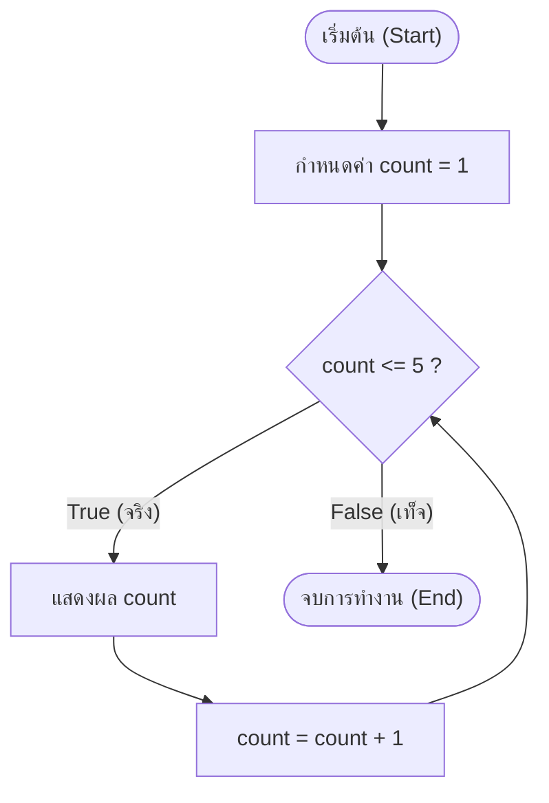

# บทที่ 6–7 (สอนควบ) — โครงสร้างควบคุมแบบทำซ้ำ (`while` loop และ `for` loop)

*(หน่วยที่ 4 ฉบับรวม: ทำซ้ำตามเงื่อนไขด้วย `while` -> ควบคุมลูปด้วย `break`/`continue` -> ทำซ้ำตามรอบด้วย `for` และ `range()` -> ลูปซ้อนลูป -> ผังงาน Looping Flowchart)*

> [!NOTE]
> **ข้อมูลบทเรียนประจำสัปดาห์ (ชดเชยสัปดาห์ที่ 7 วันหยุด)**
>
> | รายการ | รายละเอียด |
> | :--- | :--- |
> | รายวิชา | `31909-1007` การเขียนโปรแกรมด้วยภาษาไพธอน (Python Programming) |
> | ระดับชั้น | ประกาศนียบัตรวิชาชีพชั้นสูง (ปวส.) ชั้นปีที่ 1 กลุ่ม 1สทค1 |
> | หน่วยการเรียนรู้ | หน่วยที่ 4 — โครงสร้างการวนซ้ำและผังงานการทำงานซ้ำ |
> | เวลาจัดการเรียนรู้ | 4 ชั่วโมง (08.00–12.00 น.) ห้องปฏิบัติการ 1441 |
> | ต่อจาก | [[บทที่ 5 - โครงสร้างควบคุมแบบเลือกทำขั้นสูง (if elif else match-case)]] |
> | ปูทางสู่ | สัปดาห์ที่ 9: สอบวัดผลกลางภาคเรียน (Flowchart + เขียนโค้ดแก้โจทย์) |
> | ภาระงานปฏิบัติการ | [[ใบงานที่ 6-7 - การวนซ้ำด้วย while loop และ for loop]] |

> [!IMPORTANT]
> **เป้าหมายการเรียนรู้ประจำคาบ**
> เมื่อเรียนจบบทนี้แล้ว นักศึกษาสามารถ:
> 1. อธิบายเหตุผลของการใช้โครงสร้างวนซ้ำ (Looping) และความแตกต่างระหว่าง **`while` loop** กับ **`for` loop** ได้
> 2. เขียนคำสั่ง `while` ตามกฎ 3 ข้อ (เริ่มต้น, เงื่อนไข, ปรับค่า) และป้องกัน **Infinite Loop** ได้
> 3. ประยุกต์ใช้ **`break`** (หยุดทันที) และ **`continue`** (ข้ามรอบ) ร่วมกับลูปได้ถูกต้อง
> 4. ใช้คำสั่ง **`for`** ร่วมกับฟังก์ชัน **`range()`** ทั้ง 3 รูปแบบ (1, 2 และ 3 พารามิเตอร์) เพื่อวนซ้ำตามจำนวนรอบที่กำหนดได้
> 5. ใช้งานลูปวนผ่านข้อความ (String) และเขียน **Nested Loop** (ลูปซ้อนลูป) เพื่อสร้างตารางข้อมูลได้
> 6. อ่านและเขียนผังงานการทำงานซ้ำ (**Looping Flowchart**) ตามมาตรฐาน ANSI แล้วแปลงเป็นโค้ดไพธอนได้

> [!ABSTRACT] เกริ่นนำ: จากโปรแกรม "ใช้ครั้งเดียวทิ้ง" สู่โปรแกรมที่ทำงานได้จริง
> ตลอด 5 บทที่ผ่านมา เราได้เรียนรู้การสั่งงานคอมพิวเตอร์แบบ **เรียงลำดับจากบนลงล่าง (Sequence)** ในบทที่ 1–3 และอัปเกรดให้โปรแกรม **"คิดและตัดสินใจเลือกทางเดินได้" (`if - elif - else`)** ในบทที่ 4–5
>
> แต่ลองสังเกตดูให้ดีครับว่า โปรแกรมที่เราเขียนมาทั้งหมดยังมีข้อจำกัดใหญ่อยู่ 1 อย่าง คือ **"ทำงานแค่รอบเดียวแล้วจบเลย"**
> - ลองจินตนาการว่าถ้า **ตู้ ATM** รับบัตรกดเงินเสร็จ 1 ครั้งแล้วโปรแกรมปิดตัวเองไปเลย คนต่อคิวคงต้องรีสตาร์ตตู้ใหม่ทุกครั้ง
> - ถ้า **ระบบสแกนไวรัส** ตรวจไฟล์แค่ 1 ไฟล์แล้วหยุดทำงาน เราคงต้องกดสแกนด้วยมือเป็นหมื่นรอบ
> - ถ้า **เกม** จบ 1 ตาแล้วเด้งหลุดออกจากหน้าจอ ผู้เล่นคงลบทิ้งทันที
>
> ในโลกความเป็นจริง หัวใจที่ทำให้คอมพิวเตอร์ทรงพลังกว่ามนุษย์ไม่ใช่แค่ความเร็วในการคิดเลข แต่คือ **"ความอึดในการทำงานซ้ำ ๆ"** — มนุษย์พิมพ์งานซ้ำเรื่องเดิม 100 รอบก็เริ่มเบื่อ เริ่มเบลอและพิมพ์ผิด แต่คอมพิวเตอร์สามารถทำคำสั่งเดิมซ้ำ 1,000,000 รอบได้ภายในเสี้ยววินาทีโดยไม่มีคำว่าเหนื่อยหรือบ่น
>
> ในคาบเรียนวันนี้ เราจะปลดล็อกความสามารถที่สำคัญที่สุดอีก 1 อย่างของการเขียนโปรแกรม นั่นคือ **โครงสร้างควบคุมแบบทำซ้ำ (Looping)** ทั้ง **`while` loop** (ทำซ้ำตราบใดที่เงื่อนไขยังเป็นจริง) และ **`for` loop** (ทำซ้ำตามจำนวนรอบที่กำหนด) เพื่อให้โค้ดของเรามีชีวิต ทำงานต่อเนื่อง และรับมือกับงานซ้ำซ้อนจำนวนมากได้ด้วยโค้ดเพียงไม่กี่บรรทัดครับ

---

## แผนการแบ่งเวลาสอน 4 ชั่วโมง

| ช่วงเวลา | เนื้อหาที่จะสอน | กิจกรรม / จุดเน้น |
| :---: | :--- | :--- |
| **ชม. 1** | แนวคิดการวนซ้ำ, `while` loop, กฎ 3 ข้อ และ Infinite Loop | สาธิตปัญหา Copy-Paste และทดลองรันลูปนับเลข |
| **ชม. 2** | `break`, `continue`, `while-else`, Sentinel Loop และ Flowchart | ฝึกไล่ตารางค่าตัวแปร (Trace Table) และเขียนผังงาน |
| **ชม. 3** | `for` loop, ฟังก์ชัน `range()` ทั้ง 3 แบบ, วนลูป String, Nested Loop | เปรียบเทียบ `while` vs `for` และสร้างตารางสูตรคูณ |
| **ชม. 4** | ลงมือทำ **ใบงานที่ 6-7** (โจทย์ผสม `while` และ `for`) | นักศึกษาเขียน Flowchart + โค้ดจริง ส่งตรวจในคาบ |

---

## ส่วนที่ 1: ทำไมต้องมีการวนซ้ำ (The Need for Looping)

ลองนึกภาพว่าอาจารย์สั่งให้เขียนโปรแกรมแสดงคำว่า `"กำลังตรวจสอบระบบ..."` ออกทางหน้าจอ **100 บรรทัด**

ถ้าเราใช้ความรู้เก่าจากบทที่ 1–5 เราคงต้องพิมพ์ `print()` ซ้ำกัน 100 บรรทัด ซึ่ง:
- เสียเวลาพิมพ์ และไฟล์โค้ดยาวเกินความจำเป็น
- ถ้าต้องการเปลี่ยนข้อความจาก `"กำลังตรวจสอบระบบ..."` เป็น `"Checking..."` ต้องตามแก้ทั้ง 100 บรรทัด
- ถ้าจำนวนครั้งไม่ได้ตายตัว (เช่น "ทำซ้ำจนกว่าผู้ใช้จะพิมพ์คำว่า exit") เราไม่มีทางรู้ล่วงหน้าว่าต้องก๊อปปี้กี่บรรทัด

**ทางออกคือ "โครงสร้างควบคุมแบบทำซ้ำ (Loop)"** ที่สั่งให้คอมพิวเตอร์ทำชุดคำสั่งเดิมซ้ำ ๆ โดยเขียนโค้ดเพียงไม่กี่บรรทัด

### เปรียบเทียบภาพรวม 2 คำสั่งวนซ้ำใน Python

|   คำสั่ง    | ชื่อเรียกภาษาไทย             | ใช้ตอนไหน?                                                                            | อุปมาในชีวิตจริง                                            |
| :---------: | :--------------------------- | :------------------------------------------------------------------------------------ | :---------------------------------------------------------- |
| **`while`** | วนซ้ำตามเงื่อนไข             | **ยังไม่รู้จำนวนรอบแน่นอน** รู้แค่ว่าต้องทำไปเรื่อย ๆ *ตราบใดที่* เงื่อนไขยังเป็นจริง | "วิ่งรอบสนาม *จนกว่าจะเหนื่อย*" (ไม่รู้ว่าจะจบที่กี่รอบ)    |
|  **`for`**  | วนซ้ำตามจำนวนรอบ / ชุดข้อมูล | **รู้จำนวนรอบแน่นอน** หรือมีรายการข้อมูลอยู่แล้วว่ามีกี่ตัว                           | "วิ่งรอบสนาม *ให้ครบ 5 รอบ*" (รู้ล่วงหน้าว่าต้องทำ 5 ครั้ง) |

---

## ส่วนที่ 2: การวนซ้ำด้วย `while` loop (ทำซ้ำตราบใดที่เงื่อนไขเป็นจริง)

### 2.1 ไวยากรณ์พื้นฐานของ `while`

```python
while เงื่อนไข:
    คำสั่งที่ต้องการให้ทำซ้ำ (ต้องย่อหน้า 4 เคาะ)
```

การทำงาน: Python จะเช็ก **`เงื่อนไข`** ก่อนเสมอ
- ถ้าเป็น **`True`** $\rightarrow$ เข้าไปทำคำสั่งด้านใน $\rightarrow$ วนกลับไปเช็กเงื่อนไขใหม่
- ถ้าเป็น **`False`** $\rightarrow$ ออกจากลูปทันที แล้วไปทำบรรทัดถัดไปนอกลูป

---

### 2.2 กฎ 3 ข้อของ `while` loop ที่สมบูรณ์ (ห้ามลืม!)

เพื่อให้ลูปทำงานถูกต้องและจบลงได้จริง ต้องมีครบ 3 ส่วนนี้:

1. **จุดเริ่มต้น (Initialization):** กำหนดค่าตัวแปรนับรอบก่อนเข้าลูป เช่น `count = 1`
2. **เงื่อนไขการทำงาน (Condition):** ตรวจสอบว่าจะยังทำต่อหรือไม่ เช่น `while count <= 5:`
3. **การปรับค่าตัวแปร (Update):** เปลี่ยนค่าตัวแปรในลูปเพื่อให้วันหนึ่งเงื่อนไขกลายเป็นเท็จ เช่น `count += 1`

#### ตัวอย่างที่ 1: พิมพ์เลข 1 ถึง 5 พร้อมตารางไล่ค่าตัวแปร (Trace Table)

```python
count = 1                  # 1. จุดเริ่มต้น

while count <= 5:          # 2. เงื่อนไข
    print("รอบที่:", count)
    count += 1             # 3. ปรับค่า (บวกเพิ่มทีละ 1)

print("จบการทำงาน!")
```

**ไล่ดูการทำงานทีละรอบ (Trace Table):**

| รอบที่ | ค่า `count` ก่อนเช็ก | เงื่อนไข `count <= 5` | สิ่งที่พิมพ์ออกจอ                               | ค่า `count` หลัง `count += 1` |
| :----: | :------------------: | :-------------------: | :---------------------------------------------- | :---------------------------: |
|   1    |          1           |    `1 <= 5` (True)    | `รอบที่: 1`                                     |               2               |
|   2    |          2           |    `2 <= 5` (True)    | `รอบที่: 2`                                     |               3               |
|   3    |          3           |    `3 <= 5` (True)    | `รอบที่: 3`                                     |               4               |
|   4    |          4           |    `4 <= 5` (True)    | `รอบที่: 4`                                     |               5               |
|   5    |          5           |    `5 <= 5` (True)    | `รอบที่: 5`                                     |               6               |
|   6    |          6           | `6 <= 5` (**False**)  | *(ออกจากลูป)* $\rightarrow$ พิมพ์ `จบการทำงาน!` |               —               |

---

### 2.3 กับดักร้ายแรง: ลูปไม่รู้จบ (Infinite Loop)

ถ้าเราลืม **ข้อ 3 (Update)** เงื่อนไขจะเป็น `True` ตลอดกาล โปรแกรมจะค้างและรันไม่หยุด!

```python
# ตัวอย่างโค้ดผิด (Infinite Loop)
count = 1
while count <= 5:
    print("รอบที่:", count)
    # ลืมเขียน count += 1 ทำให้ count เป็น 1 ตลอดไป!
```

> [!WARNING] วิธีหยุดโปรแกรมเมื่อเผลอทำ Infinite Loop
> หากเห็นข้อความวิ่งรัว ๆ ไม่หยุดใน Terminal หรือ VS Code ให้กดปุ่ม **`Ctrl + C`** บนคีย์บอร์ด เพื่อบังคับหยุดการทำงานของ Python ทันที

---

### 2.4 รูปแบบการใช้งาน `while` ที่พบบ่อย

#### แบบ A: การสะสมผลรวม (Accumulator Pattern)
ตัวอย่าง: บวกเลข 1 ถึง 5 เข้าด้วยกัน (`1 + 2 + 3 + 4 + 5 = 15`)

```python
i = 1
total = 0                  # ตัวแปรถังสะสมคะแนน เริ่มจาก 0

while i <= 5:
    total = total + i      # เอาค่าเดิมมาบวกเพิ่มด้วย i
    i += 1

print("ผลรวมทั้งหมดคือ:", total)  # ผลลัพธ์: 15
```

#### แบบ B: วนซ้ำจนกว่าผู้ใช้จะพิมพ์ค่ายุติ (Sentinel-Controlled Loop)
เหมาะกับงานที่ **ไม่รู้ล่วงหน้า** ว่าผู้ใช้จะกรอกข้อมูลกี่ครั้ง เช่น โปรแกรมคิดเงิน หรือรับคำสั่งจากผู้ใช้

```python
command = ""

while command != "exit":
    command = input("พิมพ์คำสั่ง (พิมพ์ exit เพื่อออก): ")
    if command != "exit":
        print("ระบบกำลังทำงานตามคำสั่ง:", command)

print("ปิดระบบเรียบร้อย")
```

---

## ส่วนที่ 3: คำสั่งควบคุมลูป (`break`, `continue`, `while-else`)

บางครั้งเราต้องการควบคุมลูปให้ยืดหยุ่นขึ้น เช่น หยุดกลางคัน หรือข้ามข้อมูลบางตัวที่ไม่ต้องการ

|     คำสั่ง     | หน้าที่                                                       | เปรียบเทียบง่าย ๆ                          |
| :------------: | :------------------------------------------------------------ | :----------------------------------------- |
|  **`break`**   | **พังลูปแล้วกระโดดออกทันที** (ไม่สนเงื่อนไขแล้ว)              | กดปุ่ม Emergency Stop หยุดเครื่องจักรทันที |
| **`continue`** | **ข้ามคำสั่งที่เหลือในรอบนี้** แล้วเด้งไปเช็กเงื่อนไขรอบถัดไป | กดปุ่ม Skip ข้ามเพลงนี้ไปเล่นเพลงถัดไป     |

### 3.1 ตัวอย่าง `break` คู่กับ `while True:` (ยอดนิยมในงานจริง)

การเขียน `while True:` คือตั้งใจเปิดลูปตลอดเวลา แล้วใช้ `if ...: break` เป็นประตูทางออก

```python
while True:
    pin = input("กรอกรหัส PIN 4 หลัก: ")
    if pin == "1234":
        print("รหัสถูกต้อง ยินดีต้อนรับ!")
        break   # ออกจากลูปทันทีเมื่อรหัสถูก
    else:
        print("รหัสผิด กรุณาลองใหม่")
```

### 3.2 ตัวอย่าง `continue` (ข้ามรอบที่ไม่ต้องการ)

ตัวอย่าง: นับเลข 1 ถึง 5 แต่ไม่แสดงเลข 3 (เช่น ข้ามเลขห้องหรือพอร์ตที่ปิดใช้งาน)

```python
num = 0
while num < 5:
    num += 1           # ต้องบวกก่อน continue เสมอ! ไม่งั้นติด Infinite Loop
    if num == 3:
        continue       # ข้าม print ด้านล่าง แล้วกลับขึ้นไปเช็ก while ใหม่
    print("พอร์ตหมายเลข:", num)
```
**ผลลัพธ์:**
```text
พอร์ตหมายเลข: 1
พอร์ตหมายเลข: 2
พอร์ตหมายเลข: 4
พอร์ตหมายเลข: 5
```

### 3.3 คำสั่งพิเศษ `while - else` (ทำเมื่อจบลูปปกติโดยไม่โดน `break`)

บล็อก `else:` หลัง `while` จะทำงาน **ก็ต่อเมื่อลูปจบลงเพราะเงื่อนไขเป็น False เท่านั้น** (ถ้าหลุดออกมาเพราะโดน `break` ส่วน `else` จะไม่ทำงาน)

```python
# ระบบล็อกอินให้โอกาสกรอกรหัสผิดได้ไม่เกิน 3 ครั้ง
attempt = 1

while attempt <= 3:
    password = input(f"กรอกรหัสผ่าน (ครั้งที่ {attempt}/3): ")
    if password == "admin123":
        print("เข้าสู่ระบบสำเร็จ!")
        break
    print("รหัสไม่ถูกต้อง")
    attempt += 1
else:
    # จะมาทำตรงนี้ก็ต่อเมื่อ attempt > 3 (คือกรอกผิดครบ 3 ครั้ง ไม่เคยเจอ break)
    print("คุณกรอกรหัสผิดครบ 3 ครั้ง บัญชีถูกล็อกชั่วคราว!")
```

---

## ส่วนที่ 4: ผังงานการทำงานซ้ำ (Looping Flowchart)

ในการเขียนผังงานมาตรฐาน ANSI สัญลักษณ์ที่ใช้ควบคุมลูปยังคงใช้ **สี่เหลี่ยมขนมเปียกปูน (Decision)** แต่มี **เส้นลูกศรวนกลับขึ้นไปด้านบน** ก่อนเข้าเงื่อนไขเดิม



> [!TIP] จุดสังเกตเวลาตรวจ Flowchart ของตัวเอง
> 1. ต้องมีเส้นกำหนดค่าเริ่มต้นก่อนเข้าเงื่อนไข (ห้ามเอา `count = 1` ไปไว้ในลูป ไม่งั้นค่าจะรีเซ็ตเป็น 1 ทุกครั้ง)
> 2. เส้นทาง `True` ต้องมีการอัปเดตค่า (เช่น `count = count + 1`) ก่อนวนลูกศรกลับไปที่เงื่อนไข
> 3. ต้องมีเส้นทาง `False` ชี้ออกไปสู่จุดจบหรือขั้นตอนถัดไปเสมอ

---

## ส่วนที่ 5: การวนซ้ำด้วย `for` loop และฟังก์ชัน `range()`

เมื่อเรารู้จำนวนรอบที่แน่นอน หรือต้องการไล่ดูข้อมูลทีละตัว **คำสั่ง `for` จะเขียนสั้น ปลอดภัย และอ่านง่ายกว่า `while` มาก** เพราะไม่ต้องมานั่งประกาศตัวแปรเริ่มต้นและอัปเดตค่าเอง (โอกาสเกิด Infinite Loop แทบเป็นศูนย์!)

### 5.1 ไวยากรณ์พื้นฐานของ `for`

```python
for ตัวแปร in ลำดับข้อมูล:
    คำสั่งที่ต้องการให้ทำซ้ำ
```

---

### 5.2 รู้จักฟังก์ชัน `range()` ผู้ช่วยสร้างตัวเลขให้ `for`

ฟังก์ชัน `range()` ใช้สร้างชุดตัวเลขตามช่วงที่ต้องการ มี 3 รูปแบบการใช้งาน (จำง่าย ๆ ว่า **ตัวเลขจบจะหยุดก่อนถึงค่า `stop` เสมอ**):

| รูปแบบ                         | ความหมาย                                               | ตัวอย่างโค้ด      | เลขที่ได้                   |
| :----------------------------- | :----------------------------------------------------- | :---------------- | :-------------------------- |
| **`range(stop)`**              | เริ่มจาก `0` ไปจนถึง `stop - 1`                        | `range(5)`        | `0, 1, 2, 3, 4` (ได้ 5 ตัว) |
| **`range(start, stop)`**       | เริ่มจาก `start` ไปจนถึง `stop - 1`                    | `range(1, 6)`     | `1, 2, 3, 4, 5`             |
| **`range(start, stop, step)`** | เริ่มจาก `start` ถึงก่อน `stop` โดยเพิ่ม/ลดทีละ `step` | `range(0, 11, 2)` | `0, 2, 4, 6, 8, 10`         |

> [!CAUTION] กฎเหล็กของ `range(start, stop)`
> เลขตัวสุดท้าย **`stop` จะไม่ถูกนับรวม** (Exclusive) เช่น อยากได้เลข `1 ถึง 10` ต้องเขียน `range(1, 11)` ถ้าเขียน `range(1, 10)` จะได้แค่ `1 ถึง 9`!

#### ตัวอย่างที่ 1: `range(stop)` — ทำซ้ำตามจำนวนรอบ
```python
for i in range(5):
    print("สวัสดีรอบที่", i)
```
**ผลลัพธ์:** `0, 1, 2, 3, 4` (ทำงานทั้งหมด 5 รอบพอดี)

#### ตัวอย่างที่ 2: `range(start, stop)` — กำหนดเลขเริ่มต้นและสิ้นสุด
```python
# หาผลรวมเลข 1 ถึง 10 ด้วย for (สั้นกว่า while เยอะ!)
total = 0
for num in range(1, 11):
    total += num

print("ผลรวม 1 ถึง 10 =", total)  # ผลลัพธ์: 55
```

#### ตัวอย่างที่ 3: `range(start, stop, step)` — นับข้ามขั้นและนับถอยหลัง
```python
# นับเพิ่มทีละ 2 (เลขคู่ 2 ถึง 10)
for even in range(2, 11, 2):
    print(even, end=" ")    # ผลลัพธ์: 2 4 6 8 10

print()

# นับถอยหลัง 5 ลงมา 1 (step เป็นค่าติดลบ)
for sec in range(5, 0, -1):
    print("นับถอยหลัง:", sec)
print("ปล่อยจรวด!")
```

---

### 5.3 การใช้ `for` วนซ้ำผ่านข้อความ (String) หรือ List

`for` ไม่ได้ใช้แค่กับตัวเลขใน `range()` แต่สามารถหยิบตัวอักษรในข้อความ หรือข้อมูลในชุดมาทีละตัวได้ทันที

```python
# ตัวอย่าง 1: วนตรวจตัวอักษรในรหัสสินค้า
serial = "CPU-I7"
for ch in serial:
    print("ตัวอักษร:", ch)
```

```python
# ตัวอย่าง 2: วนสแกนรายการอุปกรณ์ในห้องปฏิบัติการ
devices = ["Router", "Switch", "Server", "Firewall"]
for item in devices:
    print("กำลัง Ping ตรวจสอบอุปกรณ์:", item)
```

---

### 5.4 ลูปซ้อนลูป (Nested Loops)

คือการนำลูป `for` ตัวหนึ่งไปวางไว้ข้างในลูป `for` อีกตัวหนึ่ง ใช้กับงานที่เป็น **ตาราง 2 มิติ (แถว x คอลัมน์)** เช่น ตารางสูตรคูณ หรือตารางเวลา

หลักการทำงาน: **ลูปนอกเดิน 1 ก้าว $\rightarrow$ ลูปในต้องหมุนให้ครบรอบของตัวเองทั้งหมด**

#### ตัวอย่าง: สร้างตารางสูตรคูณแม่ 2 ถึง แม่ 3
```python
for mae in range(2, 4):              # ลูปนอก: แม่ 2 และ แม่ 3
    print(f"--- สูตรคูณแม่ {mae} ---")
    for num in range(1, 13):         # ลูปใน: คูณ 1 ถึง 12
        print(f"{mae} x {num} = {mae * num}")
```

---

## ส่วนที่ 6: สรุปเปรียบเทียบ `while` vs `for` (เลือกใช้ให้ถูกงาน)

| เกณฑ์การตัดสินใจ                 | เลือกใช้ `while` loop                                                                                   | เลือกใช้ `for` loop                                                                |
| :------------------------------- | :------------------------------------------------------------------------------------------------------ | :--------------------------------------------------------------------------------- |
| **รู้จำนวนรอบล่วงหน้าไหม?**      | **ไม่รู้แน่นอน** (ขึ้นอยู่กับเหตุการณ์/ผู้ใช้)                                                          | **รู้แน่นอน** (เช่น 10 รอบ, ครบทุกตัวในรายการ)                                     |
| **ตัวอย่างโจทย์ที่เหมาะ**        | - เมนูโปรแกรมที่รันจนกว่าผู้ใช้กดออก<br>- รับรหัสผ่านจนกว่าจะถูก<br>- รอรับค่าจากเซนเซอร์จนกว่าไฟจะเกิน | - พิมพ์สูตรคูณแม่ 2–12<br>- สแกนพอร์ต 80 ถึง 85<br>- คำนวณผลรวมคะแนนนักเรียน 40 คน |
| **ความเสี่ยง Infinite Loop**     | **สูง** (ถ้าลืมอัปเดตตัวแปรหรือไม่มี `break`)                                                           | **ต่ำมาก** (ลูปหยุดเองเมื่อหมดช่วง `range`)                                        |
| **การใช้งาน `break`/`continue`** | ใช้ได้ทั้งคู่                                                                                           | ใช้ได้ทั้งคู่เหมือน `while` ทุกประการ                                              |

---

## ส่วนที่ 7: ตัวอย่างประยุกต์งานช่างเทคนิคคอมพิวเตอร์

### ตัวอย่างรวมมิตร (`while` + `for` + `break` + `continue`):
โปรแกรมเมนูช่างเครือข่ายขนาดเล็ก ที่ให้ผู้ใช้เลือกสแกนพอร์ตได้เรื่อย ๆ จนกว่าจะกด `0` เพื่อออก

```python
while True:
    print("\n=== โปรแกรมเครื่องมือช่างเครือข่าย ===")
    print("1. สแกนพอร์ตช่วงที่กำหนด (for loop)")
    print("2. ตรวจสอบรหัสผ่านอุปกรณ์ (จำกัด 3 ครั้ง)")
    print("0. ออกจากโปรแกรม")

    choice = input("เลือกเมนู (0-2): ")

    if choice == "0":
        print("ออกจากโปรแกรมเรียบร้อย")
        break

    elif choice == "1":
        start_port = int(input("พอร์ตเริ่มต้น: "))
        end_port = int(input("พอร์ตสิ้นสุด: "))
        for port in range(start_port, end_port + 1):
            if port == 23:
                print(f"Port {port}: ข้ามการสแกน (Telnet ไม่ปลอดภัย)")
                continue
            print(f"Scanning Port {port}... [OPEN]")

    elif choice == "2":
        for attempt in range(1, 4):
            pwd = input(f"กรอกรหัสเราเตอร์ (ครั้งที่ {attempt}/3): ")
            if pwd == "cisco123":
                print("เข้าถึงการตั้งค่าเราเตอร์สำเร็จ!")
                break
        else:
            print("กรอกรหัสผิดเกิน 3 ครั้ง! ระงับการเชื่อมต่อ")

    else:
        print("เมนูไม่ถูกต้อง กรุณาเลือก 0, 1 หรือ 2")
```

---

## สรุปสาระสำคัญประจำบท (Cheat Sheet)

1. **`while เงื่อนไข:`** ใช้เมื่อยังไม่รู้จำนวนรอบที่ชัดเจน ต้องมี **จุดเริ่มต้น + เงื่อนไข + ตัวอัปเดต** เสมอ
2. **`for ตัวแปร in range(start, stop, step):`** ใช้เมื่อรู้จำนวนรอบแน่นอน จำไว้ว่า `stop` **ไม่รวมตัวท้าย** (`range(1, 6)` ได้ `1, 2, 3, 4, 5`)
3. **`break`** = หยุดออกจากลูปทันที | **`continue`** = ข้ามรอบนี้ไปเริ่มรอบใหม่ทันที
4. **`while-else` / `for-else`** = ส่วน `else` จะทำงานเมื่อลูปจบปกติโดย **ไม่โดน `break`**
5. หากติด Infinite Loop ให้กด **`Ctrl + C`** เพื่อหยุดโปรแกรมทันที

---

## กิจกรรมและใบงานประจำสัปดาห์

* ลงมือปฏิบัติจริงในคาบชั่วโมงที่ 4: [[ใบงานที่ 6-7 - การวนซ้ำด้วย while loop และ for loop]]
* เตรียมตัวสอบกลางภาคในสัปดาห์หน้า (สัปดาห์ที่ 9): ทบทวนตั้งแต่บทที่ 1–7 และฝึกเขียน Flowchart คู่กับโค้ดให้คล่อง
