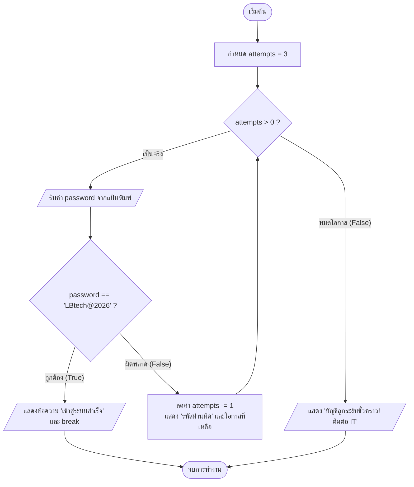

# ใบงานที่ 6 — ระบบตรวจสอบรหัสผ่านและเมนูช่างคอมพิวเตอร์ (while loop, break, continue)

> [!NOTE]
> **ข้อมูลใบงานปฏิบัติการ**
>
> | รายการ | รายละเอียด |
> | :--- | :--- |
> | รายวิชา | `31909-1007` การเขียนโปรแกรมด้วยภาษาไพธอน (Python Programming) |
> | หน่วยการเรียนรู้ | หน่วยที่ 4 — โครงสร้างการวนซ้ำ (while & for loops) และผังงานการทำงานซ้ำ |
> | คะแนนเต็ม | **20 คะแนน** (ตอนที่ 1 = 10 คะแนน, ตอนที่ 2 = 10 คะแนน) + โบนัสท้าทาย 3 คะแนน |
> | เวลาทำ | 2 ชั่วโมงในห้องปฏิบัติการ 1441 |
> | เอกสารอ้างอิง | [[บทที่ 6 - โครงสร้างควบคุมแบบทำซ้ำ (while loop, break, continue)]] |
> | ชื่อ-สกุล ผู้เรียน | ........................................................................................ |
> | ระดับชั้น / กลุ่ม | ปวส. 1 สาขาวิชาเทคโนโลยีคอมพิวเตอร์ (กลุ่ม 1สทค1) |
> | รหัสนักศึกษา | ........................................................................................ |

---

## 1. จุดประสงค์การเรียนรู้เชิงปฏิบัติการ

เมื่อนักศึกษาทำใบงานนี้สำเร็จ จะต้องสามารถ:
- [ ] เขียนโปรแกรมโครงสร้างการวนซ้ำด้วยคำสั่ง **`while`** ร่วมกับการนับรอบและการอัปเดตตัวแปรได้อย่างถูกต้อง
- [ ] นำคำสั่ง **`break`** มาประยุกต์ใช้เพื่อตัดจบการทำงานเมื่อเงื่อนไขสำเร็จก่อนกำหนดได้
- [ ] นำคำสั่ง **`continue`** มาประยุกต์ใช้เพื่อข้ามรอบการทำงานเมื่อพบข้อมูลที่ไม่ถูกต้องได้
- [ ] ประยุกต์ใช้บล็อก **`while-else`** เพื่อดักจับกรณีใช้โอกาสการวนซ้ำจนครบตามกำหนดได้
- [ ] ออกแบบและวาดผังงานการทำงานซ้ำ (**Looping Flowchart**) ตามมาตรฐาน ANSI ได้ถูกต้องตรงกับโค้ดโปรแกรม

---

## 2. ตอนที่ 1: ระบบตรวจสอบรหัสผ่านและระงับบัญชี (10 คะแนน)

### 2.1 สถานการณ์จำลอง
แผนกเทคโนโลยีสารสนเทศต้องการระบบรักษาความปลอดภัยในการเข้าใช้งานคอมพิวเตอร์เซิร์ฟเวอร์ โดยผู้ดูแลระบบกำหนดรหัสผ่านไว้ล่วงหน้าคือ `"LBtech@2026"` 
ระบบต้องให้โอกาสผู้ใช้งานกรอกรหัสผ่านได้ **สูงสุดไม่เกิน 3 ครั้ง**:
* หากกรอกถูกต้องในครั้งใดก็ตาม: ให้แสดงข้อความยินดีต้อนรับและ **ออกจากลูปทันที**
* หากกรอกผิด: ให้แสดงข้อความเตือน พร้อมบอกจำนวนครั้งที่เหลือ และวนถามใหม่
* หากกรอกผิดครบทั้ง 3 ครั้ง: ให้แสดงข้อความว่า **"บัญชีถูกระงับชั่วคราว! กรุณาติดต่อแผนก IT"** (ต้องใช้บล็อก `else` ของคำสั่ง `while`)



### 2.2 สิ่งที่ต้องส่งในตอนที่ 1
1. **ผังงาน (Flowchart):** วาด Looping Flowchart ตามมาตรฐาน ANSI ลงในกระดาษรายงาน
2. **ไฟล์โค้ดไพธอน:** บันทึกไฟล์ชื่อ `lab6_1_<รหัสนักศึกษา>.py`

---

## 3. ตอนที่ 2: ระบบเมนูคำนวณค่าซ่อมและอะไหล่คอมพิวเตอร์ (10 คะแนน)

### 3.1 สถานการณ์จำลอง
ร้านซ่อมคอมพิวเตอร์ต้องการโปรแกรมช่วยช่างในการเลือกรายการค่าบริการและคิดเงินสะสมแบบ Interactive Console Menu โดยใช้โครงสร้าง `while True:` ที่ทำงานวนซ้ำอย่างต่อเนื่อง จนกว่าช่างจะเลือกเมนูคิดเงินและออกจากโปรแกรม

#### เมนูบริการของร้าน:
* กด `1`: ค่าบริการล้างเครื่องและลง Windows ใหม่ (ราคา **350 บาท**)
* กด `2`: ค่าเปลี่ยนพาวเวอร์ซัพพลาย Power Supply 650W (ราคา **1,290 บาท**)
* กด `3`: ค่าเพิ่มหน่วยความจำ RAM DDR4 16GB (ราคา **1,450 บาท**)
* กด `4`: สรุปยอดเงินรวมทั้งหมด ชำระเงิน และออกจากโปรแกรม (`break`)

#### ข้อกำหนดเพิ่มเติม:
* ทุกครั้งที่เลือกเมนู 1, 2 หรือ 3 ให้โปรแกรมบวกสะสมยอดเงินเข้าตัวแปร `total_cost` และแสดงยอดเงินสะสมปัจจุบัน
* หากผู้ใช้พิมพ์ตัวเลขอื่นที่ไม่ใช่ 1–4 ให้แสดงข้อความแจ้งเตือนว่า *"ตัวเลือกไม่ถูกต้อง"* และใช้คำสั่ง **`continue`** เพื่อเริ่มวนรอบเมนูใหม่ทันที

### 3.2 ตัวอย่างการทำงานของโปรแกรม (Sample Run)

```text
==================================================
        โปรแกรมคำนวณค่าซ่อมคอมพิวเตอร์ LBTECH
==================================================
1. ล้างเครื่องและลง Windows ใหม่ (350 บาท)
2. เปลี่ยนพาวเวอร์ซัพพลาย 650W (1,290 บาท)
3. เพิ่มแรม RAM DDR4 16GB (1,450 บาท)
4. สรุปยอดเงินและปิดโปรแกรม
==================================================
กรุณาเลือกรายการ [1-4]: 1
[เพิ่มรายการ] ล้างเครื่องและลง Windows ใหม่ (+350.00 บาท)
>> ยอดเงินรวมสะสมขณะนี้: 350.00 บาท

กรุณาเลือกรายการ [1-4]: 3
[เพิ่มรายการ] เพิ่มแรม RAM DDR4 16GB (+1,450.00 บาท)
>> ยอดเงินรวมสะสมขณะนี้: 1,800.00 บาท

กรุณาเลือกรายการ [1-4]: 9
[ข้อผิดพลาด] หมายเลขเมนูไม่ถูกต้อง กรุณาเลือก 1-4 เท่านั้น!

กรุณาเลือกรายการ [1-4]: 4
==================================================
         ใบสรุปยอดค่าบริการและอะไหล่
==================================================
ยอดเงินรวมทั้งสิ้นที่ต้องชำระ: 1,800.00 บาท
ขอบคุณที่ใช้บริการร้านซ่อมคอมพิวเตอร์ LBTECH!
```

### 3.3 สิ่งที่ต้องส่งในตอนที่ 2
1. **ไฟล์โค้ดไพธอน:** บันทึกไฟล์ชื่อ `lab6_2_<รหัสนักศึกษา>.py`

---

## 4. เกณฑ์การให้คะแนน (Evaluation Rubric: 20 คะแนน)

> [!IMPORTANT]
> **ตารางเกณฑ์การประเมินผล**
>
> | รายการประเมิน | รายละเอียดเกณฑ์ (คะแนนเต็ม) | คะแนนที่ได้ |
> | :--- | :--- | :---: |
> | **1. ผังงานตอนที่ 1 (3 คะแนน)** | ใช้สัญลักษณ์ ANSI ถูกต้อง มีเส้นลูกศรวนลูปและเงื่อนไขชัดเจน | ..... / 3 |
> | **2. ตรรกะโค้ดตอนที่ 1 (7 คะแนน)** | ใช้ while ตรวจสอบรหัสผ่าน 3 ครั้งได้ถูกต้อง (3 คะแนน)<br>ใช้ break เมื่อรหัสผ่านถูก และใช้ while-else แจ้งล็อกระบบ (4 คะแนน) | ..... / 7 |
> | **3. เมนูและลูปตอนที่ 2 (5 คะแนน)** | ใช้ while True เปิดเมนูวนซ้ำต่อเนื่องได้ถูกต้อง (2 คะแนน)<br>มีคำสั่ง break เมื่อเลือกเมนู 4 และ continue เมื่อกรอกเลขผิด (3 คะแนน) | ..... / 5 |
> | **4. การคำนวณและจัดรูปแบบ (3 คะแนน)** | ตัวแปรสะสมยอดเงิน (Accumulator) คำนวณถูกต้อง (2 คะแนน)<br>จัดรูปแบบตัวเลขทศนิยมและคั่นหลักพันด้วย f-string สวยงาม (1 คะแนน) | ..... / 3 |
> | **5. คุณภาพโค้ดและส่งงาน (2 คะแนน)** | โค้ดมีคอมเมนต์ภาษาไทยระบุชื่อ-รหัสนักศึกษา และส่งตรงเวลา | ..... / 2 |
> | **รวมคะแนนทั้งสิ้น** | | **..... / 20** |

---

## 5. โจทย์ท้าทายเพื่อคะแนนโบนัส (+3 คะแนน)

> [!TIP]
> **โจทย์โบนัส: ระบบตรวจสอบความยาวรหัสผ่านใหม่ (Password Length Validator)**
> ให้นักศึกษาเขียนฟังก์ชันหรือลูปเพิ่มเติมในตอนที่ 1:
> เมื่อผู้ใช้ล็อกอินสำเร็จ ให้ระบบบังคับให้ผู้ใช้ตั้งรหัสผ่านใหม่ โดยกำหนดเงื่อนไขว่า **"รหัสผ่านใหม่ต้องมีความยาวอย่างน้อย 8 ตัวอักษรขึ้นไป"** 
> หากผู้ใช้พิมพ์รหัสผ่านใหม่น้อยกว่า 8 ตัวอักษร ให้โปรแกรมแจ้งเตือนว่า *"รหัสผ่านสั้นเกินไป ไม่ปลอดภัย!"* และวนถามซ้ำไปเรื่อยๆ จนกว่าจะได้รหัสผ่านที่ยาวตั้งแต่ 8 ตัวอักษรขึ้นไป จึงจะอนุญาตให้จบโปรแกรม
