# บทที่ 1 — พื้นฐานส่วนต่อประสาน (Interface), โพรโทคอล IoT และแอปพลิเคชัน Blynk

*(Designing Interface for IoT Applications: Meaning of Interface → Human vs Machine → IoT Protocols Architecture → Blynk Mobile Dashboard)*

> [!info] ข้อมูลรายวิชาและบทเรียน
>
> | รายการ | รายละเอียด |
> | :--- | :--- |
> | รหัสวิชา | `31909-2002` การออกแบบส่วนต่อประสานสำหรับงาน IoT (Designing Interface for IoT Applications) |
> | ระดับชั้น | ประกาศนียบัตรวิชาชีพชั้นสูง (ปวส.) สาขาวิชาเทคโนโลยีคอมพิวเตอร์ |
> | หลักสูตร | ประกาศนียบัตรวิชาชีพชั้นสูง พุทธศักราช 2567 (ท-ป-น: 2-3-3 รวม 5 คาบ/สัปดาห์) |
> | สัปดาห์ที่ / หน่วย | สัปดาห์ที่ 5 / หน่วยที่ 1 |
> | เวลาจัดการเรียนรู้ | 5 คาบ (ทฤษฎี 2 คาบ · ปฏิบัติ 3 คาบ) |
> | สื่อการเรียนรู้ | สไลด์บรรยาย Week 5, Wokwi Simulator, Blynk IoT Cloud & Mobile App |
> | งานปฏิบัติการที่เชื่อมโยง | [[แบบฝึกหัด - ระบบควบคุมหลอดไฟ 4 ห้องผ่าน Blynk และ Wokwi]] |

> [!abstract] จุดประสงค์การเรียนรู้ประจำบท
> เมื่อเรียนจบบทนี้แล้ว นักศึกษาสามารถ:
> 1. อธิบายความหมายและนิยามเชิงวิศวกรรมของคำว่า **"ส่วนต่อประสาน (Interface)"** ได้ถูกต้อง
> 2. จำแนกและยกตัวอย่างส่วนต่อประสานประเภท **GUI, CLI, CUI/TUI** และ **API** ได้อย่างแม่นยำ
> 3. วิเคราะห์ความแตกต่างระหว่างส่วนต่อประสานแบบ **"คนคุยกับเครื่อง (Human-to-Machine)"** และ **"เครื่องคุยกับเครื่อง (Machine-to-Machine)"** ในงานระบบสมองกลฝังตัวและ IoT ได้
> 4. อธิบายหลักการทำงานและเปรียบเทียบจุดเด่น-จุดด้อยของ **REST API**, **MQTT**, **Node-RED** และ **Blynk** ผ่านสถานการณ์จริงได้
> 5. อธิบายสถาปัตยกรรมกระแสข้อมูล (Data Flow) จากเซนเซอร์สู่หน้าจอ Dashboard บนสมาร์ตโฟนได้
> 6. เข้าใจหลักการของ **Virtual Pins** บนแพลตฟอร์ม Blynk ในฐานะ Interface ตัวกลางที่เชื่อมระหว่างโค้ดไมโครคอนโทรลเลอร์กับวิตเจ็ตบนหน้าจอ

> [!note] ทำไมบทนี้ถึงเป็นหัวใจสำคัญของวิชานี้?
> คนส่วนใหญ่เมื่อได้ยินคำว่า **"ออกแบบส่วนต่อประสาน (Interface Design)"** มักนึกถึงเพียงแค่การจัดวางปุ่ม การเลือกโทนสี หรือการวาดหน้าจอกราฟิกสวยงามบนมือถือ (GUI / UX-UI) แต่ในโลกแห่ง **Internet of Things (IoT)** อุปกรณ์ขนาดจิ๋ว เช่น ESP32, เซนเซอร์ และรีเลย์ ไม่ได้มีตามองเห็นหน้าจอ สิ่งที่อุปกรณ์เหล่านั้นใช้สื่อสารกันคือ **"โพรโทคอลและข้อกำหนดทางข้อมูล (Machine-to-Machine Interface)"** 
> 
> หากเราเข้าใจเพียงหน้าจอ แต่ไม่เข้าใจสิ่งที่อยู่ใต้ผืนน้ำเบื้องหลัง ระบบ IoT ของเราจะไม่สามารถรับส่งข้อมูลได้อย่างมีเสถียรภาพเลย บทเรียนนี้จึงถูกออกแบบมาเพื่อ **"รื้อถอนกรอบความคิดเดิม"** และปูรากฐานวิศวกรรมที่แท้จริงของคำว่า Interface ตั้งแต่ระดับความคิดไปจนถึงการลงมือสร้างจริง

---

## ช่วงที่ 1: เปิดด้วยคำถาม — "Interface คืออะไรกันแน่?"

### 1.1 คำถามเปล่าๆ ชวนฉุกคิด: "ถ้าพูดถึงคำว่า Interface เธอคิดถึงอะไร?"

ในการเริ่มต้นคาบเรียน ครูจะไม่เพิ่งเปิดพจนานุกรมแปลศัพท์ แต่จะถามนักศึกษาในห้องก่อนว่า:

> *"พวกเราเขียนโปรแกรมมาก็เยอะ ต่อวงจรไมโครคอนโทรลเลอร์ก็เคยผ่านมาแล้ว... เวลาได้ยินคำว่า **Interface** หรือภาษาไทยที่หลักสูตรเรียกว่า **ส่วนต่อประสาน** ในหัวพวกเราแวบแรกเห็นภาพอะไร?"*

ร้อยละ 90 ของคำตอบที่ได้จากผู้เรียนมักจะเป็น:
- *"หน้าจอมือถือครับอาจารย์ ที่มีปุ่มกด มีรูปภาพ"*
- *"หน้าเว็บที่มีกล่องให้กรอกข้อความ"*
- *"โปรแกรมที่มีเมนูให้คลิก"*

คำตอบเหล่านี้ **ไม่ผิด** แต่มันเป็นเพียง **เสี้ยวเดียว** ของจักรวาล Interface เท่านั้น เพื่อพิสูจน์เรื่องนี้ ลองมาดูภาพ 4 ใบในหัวข้อถัดไป

---

### 1.2 กิจกรรมภาพ 4 ใบ: "ภาพไหนคือ Interface?"

ลองสังเกตภาพ 4 สถานการณ์ต่อไปนี้ แล้วตอบว่า **ภาพใดคือ Interface?**

```
┌───────────────────────────┐      ┌───────────────────────────┐
│ [ภาพที่ 1]                │      │ [ภาพที่ 2]                │
│ หน้าจอมือถือ Dashboard    │      │ หน้าจอ Terminal / Console │
│ - ปุ่มกด Switch เปิด/ปิด  │      │ - จอดำ ตัวอักษรสีขาว      │
│ - เกจวัดอุณหภูมิสวยงาม    │      │ - พิมพ์คำสั่ง: dir, ping   │
│ - กราฟแท่งแสดงพลังงาน     │      │                           │
│   (GUI)                   │      │   (CLI)                   │
└───────────────────────────┘      └───────────────────────────┘
              ▲                                  ▲
              │                                  │
      "ภาพไหนคือ Interface?" (หรือเป็นทุกภาพ?)
              │                                  │
              ▼                                  ▼
┌───────────────────────────┐      ┌───────────────────────────┐
│ [ภาพที่ 3]                │      │ [ภาพที่ 4]                │
│ โปรแกรมเมนูใน Console     │      │ แผนภาพ API & โค้ด URL     │
│ [1] ดูยอดเงินในบัญชี      │      │ Client ──GET /data──► API │
│ [2] โอนเงิน               │      │ ◄──JSON Data──────── API  │
│ [3] ออกจากโปรแกรม         │      │                           │
│   (CUI / TUI)             │      │   (API)                   │
└───────────────────────────┘      └───────────────────────────┘
```

ลองจำแนกรายละเอียดของภาพทั้ง 4:

1. **ภาพที่ 1: GUI (Graphical User Interface)**
   - หน้าจอสมาร์ตโฟนที่มีสีสันสดใส มีวิตเจ็ตสวิตช์แบบกดเลื่อน (Toggle Switch), เกจวัดอุณหภูมิรูปวงกลม, กราฟแสดงสถิติย้อนหลัง
   - ผู้ใช้ใช้นิ้วสัมผัสหน้าจอเพื่อสั่งงาน
2. **ภาพที่ 2: CLI (Command Line Interface)**
   - หน้าจอดำแบบ FreeDOS หรือ Command Prompt (CMD) / PowerShell / Linux Bash
   - ไม่มีปุ่มกด ไม่มีเมาส์ มีเพียงเคอร์เซอร์กะพริบรอรับคำสั่งตัวอักษร เช่น `ping 192.168.1.1` หรือ `dir /w`
3. **ภาพที่ 3: CUI / TUI (Character / Text User Interface)**
   - โปรแกรมระบบที่นักศึกษาคุ้นเคยดีจากการเขียนในวิชาภาษาซีหรือไพธอน เช่น โปรแกรมแสดงเมนูตัวอักษรบนหน้าจอคอนโซล:
     ```text
     ==============================
         ATM SIMULATION SYSTEM
     ==============================
     1. ตรวจสอบยอดเงินคงเหลือ
     2. ฝากเงินเข้าบัญชี
     3. ถอนเงินสด
     4. ออกจากโปรแกรม
     กรุณาเลือกรายการ [1-4]: _
     ```
   - หรือโปรแกรมบริหารจัดการทรัพยากรบนเซิร์ฟเวอร์อย่าง `htop` ที่ใช้ตัวอักษรจัดเป็นกรอบตาราง
4. **ภาพที่ 4: API (Application Programming Interface)**
   - ไดอะแกรม Sequence Diagram แสดงการคุยกันระหว่าง Browser กับ Web Server ผ่าน URL เช่น:
     `GET https://api.weather.com/v1/temperature?city=Lopburi`
   - ผลลัพธ์ที่ได้กลับมาไม่ใช่ภาพหรือหน้าจอ แต่เป็นข้อความรูปแบบ **JSON**:
     `{"city": "Lopburi", "temp_c": 32.5, "humidity": 68}`

---

### 1.3 เฉลย: ทำไม "ทุกภาพ" ถึงเป็น Interface ทั้งสิ้น?

> [!important] คำเฉลยที่ทำให้นักศึกษาต้องประหลาดใจ
> **คำตอบที่ถูกต้องคือ: ทุกภาพคือ Interface ทั้งหมด 100%!**

เมื่อเฉลยข้อนี้ นักศึกษามักจะสงสัยทันทีว่า:
> *"อาจารย์ครับ ภาพที่ 1 เป็น UI ผมเข้าใจได้ แต่ภาพที่ 2 จอดำๆ, ภาพที่ 3 เมนูตัวหนังสือธรรมดาที่พวกผมเขียนส่งการบ้าน, ยิ่งภาพที่ 4 มีแต่ตัวหนังสือโค้ดคุยกันหลังบ้าน ไม่มีหน้าจอให้คนกดเลย มันจะเป็น Interface ได้อย่างไร?"*

คำถามนี้คือ **จุดเปลี่ยนที่สำคัญที่สุดของคาบเรียน** เพราะมันนำเราไปสู่ความเข้าใจที่ถูกต้องว่า แท้จริงแล้ว Interface ไม่ได้หมายถึง "หน้าจอคอมพิวเตอร์" เลยแม้แต่น้อย

---

## ช่วงที่ 2: มันคืออะไรกันแน่ — นิยามและแก่นแท้ของ Interface

### 2.1 นิยามเชิงวิศวกรรม: สองฝ่าย + ข้อตกลงร่วม

ในทางวิทยาศาสตร์และวิศวกรรมศาสตร์:

> **Interface (ส่วนต่อประสาน)** คือ **"จุดหรือพรมแดนที่สองฝ่ายมาพบกัน และสามารถมีปฏิสัมพันธ์หรือสื่อสารส่งผ่านข้อมูล/พลังงานระหว่างกันได้ ภายใต้ข้อตกลง (Protocol / Specification) ที่กำหนดไว้ล่วงหน้า"**

คำว่า **"สองฝ่าย"** ในที่นี้ ไม่จำเป็นต้องเป็น **มนุษย์กับคอมพิวเตอร์** เสมอไป:
- อาจเป็น **มนุษย์ กับ เครื่องจักร**
- อาจเป็น **ซอฟต์แวร์ชิ้นที่ 1 กับ ซอฟต์แวร์ชิ้นที่ 2**
- หรืออาจเป็น **แผงวงจรอิเล็กทรอนิกส์ กับ เซนเซอร์วัดค่า**

และคำว่า **"ข้อตกลง (Protocol)"** คือกติกาที่ทำให้ทั้งสองฝ่ายคุยกันรู้เรื่อง ถ้าฝ่ายหนึ่งส่งแบบหนึ่ง แต่อีกฝ่ายเข้าใจอีกแบบหนึ่ง การสื่อสารจะไม่เกิดขึ้น

---

### 2.2 อุปมาเปรียบเทียบในชีวิตจริง 3 ตัวอย่าง (ก่อนเข้าศัพท์เทคนิค)

เพื่อให้นักศึกษาเข้าใจแก่นของ Interface โดยไม่ต้องท่องจำ ลองดูสิ่งที่พวกเราเจอกันทุกวัน:

#### 1) ปลั๊กไฟกับเต้ารับบนผนัง (Power Plug & Socket)
- **สองฝ่ายที่มาเจอกัน:** พัดลม (อุปกรณ์ไฟฟ้า) กับ ระบบสายส่งไฟฟ้าแรงสูงของประเทศ
- **Interface คืออะไร:** หน้ากากเต้ารับบนกำแพงที่มีรู 2 รู หรือ 3 รู พร้อมขาปลั๊กตัวผู้
- **ความลับของตัวอย่างนี้:** 
  เราในฐานะคนใช้งานพัดลม **ไม่จำเป็นต้องรู้เลยว่า** ไฟฟ้านี้ผลิตมาจากเขื่อนพลังน้ำกาญจนบุรี, โรงไฟฟ้าก๊าซธรรมชาติบางปะกง หรือโซลาร์ฟาร์มลพบุรี เราไม่ต้องรู้ว่าสายไฟใต้ดินเดินท่ออย่างไร **หน้าที่ของเรามีแค่อย่างเดียว คือ เอาขาปลั๊กที่ตรงตามมาตรฐาน Interface เสียบเข้ากับเต้ารับ** แล้วพัดลมก็หมุนทันที!
- เต้ารับทำหน้าที่ซ่อนความซับซ้อนมหาศาลของระบบโรงไฟฟ้าไว้ข้างหลังกำแพง

#### 2) เมนูในร้านอาหารตามสั่ง (Restaurant Menu)
- **สองฝ่ายที่มาเจอกัน:** ลูกค้าที่หิวข้าว กับ เชฟผู้เชี่ยวชาญในครัว
- **Interface คืออะไร:** **ใบรายการอาหาร (Menu)**
- **การทำงาน:** 
  - เมนูบอกลูกค้าอย่างชัดเจนว่า *“คุณสั่งอะไรได้บ้าง (Input)”* เช่น กะเพราหมูกรอบ, ต้มยำกุ้ง, ข้าวผัดปู
  - เมนูบอกว่า *“คุณจะได้อะไรกลับคืนมา (Output)”* และราคาเท่าใด
  - **ครัวคือระบบหลังบ้าน (Backend):** ลูกค้าไม่ต้องเดินเข้าไปดูว่าเชฟตั้งกระทะอย่างไร ใช้แก๊สยี่ห้อไหน ใส่ซีอิ๊วสูตรใด ลูกค้าแค่ส่งข้อความสั่งตามเมนู แล้วรอรับอาหารตามข้อตกลง

#### 3) รีโมตคอนโทรลโทรทัศน์ (TV Remote Control)
- **สองฝ่ายที่มาเจอกัน:** นิ้วมือของมนุษย์ กับ แผงวงจรประมวลผลวิดีโอดิจิทัลในสมาร์ตทีวี
- **Interface คืออะไร:** ปุ่มยางกดบนตัวรีโมต (ปุ่ม Power, Volume +, Channel -)
- เราไม่ต้องเอาไขควงไปจิ้มต่อลายวงจรแผงวงจรในทีวีเพื่อเปลี่ยนช่อง เรากดปุ่มบน Interface แล้วรีโมตก็แปลงเป็นรหัสแสงอินฟราเรดส่งไปคุยกับทีวีแทนเรา

---

### 2.3 สะพานเชื่อมจากสิ่งที่นักศึกษารู้จักดี: จาก "Function" สู่ "API"

นักศึกษา ปวส. ทุกคนเคยเขียนฟังก์ชันในภาษาไพธอนหรือภาษาซีมาแล้ว:

```python
# ตัวอย่างฟังก์ชันคำนวณภาษีมูลค่าเพิ่ม (VAT 7%)
def calculate_vat(total_price):
    vat_rate = 0.07
    vat_amount = total_price * vat_rate
    net_total = total_price + vat_amount
    return net_total
```

ลองสังเกตฟังก์ชันนี้ให้ดี:
1. **คนเรียกใช้ (Caller):** เขียนคำสั่ง `pay = calculate_vat(1000)`
2. **คนเรียกต้องส่งอะไรเข้าไป?** ส่งตัวเลขราคาสินค้า (`total_price`) ซึ่งเป็น **Parameter (Input)**
3. **คนเรียกจะได้อะไรกลับมา?** ได้ยอดเงินสุทธิรวมภาษี ซึ่งเป็น **Return Value (Output)**

> [!tip] ข้อสังเกตสำคัญ
> เพื่อนร่วมทีมหรือโปรแกรมหลักที่เรียกใช้ฟังก์ชัน `calculate_vat()` **ไม่จำเป็นต้องสนใจเลยว่าข้างในฟังก์ชันเขียนโค้ดกี่บรรทัด หรือใช้วิธีคำนวณอย่างไร** ขอเพียงแค่ส่งตัวเลขเข้าไป แล้วฟังก์ชันส่งผลลัพธ์ที่ถูกต้องกลับมาตามสัญญา
> 
> **"ชื่อฟังก์ชัน + พารามิเตอร์ที่รับเข้า + ค่าที่ส่งออก" นั่นแหละคือ Interface ระดับซอฟต์แวร์ (Software Function Interface)!**

#### เมื่อก้าวเข้าสู่โลกของ Network: API คืออะไร?

ถ้าฟังก์ชันนี้ไม่ได้รันอยู่ในคอมพิวเตอร์เครื่องเดียวกัน แต่ตั้งอยู่บนเซิร์ฟเวอร์ที่ประเทศสิงคโปร์ แล้วบอร์ด ESP32 หรือมือถือของเราอยากเรียกใช้บ้างล่ะ?

```
[คอมพิวเตอร์ของเรา]                           [เซิร์ฟเวอร์ปลายทาง]
   มือถือ / ESP32                              Cloud Server
        │                                            │
        │─── ส่ง HTTP GET /calculate_vat?price=1000 ─►│ (รับ Request)
        │                                            │ คำนวณเบื้องหลัง
        │◄── ตอบกลับ {"net_total": 1070.0} ──────────│ (ส่ง Response)
```

> **API (Application Programming Interface) แท้จริงแล้วก็คือ "ฟังก์ชันที่ถูกเรียกข้ามเครื่องผ่านระบบเครือข่ายอินเทอร์เน็ต" นั่นเอง!**
> 
> นักศึกษาที่เคยกลัวคำว่า API พอเห็นภาพนี้จะเข้าใจทันทีว่า มันก็แค่ฟังก์ชันที่มี Input ส่งไปตามสายแลน/Wi-Fi และมี Output ส่งกลับมาเป็นก้อนข้อมูล

---

### 2.4 ทำไมคนทั่วไปถึงนึกถึงแต่ GUI?

ทำไมเวลาพูดถึง Interface ทุกคนถึงนึกถึงแต่หน้าจอ GUI สวยๆ?
1. **เพราะ GUI คือสิ่งเดียวที่ "ตามนุษย์มองเห็น":** เราจับสมาร์ตโฟนตั้งแต่วัยเด็ก เลื่อน TikTok แตะไอคอนแอป เราสัมผัสมันทุกวัน
2. **หลักสูตรการศึกษาสายศิลป์/ดีไซน์สอนแต่หน้าจอ:** คำว่า UI/UX ในตลาดส่วนใหญ่ถูกตีกรอบอยู่แค่การจัดวางเลย์เอาต์ ออกแบบกราฟิกบน Figma หรือ Adobe XD
3. **แต่ความจริงเชิงวิศวกรรมคือ:** **"ผู้ใช้งาน (User) ของ Interface ไม่จำเป็นต้องเป็นมนุษย์เสมอไป!"**

ในระบบอัตโนมัติ:
- ซอฟต์แวร์ระบบคลังสินค้า สื่อสารกับ ซอฟต์แวร์ระบบธนาคาร → **ไม่มีมนุษย์มานั่งกดปุ่ม**
- บอร์ดวัดระดับน้ำเขื่อนป่าสักชลสิทธิ์ ส่งข้อมูลเตือนภัยไปยังเซิร์ฟเวอร์กรมชลประทาน → **ไม่มีมนุษย์มานั่งเฝ้า**

ทั้งสองกรณีมี Interface เชื่อมอยู่ตลอดเวลา แต่เป็น Interface ที่ไม่มีรูปภาพ ไม่มีสี และไม่มีปุ่มกด

---

### 2.5 สรุปแบ่ง Interface ออกเป็น 2 โลกใหญ่

เพื่อให้เห็นภาพรวมชัดเจน เราสามารถแบ่งส่วนต่อประสานในโลกคอมพิวเตอร์ออกเป็น 2 กลุ่มหลัก:

```
                         ┌─────────────────────────────────────────┐
                         │               INTERFACE                 │
                         │             (ส่วนต่อประสาน)              │
                         └────────────────────┬────────────────────┘
                                              │
                      ┌───────────────────────┴───────────────────────┐
                      ▼                                               ▼
         ┌─────────────────────────┐                     ┌─────────────────────────┐
         │     คน คุยกับ เครื่อง    │                     │   เครื่อง คุยกับ เครื่อง │
         │   (Human-to-Machine)    │                     │   (Machine-to-Machine)  │
         │          [H2M]          │                     │          [M2M]          │
         └────────────┬────────────┘                     └────────────┬────────────┘
                      │                                               │
     ┌────────────────┼────────────────┐             ┌────────────────┼────────────────┐
     ▼                ▼                ▼             ▼                ▼                ▼
  [ GUI ]          [ CLI ]          [ VUI ]       [ API ]          [ MQTT ]       [ Serial ]
หน้าจอกราฟิก    พิมพ์คำสั่งจอดำ   สั่งงานด้วยเสียง   REST API /      Publish /       UART, I2C,
ปุ่มกด, สีสัน   (Terminal/Bash)   (Siri, Alexa)    Web Service      Subscribe          SPI
```

> [!important] ตารางเปรียบเทียบระหว่าง 2 กลุ่มใหญ่
>
> | มิติการเปรียบเทียบ | กลุ่มที่ 1: คนคุยกับเครื่อง (H2M) | กลุ่มที่ 2: เครื่องคุยกับเครื่อง (M2M) |
> | :--- | :--- | :--- |
> | **ผู้ส่ง/ผู้รับสาร** | มนุษย์ ↔ โปรแกรมคอมพิวเตอร์ | โปรแกรมคอมพิวเตอร์ ↔ บอร์ดฮาร์ดแวร์ / เซิร์ฟเวอร์ |
> | **ตัวอย่างเทคโนโลยี** | **GUI** (แอปมือถือ, เว็บไซต์)<br>**CLI** (Bash, CMD, PowerShell)<br>**CUI/TUI** (เมนูตัวเลขคอนโซล, htop)<br>**VUI** (ระบบสั่งการด้วยเสียง) | **REST API** (HTTP GET/POST, JSON)<br>**MQTT** (Pub/Sub สำหรับ IoT)<br>**Hardware Serial** (UART, I2C, SPI)<br>**WebSocket** (การสื่อสารสองทิศทาง) |
> | **เป้าหมายในการออกแบบ** | ใช้งานง่าย (Usability), สวยงาม, เข้าใจได้ทันทีโดยไม่ต้องอ่านคู่มือ | รวดเร็ว (Speed), ขนาดข้อมูลเล็ก (Lightweight), ประหยัดพลังงาน, มีเสถียรภาพ |
> | **รูปแบบข้อมูล** | ภาพ, ไอคอน, ข้อความภาษาคน, สัญญาณเสียง | ไบนารี (Byte), รหัสฐานสิบหก, โครงสร้าง JSON, XML |
> | **บทบาทในงาน IoT** | หน้าจอ Dashboard สำหรับผู้บริหารหรือผู้ใช้งานดูข้อมูล | โพรโทคอลส่งข้อมูลจากเซนเซอร์ขึ้นคลาวด์ หรือสั่งงานรีเลย์ |

> [!warning] สัจธรรมของวิชา IoT
> **งานในระบบ IoT กว่า 80% อาศัยอยู่ฝั่งขวา (เครื่องคุยกับเครื่อง)!**
> 
> หากนักศึกษาสร้างแอปพลิเคชันที่มีปุ่มกดสวยงามระดับมือรางวัล แต่ฝั่งเครื่องคุยกับเครื่องไม่เสถียร แพ็กเก็ตข้อมูลตกหล่น บอร์ดกินไฟมหาศาล ระบบ IoT นั้นก็เป็นเพียงแค่ "ของเล่นจำลอง" ที่นำไปใช้งานจริงในโรงงานอุตสาหกรรมหรือฟาร์มอัจฉริยะไม่ได้เลย

---

## ช่วงที่ 3: สถาปัตยกรรม IoT Protocols และแอปพลิเคชัน Blynk

### 3.1 สถานการณ์จำลองเดียว: "เซนเซอร์วัดอุณหภูมิในห้อง แล้วอยากเห็นบนมือถือ"

เพื่อให้เห็นภาพการทำงานประสานกันของระบบทั้งหมด ให้พวกเราจินตนาการถึงโจทย์ข้อนี้:

> *"เรามีบอร์ด **ESP32** ต่ออยู่กับเซนเซอร์วัดอุณหภูมิในห้องนอน และเรานอนอยู่นอกบ้าน แล้วอยากเปิดสมาร์ตโฟนดูว่า ตอนนี้ห้องนอนของเราร้อนกี่องศาเซลเซียส?"*

คำถามคือ: **จากขาของเซนเซอร์ ไปจนถึงพิกเซลที่สว่างขึ้นบนหน้าจอมือถือ ข้อมูลเดินทางผ่าน Interface อะไรบ้าง?**

เรามาทำความรู้จักตัวละครสำคัญ 4 ตัวในเส้นทางนี้:

---

### 3.2 สี่เครื่องมือสำคัญที่ใช้ในระบบ IoT

#### 1) REST API = "โทรศัพท์ไปถาม แล้วปลายสายตอบกลับ (Request / Response)"

```
      [มือถือของเรา]                              [Web Server]
             │                                         │
             │────── "ตอนนี้อุณหภูมิเท่าไหร่?" ────────►│ (Request)
             │        (GET /api/temperature)           │
             │                                         │
             │◄───── "อุณหภูมิ 28 องศาเซลเซียส" ────────│ (Response)
             │        ({"temp": 28.0})                 │
```

- **พฤติกรรม:** เป็นการสื่อสารแบบสองฝ่าย โดยฝั่งไคลเอนต์เป็นคนเริ่มคุยก่อนเสมอ ถ้าเราไม่กดถาม เซิร์ฟเวอร์ก็จะอยู่เฉยๆ ไม่เคยทักเรามาก่อน
- **เหมือนอะไรในชีวิตจริง:** เหมือนการที่เราเปิดเว็บบราวเซอร์ขึ้นมาดูผลบอล ถ้าบอลกำลังแข่งอยู่แล้วเราอยากรู้คะแนนล่าสุด เราต้องกดปุ่ม **Refresh (F5)** เพื่อถามใหม่เรื่อยๆ
- **ข้อดี:** เข้าใจง่าย เป็นรากฐานของระบบเว็บทั่วโลก ทดสอบง่ายด้วยบราวเซอร์
- **ข้อจำกัดในงาน IoT:**
  - มีค่าใช้จ่ายแฝงสูง (Overhead มหาศาล) เพราะทุกครั้งที่ส่งคำถาม จะต้องแนบ HTTP Header ยาวเป็นร้อยๆ ไบต์ แม้ตัวข้อมูลจริงจะมีแค่เลข `28` เพียง 2 ไบต์ก็ตาม
  - สิ้นเปลืองแบตเตอรี่ของบอร์ดไมโครคอนโทรลเลอร์อย่างยิ่งหากต้องต่อเชื่อมใหม่ทุกครั้ง

---

#### 2) MQTT = "กลุ่มไลน์ข่าวสาร หรือช่อง YouTube ที่เรากดกระดิ่งติดตาม (Publish / Subscribe)"

ในงาน IoT ขนาดใหญ่ เราไม่นิยมใช้ REST API ให้บอร์ดส่งข้อมูลถี่ๆ แต่เราจะใช้โพรโทคอลที่ชื่อว่า **MQTT (Message Queuing Telemetry Transport)**

```
 ┌──────────────┐                       ┌──────────────┐                       ┌──────────────┐
 │ Sensor ESP32 │                       │ MQTT Broker  │                       │ มือถือของเรา │
 └──────┬───────┘                       └──────┬───────┘                       └──────┬───────┘
        │                                      │                                      │
        │                                      │◄─── ขอติดตาม "room/temp" ────────────│ (Subscribe)
        │                                      │     (กดกระดิ่งรอฟังข่าว)              │
        │                                      │                                      │
        │─── โพสต์ข่าว "room/temp: 29.5" ──────►│                                      │
        │    (Publish ข้อความลงหัวข้อ)          │─── ส่งต่อข้อความให้คนที่ติดตาม ──────►│ (รับข้อมูลทันที!)
        │                                      │     ("room/temp: 29.5")              │
```

- **สามองค์ประกอบหลักของ MQTT:**
  1. **Publisher (ผู้ประกาศ):** บอร์ด ESP32 ที่อ่านค่าจากเซนเซอร์ แล้วส่งค่าขึ้นไป
  2. **Topic (หัวข้อข่าว):** ชื่อห้องหรือหมวดหมู่ เช่น `home/bedroom/temperature`
  3. **Subscriber (ผู้รับข่าว):** แอปบนมือถือ หรือระบบควบคุมเครื่องปรับอากาศที่ลงทะเบียนไว้ว่า "ถ้ามีข้อมูลในหัวข้อนี้ ส่งมาให้ฉันด้วยนะ"
  4. **Broker (คนกลาง):** เครื่องเซิร์ฟเวอร์ศูนย์กลาง (เช่น Mosquitto, EMQX หรือ HiveMQ) ทำหน้าที่เหมือนบุรุษไปรษณีย์หรือแอดมินกลุ่มไลน์ คอยรับข่าวจาก Publisher แล้วแจกจ่ายให้ Subscribers ทุกคนที่รออยู่
- **เหมือนอะไรในชีวิตจริง:** เหมือน **กลุ่ม LINE แจ้งเตือนภัย** เมื่อเซนเซอร์ตรวจพบน้ำท่วม มันจะส่งข้อความลงกลุ่ม 1 ครั้ง สมาชิก 500 คนในกลุ่มก็จะได้รับการแจ้งเตือนเด้งพร้อมกันทันทีโดยไม่ต้องโทรศัพท์ถามทีละคน
- **ทำไม IoT ถึงรัก MQTT?**
  - ขนาด Header เล็กจิ๋วเพียง **2 ไบต์** เท่านั้น! (เทียบกับ HTTP ที่เป็นร้อยไบต์)
  - ประหยัดพลังงาน แบตเตอรี่ก้อนเล็กๆ อยู่ได้เป็นเดือนหรือเป็นปี
  - รองรับการทำงานแบบสองทิศทางตามเวลาจริง (Real-Time Push)

---

#### 3) Node-RED = "กระดานลากสายเชื่อมต่อระบบ (Visual IoT Middleware)"

ในโลกความจริง ข้อมูลจากเซนเซอร์อาจส่งมาเป็น MQTT แต่แอปเป้าหมายอาจรับได้เฉพาะ REST API หรือต้องการให้ส่งแจ้งเตือนเข้าแอป LINE เมื่ออุณหภูมิเกิน 40 องศาเซลเซียส

แทนที่เราจะต้องมานั่งเขียนโค้ด Backend ด้วยภาษา Python, Node.js หรือ Go ยาวนับร้อยบรรทัด โลก IoT มีเครื่องมือที่ทรงพลังมากชื่อว่า **Node-RED**

```
 [ MQTT In ] ──(ลากสาย)──► [ Function: เช็คอุณหภูมิ ] ──(ลากสาย)──► [ Line Notify ]
(รับค่าเซนเซอร์)              (ถ้า > 38 องศาเซลเซียส)                 (ส่งแจ้งเตือนเข้ามือถือ)
                                    │
                                 (ลากสาย)
                                    ▼
                             [ UI Dashboard ]
                            (แสดงเข็มวัดบนหน้าเว็บ)
```

- **Node-RED คืออะไร:** ซอฟต์แวร์เครื่องมือสำหรับเชื่อมต่อฮาร์ดแวร์ อุปกรณ์ และบริการคลาวด์เข้าด้วยกัน โดยใช้วิธี **การเขียนโปรแกรมแบบโฟลว์ภาพ (Flow-Based Programming)**
- **ลักษณะการทำงาน:** เราจะเห็น "กล่องคำสั่ง (Nodes)" วางอยู่บนหน้าจอ เช่น กล่องรับ MQTT, กล่องเขียนไฟล์, กล่องส่งอีเมล เรามีหน้าที่เพียงแค่ **คลิกลากสายเชื่อมจากช่องสัญญาณออก (Output) ของกล่องแรก ไปยังช่องสัญญาณเข้า (Input) ของกล่องถัดไป**
- **บทบาท:** ทำหน้าที่เป็น "ล่ามคนกลาง" คอยปรับเปลี่ยน Interface ของระบบที่คุยคนละภาษาให้ต่อกันติดได้อย่างน่าอัศจรรย์

---

#### 4) Blynk = "แพลตฟอร์มสำเร็จรูปสำหรับ IoT Dashboard & Mobile Interface"

เมื่อมาถึงฝั่งสุดท้าย คือฝั่งหน้าจอมือถือที่มนุษย์เราต้องมอง หากเราต้องไปเรียนเขียนแอปพลิเคชัน Android ด้วยภาษา Kotlin หรือเขียนแอป iOS ด้วยภาษา Swift ตั้งแต่ศูนย์ ต้องใช้เวลาหลายเดือนกว่าจะได้ปุ่มเปิดปิดไฟสักปุ่มหนึ่ง

แพลตฟอร์ม **Blynk (บลองค์)** ถูกสร้างขึ้นมาเพื่อแก้ปัญหานี้โดยเฉพาะ!

```
┌─────────────────────────────────────────────────────────────┐
│                 BLYNK IOT ARCHITECTURE                      │
├─────────────────┬─────────────────────────┬─────────────────┤
│ [1] อุปกรณ์     │ [2] เซิร์ฟเวอร์กลาง     │ [3] ส่วนต่อประสาน│
│     (Device)    │     (Blynk Cloud)       │     (Blynk App) │
│                 │                         │                 │
│  ESP32 / ESP8266│ ◄─── อินเทอร์เน็ต ────► │  สมาร์ตโฟน      │
│  ต่อขาหลอดไฟ/เซนเซอร์│   (Wi-Fi / 4G)          │  ปุ่มกด, สวิตช์,  │
│                 │  จัดการ Authentication  │  เกจวัด, กราฟ   │
│                 │  และ Data Stream        │  (iOS & Android)│
└─────────────────┴─────────────────────────┴─────────────────┘
```

- **Blynk คืออะไร:** แพลตฟอร์ม IoT ครบวงจรที่รวมระบบคลาวด์ (Blynk.Cloud), ไลบรารีสำหรับไมโครคอนโทรลเลอร์ (Blynk Library) และแอปพลิเคชันสำหรับแสดงผลหน้าจอ (Blynk App) เข้าไว้ด้วยกัน
- **จุดเด่นของ Blynk:**
  1. **Low-Code Interface:** ผู้ใช้เพียงแค่ใช้นิ้วลากวางวิตเจ็ต (Widgets) เช่น วิตเจ็ต Button, Slider, Gauge, Chart ลงบนหน้าจอมือถือ ก็ได้หน้าตาแอปพลิเคชันที่พร้อมใช้งานทันที
  2. **เชื่อมต่อง่ายดาย:** มีไลบรารีสำเร็จรูปสำหรับ ESP32 แค่ใส่รหัส Wi-Fi และ Auth Token เพียงบรรทัดเดียว บอร์ดก็ต่อเข้ากับแอปบนมือถือได้จากทั่วทุกมุมโลก
  3. **มีแนวคิด Virtual Pins:** ซ่อนความซับซ้อนของระดับฮาร์ดแวร์ไว้เบื้องหลังอย่างชาญฉลาด

---

### 3.3 แผนภาพกระแสข้อมูลรวม (End-to-End System Flow)

เมื่อนำเครื่องมือทั้งหมดมาร้อยเรียงเข้าด้วยกัน จากเซนเซอร์สู่นิ้วมือของผู้ใช้ เราจะเห็นภาพการเดินทางของข้อมูลดังนี้:

```mermaid
flowchart LR
    A["🌡️ เซนเซอร์วัดอุณหภูมิ<br/>(ฮาร์ดแวร์กายภาพ)"] -->|"สัญญาณไฟฟ้า Analog/I2C<br/>[Hardware Interface]"| B["🧠 บอร์ด ESP32<br/>(ประมวลผลค่าดิบ)"]
    
    B -->|"โพรโทคอล MQTT / Wi-Fi<br/>[M2M Network Interface]"| C["☁️ MQTT Broker /<br/>Blynk Cloud"]
    
    C -->|"REST API / Webhook<br/>[Software Web Interface]"| D["⚙️ Node-RED /<br/>Logic Engine"]
    
    D -->|"WebSocket / JSON Push<br/>[App Interface Protocol]"| E["📱 แอปพลิเคชันมือถือ Blynk<br/>(หน้าจอ Dashboard UI)"]
    
    E -->|"การแสดงผลทางสายตา & การกดสัมผัส<br/>[Human-Machine Interface]"| F["👤 มนุษย์ / ผู้ใช้งาน<br/>(เห็นอุณหภูมิ 29°C)"]

    style A fill:#e1f5fe,stroke:#0288d1,stroke-width:2px
    style B fill:#fff9c4,stroke:#fbc02d,stroke-width:2px
    style C fill:#ede7f6,stroke:#512da8,stroke-width:2px
    style D fill:#fce4ec,stroke:#c2185b,stroke-width:2px
    style E fill:#e8f5e9,stroke:#388e3c,stroke-width:2px
    style F fill:#ffebee,stroke:#d32f2f,stroke-width:2px
```



> [!important] สรุปเชื่อมโยงสู่คำเฉลยตอนต้นคาบ
> ลองมองภาพโฟลว์ข้างต้นให้ละเอียด ในเส้นทางเพียงเส้นทางเดียวที่ข้อมูลเดินทาง มี **Interface** ซ้อนกันอยู่ถึง 5 ระดับ:
> 1. **Hardware Interface:** สายไฟและขาขั้วต่อระหว่างเซนเซอร์กับชิป ESP32
> 2. **Network Protocol Interface:** โพรโทคอล MQTT และ TCP/IP ที่ส่งข้ามคลื่นสัญญาณ Wi-Fi
> 3. **Cloud Web Interface:** REST API และ Webhook ที่เชื่อมเซิร์ฟเวอร์ต่อกัน
> 4. **Application Protocol Interface:** ก้อนข้อมูล JSON ที่ส่งเข้ามือถือ
> 5. **User Interface (GUI):** สีของปุ่ม เข็มของเกจวัดที่สายตามนุษย์มองเห็น
> 
> นี่คือเหตุผลว่าทำไมในตอนเปิดคาบเรียน ครูจึงเฉลยว่า **"ทุกอย่างคือ Interface"** เพราะในงานวิศวกรรมคอมพิวเตอร์ ระบบจะทำงานได้ ทุกจุดรอยต่อต้องมีข้อตกลงที่ถูกต้องตรงกันเสมอ!

---

### 3.4 เจาะลึกหัวใจของ Blynk: กลไก "Virtual Pins"

เวลาเราเขียนโปรแกรมบนไมโครคอนโทรลเลอร์ปกติ เรามักจะคุ้นเคยกับการสั่งงานขาฮาร์ดแวร์ตรงๆ เช่น:
```cpp
digitalWrite(18, HIGH); // สั่งให้ขา GPIO 18 จ่ายไฟ 3.3V ให้หลอดไฟติด
```

แต่บนแอปพลิเคชัน Blynk มีแนวคิดที่ทรงพลังและถือเป็น **Interface Abstraction** ที่ยอดเยี่ยมมาก นั่นคือ **"Virtual Pins (ขาดิจิทัลเสมือน)"** ตั้งแต่ `V0` ถึง `V255`

```
┌────────────────────────────────┐
│      หน้าจอมือถือ Blynk UI      │
│  [🔘 ปุ่มสวิตช์ห้องนั่งเล่น]   │
└───────────────┬────────────────┘
                │ กดเปิด (ส่งค่า 1)
                ▼
┌────────────────────────────────┐
│       Virtual Pin V1           │ ◄─── นี่คือ "Interface ระดับซอฟต์แวร์"
└───────────────┬────────────────┘      ตัดขาดความผูกมัดกับเบอร์ขาจริง
                │ เรียกฟังก์ชัน
                ▼
┌────────────────────────────────┐
│       โค้ดในตัว ESP32          │
│   BLYNK_WRITE(V1) {            │
│       int val = param.asInt(); │
│       digitalWrite(18, val);   │
│   }                            │
└───────────────┬────────────────┘
                │ จ่ายไฟ 3.3V
                ▼
┌────────────────────────────────┐
│ 💡 หลอดไฟ LED ทางกายภาพ (GPIO 18)│
└────────────────────────────────┘
```

#### ทำไม Blynk ต้องออกแบบให้มี Virtual Pin? ทำไมไม่สั่งขา GPIO 18 ตรงๆ จากแอป?
1. **ลดการผูกมัด (Decoupling):** หน้าจอแอปพลิเคชันไม่จำเป็นต้องรู้ว่าเราเอาหลอดไฟไปเสียบไว้ที่ขาเบอร์อะไร ถ้าวันหนึ่งขา GPIO 18 เกิดช็อตไหม้ เราย้ายสายไฟไปเสียบขา GPIO 23 เราเพียงแค่แก้โค้ดในบอร์ดบรรทัดเดียว โดย **ไม่ต้องไปรื้อแก้ไขหน้าจอแอปมือถือใหม่เลย!**
2. **ส่งข้อมูลได้หลากหลายชนิด (Data Flexibility):** ขาฮาร์ดแวร์ปกติรับได้แค่ค่าดิจิทัล 0 กับ 1 หรือค่าแรงดันแอนะล็อก แต่ Virtual Pin สามารถส่งข้อความสตริง (เช่น `"แอร์เปิดแล้ว"`), ตัวเลขอุณหภูมิทศนิยม (`36.75`), หรือพิกัดละติจูด-ลองจิจูดได้
3. **เปิดประตูสู่ตรรกะเงื่อนไข (Logic Processing):** เมื่อกดปุ่มบนแอป แทนที่จะสั่งขาไฟติดทันที บอร์ดสามารถเอาค่านั้นมาผ่านเงื่อนไข `if-else` ก่อนได้ เช่น *"ถ้าคนกดเปิดไฟ แต่เวลาขณะนั้นเป็นเวลากลางวัน ให้แจ้งเตือนและไม่เปิดไฟ"*

#### รูปแบบคำสั่งมาตรฐานของ Blynk ที่ต้องรู้

##### ฝั่งที่ 1: แอปส่งค่าลงมาหาบอร์ด (App → Hardware)
ใช้แมโครฟังก์ชัน `BLYNK_WRITE(Virtual_Pin)` โดยฟังก์ชันนี้จะถูกเรียกทำงานโดยอัตโนมัติเมื่อผู้ใช้กดปุ่มหรือเลื่อนสไลเดอร์บนแอป:

```cpp
// เมื่อผู้ใช้กดปุ่มที่ผูกไว้กับ Virtual Pin V1 บนมือถือ
BLYNK_WRITE(V1) {
    int pinValue = param.asInt(); // อ่านค่าที่ส่งมา (0 หรือ 1)
    
    if (pinValue == 1) {
        digitalWrite(18, HIGH); // สั่งเปิดไฟห้อง 1
        Serial.println("ไฟห้องที่ 1: เปิด [ON]");
    } else {
        digitalWrite(18, LOW);  // สั่งปิดไฟห้อง 1
        Serial.println("ไฟห้องที่ 1: ปิด [OFF]");
    }
}
```

##### ฝั่งที่ 2: บอร์ดส่งค่าขึ้นไปแสดงผลบนแอป (Hardware → App)
ใช้ฟังก์ชัน `Blynk.virtualWrite(Virtual_Pin, ค่าที่ต้องการส่ง)`:

```cpp
// บอร์ดอ่านค่าเซนเซอร์ความเข้มแสง แล้วส่งไปแสดงที่เข็มวัดบนแอป (Virtual Pin V5)
int lightLevel = analogRead(34);
Blynk.virtualWrite(V5, lightLevel);
```

> [!danger] กฎเหล็กของ Blynk: "ห้ามใช้ `delay()` ในฟังก์ชัน `loop()` เด็ดขาด!"
> นักศึกษามือใหม่ชอบเขียนโค้ดอ่านเซนเซอร์แบบเดิม:
> ```cpp
> void loop() {
>     Blynk.run();
>     int val = analogRead(34);
>     Blynk.virtualWrite(V5, val);
>     delay(1000); // ❌ ห้ามทำเด็ดขาด!
> }
> ```
> **ทำไมถึงห้ามทำ?** เพราะคำสั่ง `Blynk.run()` ทำหน้าที่ส่งสัญญาณทักทาย (Heartbeat Ping) ไปยังเซิร์ฟเวอร์คลาวด์ทุกๆ เสี้ยววินาที เพื่อรายงานตัวว่า "บอร์ดยังอยู่นะ" การสั่ง `delay(1000)` จะทำให้ CPU หยุดนิ่ง 1 วินาทีเต็ม ส่งผลให้การคุยกับคลาวด์สะดุด และเซิร์ฟเวอร์จะตัดการเชื่อมต่อทันที (Device Offline)
> 
> **วิธีที่ถูกต้อง:** ต้องใช้ **`BlynkTimer`** มาจัดตารางเวลาส่งข้อมูล โดยปล่อยให้ฟังก์ชัน `loop()` วิ่งอย่างอิสระที่สุด

---

## ช่วงที่ 4: สรุปบทเรียน กิจกรรมตรวจสอบความเข้าใจ และก้าวต่อไป

### 4.1 ตารางสรุป 4 เครื่องมือโพรโทคอลสำหรับงานส่วนต่อประสาน IoT

> [!abstract] สรุปเปรียบเทียบหมัดต่อหมัด
>
> | เครื่องมือ / เทคโนโลยี | ลักษณะเด่น | อุปมาเปรียบเทียบ | หน้าที่หลักในงาน IoT |
> | :--- | :--- | :--- | :--- |
> | **REST API** | ฝั่ง Client ต้อง Request ถึงจะได้ Response | โทรศัพท์ไปถามข้อมูล | ส่งข้อมูลข้ามระบบเว็บ, บันทึกลงฐานข้อมูล SQL/NoSQL |
> | **MQTT** | Pub/Sub ผ่าน Broker, ข้อมูลเบาหวิว 2 ไบต์ | กลุ่ม LINE กระจายข่าวสาร | เซนเซอร์ส่งข้อมูลถี่ๆ, อุปกรณ์สื่อสารกันแบบ Real-time |
> | **Node-RED** | โปรแกรมแบบลากสายกล่อง Node (Low-Code) | กระดานล่ามแปลภาษา | ดักจับข้อมูล แปลงฟอร์แมต เชื่อมต่อระบบต่างค่าย |
> | **Blynk** | Dashboard มือถือสำเร็จรูป ผูกด้วย Virtual Pin | รีโมตคอนโทรลอัจฉริยะ | หน้าจอ UI ให้มนุษย์ควบคุมและมอนิเตอร์บอร์ด ESP32 |

---

### 4.2 กิจกรรมประเมินผลความเข้าใจ (Check for Understanding)

ลองตอบคำถามสั้นๆ 3 ข้อต่อไปนี้ด้วยตนเองเพื่อประเมินความพร้อม:

1. **คำถาม:** ทำไมคำสั่ง `GET https://api.thingspeak.com/channels/.../feeds.json` ถึงจัดว่าเป็น Interface ทั้งที่ไม่มีปุ่มกดและไม่มีหน้าจอรูปภาพ?
   - *แนวคำตอบ:* เพราะมันมีข้อตกลงชัดเจนระหว่างคนเรียก (Client) และเซิร์ฟเวอร์ โดยระบุว่าต้องส่ง URL รูปแบบใด แล้วจะได้ข้อมูลกลับมาเป็นก้อน JSON ตามโครงสร้างที่ตกลงไว้ จึงเป็น Interface ประเภท Machine-to-Machine (API)
2. **คำถาม:** ถ้าเราต้องการติดตั้งเซนเซอร์วัดความชื้นในดิน 20 จุดในแปลงเกษตรขนาด 50 ไร่ ใช้แบตเตอรี่โซลาร์เซลล์ขนาดเล็ก ระหว่าง **REST API** กับ **MQTT** ควรเลือกใช้โพรโทคอลใด เพราะเหตุผลใด?
   - *แนวคำตอบ:* ควรเลือก **MQTT** เพราะแพ็กเก็ตข้อมูลเล็กมาก (Header เพียง 2 ไบต์) ไม่ต้องสร้าง Connection ใหม่ทุกครั้ง ทำให้ประหยัดพลังงานแบตเตอรี่และปริมาณดาต้าของซิมการ์ดได้ดีกว่า REST API มหาศาล
3. **คำถาม:** การใช้ **Virtual Pin (`V1`)** ใน Blynk มีข้อดีเหนือกว่าการสั่งให้แอปคุมขาฮาร์ดแวร์โดยตรง (Direct Digital Pin) อย่างไร?
   - *แนวคำตอบ:* ช่วยลดการผูกมัด (Decoupling) ทำให้สามารถย้ายขาฮาร์ดแวร์ได้โดยไม่ต้องแก้แอปมือถือ, สามารถส่งข้อมูลโครงสร้างซับซ้อนได้ และเปิดโอกาสให้บอร์ดเขียนตรรกะตรวจสอบเงื่อนไขความปลอดภัยก่อนจ่ายไฟให้อุปกรณ์จริง

---

### 4.3 ก้าวต่อไป: สู่ภาคปฏิบัติการสร้างจริง

หลังจากเข้าใจทฤษฎีเรื่องส่วนต่อประสาน โพรโทคอลสื่อสาร และสถาปัตยกรรมของ Blynk แล้ว ในคาบปฏิบัติการ 3 ชั่วโมงต่อจากนี้ นักศึกษาจะได้รับภารกิจสำคัญในการ **ลงมือสร้างส่วนต่อประสานควบคุมระบบบ้านอัจฉริยะเสมือนจริงบนโปรแกรม Wokwi และควบคุมผ่านมือถือจริงด้วย Blynk Cloud**

👉 **เปิดอ่านข้อกำหนดและขั้นตอนการทำใบงานได้ที่:** [[แบบฝึกหัด - ระบบควบคุมหลอดไฟ 4 ห้องผ่าน Blynk และ Wokwi]]
