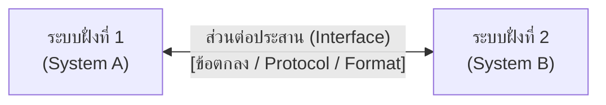
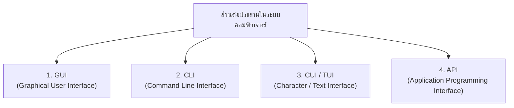
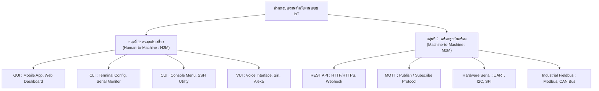
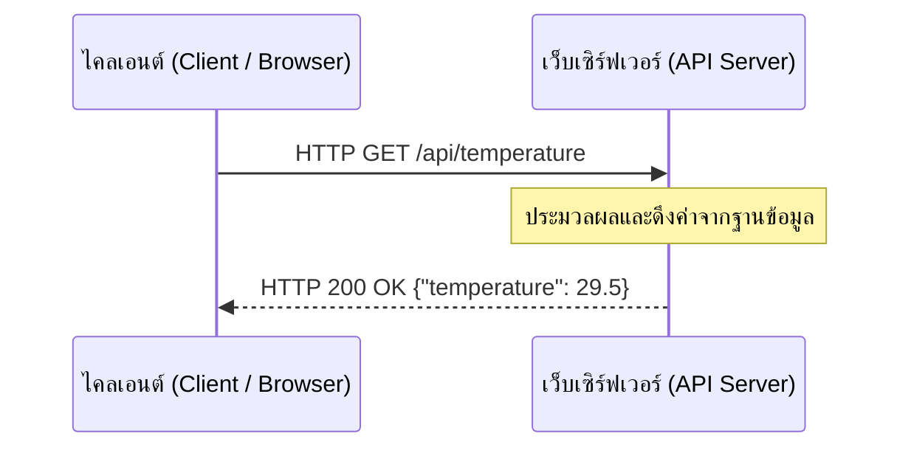
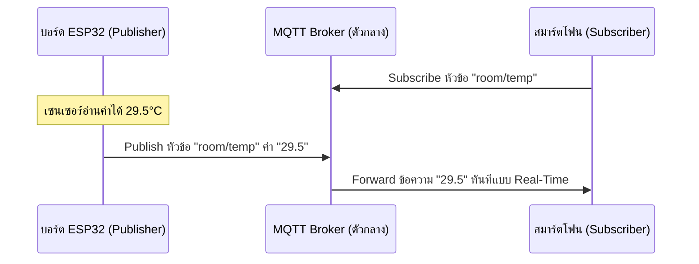
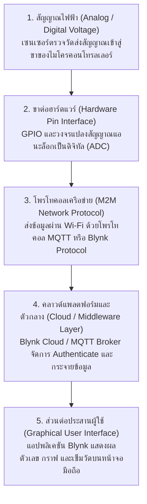
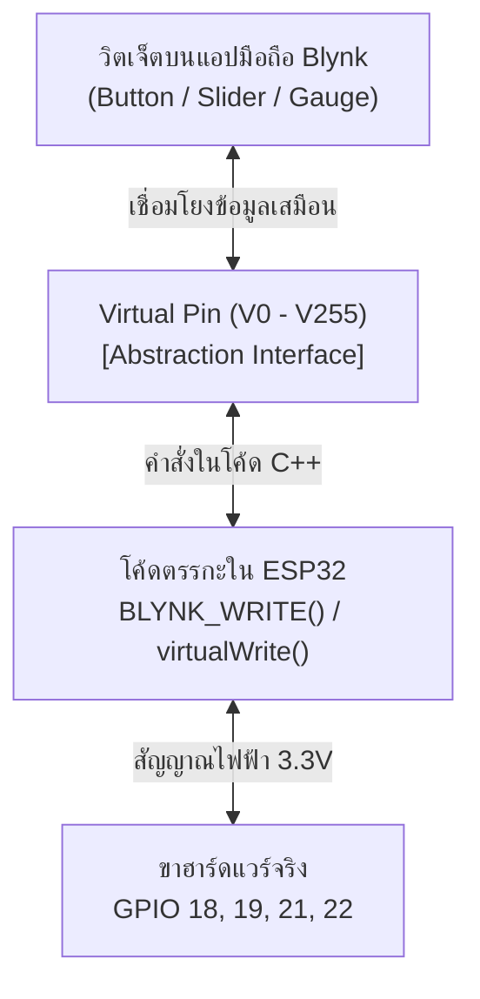

# บทที่ 1 — พื้นฐานส่วนต่อประสาน (Interface), โพรโทคอล IoT และแอปพลิเคชัน Blynk

> [!NOTE]
> **ข้อมูลรายวิชาและบทเรียน**
>
> | รายการ | รายละเอียด |
> | :--- | :--- |
> | รหัสวิชา | `31909-2002` การออกแบบส่วนต่อประสานสำหรับงาน IoT (Designing Interface for IoT Applications) |
> | ระดับชั้น | ประกาศนียบัตรวิชาชีพชั้นสูง (ปวส.) สาขาวิชาเทคโนโลยีคอมพิวเตอร์ |
> | หลักสูตร | ประกาศนียบัตรวิชาชีพชั้นสูง พุทธศักราช 2567 (ท-ป-น: 2-3-3 รวม 5 คาบ/สัปดาห์) |
> | สัปดาห์ที่ / หน่วย | สัปดาห์ที่ 5 / หน่วยที่ 1 |
> | เวลาจัดการเรียนรู้ | 5 คาบ (ทฤษฎี 2 คาบ และปฏิบัติ 3 คาบ) |
> | เอกสารอ้างอิง | เล่มหลักสูตร ปวส. 2567 หน้า 53 |
> | งานปฏิบัติการที่เชื่อมโยง | [[แบบฝึกหัด - ระบบควบคุมหลอดไฟ 4 ห้องผ่าน Blynk และ Wokwi]] |

> [!IMPORTANT]
> **จุดประสงค์การเรียนรู้ประจำบท**
> 1. อธิบายความหมาย นิยาม และองค์ประกอบทางวิศวกรรมของคำว่า "ส่วนต่อประสาน (Interface)" ได้ถูกต้อง
> 2. จำแนกคุณลักษณะ ความแตกต่าง และข้อจำกัดของส่วนต่อประสานประเภท GUI, CLI, CUI/TUI และ API ได้
> 3. วิเคราะห์ความแตกต่างระหว่างส่วนต่อประสานแบบคนคุยกับเครื่อง (Human-to-Machine) และเครื่องคุยกับเครื่อง (Machine-to-Machine) ในงานระบบ IoT ได้
> 4. อธิบายสถาปัตยกรรมและหลักการทำงานของโพรโทคอลสื่อสาร REST API, MQTT, เครื่องมือ Node-RED และแพลตฟอร์ม Blynk ได้
> 5. อธิบายสถาปัตยกรรมกระแสข้อมูล (Data Flow) จากเซนเซอร์ตรวจวัดไปจนถึงหน้าจอแสดงผลบนสมาร์ตโฟนได้
> 6. อธิบายหลักการของ Virtual Pins ในฐานะส่วนต่อประสานชั้นนามธรรม (Abstraction Layer) ระหว่างฮาร์ดแวร์กับหน้าจอควบคุม

---

## 1. ความหมายและนิยามเชิงวิศวกรรมของส่วนต่อประสาน (Interface)

### 1.1 นิยามและความสำคัญ

ในทางวิศวกรรมคอมพิวเตอร์และระบบสารสนเทศ **ส่วนต่อประสาน (Interface)** หมายถึง:

> **"จุดเชื่อมต่อหรือพรมแดนร่วม (Shared Boundary) ที่ระบบย่อยสองส่วนขึ้นไปใช้ในการแลกเปลี่ยนข้อมูล สัญญาณ หรือพลังงานระหว่างกัน ภายใต้ข้อตกลงและระเบียบวิธี (Protocols / Specifications) ที่กำหนดไว้ล่วงหน้า"**

ส่วนต่อประสานทำหน้าที่เป็น **ตัวกลาง (Intermediary)** ที่ช่วยให้อุปกรณ์ โปรแกรม หรือผู้ใช้งานสามารถมีปฏิสัมพันธ์กันได้ โดยที่แต่ละฝ่าย **ไม่จำเป็นต้องรู้รายละเอียดการทำงานภายใน (Internal Implementation)** ของอีกฝ่ายหนึ่ง



### 1.2 หลักการซ่อนรายละเอียด (Abstraction and Encapsulation)

หัวใจสำคัญของการออกแบบ Interface คือการสร้าง **ความสัมพันธ์แบบหลวม (Loose Coupling)** โดย Interface จะเปิดเผยเฉพาะสิ่งที่จำเป็นต่อการสื่อสารเท่านั้น:

1. **สิ่งที่ Interface เปิดเผย:** ข้อมูลนำเข้าที่ต้องการ (Input Parameters), รูปแบบคำสั่งที่ยอมรับ (Accepted Commands), ข้อมูลส่งออกที่จะส่งคืน (Output Response)
2. **สิ่งที่ Interface ซ่อนไว้:** อัลกอริทึมการประมวลผลภายใน, ภาษาที่ใช้เขียน, ฐานข้อมูลเบื้องหลัง, แผงวงจรไฟฟ้า หรือสถาปัตยกรรมฮาร์ดแวร์

### 1.3 ตัวอย่างเปรียบเทียบในเชิงกายภาพและระบบคอมพิวเตอร์

| ตัวอย่าง | ฝ่ายที่ 1 | ฝ่ายที่ 2 | ส่วนต่อประสาน (Interface) | สิ่งที่ถูกซ่อนไว้เบื้องหลัง (Implementation) |
| :--- | :--- | :--- | :--- | :--- |
| **เต้ารับไฟฟ้า** | เครื่องใช้ไฟฟ้า | เครือข่ายสายส่งไฟฟ้า | เต้ารับและขาปลั๊ก (220V 50Hz) | โรงไฟฟ้า แหล่งกำเนิดพลังงาน สายส่งแรงสูงใต้ดิน |
| **เมนูร้านอาหาร** | ลูกค้า | ห้องครัว / เชฟ | รายการอาหารในเล่มเมนู | แหล่งที่มาของวัตถุดิบ ขั้นตอนการปรุง ชนิดของเครื่องครัว |
| **รีโมตทีวี** | ผู้ใช้งาน | วงจรประมวลผลในทีวี | แผงปุ่มกดบนตัวรีโมต | วงจรดิจิทัล บอร์ดจ่ายไฟ ระบบถอดรหัสสัญญาณภาพ |
| **ฟังก์ชันในโปรแกรม** | โค้ดส่วนหลัก | ฟังก์ชันย่อย | ชื่อฟังก์ชัน, Parameters, Return | ลูปการคำนวณ ตัวแปรชั่วคราว อัลกอริทึมภายใน |
| **Web API** | โมบายแอปพลิเคชัน | คลาวด์เซิร์ฟเวอร์ | HTTP Endpoint (URL, JSON) | โครงสร้าง Database ภาษา Backend และระบบแคช |

---

## 2. รูปแบบของส่วนต่อประสานในระบบคอมพิวเตอร์ (Forms of Interfaces)

ส่วนต่อประสานในระบบคอมพิวเตอร์ถูกพัฒนาขึ้นเพื่อตอบสนองลักษณะการใช้งานที่แตกต่างกัน โดยสามารถจำแนกออกเป็น 4 รูปแบบหลัก:



### 2.1 Graphical User Interface (GUI)
ส่วนต่อประสานที่อาศัยวัตถุกราฟิก เช่น หน้าต่าง, ไอคอน, ปุ่มกด, เมนูแบบเลื่อนลง, เกจวัด และกราฟ ในการสื่อสารกับผู้ใช้
* **ช่องทางนำเข้า:** หน้าจอสัมผัส (Touchscreen), เมาส์, คีย์บอร์ด
* **จุดเด่น:** เรียนรู้การใช้งานได้ง่าย ผู้ใช้มองเห็นภาพสถานะการทำงานได้ทันที ไม่จำเป็นต้องจำคำสั่ง
* **จุดด้อย:** ใช้ทรัพยากรหน่วยความจำและหน่วยประมวลผลสูง ไม่เหมาะกับการรันบนไมโครคอนโทรลเลอร์ขนาดเล็ก

### 2.2 Command Line Interface (CLI)
ส่วนต่อประสานแบบบรรทัดคำสั่งที่รับข้อมูลนำเข้าเป็นสตริงข้อความคำสั่งตามไวยากรณ์ที่กำหนด เช่น Windows CMD, PowerShell, Linux Bash
* **ช่องทางนำเข้า:** คีย์บอร์ด
* **จุดเด่น:** ประมวลผลได้รวดเร็ว กินทรัพยากรต่ำมาก สามารถเขียน Shell Script เพื่อทำงานอัตโนมัติ (Automation) ได้ดี
* **จุดด้อย:** ผู้ใช้ต้องจดจำคำสั่งและพารามิเตอร์อย่างแม่นยำ หากพิมพ์ผิดโปรแกรมจะไม่ทำงาน

### 2.3 Character / Text User Interface (CUI / TUI)
ส่วนต่อประสานแบบข้อความและตารางบนหน้าจอคอนโซล โดยจำลองเมนูและกรอบการทำงานด้วยรหัสตัวอักษร เช่น โปรแกรมมอนิเตอร์เซิร์ฟเวอร์ `htop` หรือโปรแกรมเมนูตัวเลขที่ผู้ใช้พิมพ์เลือกรายการ `1`, `2`, `3`
* **ช่องทางนำเข้า:** คีย์บอร์ด
* **จุดเด่น:** โครงสร้างไม่ซับซ้อน รันบน Terminal ผ่านการเชื่อมต่อความเร็วต่ำอย่าง SSH หรือ Serial ได้อย่างราบรื่น
* **จุดด้อย:** ขาดความยืดหยุ่นในการจัดวางรูปแบบกราฟิกที่ละเอียดอ่อน

### 2.4 Application Programming Interface (API)
ส่วนต่อประสานสำหรับโปรแกรมประยุกต์ เป็นชุดข้อตกลงและช่องทางการสื่อสารที่ออกแบบมาเพื่อให้ **ซอฟต์แวร์สื่อสารกับซอฟต์แวร์** โดยตรง ปราศจากหน้าจอแสดงผลสำหรับสายตามนุษย์
* **ช่องทางนำเข้า/ส่งออก:** ก้อนข้อมูลโครงสร้าง เช่น JSON, XML, หรือไบนารี ผ่านเครือข่าย HTTP/TCP
* **จุดเด่น:** ทำให้ระบบต่างภาษา ต่างสถาปัตยกรรม สามารถแลกเปลี่ยนข้อมูลและทำงานร่วมกันได้
* **ตัวอย่าง:** `GET /api/v1/sensors/temperature` ส่งผลลัพธ์เป็น `{"temp": 28.5, "unit": "C"}`

---

## 3. การจำแนกประเภทส่วนต่อประสาน: คนคุยกับเครื่อง vs เครื่องคุยกับเครื่อง

ในมุมมองสถาปัตยกรรมระบบ IoT เราจำแนกส่วนต่อประสานออกเป็น 2 กลุ่มตามคู่ปฏิสัมพันธ์:



> [!NOTE]
> **ตารางวิเคราะห์เปรียบเทียบ H2M และ M2M**
>
> | มิติการวิเคราะห์ | ส่วนต่อประสาน คนคุยกับเครื่อง (H2M) | ส่วนต่อประสาน เครื่องคุยกับเครื่อง (M2M) |
> | :--- | :--- | :--- |
> | **ผู้ส่งและผู้รับสาร** | มนุษย์ และ ซอฟต์แวร์ | ซอฟต์แวร์ และ ฮาร์ดแวร์/เซิร์ฟเวอร์ |
> | **เป้าหมายหลัก** | ความสะดวกในการใช้งาน (Usability) และความชัดเจนทางสายตา | ความเร็ว ความถูกต้อง และการประหยัดพลังงาน |
> | **รูปแบบข้อมูล** | กราฟิก สี ฟอนต์ เสียงแจ้งเตือน | บิต, ไบต์, JSON, โครงสร้างข้อมูลจำเพาะ |
> | **สัดส่วนในงาน IoT** | ประมาณ 20% (หน้าจอ Dashboard ติดตามผล) | มากกว่า 80% (การรับส่งข้อมูลระหว่างโหนด) |

> [!WARNING]
> ความเข้าใจผิดที่พบบ่อยในงาน IoT คือการทุ่มเททรัพยากรทั้งหมดไปที่การออกแบบหน้าจอ GUI บนมือถือ แต่ละเลยการออกแบบ M2M Interface ส่งผลให้อุปกรณ์สูญเสียพลังงานแบตเตอรี่อย่างรวดเร็ว ข้อมูลตกหล่นเมื่อเครือข่ายไม่เสถียร หรือไม่สามารถขยายขนาดระบบ (Scalability) ได้

---

## 4. โพรโทคอลและเครื่องมือสื่อสารสำหรับงาน IoT

ในการส่งข้อมูลจากเซนเซอร์ภาคสนามขึ้นสู่ระบบคลาวด์ มีเครื่องมือและโพรโทคอลมาตรฐานที่สำคัญ 4 ตัว:


### 4.1 REST API (HTTP Request / Response)
การสื่อสารบนสถาปัตยกรรมเว็บดั้งเดิม โดยไคลเอนต์เป็นผู้ส่งคำร้องขอ (Request) และเซิร์ฟเวอร์ตอบกลับ (Response)



* **ลักษณะสำคัญ:** การสื่อสารแบบทางเดียว (Client-initiated) หากไคลเอนต์ไม่ส่งคำร้องขอ เซิร์ฟเวอร์จะไม่สามารถส่งข้อมูลล่าสุดมาให้ได้
* **ข้อจำกัดในงาน IoT:** HTTP Header มีขนาดใหญ่ (หลักร้อยไบต์ขึ้นไป) สิ้นเปลืองแบนด์วิดท์และพลังงานประมวลผลสูง ไม่เหมาะกับอุปกรณ์ที่ส่งข้อมูลทุกวินาที

### 4.2 MQTT (Message Queuing Telemetry Transport)
โพรโทคอลมาตรฐานที่ออกแบบมาเพื่ออุปกรณ์สมองกลฝังตัวและระบบเครือข่ายที่มีข้อจำกัดโดยเฉพาะ ทำงานบนโมเดล **Publish / Subscribe**



* **Publisher:** อุปกรณ์ที่ส่งข้อมูลเข้าสู่หัวข้อที่กำหนด (Topic)
* **Broker:** เซิร์ฟเวอร์ศูนย์กลางคอยกระจายข้อความให้ตรงกับผู้รับ
* **Subscriber:** อุปกรณ์หรือแอปที่ลงทะเบียนรอรับข้อมูลในหัวข้อที่สนใจ
* **จุดเด่นสำหรับงาน IoT:**
  1. ขนาดส่วนหัวของข้อมูล (Header) มีขนาดเล็กเพียง **2 ไบต์**
  2. รองรับการทำงานแบบสองทิศทางตามเวลาจริง (Push Mechanism)
  3. มีระดับคุณภาพการบริการ (Quality of Service: QoS 0, 1, 2) รับประกันการส่งข้อมูล

### 4.3 Node-RED (Visual IoT Integration Middleware)
ซอฟต์แวร์เครื่องมือสำหรับผสานระบบแบบ Flow-Based Programming โดยพัฒนาบน Node.js
* ทำหน้าที่เป็น **ตัวกลางเชื่อมประสาน (Middleware / Adapter)** รับข้อมูลจากโพรโทคอลฝั่งฮาร์ดแวร์ (MQTT, Modbus, Serial) แล้วแปลงรูปแบบส่งต่อไปยังบริการฝั่งซอฟต์แวร์ (REST API, Database, Line Notify) โดยไม่ต้องเขียนโปรแกรม Backend ขนาดยาว

### 4.4 แพลตฟอร์ม Blynk (Blynk IoT Platform)
แพลตฟอร์มสำเร็จรูปที่ให้บริการทั้ง Cloud Server, Hardware Agent Library และ Mobile/Web GUI Dashboard
* ช่วยให้นักพัฒนาสร้างส่วนต่อประสานผู้ใช้ (User Interface) บนสมาร์ตโฟนได้โดยไม่ต้องเขียนโค้ด Native App (iOS/Android) 
* เชื่อมโยงหน้าจอกับโค้ดบนไมโครคอนโทรลเลอร์ผ่านระบบ **Virtual Pins**

---

## 5. สถาปัตยกรรมกระแสข้อมูลแบบครบวงจร (End-to-End System Architecture)

เมื่อพิจารณาระบบ IoT ตั้งแต่เซนเซอร์ตรวจวัดจนถึงหน้าจอผู้ใช้ ข้อมูลจะต้องเดินทางผ่านส่วนต่อประสานทั้งหมด 5 ระดับ:



---

## 6. สถาปัตยกรรมกลไก Virtual Pins ของแพลตฟอร์ม Blynk

### 6.1 แนวคิด Hardware Abstraction Layer

ในการเขียนโปรแกรมควบคุมไมโครคอนโทรลเลอร์แบบดั้งเดิม การสั่งงานมักจะผูกมัดกับหมายเลขขาทางกายภาพ เช่น ขา GPIO 18, 19
แต่แพลตฟอร์ม Blynk ได้นำเสนอแนวคิด **Virtual Pins (ขาดิจิทัลเสมือน: V0 ถึง V255)** เข้ามาเป็นตัวกลาง:



### 6.2 เหตุผลทางวิศวกรรมที่ใช้ Virtual Pins

1. **การลดการผูกมัด (Decoupling):** หากมีการย้ายขาฮาร์ดแวร์จริงบนบอร์ด จะแก้ไขเฉพาะโค้ดโปรแกรมในไมโครคอนโทรลเลอร์ โดยไม่ต้องแก้ไขการตั้งค่าบนหน้าจอแอปพลิเคชัน
2. **ความยืดหยุ่นของชนิดข้อมูล (Data Type Flexibility):** ขาฮาร์ดแวร์รองรับเพียงสถานะ 0/1 หรือค่าแรงดัน แต่ Virtual Pin รองรับข้อมูลตัวเลขทศนิยม สตริงข้อความ อาร์เรย์ หรือโครงสร้าง JSON
3. **การประมวลผลตรรกะก่อนสั่งงาน (Pre-Processing Logic):** ข้อมูลที่รับเข้ามาสามารถนำไปตรวจสอบความถูกต้อง (Validation) หรือคำนวณเงื่อนไขความปลอดภัยก่อนขับสัญญาณออกสู่อุปกรณ์จริง

### 6.3 รูปแบบคำสั่งการใช้งาน Virtual Pins

#### 1) รับค่าจากแอปพลิเคชันลงสู่ฮาร์ดแวร์ (App to Device)
ทำงานผ่าน Callback Function `BLYNK_WRITE(Virtual_Pin)`:

```cpp
// เมื่อผู้ใช้กดปุ่ม V1 บนแอปพลิเคชัน Blynk
BLYNK_WRITE(V1) {
    int buttonState = param.asInt(); // อ่านค่าที่ส่งมา (0 หรือ 1)
    digitalWrite(18, buttonState);    // สั่งงานขา GPIO 18 ตามค่าที่รับได้
}
```

#### 2) ส่งค่าจากฮาร์ดแวร์ขึ้นสู่แอปพลิเคชัน (Device to App)
ทำงานผ่านคำสั่ง `Blynk.virtualWrite(Virtual_Pin, Value)`:

```cpp
// ส่งค่าที่อ่านได้จากเซนเซอร์ขึ้นไปแสดงบน Widget เกจวัด V5
int sensorValue = analogRead(34);
Blynk.virtualWrite(V5, sensorValue);
```

### 6.4 ข้อกำหนดด้านการจัดการเวลา: การใช้ BlynkTimer

> [!WARNING]
> **ข้อห้ามสำคัญ:** ห้ามใช้คำสั่ง `delay()` ภายในฟังก์ชัน `loop()` ขณะใช้งาน Blynk เด็ดขาด

การทำงานของ Blynk อาศัยฟังก์ชัน `Blynk.run()` ในการส่งสัญญาณตรวจสอบการมีตัวตน (Heartbeat / Ping) ระหว่างบอร์ดกับคลาวด์เซิร์ฟเวอร์ การเรียกคำสั่ง `delay()` จะทำให้ระบบประมวลผลหยุดชะงัก การตอบสนอง Ping ขาดหาย ส่งผลให้เซิร์ฟเวอร์ตัดการเชื่อมต่อ (Device Offline)

**วิธีการที่ถูกต้อง:** ใช้ไลบรารี **`BlynkTimer`** ในการกำหนดรอบเวลาการอ่านเซนเซอร์และส่งข้อมูล:

```cpp
BlynkTimer timer;

void readSensorTask() {
    int val = analogRead(34);
    Blynk.virtualWrite(V5, val);
}

void setup() {
    // กำหนดให้ฟังก์ชัน readSensorTask ทำงานทุกๆ 1000 มิลลิวินาที (1 วินาที)
    timer.setInterval(1000L, readSensorTask);
}

void loop() {
    Blynk.run(); // จัดการแพ็กเก็ตเครือข่าย
    timer.run(); // จัดการตัวจับเวลางานตามรอบ
}
```

---

## 7. สรุปสาระสำคัญประจำบท

> [!NOTE]
> **สรุปแก่นความรู้บทที่ 1**
> 1. **ส่วนต่อประสาน (Interface)** คือจุดเชื่อมต่อระหว่างสองระบบภายใต้ข้อตกลงร่วมกัน โดยมีวัตถุประสงค์เพื่อซ่อนความซับซ้อนภายในของแต่ละฝ่าย
> 2. Interface ไม่ได้จำกัดอยู่เพียงหน้าจอกราฟิก (GUI) แต่ครอบคลุมถึง CLI, CUI และ **API** ซึ่งทำหน้าที่เชื่อมต่อระหว่างระบบซอฟต์แวร์ด้วยกัน
> 3. งานระบบ IoT มุ่งเน้นไปที่ส่วนต่อประสานแบบ **เครื่องคุยกับเครื่อง (M2M)** เป็นหลัก เพื่อให้ระบบแลกเปลี่ยนข้อมูลได้อย่างรวดเร็ว มีเสถียรภาพ และประหยัดพลังงาน
> 4. **MQTT** เหมาะสำหรับการส่งข้อมูลเซนเซอร์ในระบบ IoT เนื่องจากแพ็กเก็ตมีขนาดเล็กและใช้โครงสร้าง Publish/Subscribe ในขณะที่ **REST API** เหมาะกับงานบันทึกและร้องขอข้อมูลแบบ Web Service
> 5. **Blynk** เป็นแพลตฟอร์มส่วนต่อประสานที่ใช้แนวคิด **Virtual Pins** ในการตัดขาดความผูกมัดระหว่างหน้าจอ UI กับขาฮาร์ดแวร์ ช่วยให้การพัฒนาส่วนต่อประสานทำได้รวดเร็วและมีความยืดหยุ่นสูง

---

### เอกสารปฏิบัติการต่อเนื่อง
นักศึกษาสามารถนำความรู้เชิงทฤษฎีในบทนี้ ไปประยุกต์ใช้ในการสร้างระบบจำลอง Smart Home บนบอร์ด ESP32 ผ่านโปรแกรม Wokwi และออกแบบหน้าจอควบคุมบนสมาร์ตโฟนได้ที่:
* **ใบงานปฏิบัติการ:** [[แบบฝึกหัด - ระบบควบคุมหลอดไฟ 4 ห้องผ่าน Blynk และ Wokwi]]
