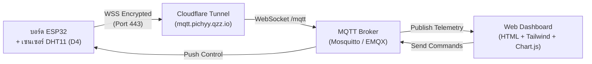
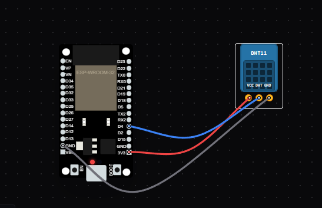
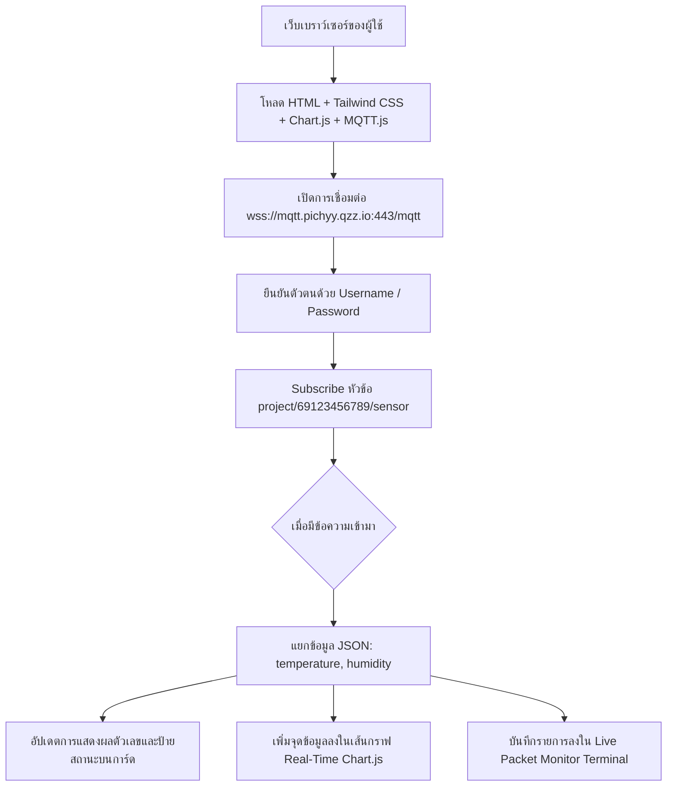

# ปฏิบัติการ: ระบบตรวจวัดสภาพแวดล้อม ESP32 + DHT11 ผ่าน MQTT over WSS (Port 443) และ Web Dashboard

*(LBtech IoT Architecture: Microcontroller Telemetry -> Secure WebSocket -> MQTT Broker via Cloudflare Tunnel -> Real-Time Web Interface)*

> [!NOTE]
> **ข้อมูลปฏิบัติการและเอกสารแนบ**
>
> | รายการ | รายละเอียด |
> | :--- | :--- |
> | รายวิชา | `31909-2002` การออกแบบส่วนต่อประสานสำหรับงาน IoT |
> | ระดับชั้น | ประกาศนียบัตรวิชาชีพชั้นสูง (ปวส.) สาขาวิชาเทคโนโลยีคอมพิวเตอร์ |
> | ฮาร์ดแวร์เป้าหมาย | บอร์ดไมโครคอนโทรลเลอร์ ESP32 และเซนเซอร์วัดอุณหภูมิความชื้น DHT11 (ขา D4) |
> | โพรโทคอลสื่อสาร | MQTT over WSS (Secure WebSocket) พอร์ต 443 ผ่าน Cloudflare Tunnel |
> | โฮสต์โบรกเกอร์ | `mqtt.pichyy.qzz.io:443/mqtt` |
> | หน้าจอส่วนต่อประสาน | Web Dashboard (HTML5, Tailwind CSS, MQTT.js, Chart.js) |
> | ไฟล์หน้าจอควบคุม | [[iot-dashboard.html]] |
> | ภาพผังวงจรจำลอง | `` |

> [!IMPORTANT]
> **จุดประสงค์การเรียนรู้เชิงปฏิบัติการ**
> 1. เข้าใจหลักการและสถาปัตยกรรมของ **MQTT over WebSockets (WSS)** ที่วิ่งผ่านพอร์ต 443 (HTTPS/WSS)
> 2. อธิบายเหตุผลและความจำเป็นในการใช้ **Cloudflare Tunnel** เพื่อแก้ปัญหาไฟร์วอลล์และ NAT ของระบบเครือข่ายสถานศึกษา
> 3. ออกแบบและประยุกต์ใช้ **Adapter Pattern** ในภาษา C++ (`WebSocketClientAdapter`) เพื่อแปลงสตรีมของ WebSocketsClient ให้เป็นอินเตอร์เฟซ Stream มาตรฐานสำหรับไลบรารี MQTT
> 4. กำหนดโครงสร้างข้อความโทรมาตร (Telemetry Payload) ในรูปแบบ **JSON** และกำหนดหัวข้อการสื่อสาร (Topics) แบบแยกสองทิศทาง (Sensor Data vs Remote Control)
> 5. พัฒนาและเชื่อมต่อหน้าจอ **Web Dashboard** เพื่อแสดงผลเกจวัด ค่าอุณหภูมิ-ความชื้น กราฟสถิติแบบ Real-Time และแผงสวิตช์ส่งคำสั่งควบคุมทางไกล

---

## 1. สถาปัตยกรรมระบบ (System Architecture)

ในการทำงานจริงของระบบ IoT ระดับองค์กรหรือการจำลองผ่านเครือข่ายอินเทอร์เน็ตภายนอก บ่อยครั้งที่พอร์ต MQTT ดั้งเดิม (พอร์ต 1883 สำหรับ TCP ธรรมดา หรือพอร์ต 8883 สำหรับ MQTTS) จะถูกบล็อกโดยไฟร์วอลล์ของสถานศึกษาหรือผู้ให้บริการอินเทอร์เน็ต

ระบบ **LBtech IoT** แก้ปัญหานี้ด้วยการนำ **MQTT over WSS (Secure WebSocket)** วิ่งผ่าน **พอร์ต 443** ซึ่งเป็นพอร์ตเดียวกับเว็บเบราว์เซอร์ปลอดภัย (HTTPS) ร่วมกับ **Cloudflare Tunnel** ทำให้สามารถรับส่งข้อมูลได้จากทุกที่โดยไม่ต้องทำ Port Forwarding ที่เราเตอร์



---

## 2. แผนผังวงจรและการเชื่อมต่อฮาร์ดแวร์ (Circuit Wiring)

ระบบจำลองการทำงานด้วยบอร์ด **ESP32 NodeMCU** เชื่อมต่อกับเซนเซอร์ **DHT11** จำนวน 1 ตัว บนขาพอร์ตดิจิทัล D4



> [!NOTE]
> **ตารางการเชื่อมต่อขาฮาร์ดแวร์ (Pin Connections)**
>
> | เซนเซอร์ DHT11 | บอร์ด ESP32 DevKit | สีสายสัญญาณในวงจร | หน้าที่ |
> | :--- | :--- | :--- | :--- |
> | **VCC** | **3V3** | สีแดง (Red) | แรงดันไฟเลี้ยง 3.3V |
> | **DAT / OUT** | **GPIO 4 (D4)** | สีน้ำเงิน (Blue) | สัญญาณข้อมูลดิจิทัล One-Wire Bus |
> | **GND** | **GND** | สีเทา/ดำ (Grey/Black) | กราวด์ร่วมของระบบ |

### ข้อมูลจำลองวงจรบน Wokwi (`diagram.json`)
```json
{
  "version": 1,
  "author": "LBtech IoT",
  "editor": "wokwi",
  "parts": [
    { "type": "board-esp32-devkit-c-v4", "id": "esp", "top": 0, "left": 0, "attrs": {} },
    { "type": "wokwi-dht11", "id": "dht", "top": -40, "left": 160, "attrs": { "temperature": "28.5", "humidity": "65" } }
  ],
  "connections": [
    [ "esp:TX", "$serialMonitor:RX", "", [] ],
    [ "esp:RX", "$serialMonitor:TX", "", [] ],
    [ "esp:3V3", "dht:VCC", "red", [ "v0" ] ],
    [ "esp:4", "dht:SDA", "blue", [ "v0" ] ],
    [ "esp:GND.1", "dht:GND", "gray", [ "v0" ] ]
  ]
}
```

---

## 3. ข้อกำหนดหัวข้อ MQTT และโครงสร้างข้อมูล (Topics & Payload Schema)

### 3.1 ข้อมูลการเชื่อมต่อ Broker
* **Host:** `mqtt.pichyy.qzz.io`
* **Port:** `443` (WSS / Secure WebSocket)
* **Path:** `/mqtt`
* **Username:** `69123456789`
* **Password:** `News030347`
* **Client ID (ESP32):** `esp32-dht11-69123456789`
* **Client ID (Web):** `web-dashboard-[สุ่มอักษร]`

### 3.2 หัวข้อการสื่อสาร (Topics)

> [!IMPORTANT]
> **ตารางกำหนดข้อตกลง Interface ระหว่าง ESP32 กับ Web Dashboard**
>
> | ชื่อตัวแปร Topic | เส้นทาง Topic | ทิศทางข้อมูล | ชนิดข้อมูล | คำอธิบาย |
> | :--- | :--- | :---: | :---: | :--- |
> | `topic_sensor` | `project/69123456789/sensor` | ESP32 -> Web | JSON | ส่งค่าอุณหภูมิและความชื้นทุก 5 วินาที |
> | `topic_control` | `project/69123456789/control` | Web -> ESP32 | String / JSON | ส่งคำสั่งควบคุมอุปกรณ์ทางไกล |

#### โครงสร้าง JSON ของ `topic_sensor` (ส่งทุก 5 วินาที)
```json
{
  "temperature": 29.5,
  "humidity": 68.0,
  "device": "esp32-dht11"
}
```

#### ชุดคำสั่งควบคุมทางไกลผ่าน `topic_control`
* `LED_ON`: สั่งเปิดหลอดไฟสถานะบนบอร์ด
* `LED_OFF`: สั่งปิดหลอดไฟสถานะบนบอร์ด
* `RELAY_ON`: สั่งเปิดรีเลย์ควบคุมโหลดไฟฟ้า
* `RELAY_OFF`: สั่งปิดรีเลย์ควบคุมโหลดไฟฟ้า
* Payload แบบกำหนดเอง (Custom): เช่น `BEEP` หรือ `{"fan": true}`

---

## 4. ซอร์สโค้ดฝั่งอุปกรณ์ (ESP32 C++ Source Code)

ซอร์สโค้ดนี้ใช้ **Adapter Pattern** สร้างคลาส `WebSocketClientAdapter` เพื่อสืบทอดจาก `Client` ของ Arduino ทำให้สามารถนำไลบรารี `MQTTClient` ปกติมาส่งข้อมูลผ่าน `WebSocketsClient` ที่เข้ารหัส WSS บนพอร์ต 443 ได้อย่างแนบเนียน

```cpp
// ========================================================
// LBtech IoT: ESP32 + DHT11 (Pin D4) MQTT over WSS (Port 443)
// ========================================================
#include <WiFi.h>
#include <WiFiClientSecure.h>
#include <WebSocketsClient.h>
#include <MQTT.h>
#include <DHT.h>
#include <vector>

// Adapter แปลง WebSocketsClient ให้เป็น Client Stream สำหรับไลบรารี MQTT
class WebSocketClientAdapter : public Client {
private:
  WebSocketsClient& _ws;
  std::vector<uint8_t> _rxBuffer;
public:
  WebSocketClientAdapter(WebSocketsClient& ws) : _ws(ws) {}
  void feed(uint8_t* payload, size_t length) {
    _rxBuffer.insert(_rxBuffer.end(), payload, payload + length);
  }
  int connect(IPAddress ip, uint16_t port) override { return 1; }
  int connect(const char *host, uint16_t port) override { return 1; }
  size_t write(uint8_t b) override { return write(&b, 1); }
  size_t write(const uint8_t *buf, size_t size) override {
    if (_ws.isConnected()) {
      _ws.sendBIN(buf, size);
      return size;
    }
    return 0;
  }
  int available() override { return (int)_rxBuffer.size(); }
  int read() override {
    if (_rxBuffer.empty()) return -1;
    uint8_t b = _rxBuffer.front();
    _rxBuffer.erase(_rxBuffer.begin());
    return b;
  }
  int read(uint8_t *buf, size_t size) override {
    size_t toRead = std::min(size, _rxBuffer.size());
    if (toRead == 0) return 0;
    std::copy(_rxBuffer.begin(), _rxBuffer.begin() + toRead, buf);
    _rxBuffer.erase(_rxBuffer.begin(), _rxBuffer.begin() + toRead);
    return (int)toRead;
  }
  int peek() override { return _rxBuffer.empty() ? -1 : _rxBuffer.front(); }
  void flush() override {}
  void stop() override { _rxBuffer.clear(); }
  uint8_t connected() override { return _ws.isConnected(); }
  operator bool() override { return _ws.isConnected(); }
};

#define DHTPIN 4
#define DHTTYPE DHT11
DHT dht(DHTPIN, DHTTYPE);

const char* ssid     = "Ommic-GUST";
const char* password = "";

const char* ws_host = "mqtt.pichyy.qzz.io";
const int   ws_port = 443;
const char* ws_path = "/mqtt";

const char* mqtt_client_id = "esp32-dht11-69123456789";
const char* mqtt_user      = "69123456789";
const char* mqtt_pass      = "News030347";

const char* topic_sensor  = "project/69123456789/sensor";
const char* topic_control = "project/69123456789/control";

WebSocketsClient webSocket;
WebSocketClientAdapter wsClient(webSocket);
MQTTClient mqtt(256);

unsigned long lastSend = 0;

void messageReceived(String &topic, String &payload) {
  Serial.println("[MQTT] ได้รับคำสั่ง [" + topic + "]: " + payload);
}

void webSocketEvent(WStype_t type, uint8_t * payload, size_t length) {
  switch (type) {
    case WStype_DISCONNECTED:
      Serial.println("[WSS] หลุดการเชื่อมต่อ!");
      break;
    case WStype_CONNECTED:
      Serial.println("[WSS] เชื่อมต่อ Cloudflare Tunnel สำเร็จ (Port 443)!");
      break;
    case WStype_BIN:
      wsClient.feed(payload, length);
      break;
    default:
      break;
  }
}

void connectMQTT() {
  Serial.print("กำลังเชื่อมต่อ MQTT Broker...");
  while (!mqtt.connect(mqtt_client_id, mqtt_user, mqtt_pass)) {
    Serial.print(".");
    webSocket.loop();
    delay(500);
  }
  Serial.println("\nเชื่อมต่อ MQTT สำเร็จ!");
  mqtt.subscribe(topic_control);
}

void setup() {
  Serial.begin(115200);
  dht.begin();

  WiFi.begin(ssid, password);
  Serial.print("กำลังเชื่อมต่อ WiFi");
  while (WiFi.status() != WL_CONNECTED) {
    delay(500);
    Serial.print(".");
  }
  Serial.println("\nWiFi เชื่อมต่อแล้ว!");

  webSocket.beginSSL(ws_host, ws_port, ws_path, "", "mqtt");
  webSocket.onEvent(webSocketEvent);
  webSocket.setReconnectInterval(5000);

  mqtt.begin(wsClient);
  mqtt.onMessage(messageReceived);
}

void loop() {
  webSocket.loop();
  mqtt.loop();

  if (webSocket.isConnected() && !mqtt.connected()) {
    connectMQTT();
  }

  if (millis() - lastSend > 5000) {
    lastSend = millis();

    float humidity = dht.readHumidity();
    float temperature = dht.readTemperature();

    if (isnan(humidity) || isnan(temperature)) {
      Serial.println("[DHT11] อ่านค่าไม่สำเร็จ! ตรวจสอบสายสัญญาณขา D4");
      return;
    }

    String payload = "{";
    payload += "\"temperature\":" + String(temperature, 1) + ",";
    payload += "\"humidity\":" + String(humidity, 1) + ",";
    payload += "\"device\":\"esp32-dht11\"";
    payload += "}";

    if (mqtt.connected()) {
      mqtt.publish(topic_sensor, payload);
      Serial.println("ส่งข้อมูล: " + payload);
    }
  }
}
```

---

## 5. การทำงานของส่วนต่อประสาน Web Dashboard (`iot-dashboard.html`)

หน้าจอ Web Dashboard ถูกสร้างขึ้นด้วยสถาปัตยกรรม Single Page Application (SPA) ทำงานบนเบราว์เซอร์โดยตรงโดยไม่ต้องมี Web Backend:



### องค์ประกอบหลักของหน้าจอ Web Dashboard
1. **Header & Live Connection Badge:** แสดงสถานะการเชื่อมต่อกับ WSS Broker (Connecting, Connected, Disconnected) พร้อมปุ่ม Reconnect ด้วยตนเอง
2. **Metrics Cards (4 การ์ด):**
   * **Temperature Card:** แสดงอุณหภูมิปัจจุบัน (°C) และป้ายประเมินสภาวะ (Optimal, High, Cool)
   * **Humidity Card:** แสดงความชื้นสัมพัทธ์ (%RH) และป้ายประเมินสภาวะ (Normal, Humid, Dry)
   * **Packets Received:** ตัวนับจำนวนแพ็กเก็ตที่ได้รับทั้งหมด พร้อมตัวบอกเวลาความสดของข้อมูล (เช่น `2s ago`)
   * **MCU Target Card:** ข้อมูลอุปกรณ์ระบุ `esp32-dht11` พอร์ต WSS :443 สถานะ Online
3. **Real-Time Sensor Telemetry Chart:** กราฟเส้นแบบ Dual Y-Axis (เส้นสีเขียวสำหรับอุณหภูมิ และเส้นสีน้ำเงินสำหรับความชื้น) เลื่อนจุดข้อมูลตามเวลาจริงย้อนหลัง 20 จุด
4. **Remote Control Panel:** แผงปุ่มกดส่งคำสั่งด่วนไปยัง `topic_control` ได้แก่ `LED_ON`, `LED_OFF`, `RELAY_ON`, `RELAY_OFF` และช่องกรอกข้อความคำสั่งแบบ Custom
5. **Live MQTT Packet Monitor:** หน้าต่างเทอร์มินัลแสดง Log ทุกแพ็กเก็ตทั้งขาเข้า (IN / Telemetry) และขาออก (OUT / Control) แบบ Real-Time

> [!TIP]
> สามารถเปิดไฟล์หน้าจอเพื่อใช้งานและทดสอบได้ทันทีที่: [[iot-dashboard.html]]

---

## 6. ลำดับขั้นตอนการทดสอบระบบ (Verification Steps)

1. **เตรียมไลบรารีใน Arduino IDE หรือ Wokwi:**
   * `WebSocketsClient` (โดย Markus Sattler)
   * `MQTT` (โดย Joel Gaehwiler)
   * `DHT sensor library` (โดย Adafruit)
2. **อัปโหลดโค้ดลง ESP32:**
   * ตรวจสอบการต่อสายขา D4 ของ DHT11
   * เปิด Serial Monitor ที่ความเร็ว 115200 bps
   * สังเกตข้อความ `[WSS] เชื่อมต่อ Cloudflare Tunnel สำเร็จ (Port 443)!` และ `เชื่อมต่อ MQTT สำเร็จ!`
3. **เปิดหน้าจอ Web Dashboard:**
   * ดับเบิลคลิกเปิดไฟล์ `iot-dashboard.html` บนเว็บเบราว์เซอร์ (Google Chrome, Edge, Safari)
   * สังเกตไฟสถานะที่มุมขวาบนจะเปลี่ยนจากสีเหลืองเป็นสีเขียว `WSS Connected`
4. **ทดสอบการรับค่าโทรมาตร (Telemetry):**
   * ตรวจสอบว่าตัวเลขบนการ์ดอุณหภูมิและความชื้นอัปเดตทุก 5 วินาที
   * สังเกตเส้นกราฟ Chart.js ค่อยๆ ขยับวาดจุดตามเวลา
5. **ทดสอบการสั่งการทางไกล (Remote Control):**
   * กดปุ่ม `LED ON` หรือ `RELAY ON` บนหน้าเว็บ
   * สังเกต Serial Monitor ของ ESP32 จะพิมพ์ข้อความ:
     `[MQTT] ได้รับคำสั่ง [project/69123456789/control]: LED_ON`
