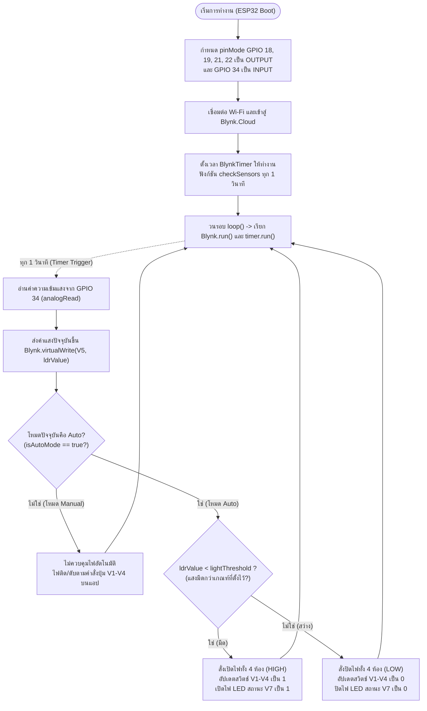

# แบบฝึกหัดและใบงานปฏิบัติการ: ระบบควบคุมหลอดไฟ 4 ห้องผ่าน Blynk IoT และ Wokwi

*(Smart Home Lighting Control with 4-Room Actuation, LDR Automatic Sensing, and Dynamic Threshold Tuning)*

> [!info] ข้อมูลใบงานปฏิบัติการ
>
> | รายการ | รายละเอียด |
> | :--- | :--- |
> | รายวิชา | `31909-2002` การออกแบบส่วนต่อประสานสำหรับงาน IoT |
> | ระดับชั้น | ปวส. ชั้นปีที่ 1 / ปีที่ 2 สาขาวิชาเทคโนโลยีคอมพิวเตอร์ |
> | สัปดาห์ / หน่วยการเรียน | สัปดาห์ที่ 5 / หน่วยที่ 1 (ส่วนต่อประสานสำหรับงาน IoT และ Blynk Platform) |
> | เวลาปฏิบัติการ | 3 ชั่วโมง (150 นาที) |
> | คะแนนเต็ม | **20 คะแนน** (เกณฑ์ประเมินทักษะปฏิบัติ 5 มิติ) + โบนัสท้าทาย 3 คะแนน |
> | เครื่องมือที่ใช้ | โปรแกรมจำลองวงจร [Wokwi.com](https://wokwi.com), แพลตฟอร์ม [Blynk.Cloud](https://blynk.cloud) และสมาร์ตโฟน (Blynk IoT App) |
> | เนื้อหาอ้างอิง | [[บทที่ 1 - พื้นฐานส่วนต่อประสาน IoT Protocols และแอปพลิเคชัน Blynk]] |

---

## 1. จุดประสงค์เชิงปฏิบัติการ (Actionable Objectives)

เมื่อนักศึกษาทำแบบฝึกหัดปฏิบัติการชุดนี้สำเร็จ จะต้องสามารถ:
- [ ] **ออกแบบและกำหนด Datastreams (Virtual Pins)** บนแพลตฟอร์ม Blynk Cloud เพื่อใช้เป็นส่วนต่อประสานส่งผ่านข้อมูลระหว่างฮาร์ดแวร์กับผู้ใช้ได้อย่างถูกต้อง
- [ ] **ออกแบบส่วนต่อประสานผู้ใช้แบบกราฟิก (GUI Dashboard)** บนมือถือและเว็บบราวเซอร์ โดยจัดวางวิตเจ็ต (Switch, Slider, Gauge, LED) ได้อย่างเป็นระเบียบ สะอาดตา และใช้งานง่ายตามหลัก UX/UI
- [ ] **ต่อวงจรจำลองบน Wokwi Simulator** โดยเชื่อมต่อไมโครคอนโทรลเลอร์ ESP32 ร่วมกับตัวต้านทานปรับค่าตามแสง (LDR Photoresistor) และหลอด LED แสดงผล 4 หลอดได้อย่างถูกต้องตามหลักไฟฟ้า
- [ ] **เขียนโปรแกรมภาษา C++ (Arduino Framework)** ควบคุมการทำงานแบบ **2 โหมด (Manual Mode และ Auto Mode)**
- [ ] **เชื่อมโยงตรรกะการตัดสินใจ:** สามารถปรับแต่งค่าเกณฑ์ระดับความสว่าง (Threshold) แบบ Dynamic จากสไลเดอร์บนหน้าจอมือถือ แล้วนำค่านั้นมาตัดสินใจเปิด-ปิดหลอดไฟตามสภาพแวดล้อมได้แบบ Real-Time
- [ ] **ใช้คำสั่ง `BlynkTimer`** ในการจัดตารางเวลาอ่านเซนเซอร์โดยไม่ใช้ `delay()` เพื่อรักษาเสถียรภาพการเชื่อมต่อของระบบ IoT

---

## 2. สถานการณ์จำลอง (Scenario)

บริษัท **Smart Living Automation** ได้รับโจทย์จากเจ้าของบ้านพักอาศัย ให้ติดตั้งระบบไฟฟ้าส่องสว่างอัจฉริยะครอบคลุม **4 ห้องหลัก** ได้แก่:
1. **ห้องนั่งเล่น (Living Room)**
2. **ห้องนอน (Bedroom)**
3. **ห้องครัว (Kitchen)**
4. **ห้องทำงาน (Study Room)**

นอกจากนี้ เจ้าของบ้านต้องการ **ระบบประหยัดพลังงานอัจฉริยะ (Eco-Smart Lighting)** โดยติดตั้ง **เซนเซอร์ตรวจวัดความเข้มแสงแดดธรรมชาติ (LDR Sensor)** ไว้ภายนอกบ้าน 1 ตัว เพื่อคอยตรวจสอบความสว่างในแต่ละช่วงเวลา

```
                   ┌───────────────────────────────────────┐
                   │    สมาร์ตโฟนของเจ้าของบ้าน (Blynk App) │
                   │  - สลับโหมด [Manual / Auto]           │
                   │  - ปุ่มเปิด/ปิดไฟแยก 4 ห้อง             │
                   │  - เข็มเกจแสดงความเข้มแสงแดดปัจจุบัน   │
                   │  - แถบสไลเดอร์ตั้งค่า Threshold แสง    │
                   └───────────────────▲───────────────────┘
                                       │ (Wi-Fi Internet)
                                       ▼
                   ┌───────────────────────────────────────┐
                   │        บอร์ดสมองกลฝังตัว ESP32         │
                   │           (จำลองบน Wokwi)             │
                   └───────┬───────────────────────┬───────┘
                           │                       │
              (อ่านค่าแรงดันแอนะล็อก)         (สั่งขับไฟจ่ายกระแส)
                           │                       │
                           ▼                       ▼
                   ┌──────────────┐        ┌───────────────────────┐
                   │ เซนเซอร์ LDR │        │ หลอดไฟ LED ประจำ 4 ห้อง│
                   │  (วัดแสงแดด) │        │ [ห้อง 1] [ห้อง 2]     │
                   │   GPIO 34    │        │ [ห้อง 3] [ห้อง 4]     │
                   └──────────────┘        │ GPIO: 18, 19, 21, 22  │
                                           └───────────────────────┘
```

### ข้อกำหนดการทำงานของระบบ (Functional Specifications)

1. **โหมดควบคุมเองด้วยมือ (Manual Mode):**
   - ผู้ใช้สามารถกดสวิตช์เปิดหรือปิดไฟของแต่ละห้องได้อย่างอิสระ ผ่านปุ่มกดทั้ง 4 ปุ่มบนแอปพลิเคชัน Blynk
   - ระบบจะไม่นำค่าจากเซนเซอร์ LDR มาสั่งเปิดหรือปิดไฟ
2. **โหมดเปิดปิดไฟอัตโนมัติตามแสง (Auto Mode):**
   - บอร์ด ESP32 จะอ่านค่าความสว่างจากเซนเซอร์ LDR ตลอดเวลา (ส่งค่าขึ้นไปแสดงบนเข็มเกจบนแอป)
   - หาก **ค่าความเข้มแสง น้อยกว่าค่าเกณฑ์ (LDR < Threshold)** ซึ่งแสดงว่า *"ท้องฟ้ามืดแล้วหรือเข้าสู่ช่วงค่ำ"* → **ระบบจะสั่งเปิดไฟทั้ง 4 ห้องโดยอัตโนมัติ** พร้อมส่งสัญญาณไฟ LED บนแอปว่า "ระบบไฟอัตโนมัติกำลังทำงาน"
   - หาก **ค่าความเข้มแสง มากกว่าหรือเท่ากับเกณฑ์ (LDR >= Threshold)** ซึ่งแสดงว่า *"มีแสงแดดเพียงพอแล้ว"* → **ระบบจะสั่งปิดไฟทั้ง 4 ห้องโดยอัตโนมัติ** เพื่อประหยัดค่าไฟฟ้า
3. **การตั้งค่าเกณฑ์แสงแบบไดนามิก (Dynamic Threshold Tuning):**
   - เจ้าของบ้านแต่ละคนมีความชอบไม่เหมือนกัน บางคนชอบให้เปิดไฟตั้งแต่เริ่มโพล้เพล้ บางคนชอบให้เปิดตอนมืดสนิท
   - **ห้ามฮาร์ดโค้ด (Hard-code) ตัวเลขเกณฑ์ไว้ในโปรแกรมบอร์ด!** 
   - ผู้ใช้ต้องสามารถเลื่อน **Slider Widget บนแอป Blynk** เพื่อปรับเปลี่ยนค่าเกณฑ์ความไวแสงได้ตามต้องการในทันที

---

## 3. แผนผังการต่อวงจรใน Wokwi (Circuit Connection)

เพื่อให้นักศึกษาฝึกปฏิบัติตามมาตรฐานงานสมองกลฝังตัว ให้ต่อวงจรไมโครคอนโทรลเลอร์ ESP32 บนโปรแกรมจำลอง **Wokwi** ดังนี้:

> [!info] ตารางการต่อขาฮาร์ดแวร์ (Hardware Pin Assignment)
>
> | อุปกรณ์ | ขาบนอุปกรณ์ | ขาบน ESP32 | หน้าที่การทำงาน |
> | :--- | :--- | :--- | :--- |
> | **LED 1 (สีเขียว)** | ขา Anode (+) ผ่าน R 220Ω / Cathode ลง GND | **GPIO 18** | ตัวแทนหลอดไฟ: ห้องนั่งเล่น |
> | **LED 2 (สีแดง)** | ขา Anode (+) ผ่าน R 220Ω / Cathode ลง GND | **GPIO 19** | ตัวแทนหลอดไฟ: ห้องนอน |
> | **LED 3 (สีเหลือง)** | ขา Anode (+) ผ่าน R 220Ω / Cathode ลง GND | **GPIO 21** | ตัวแทนหลอดไฟ: ห้องครัว |
> | **LED 4 (สีน้ำเงิน)** | ขา Anode (+) ผ่าน R 220Ω / Cathode ลง GND | **GPIO 22** | ตัวแทนหลอดไฟ: ห้องทำงาน |
> | **LDR Module** | ขา VCC (ต่อเข้า 3.3V), GND (ลง GND)<br>ขา Signal / AO (สัญญาณแอนะล็อก) | **GPIO 34** (ADC1_CH6) | เซนเซอร์ตรวจวัดความเข้มแสง (0–4095) |

> [!tip] ตัวอย่างโครงสร้างไฟล์ `diagram.json` ของ Wokwi (สำหรับตรวจสอบการต่อสาย)
> หากนักศึกษาต้องการตรวจสอบหรืออิมพอร์ตผังวงจรลงใน Wokwi สามารถใช้โครงสร้าง JSON นี้เป็นแนวทางได้:
> ```json
> {
>   "version": 1,
>   "author": "Pichyy IoT Course",
>   "editor": "wokwi",
>   "parts": [
>     { "type": "board-esp32-devkit-c-v4", "id": "esp", "top": 0, "left": 0, "attrs": {} },
>     { "type": "wokwi-led", "id": "led1", "top": -100, "left": 100, "attrs": { "color": "green" } },
>     { "type": "wokwi-led", "id": "led2", "top": -50, "left": 100, "attrs": { "color": "red" } },
>     { "type": "wokwi-led", "id": "led3", "top": 0, "left": 100, "attrs": { "color": "yellow" } },
>     { "type": "wokwi-led", "id": "led4", "top": 50, "left": 100, "attrs": { "color": "blue" } },
>     { "type": "wokwi-resistor", "id": "r1", "top": -90, "left": 160, "attrs": { "value": "220" } },
>     { "type": "wokwi-resistor", "id": "r2", "top": -40, "left": 160, "attrs": { "value": "220" } },
>     { "type": "wokwi-resistor", "id": "r3", "top": 10, "left": 160, "attrs": { "value": "220" } },
>     { "type": "wokwi-resistor", "id": "r4", "top": 60, "left": 160, "attrs": { "value": "220" } },
>     { "type": "wokwi-photoresistor-sensor", "id": "ldr", "top": -100, "left": -120, "attrs": {} }
>   ],
>   "connections": [
>     [ "esp:TX", "$serialMonitor:RX", "", [] ],
>     [ "esp:RX", "$serialMonitor:TX", "", [] ],
>     [ "esp:18", "led1:A", "green", [ "v0" ] ],
>     [ "led1:C", "r1:1", "black", [ "v0" ] ],
>     [ "r1:2", "esp:GND.1", "black", [ "v0" ] ],
>     [ "esp:19", "led2:A", "red", [ "v0" ] ],
>     [ "led2:C", "r2:1", "black", [ "v0" ] ],
>     [ "r2:2", "esp:GND.1", "black", [ "v0" ] ],
>     [ "esp:21", "led3:A", "gold", [ "v0" ] ],
>     [ "led3:C", "r3:1", "black", [ "v0" ] ],
>     [ "r3:2", "esp:GND.1", "black", [ "v0" ] ],
>     [ "esp:22", "led4:A", "blue", [ "v0" ] ],
>     [ "led4:C", "r4:1", "black", [ "v0" ] ],
>     [ "r4:2", "esp:GND.1", "black", [ "v0" ] ],
>     [ "esp:3V3", "ldr:VCC", "red", [ "v0" ] ],
>     [ "esp:GND.2", "ldr:GND", "black", [ "v0" ] ],
>     [ "esp:34", "ldr:AO", "orange", [ "v0" ] ]
>   ]
> }
> ```

---

## 4. ข้อกำหนดการออกแบบส่วนต่อประสาน (Blynk Datastreams & UI Specification)

นักศึกษาต้องล็อกอินเข้าสู่ **Blynk.Cloud** แล้วสร้าง Template ใหม่ชื่อ `Smart Home Lighting 4-Room` โดยกำหนดตาราง Datastreams ตามตารางนี้อย่างเคร่งครัด:

> [!important] ตารางกำหนดข้อตกลง Interface (Virtual Pin Datastream Map)
>
> | Virtual Pin | ชื่อ Datastream | ชนิดข้อมูล (Data Type) | ช่วงค่า (Range) | หน้าที่และความหมาย | ชนิด Widget บนหน้าจอ |
> | :---: | :--- | :---: | :---: | :--- | :--- |
> | `V0` | `System_Mode` | Integer | `0` ถึง `1` | `0` = โหมด Manual, `1` = โหมด Auto | **Segmented Switch** หรือ **Switch** |
> | `V1` | `Light_Room1` | Integer | `0` ถึง `1` | ควบคุมไฟห้องนั่งเล่น (`0`=ปิด, `1`=เปิด) | **Button** (โหมด Switch) |
> | `V2` | `Light_Room2` | Integer | `0` ถึง `1` | ควบคุมไฟห้องนอน (`0`=ปิด, `1`=เปิด) | **Button** (โหมด Switch) |
> | `V3` | `Light_Room3` | Integer | `0` ถึง `1` | ควบคุมไฟห้องครัว (`0`=ปิด, `1`=เปิด) | **Button** (โหมด Switch) |
> | `V4` | `Light_Room4` | Integer | `0` ถึง `1` | ควบคุมไฟห้องทำงาน (`0`=ปิด, `1`=เปิด) | **Button** (โหมด Switch) |
> | `V5` | `LDR_Light_Value` | Integer | `0` ถึง `4095` | ค่าความเข้มแสงสดจากเซนเซอร์ LDR | **Gauge** หรือ **Value Display** |
> | `V6` | `Light_Threshold` | Integer | `0` ถึง `4095` | เกณฑ์ความสว่างสำหรับสั่งไฟติดอัตโนมัติ | **Slider** (ปรับค่าได้ 0-4095) |
> | `V7` | `Auto_Light_Status` | Integer | `0` ถึง `1` | สถานะแจ้งเตือนว่าขณะนี้ระบบ Auto เปิดไฟอยู่ | **LED Widget** บนหน้าจอ |

### คำแนะนำการจัดวางหน้าจอ (UI Layout Best Practices)
1. **โซนที่ 1 (ด้านบนสุด):** วางตัวสลับโหมดหลัก (`V0`) พร้อมป้ายบอกสถานะว่าขณะนี้กำลังอยู่ในโหมดใด
2. **โซนที่ 2 (ส่วนเซนเซอร์วัดแสง):** วางเข็มเกจวัดค่าแสงปัจจุบัน (`V5`) ควบคู่กับแถบสไลเดอร์ปรับเกณฑ์ (`V6`) และไฟสถานะระบบอัตโนมัติ (`V7`)
3. **โซนที่ 3 (ส่วนควบคุมหลอดไฟ 4 ห้อง):** วางปุ่มสวิตช์ 4 ปุ่ม (`V1`-`V4`) จัดเรียงแบบกริด 2x2 หรือเรียงแถวแนวตั้ง พร้อมระบุชื่อห้องและเลือกสีปุ่มให้สอดคล้องกับสีหลอด LED จริง

---

## 5. ผังงานการทำงานของระบบ (System Logic Flowchart)



---

## 6. ซอร์สโค้ดโปรแกรมต้นแบบ (Complete Working Code)

ให้นักศึกษานำซอร์สโค้ดนี้ไปเปิดและปรับแต่งในแท็บ `sketch.ino` บน Wokwi โดยต้องนำค่า **`BLYNK_TEMPLATE_ID`**, **`BLYNK_TEMPLATE_NAME`** และ **`BLYNK_AUTH_TOKEN`** ของตนเองมาใส่ใน 3 บรรทัดแรก:

```cpp
/*
 * =========================================================================
 * รายวิชา: 31909-2002 การออกแบบส่วนต่อประสานสำหรับงาน IoT
 * ใบงานปฏิบัติการ: ระบบควบคุมหลอดไฟ 4 ห้องผ่าน Blynk และ Wokwi
 * สาขาวิชาเทคโนโลยีคอมพิวเตอร์ วิทยาลัยเทคนิคลพบุรี
 * =========================================================================
 */

// 1. ใส่ข้อมูล Template และ Auth Token จากบัญชี Blynk.Cloud ของนักศึกษา
#define BLYNK_TEMPLATE_ID   "TMPLxxxxxx"
#define BLYNK_TEMPLATE_NAME "Smart Home Lighting 4-Room"
#define BLYNK_AUTH_TOKEN    "Your_Auth_Token_Here"

// 2. เรียกใช้งานไลบรารีที่จำเป็น
#include <WiFi.h>
#include <WiFiClient.h>
#include <BlynkSimpleEsp32.h>

// 3. กำหนดข้อมูลการเชื่อมต่อ Wi-Fi สำหรับโปรแกรมจำลอง Wokwi
char ssid[] = "Wokwi-GUEST";
char pass[] = "";

// 4. กำหนดหมายเลขขาฮาร์ดแวร์ (GPIO Assignment)
const int PIN_LED_ROOM1 = 18;  // ห้องนั่งเล่น (เขียว)
const int PIN_LED_ROOM2 = 19;  // ห้องนอน (แดง)
const int PIN_LED_ROOM3 = 21;  // ห้องครัว (เหลือง)
const int PIN_LED_ROOM4 = 22;  // ห้องทำงาน (น้ำเงิน)
const int PIN_LDR_SENSOR = 34; // เซนเซอร์วัดแสง LDR (Analog Input)

// 5. ตัวแปรเก็บสถานะของระบบ
bool isAutoMode = false;       // สถานะโหมด: false = Manual, true = Auto
int lightThreshold = 1500;     // ค่าเกณฑ์ความสว่างเริ่มต้น (ปรับได้จาก Slider V6)
int currentLightValue = 0;     // ตัวแปรเก็บค่าแสงสดที่อ่านได้จากเซนเซอร์

// 6. ประกาศอ็อบเจกต์ตัวจับเวลา (ป้องกันการใช้ delay)
BlynkTimer timer;

// =========================================================================
// ฟังก์ชันจัดการเหตุการณ์เมื่อมีการสั่งงานจาก Blynk App (Virtual Pins Callback)
// =========================================================================

// V0: สวิตช์สลับโหมด Manual (0) / Auto (1)
BLYNK_WRITE(V0) {
    int modeVal = param.asInt();
    isAutoMode = (modeVal == 1);
    
    Serial.print("[System Mode Changed]: ");
    if (isAutoMode) {
        Serial.println("โหมดอัตโนมัติ (AUTO MODE) เปิดทำงาน");
    } else {
        Serial.println("โหมดควบคุมด้วยมือ (MANUAL MODE) เปิดทำงาน");
        Blynk.virtualWrite(V7, 0); // ดับไฟเตือน Auto Status
    }
}

// V1: ควบคุมไฟห้องที่ 1 (เฉพาะเมื่ออยู่ในโหมด Manual)
BLYNK_WRITE(V1) {
    if (!isAutoMode) {
        int state = param.asInt();
        digitalWrite(PIN_LED_ROOM1, state);
        Serial.printf("[Manual] ห้องนั่งเล่น: %s\n", state ? "เปิดไฟ" : "ปิดไฟ");
    }
}

// V2: ควบคุมไฟห้องที่ 2 (เฉพาะเมื่ออยู่ในโหมด Manual)
BLYNK_WRITE(V2) {
    if (!isAutoMode) {
        int state = param.asInt();
        digitalWrite(PIN_LED_ROOM2, state);
        Serial.printf("[Manual] ห้องนอน: %s\n", state ? "เปิดไฟ" : "ปิดไฟ");
    }
}

// V3: ควบคุมไฟห้องที่ 3 (เฉพาะเมื่ออยู่ในโหมด Manual)
BLYNK_WRITE(V3) {
    if (!isAutoMode) {
        int state = param.asInt();
        digitalWrite(PIN_LED_ROOM3, state);
        Serial.printf("[Manual] ห้องครัว: %s\n", state ? "เปิดไฟ" : "ปิดไฟ");
    }
}

// V4: ควบคุมไฟห้องที่ 4 (เฉพาะเมื่ออยู่ในโหมด Manual)
BLYNK_WRITE(V4) {
    if (!isAutoMode) {
        int state = param.asInt();
        digitalWrite(PIN_LED_ROOM4, state);
        Serial.printf("[Manual] ห้องทำงาน: %s\n", state ? "เปิดไฟ" : "ปิดไฟ");
    }
}

// V6: สไลเดอร์ปรับค่าเกณฑ์แสง (Threshold) แบบ Dynamic
BLYNK_WRITE(V6) {
    lightThreshold = param.asInt();
    Serial.printf("[Threshold Updated] ค่าเกณฑ์แสงใหม่: %d\n", lightThreshold);
}

// =========================================================================
// ฟังก์ชันอ่านเซนเซอร์และตัดสินใจตรรกะอัตโนมัติ (รันทุกๆ 1 วินาที)
// =========================================================================
void checkLightAndProcessLogic() {
    // 1. อ่านค่าความสว่างจากเซนเซอร์ LDR (0 - 4095 บน ESP32 ADC)
    currentLightValue = analogRead(PIN_LDR_SENSOR);
    
    // 2. ส่งค่าแสงสดขึ้นไปแสดงบนเกจหน้าจอแอป (Virtual Pin V5)
    Blynk.virtualWrite(V5, currentLightValue);

    // 3. ตรวจสอบเงื่อนไขหากกำลังทำงานในโหมด Auto
    if (isAutoMode) {
        // หากค่าแสงน้อยกว่า Threshold หมายความว่าสภาพแวดล้อมมืด -> สั่งเปิดไฟ
        if (currentLightValue < lightThreshold) {
            // สั่งเปิดหลอดไฟจริงทั้ง 4 ห้อง
            digitalWrite(PIN_LED_ROOM1, HIGH);
            digitalWrite(PIN_LED_ROOM2, HIGH);
            digitalWrite(PIN_LED_ROOM3, HIGH);
            digitalWrite(PIN_LED_ROOM4, HIGH);

            // ซิงโครไนซ์อัปเดตสวิตช์บนหน้าจอแอปให้แสดงว่าเปิดไฟอยู่
            Blynk.virtualWrite(V1, 1);
            Blynk.virtualWrite(V2, 1);
            Blynk.virtualWrite(V3, 1);
            Blynk.virtualWrite(V4, 1);
            
            // เปิดไฟ LED สถานะ Auto บนหน้าจอแอป
            Blynk.virtualWrite(V7, 255);
            Serial.printf("[Auto Active - DARK] แสง (%d) < เกณฑ์ (%d) -> เปิดไฟทั้ง 4 ห้อง\n", 
                          currentLightValue, lightThreshold);
        } else {
            // หากค่าแสงมากกว่าหรือเท่ากับ Threshold หมายความว่าสว่างแล้ว -> สั่งปิดไฟ
            digitalWrite(PIN_LED_ROOM1, LOW);
            digitalWrite(PIN_LED_ROOM2, LOW);
            digitalWrite(PIN_LED_ROOM3, LOW);
            digitalWrite(PIN_LED_ROOM4, LOW);

            // ซิงโครไนซ์อัปเดตสวิตช์บนหน้าจอแอปให้แสดงว่าปิดไฟ
            Blynk.virtualWrite(V1, 0);
            Blynk.virtualWrite(V2, 0);
            Blynk.virtualWrite(V3, 0);
            Blynk.virtualWrite(V4, 0);

            // ดับไฟ LED สถานะ Auto บนหน้าจอแอป
            Blynk.virtualWrite(V7, 0);
            Serial.printf("[Auto Active - BRIGHT] แสง (%d) >= เกณฑ์ (%d) -> ปิดไฟเพื่อประหยัดพลังงาน\n", 
                          currentLightValue, lightThreshold);
        }
    }
}

// =========================================================================
// ฟังก์ชันเริ่มต้นระบบ (Setup)
// =========================================================================
void setup() {
    Serial.begin(115200);
    Serial.println("\n--- กำลังเริ่มระบบ Smart Home Lighting System ---");

    // กำหนดโหมดการทำงานของขาขาออก (LEDs)
    pinMode(PIN_LED_ROOM1, OUTPUT);
    pinMode(PIN_LED_ROOM2, OUTPUT);
    pinMode(PIN_LED_ROOM3, OUTPUT);
    pinMode(PIN_LED_ROOM4, OUTPUT);

    // กำหนดขาเข้าสำหรับเซนเซอร์ LDR
    pinMode(PIN_LDR_SENSOR, INPUT);

    // เริ่มต้นให้ไฟทุกดวงดับ
    digitalWrite(PIN_LED_ROOM1, LOW);
    digitalWrite(PIN_LED_ROOM2, LOW);
    digitalWrite(PIN_LED_ROOM3, LOW);
    digitalWrite(PIN_LED_ROOM4, LOW);

    // เชื่อมต่อเข้าสู่ระบบ Blynk ผ่าน Wi-Fi
    Blynk.begin(BLYNK_AUTH_TOKEN, ssid, pass);

    // กำหนดให้เรียกฟังก์ชัน checkLightAndProcessLogic ทุก 1000 มิลลิวินาที (1 วินาที)
    timer.setInterval(1000L, checkLightAndProcessLogic);
    
    // กำหนดค่าเริ่มต้นให้กับ Slider บนแอป
    Blynk.virtualWrite(V6, lightThreshold);
    Blynk.virtualWrite(V0, 0); // เริ่มต้นที่โหมด Manual
}

// =========================================================================
// ฟังก์ชันลูปหลัก (Main Loop)
// =========================================================================
void loop() {
    Blynk.run();  // ดูแลรักษาการเชื่อมต่อและรับส่งคำสั่งกับ Blynk Cloud
    timer.run();  // สั่งให้ตัวจับเวลาทำงานตามรอบเวลาที่กำหนด
    // ข้อควรระวัง: ห้ามใส่ delay() ในฟังก์ชันนี้เด็ดขาด!
}
```

---

## 7. ขั้นตอนการลงมือปฏิบัติทีละขั้น (Step-by-Step Guide)

```
[ขั้นที่ 1] สร้าง Blynk Template & กำหนด 8 Datastreams
     │
     ▼
[ขั้นที่ 2] ออกแบบ Dashboard (Web Console & Mobile App)
     │
     ▼
[ขั้นที่ 3] เปิด Wokwi ต่อวงจร ESP32 + LED 4 หลอด + LDR
     │
     ▼
[ขั้นที่ 4] ใส่ไลบรารี Blynk ใน Wokwi และนำ Auth Token วางในโค้ด
     │
     ▼
[ขั้นที่ 5] กด Start Simulation ใน Wokwi แล้วทดสอบจากสมาร์ตโฟน
```

### ขั้นที่ 1: เตรียมการบน Blynk.Cloud
1. เข้าเว็บไซต์ [blynk.cloud](https://blynk.cloud) ล็อกอินเข้าสู่ระบบ
2. ไปที่เมนู **Developer Zone → Templates** กดปุ่ม **+ New Template**
   - Name: `Smart Home Lighting 4-Room`
   - Hardware: `ESP32`
   - Connection Type: `WiFi`
3. ไปที่แท็บ **Datastreams** แล้วกด **+ New Datastream → Virtual Pin** สร้างครบทั้ง 8 ขา (`V0` ถึง `V7`) ตามตารางในหัวข้อที่ 4

### ขั้นที่ 2: วางหน้าจอควบคุม (Dashboard UI)
1. ไปที่แท็บ **Web Dashboard** ใน Template ลากวางวิตเจ็ต:
   - วิตเจ็ต **Switch** สำหรับ `V0` (ตั้งชื่อ: "Manual / Auto Mode")
   - วิตเจ็ต **Switch** 4 ตัวสำหรับ `V1`, `V2`, `V3`, `V4` (ระบุชื่อห้องแต่ละห้อง)
   - วิตเจ็ต **Gauge** สำหรับ `V5` (ตั้งค่า Min: 0, Max: 4095, ชื่อ: "ความสว่างแสงแดด")
   - วิตเจ็ต **Slider** สำหรับ `V6` (ตั้งค่า Min: 0, Max: 4095, ชื่อ: "ตั้งเกณฑ์แสงอัตโนมัติ")
   - วิตเจ็ต **LED** สำหรับ `V7` (ชื่อ: "สถานะเปิดไฟอัตโนมัติ")
2. เปิดแอป **Blynk IoT** บนมือถือ เข้า Template เดียวกัน แล้วจัดวาง Mobile Dashboard ให้สวยงาม

### ขั้นที่ 3: จำลองการทำงานบน Wokwi
1. เข้าเว็บ [wokwi.com](https://wokwi.com) เลือกบอร์ด **ESP32**
2. ในแท็บ **Library Manager** (ไอคอนกล่องเครื่องมือด้านซ้าย) ค้นหาและกดติดตั้งไลบรารี **`Blynk`**
3. ต่อสายวงจรหลอด LED 4 สี พร้อมตัวต้านทาน 220 โอห์ม และเซนเซอร์วัดแสง LDR ตามแผนผังในหัวข้อที่ 3
4. คัดลอก Auth Token จากหน้า **Devices** บน Blynk.Cloud มาใส่ในโค้ดบรรทัดที่ 12
5. กดปุ่มสีเขียว **"Start the simulation"** เพื่อเริ่มทดสอบ!

---

## 8. ตารางกรณีทดสอบ (Test Cases & Verification Matrix)

นักศึกษาต้องทำการทดลองและบันทึกผลการทำงานของระบบให้ครบทั้ง 4 กรณี:

> [!abstract] ตารางบันทึกผลการทดสอบระบบ
>
> | กรณีทดสอบ (Test Case) | การตั้งค่าบน Blynk App | สภาพแวดล้อมบน Wokwi (LDR) | ผลลัพธ์ที่คาดหวัง (Expected Result) | ผลการทดลองจริง (Pass / Fail) |
> | :---: | :--- | :--- | :--- | :---: |
> | **TC-1: ทดสอบ Manual Mode** | ปรับโหมด `V0` = **Manual**<br>กดเปิดสวิตช์ `V1` และ `V3`<br>กดปิดสวิตช์ `V2` และ `V4` | เลื่อนค่าแสง LDR ขึ้นๆ ลงๆ | หลอด LED 1 (เขียว) และ 3 (เหลือง) ต้องสว่าง<br>หลอด LED 2 (แดง) และ 4 (น้ำเงิน) ต้องดับ<br>ค่าแสง LDR ไม่มีผลกระทบต่อหลอดไฟ | `[  ] Pass`<br>`[  ] Fail` |
> | **TC-2: Auto Mode เมื่อแสงมืด** | ปรับโหมด `V0` = **Auto**<br>ตั้ง Slider `V6` (เกณฑ์) = **2000** | เลื่อนเซนเซอร์ LDR ให้มีค่าแสง = **500 lux** (อ่านค่าได้ต่ำกว่า 2000) | หลอด LED ทั้ง 4 หลอดต้อง **ติดสว่างทันที**<br>สวิตช์ V1-V4 บนแอปต้องเด้งเป็นสถานะ ON<br>ไฟ LED Widget V7 บนแอปต้องสว่างขึ้น | `[  ] Pass`<br>`[  ] Fail` |
> | **TC-3: Auto Mode เมื่อแสงสว่าง** | คงโหมด `V0` = **Auto**<br>เกณฑ์ `V6` คงเดิม = **2000** | เลื่อนเซนเซอร์ LDR ให้สว่างขึ้น ค่าแสง = **3500 lux** (สูงกว่า 2000) | หลอด LED ทั้ง 4 หลอดต้อง **ดับลงพร้อมกัน**<br>สวิตช์ V1-V4 บนแอปต้องเด้งกลับเป็น OFF<br>ไฟ LED Widget V7 บนแอปต้องดับลง | `[  ] Pass`<br>`[  ] Fail` |
> | **TC-4: การปรับค่า Threshold แบบ Dynamic** | สภาพแสงปัจจุบันอยู่ที่ **1800 lux** (ไฟเปิดอยู่เพราะ 1800 < 2000) | ค่าแสงคงที่ที่ 1800 | เมื่อใช้นิ้วเลื่อน Slider บนแอปปรับเกณฑ์ลงเหลือ **1000** → หลอดไฟทั้งหมดต้องดับทันที (เพราะ 1800 >= 1000) โดยไม่ต้องรีสตาร์ตบอร์ด | `[  ] Pass`<br>`[  ] Fail` |

---

## 9. เกณฑ์การประเมินผล (Evaluation Rubric: 20 คะแนน)

> [!important] เกณฑ์การให้คะแนนแบบละเอียด
>
> | หัวข้อการประเมิน | รายละเอียดเกณฑ์ (คะแนนเต็ม) | คะแนนที่ได้ |
> | :--- | :--- | :---: |
> | **1. การต่อวงจรฮาร์ดแวร์บน Wokwi (4 คะแนน)** | ต่อ LED 4 ดวงถูกต้องตามขามีกราวด์และตัวต้านทานครบ (2 คะแนน)<br>ต่อเซนเซอร์ LDR เข้าขา Analog ADC1 ถูกต้อง (2 คะแนน) | ..... / 4 |
> | **2. การออกแบบส่วนต่อประสาน Blynk (5 คะแนน)** | กำหนด Virtual Pins และ Datastreams V0-V7 ถูกต้องตรงตามสเปก (2 คะแนน)<br>จัดวาง Dashboard หน้าจอสวยงาม มีชื่อกำกับชัดเจน ใช้งานง่าย (3 คะแนน) | ..... / 5 |
> | **3. ความถูกต้องของตรรกะโปรแกรม (6 คะแนน)** | โหมด Manual สั่งเปิด-ปิดไฟแยก 4 ห้องได้อิสระ (2 คะแนน)<br>โหมด Auto ตรวจจับค่าแสงเปิด-ปิดไฟได้ตรงตามเงื่อนไข (2 คะแนน)<br>แถบ Slider ปรับ Threshold แบบ Dynamic ส่งผลต่อการทำงานทันที (2 คะแนน) | ..... / 6 |
> | **4. คุณภาพของโค้ดและเสถียรภาพ (3 คะแนน)** | ใช้ `BlynkTimer` จัดการงาน ไม่มีคำสั่ง `delay()` ใน `loop()` (2 คะแนน)<br>มีคอมเมนต์ภาษาไทยอธิบายโค้ดชัดเจนเป็นระเบียบ (1 คะแนน) | ..... / 3 |
> | **5. การส่งงานและการทดสอบ (2 คะแนน)** | แนบลิงก์ Wokwi ที่ใช้งานได้จริง และมีผลบันทึก Test Cases ครบ (2 คะแนน) | ..... / 2 |
> | **รวมคะแนนทั้งสิ้น** | | **..... / 20** |

---

## 10. สิ่งที่นักศึกษาต้องส่งและแบบประเมินตนเอง

### สิ่งที่ต้องแนบส่งในระบบ Google Classroom / ส่งครูผู้สอน:
1. **ลิงก์โครงการ Wokwi:** ที่ตั้งค่าแชร์เป็นสาธารณะ (Shareable Link)
2. **ภาพถ่ายหน้าจอ (Screenshots):**
   - ภาพหน้าจอ Dashboard บนมือถือ/คอมพิวเตอร์ ขณะอยู่ในโหมด Manual และ Auto
   - ภาพวงจรบน Wokwi ขณะหลอดไฟสว่างครบทั้ง 4 ดวง
3. **ไฟล์ซอร์สโค้ด:** ไฟล์ `.ino` ที่เขียนคอมเมนต์ชื่อ-สกุล และรหัสนักศึกษาไว้ที่หัวโปรแกรม

---

## 💡 โบนัสพิเศษเพื่อชิงคะแนนเต็ม +3 (Challenge Section)

สำหรับนักศึกษาที่ต้องการท้าทายความสามารถทางวิศวกรรมคอมพิวเตอร์ระดับสูง:

> [!tip] ภารกิจท้าทาย: "ระบบป้องกันหลอดไฟกระพริบรัว (Hysteresis Deadband)"
> ในการใช้งานจริง แสงอาทิตย์เวลาพลบค่ำมักจะมีความผันผวนเล็กน้อย หากเราตั้งเกณฑ์ไว้ที่ `1500` แล้วค่าแสงแกว่งไปมาระหว่าง `1499` กับ `1501` หลอดไฟจะกระพริบติดๆ ดับๆ สร้างความเสียหายให้กับหลอดไฟและรบกวนผู้อยู่อาศัย
> 
> **โจทย์โบนัส:** ให้นักศึกษาปรับปรุงตรรกะในฟังก์ชัน `checkLightAndProcessLogic()` โดยเพิ่มช่วง **Hysteresis Deadband (±100 หน่วย)** กล่าวคือ:
> - ไฟจะเปิด ก็ต่อเมื่อ แสงมืดลงจนต่ำกว่า `Threshold - 100` (เช่น < 1400)
> - ไฟจะปิด ก็ต่อเมื่อ แสงสว่างขึ้นจนเกินกว่า `Threshold + 100` (เช่น > 1600)
> 
> *ใครทำฟังก์ชันนี้สำเร็จและอธิบายหลักการทำงานได้ รับคะแนนพิเศษเพิ่มทันที +3 คะแนน!*
